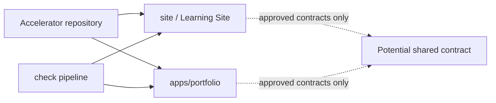
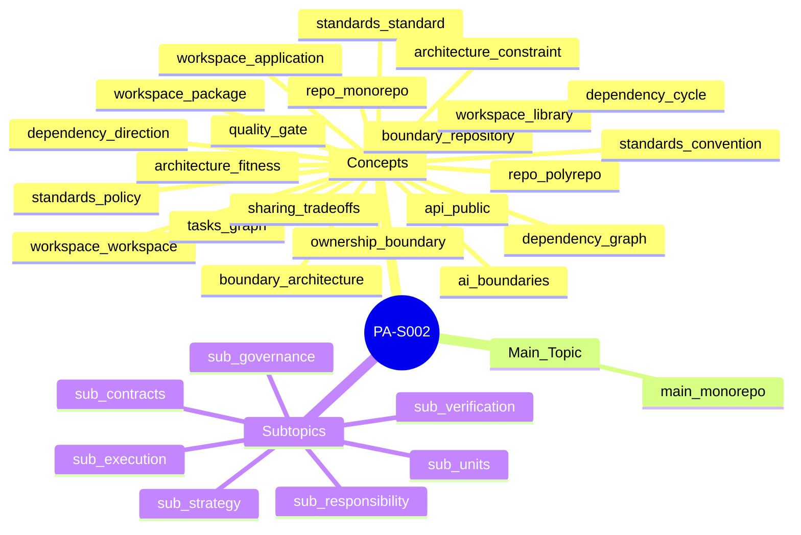

# PA-S002 — Accelerator Monorepo and Engineering Standards
**F0 · PA-S002 · 150–210 min (instructional estimate)**

> **30-SECOND SYNTHESIS**
> 1. One repository does not mean monolithic architecture.
> 2. APIs and graphs bound change, not folder names.
> 3. Gates and ownership require testable rules and actual evidence.

## 1. Objective
Define, compare and verify package boundaries, dependencies and engineering standards to evolve the Accelerator without regressing the Learning Site.

## 2. Learning Preview
The central problem is deciding what may be shared and what must remain autonomous between `apps/portfolio/` and `site/`; the outcome is a small set of verifiable contracts, gates and decisions.

## 3. Concepts
### Staff → Principal Software Engineering

<!-- concept: repo.monorepo -->
#### Monorepo (`repo.monorepo`)
##### Level 1 — Foundation
**Definition and scope.** A monorepo places multiple related projects under one version-control history and coordinated change surface. It does not imply a single deployment or monolithic architecture.

##### Level 2 — Mechanism
**Worked case.** In the Accelerator, a shared contract change could be committed together with its site and portfolio consumers, while the two remain separate projects.

**Retrieval.** Does a monorepo require deploying the site and portfolio together? **Answer and explanation:** No. Code location and deployment units are separate decisions.

##### Level 3 — Deep dive (optional)
**Limit / trade-off.** One history simplifies atomic changes but can expand tooling, access and pipeline scope unless segmented.
**Lecturas:** [R1], [R2], [R3], [R4], [R5].

<!-- concept: repo.polyrepo -->
#### Polyrepo (`repo.polyrepo`)
##### Level 1 — Foundation
**Definition and scope.** A polyrepo places projects in separate repositories, whose histories and permissions can be managed independently.

##### Level 2 — Mechanism
**Worked case.** A shared library in a separate repository is commonly versioned and consumed by each product through a declared dependency.

**Retrieval.** What additional cost arises when changing a library and its consumers in a polyrepo? **Answer and explanation:** Coordinating versions and changes across independent repository histories.

##### Level 3 — Deep dive (optional)
**Limit / trade-off.** Separate repositories do not guarantee decoupling: consumers can still depend on private contracts or incompatible versions.
**Lecturas:** [R1], [R2], [R3], [R4], [R5].

<!-- concept: boundary.repository -->
#### Repository boundary (`boundary.repository`)
##### Level 1 — Foundation
**Definition and scope.** A repository boundary determines where a code history is managed and how permissions and reviews are administered.

##### Level 2 — Mechanism
**Worked case.** A pull request against the root may change site and portfolio; path filters and CODEOWNERS can assign differentiated review responsibilities.

**Retrieval.** Does moving code to another folder prevent invalid imports? **Answer and explanation:** No; enforceable dependency rules are required.

##### Level 3 — Deep dive (optional)
**Limit / trade-off.** A Git path must not be mistaken for an architectural contract.
**Lecturas:** [R1], [R2], [R3], [R4], [R5].

<!-- concept: boundary.architecture -->
#### Architectural boundary (`boundary.architecture`)
##### Level 1 — Foundation
**Definition and scope.** An architectural boundary separates responsibilities and specifies allowed dependencies and interfaces between components.

##### Level 2 — Mechanism
**Worked case.** The site may consume a public content contract while the portfolio implementation remains inaccessible through import rules.

**Retrieval.** What evidence substantiates an architectural boundary? **Answer and explanation:** A declared contract and a test that rejects a forbidden dependency.

##### Level 3 — Deep dive (optional)
**Limit / trade-off.** Directory separation without static checks or review may be cosmetic.
**Lecturas:** [R1], [R2], [R3], [R4], [R5].

<!-- concept: standards.convention -->
#### Convention (`standards.convention`)
##### Level 1 — Foundation
**Definition and scope.** A convention is an agreed or habitual practice, potentially flexible and not necessarily enforced by tooling.

##### Level 2 — Mechanism
**Worked case.** Naming tests *.test.ts helps discovery when the runner uses that pattern.

**Retrieval.** Must a convention always block a merge? **Answer and explanation:** No; that depends on criticality and governance.

##### Level 3 — Deep dive (optional)
**Limit / trade-off.** Without documentation or enforcement, new teams may follow a different convention.
**Lecturas:** [R1], [R2], [R3], [R4], [R5].

<!-- concept: standards.policy -->
#### Policy (`standards.policy`)
##### Level 1 — Foundation
**Definition and scope.** A policy expresses an organizational requirement or restriction and defines who can authorize exceptions.

##### Level 2 — Mechanism
**Worked case.** A policy can prohibit secrets in commits and require incident review; a scanner implements only part of that policy.

**Retrieval.** Is a linter enough to demonstrate policy compliance? **Answer and explanation:** No; it covers only detected and configured cases.

##### Level 3 — Deep dive (optional)
**Limit / trade-off.** Publishing rules without ownership, exceptions, and audit produces superficial compliance.
**Lecturas:** [R1], [R2], [R3], [R4], [R5].

<!-- concept: standards.standard -->
#### Engineering standard (`standards.standard`)
##### Level 1 — Foundation
**Definition and scope.** An engineering standard documents technical requirements and conformity criteria for a specified scope; it may be internal or external.

##### Level 2 — Mechanism
**Worked case.** A package standard may require explicit exports and compatibility tests for shared APIs.

**Retrieval.** What distinguishes an enforceable standard from a preference? **Answer and explanation:** Scope, observable criteria, authority, and exception process.

##### Level 3 — Deep dive (optional)
**Limit / trade-off.** Standardizing before discovering S001–S005 variation can block legitimate solutions.
**Lecturas:** [R1], [R2], [R3], [R4], [R5].

<!-- concept: quality.gate -->
#### Quality gate (`quality.gate`)
##### Level 1 — Foundation
**Definition and scope.** A quality gate is an acceptance condition that must pass before a transition, such as merging a pull request.

##### Level 2 — Mechanism
**Worked case.** The npm run check script chains lint, typecheck, tests, build and output tests; a branch rule could require its successful status if configured.

**Retrieval.** Does a passing local check mean a branch is protected? **Answer and explanation:** No; protection and required checks are configured separately.

##### Level 3 — Deep dive (optional)
**Limit / trade-off.** The existence of a script does not prove CI invokes it, protects the branch, or evaluates pedagogical quality.
**Lecturas:** [R1], [R2], [R3], [R4], [R5].

<!-- concept: architecture.constraint -->
#### Architectural constraint (`architecture.constraint`)
##### Level 1 — Foundation
**Definition and scope.** An architectural constraint limits admissible system structures or relationships to preserve agreed qualities.

##### Level 2 — Mechanism
**Worked case.** Forbidding imports from apps/portfolio/src into site/ would be an isolation rule enforceable through static analysis.

**Retrieval.** Does a README rule demonstrate compliance? **Answer and explanation:** No; compare it with the real graph and reviews or tests.

##### Level 3 — Deep dive (optional)
**Limit / trade-off.** An absolute prohibition may block a justified migration; traceable exceptions prevent arbitrariness.
**Lecturas:** [R1], [R2], [R3], [R4], [R5].

<!-- concept: architecture.fitness -->
#### Architecture fitness function (`architecture.fitness`)
##### Level 1 — Foundation
**Definition and scope.** An architecture fitness function evaluates a defined architectural property repeatably through a test, measurement, or analysis.

##### Level 2 — Mechanism
**Worked case.** A test that fails on cross-package internal imports evaluates that specific rule; it does not prove the entire architecture is good.

**Retrieval.** What claim does a no-cycles test validate? **Answer and explanation:** Only absence of cycles in the graph the tool actually analyzed.

##### Level 3 — Deep dive (optional)
**Limit / trade-off.** False negatives arise if the detector misses dynamic imports; false positives arise if it rejects legitimate exceptions.
**Lecturas:** [R1], [R2], [R3], [R4], [R5].

<!-- concept: ownership.boundary -->
#### Ownership boundary (`ownership.boundary`)
##### Level 1 — Foundation
**Definition and scope.** An ownership boundary assigns responsibility for changes, review, maintenance and failure response; it can span repositories and packages.

##### Level 2 — Mechanism
**Worked case.** CODEOWNERS can request path-specific reviewers, while an ADR documents who approves shared-contract changes.

**Retrieval.** Does CODEOWNERS prove an effective review occurred? **Answer and explanation:** No; active rules and actual pull requests must be inspected.

##### Level 3 — Deep dive (optional)
**Limit / trade-off.** Owning a path does not automatically control deployment permissions or guarantee response availability.
**Lecturas:** [R1], [R2], [R3], [R4], [R5].

### Frontend Platform Architecture (FPA)

<!-- concept: workspace.workspace -->
#### Workspace (`workspace.workspace`)
##### Level 1 — Foundation
**Definition and scope.** A workspace is a set of projects treated by a package manager as related local units whose dependencies may be linked during installation.

##### Level 2 — Mechanism
**Worked case.** The root package.json declares apps/portfolio in workspaces; adding a path does not automatically make the static site an npm package.

**Retrieval.** Is a site/ directory necessarily part of npm workspaces? **Answer and explanation:** No; it requires a package definition and deliberate inclusion.

##### Level 3 — Deep dive (optional)
**Limit / trade-off.** Commands and semantics depend on the selected package manager and versions; preserving the current scheme avoids unjustified migration.
**Lecturas:** [R1], [R2], [R3], [R4], [R5].

<!-- concept: workspace.application -->
#### Application (`workspace.application`)
##### Level 1 — Foundation
**Definition and scope.** An application is a software unit delivering an executable experience or service, with identifiable inputs, behavior and operational lifecycle.

##### Level 2 — Mechanism
**Worked case.** apps/portfolio is a professional product; site/ is a separate learning product even if published statically.

**Retrieval.** Why should full theory not be moved into apps/portfolio? **Answer and explanation:** Because portfolio and learning site have different purposes and content contracts.

##### Level 3 — Deep dive (optional)
**Limit / trade-off.** Application is not synonymous with an npm package: it may lack its own manifest and consume shared libraries.
**Lecturas:** [R1], [R2], [R3], [R4], [R5].

<!-- concept: workspace.package -->
#### Package (`workspace.package`)
##### Level 1 — Foundation
**Definition and scope.** A package is an identifiable unit for dependency resolution or distribution, described by metadata such as `name`, `version`, and possibly `exports` in `package.json`. It may carry code, types, assets, or tools; it need not be a library.

##### Level 2 — Mechanism
**Worked case.** A future packages/content-contract could export shared schemas, but only after a repeated need and stable API have been demonstrated.

**Retrieval.** When should a shared package be created? **Answer and explanation:** When a contract and real consumers justify versioning and maintenance costs.

##### Level 3 — Deep dive (optional)
**Limit / trade-off.** Extracting files merely for visual similarity can produce premature abstraction and change propagation.
**Lecturas:** [R1], [R2], [R3], [R4], [R5].

<!-- concept: workspace.library -->
#### Library (`workspace.library`)
##### Level 1 — Foundation
**Definition, boundary, and distinction.** A library bundles reusable functionality called by other programs, such as session-contract validation functions. **Library** describes code's role for its consumers; **package** describes its packaging or resolution. A library can be published as an npm package, but an npm package can also contain an application, tooling, or assets with no reusable code library. [R2], [R3].

##### Level 2 — Mechanism
**Hypothetical worked example and verifiable path.** `packages/session-schema/src/validate.ts` exports `validateSession(input)`. The `site/` renderer imports it through a public entry point. 📥 Input: a session object. ⚙️ Mechanism: the library checks identifiers and required fields and returns structured errors. 📤 Result: the consumer rejects an invalid session before publication. A compatible function change needs consumer contract tests; an incompatible change can break consumers even if the package still installs. This does not claim the library currently exists in the repository.

**Counterexample.** Extracting dashboard-specific CSS into a purported shared library with no second consumer does not demonstrate reuse; it can add coupling and maintenance.

**Retrieval.** Can an npm package exist without exposing a reusable library? **Answer and feedback:** Yes; its purpose might be to run an application or distribute tools. The manifest defines a distribution unit, not whether its contents are reusable.

##### Level 3 — Deep dive (optional)
**Decision and verification.** Before extracting a library, establish real consumers, contract, version semantics, and integration tests. Verify exports, actual import resolution, and change propagation; do not infer benefits solely from fewer duplicate files. [R2], [R3].

<!-- concept: dependency.graph -->
#### Dependency graph (`dependency.graph`)
##### Level 1 — Foundation
**Definition and scope.** A dependency graph models units as nodes and directed dependency relationships as edges.

##### Level 2 — Mechanism
**Worked case.** If portfolio imports contracts, the portfolio → contracts edge means the consumer requires the provider; traversing edges identifies impact.

**Retrieval.** If contracts changes, in which direction should consumers be found? **Answer and explanation:** Reverse edges: projects depending on contracts.

##### Level 3 — Deep dive (optional)
**Limit / trade-off.** An actual graph must be derived from imports/manifests; a hypothetical picture cannot certify repository state.
**Lecturas:** [R1], [R2], [R3], [R4], [R5].

<!-- concept: dependency.direction -->
#### Dependency direction (`dependency.direction`)
##### Level 1 — Foundation
**Definition and scope.** Dependency direction specifies which consumer unit knows the contract of which provider unit. An `A → B` edge means A depends on B; it does not prove that B depends on A.

##### Level 2 — Mechanism
**Worked case.** If site → contracts and contracts → site, the cycle makes independent building, isolation, and evolution harder.

**Retrieval.** What change fixes a contract package importing the application? **Answer and explanation:** Move the concrete dependency to the consumer and keep contracts independent of applications.

##### Level 3 — Deep dive (optional)
**Limit / trade-off.** Not every cycle is invalid in every language or runtime, but package cycles often complicate platform boundaries.
**Lecturas:** [R1], [R2], [R3], [R4], [R5].

<!-- concept: dependency.cycle -->
#### Dependency cycle (`dependency.cycle`)
##### Level 1 — Foundation
**Definition and nonexample.** A directed cycle exists when following dependencies returns to the original node: `A → B → C → A`. Two modules sharing one library (`A → C ← B`) **do not** create a cycle. A cycle is a graph property, separate from the direction of an individual edge. [R1], [R4].

##### Level 2 — Mechanism
**Hypothetical example and propagation.** `site/renderer` imports `packages/contracts`; a later change makes `packages/contracts` import a private helper from `site/renderer`. This yields `renderer → contracts → renderer`. 📥 Input: the new import from contracts. ⚙️ Mechanism: dependency traversal returns to renderer, precluding a strict topological ordering across those units. 📤 Result: some independent build, initialization, or release strategies become constrained; the exact symptom depends on runtime and tooling. The repair keeps contracts independent of renderer internals, or extracts a truly stable lower-level dependency.

**Counterexample and edge case.** A module import cycle does not necessarily cause a runtime failure: ECMAScript permits circular dependencies, although accessing bindings before initialization can fail depending on execution order. Do not equate a package dependency cycle with an inevitable execution failure.

**Retrieval.** If `A → B` and `B → C`, is there a cycle? **Answer and feedback:** Not yet. There must be a path back from C (or B) to A (or B), such as `C → A`.

##### Level 3 — Deep dive (optional)
**Reproducible detection.** Traverse imports/manifests and find strongly connected components; a component larger than one node establishes a cycle in the *analyzed* graph. Check self-imports according to policy. Dynamic imports, aliases, and conditional resolution can create false negatives when unsupported by the analyzer. Include positive fixture `A → B → A` and negative fixture `A → C ← B`. [R1], [R4].

<!-- concept: api.public -->
#### Public API (`api.public`)
##### Level 1 — Foundation
**Definition and scope.** A package public application programming interface (API) declares the supported symbols and behaviors for consumers; it does not imply public internet access.

##### Level 2 — Mechanism
**Worked case.** The package.json exports field can limit import paths; types express shapes and contract tests check relevant behavior.

**Retrieval.** Why is a deep import into src/internal risky? **Answer and explanation:** It couples consumers to private structure that may change without compatibility promises.

##### Level 3 — Deep dive (optional)
**Limit / trade-off.** An export map does not replace compatibility policy or prevent every internal-path access outside the resolver.
**Lecturas:** [R1], [R2], [R3], [R4], [R5].

<!-- concept: tasks.graph -->
#### Build task graph (`tasks.graph`)
##### Level 1 — Foundation
**Definition and scope.** A task graph models operations such as test, typecheck and build and their execution dependencies; it differs from the module graph.

##### Level 2 — Mechanism
**Worked case.** If build(site) requires svg(diagrams), conversion must finish before HTML publication; the actual pipeline can be verified from existing scripts.

**Retrieval.** Does an import graph alone determine lint and build order? **Answer and explanation:** No; the task graph includes additional command-level relationships.

##### Level 3 — Deep dive (optional)
**Limit / trade-off.** A cached task is reliable only when its key includes relevant inputs and configuration; incorrect caching can hide changes.
**Lecturas:** [R1], [R2], [R3], [R4], [R5].

<!-- concept: sharing.tradeoffs -->
#### Shared-code trade-offs (`sharing.tradeoffs`)
##### Level 1 — Foundation
**Definition and scope.** Sharing implementation can reduce intentional duplication while creating coordination and dependency between teams and products.

##### Level 2 — Mechanism
**Worked case.** A genuinely stable formatting helper may be shared; a site-specific component should not be generalized before observing other consumers.

**Retrieval.** Does fewer duplicated files prove better architecture? **Answer and explanation:** No; autonomy, propagation and effective contracts must be considered.

##### Level 3 — Deep dive (optional)
**Limit / trade-off.** The cost of changing a shared abstraction can exceed that of small separate implementations.
**Lecturas:** [R1], [R2], [R3], [R4], [R5].

### AI Product Engineering (AIPE)

<!-- concept: ai.boundaries -->
#### AI product boundaries (`ai.boundaries`)
##### Level 1 — Foundation
**Definition and scope.** Artificial intelligence (AI) product boundaries separate interface, orchestration, provider, data, evaluation and safety policy when those responsibilities exist.

##### Level 2 — Mechanism
**Worked case.** In a hypothetical assisted-search product, an evaluation request contract may be shared without giving the UI provider credentials.

**Retrieval.** Does a monorepo authorize the frontend to use model secrets directly? **Answer and explanation:** No; security and runtime boundaries remain independent of repository layout.

##### Level 3 — Deep dive (optional)
**Limit / trade-off.** Extracting an AI gateway without real consumers now would be speculative; PA-S002 studies the boundary rather than building a model platform.
**Lecturas:** [R1], [R2], [R3], [R4], [R5].

## 4. Main Topic
<!-- topic: main.monorepo requires: repo.monorepo,repo.polyrepo,boundary.repository,boundary.architecture,workspace.workspace,workspace.application,workspace.package,workspace.library,dependency.graph,dependency.direction,dependency.cycle,api.public,tasks.graph,sharing.tradeoffs,standards.convention,standards.policy,standards.standard,quality.gate,architecture.constraint,architecture.fitness,ownership.boundary,ai.boundaries -->
**Thesis.** The appropriate architecture separates products while enabling coordinated changes only through intentional contracts. The existing root declares an npm workspace for the portfolio; this does not establish that site/ is a workspace or that branch checks are required. The goal is not to maximize package count, but to prevent accidental dependencies while enabling coordinated change. [R1–R5]
<!-- integration: main.monorepo -->

## 5. Subtopics
<!-- topic: sub.strategy requires: repo.monorepo,repo.polyrepo,boundary.repository,boundary.architecture -->
### Repository topology and autonomy
**Separate foundations.** Concepts `repo.monorepo`, `repo.polyrepo`, `boundary.repository`, `boundary.architecture` were defined independently; here we examine how their contracts interact in a real decision.
In a monorepo, one review can span both products while each keeps its own publishing lifecycle. Polyrepo offers independent histories but requires cross-repository coordination. The decision criterion is total evolution cost, not universal superiority.

**Contraejemplo / prueba:** A seemingly local change breaks a private import: compare the graph before/after, execute checks, and review output HTML rather than infer success from absence of visible errors.
<!-- integration: sub.strategy -->

<!-- topic: sub.units requires: workspace.workspace,workspace.application,workspace.package,workspace.library -->
### Workspaces, applications and packages
**Separate foundations.** Concepts `workspace.workspace`, `workspace.application`, `workspace.package`, `workspace.library` were defined independently; here we examine how their contracts interact in a real decision.
The root already uses npm workspaces for portfolio. A package requires a manifest, name and consumption contract; a shared folder need not become a package. Prefer real boundaries on the existing manager and add workspaces only for proven consumers.

**Contraejemplo / prueba:** A seemingly local change breaks a private import: compare the graph before/after, execute checks, and review output HTML rather than infer success from absence of visible errors.
<!-- integration: sub.units -->

<!-- topic: sub.contracts requires: dependency.graph,dependency.direction,dependency.cycle,api.public -->
### Dependencies, APIs and direction
**Separate foundations.** Concepts `dependency.graph`, `dependency.direction`, `dependency.cycle`, `api.public` were defined independently; here we examine how their contracts interact in a real decision.
The directed graph identifies consumers; exports defines the supported surface; tests reject deep imports. First inspect actual imports, then define allowed dependencies and finally test invalid fixtures; directory names alone are insufficient.

**Contraejemplo / prueba:** A seemingly local change breaks a private import: compare the graph before/after, execute checks, and review output HTML rather than infer success from absence of visible errors.
<!-- integration: sub.contracts -->

<!-- topic: sub.execution requires: tasks.graph,sharing.tradeoffs -->
### Task graph and shared code
**Separate foundations.** Concepts `tasks.graph`, `sharing.tradeoffs` were defined independently; here we examine how their contracts interact in a real decision.
The project graph indicates who depends on whom; the task graph additionally requires SVG generation before final HTML. Shared code is justified only after a repeated contract appears. Cache optimization requires validating all inputs before claiming speed gains.

**Contraejemplo / prueba:** A seemingly local change breaks a private import: compare the graph before/after, execute checks, and review output HTML rather than infer success from absence of visible errors.
<!-- integration: sub.execution -->

<!-- topic: sub.governance requires: standards.convention,standards.policy,standards.standard -->
### Conventions, policies and standards
**Separate foundations.** Concepts `standards.convention`, `standards.policy`, `standards.standard` were defined independently; here we examine how their contracts interact in a real decision.
Convention supports flexible coordination, policy imposes obligations with ownership and exceptions, and standard defines reproducible conformity. Test names may be convention, secret prohibition policy, and verifiable exports a standard. Avoid global S006–S120 rules before comparing the pilot.

**Contraejemplo / prueba:** A seemingly local change breaks a private import: compare the graph before/after, execute checks, and review output HTML rather than infer success from absence of visible errors.
<!-- integration: sub.governance -->

<!-- topic: sub.verification requires: quality.gate,architecture.constraint,architecture.fitness -->
### Quality gates, constraints and fitness
**Separate foundations.** Concepts `quality.gate`, `architecture.constraint`, `architecture.fitness` were defined independently; here we examine how their contracts interact in a real decision.
A gate is a decision point; a fitness function tests a property. The current check combines lint, types, tests, build and HTML; scripts do not prove successful execution. A boundary test may pass while missing a dynamic import; document precise coverage.

**Contraejemplo / prueba:** A seemingly local change breaks a private import: compare the graph before/after, execute checks, and review output HTML rather than infer success from absence of visible errors.
<!-- integration: sub.verification -->

<!-- topic: sub.responsibility requires: ownership.boundary,ai.boundaries -->
### Ownership and AI boundaries
**Separate foundations.** Concepts `ownership.boundary`, `ai.boundaries` were defined independently; here we examine how their contracts interact in a real decision.
Ownership governs approval and operation, not merely a CODEOWNERS file. In AI, separation of credentials, contracts and evaluation is independent of code location. Designing these boundaries in this pilot does not authorize fictitious AI services.

**Contraejemplo / prueba:** A seemingly local change breaks a private import: compare the graph before/after, execute checks, and review output HTML rather than infer success from absence of visible errors.
<!-- integration: sub.responsibility -->

## 6. Cross-Domain Synthesis
Staff→Principal decides scope, risk and ownership; FPA materializes frontend boundaries and graphs; AIPE introduces future isolation of data and providers. This integration does not turn the pilot into an AI platform.

## 7. Theory → Practice Map
| Theory | Verifiable work | Expected evidence |
|---|---|---|
| Monorepo/workspace | Inspect package.json, scripts, dependencies | Verified inventory |
| Boundaries/API | Import rules + negative test | Test output |
| Gates/ownership | Review CI, ADR and branch protection | Explicit configuration and decision |

## 8. Time Breakdown
Inventory 30 min; concepts 60–90 min; decisions 30 min; validation 30–60 min. Estimate, not measured time.

## 9. Real-World Example
**Verified connected-repository case:** package.json includes `workspaces: ["apps/portfolio"]` and `npm run check` chains lint, typecheck, test, build and output testing. Technology Radar is labeled an initial draft. This does not establish active GitHub gates or the local working tree state.

## 10. Production-Ready Example
**Proposed design, not verified implementation.** Keep `site/` and `apps/portfolio/` as autonomous products. A future `packages/content-contract/` is created only with two real consumers; it exports only public schemas. Before merging: import boundary tests, contract tests, lint, types, build and ES/EN HTML tests. A forbidden import must fail the gate; an exception needs an ADR. If Mermaid fails, stop build and retain `.mmd` source. Never show invented progress as a populated dashboard.

## 11. Visual Learning Studio
**Mind map:** the following Mermaid diagram is canonical source for responsive SVG; each node represents a taught section, not a statistic.

**Flashcards:** Each card preserves its source and explanatory answer; none represents mastery.

- `fc.repo.monorepo` [repo.monorepo] Does a monorepo require deploying the site and portfolio together? — No. Code location and deployment units are separate decisions.
- `fc.repo.polyrepo` [repo.polyrepo] What additional cost arises when changing a library and its consumers in a polyrepo? — Coordinating versions and changes across independent repository histories.
- `fc.boundary.repository` [boundary.repository] Does moving code to another folder prevent invalid imports? — No; enforceable dependency rules are required.
- `fc.boundary.architecture` [boundary.architecture] What evidence substantiates an architectural boundary? — A declared contract and a test that rejects a forbidden dependency.
- `fc.workspace.workspace` [workspace.workspace] Is a site/ directory necessarily part of npm workspaces? — No; it requires a package definition and deliberate inclusion.
- `fc.workspace.application` [workspace.application] Why should full theory not be moved into apps/portfolio? — Because portfolio and learning site have different purposes and content contracts.
- `fc.workspace.package` [workspace.package] When should a shared package be created? — When a contract and real consumers justify versioning and maintenance costs.
- `fc.workspace.library` [workspace.library] Is a library identical to a package? — No. A library describes consumed functionality, while a package describes packaging and resolution; packages can also distribute tools.
- `fc.dependency.graph` [dependency.graph] If contracts changes, in which direction should consumers be found? — Reverse edges: projects depending on contracts.
- `fc.dependency.direction` [dependency.direction] What change fixes a contract package importing the application? — Move the concrete dependency to the consumer and keep contracts independent of applications.
- `fc.dependency.cycle` [dependency.cycle] Does A → B → C alone establish a cycle? — No. A return path such as C → A is required; two consumers sharing a dependency do not form a cycle.
- `fc.api.public` [api.public] Why is a deep import into src/internal risky? — It couples consumers to private structure that may change without compatibility promises.
- `fc.tasks.graph` [tasks.graph] Does an import graph alone determine lint and build order? — No; the task graph includes additional command-level relationships.
- `fc.sharing.tradeoffs` [sharing.tradeoffs] Does fewer duplicated files prove better architecture? — No; autonomy, propagation and effective contracts must be considered.
- `fc.standards.convention` [standards.convention] Must a convention always block a merge? — No; that depends on criticality and governance.
- `fc.standards.policy` [standards.policy] Is a linter enough to demonstrate policy compliance? — No; it covers only detected and configured cases.
- `fc.standards.standard` [standards.standard] What distinguishes an enforceable standard from a preference? — Scope, observable criteria, authority, and exception process.
- `fc.quality.gate` [quality.gate] Does a passing local check mean a branch is protected? — No; protection and required checks are configured separately.
- `fc.architecture.constraint` [architecture.constraint] Does a README rule demonstrate compliance? — No; compare it with the real graph and reviews or tests.
- `fc.architecture.fitness` [architecture.fitness] What claim does a no-cycles test validate? — Only absence of cycles in the graph the tool actually analyzed.
- `fc.ownership.boundary` [ownership.boundary] Does CODEOWNERS prove an effective review occurred? — No; active rules and actual pull requests must be inspected.
- `fc.ai.boundaries` [ai.boundaries] Does a monorepo authorize the frontend to use model secrets directly? — No; security and runtime boundaries remain independent of repository layout.
- `fc.main` [main.monorepo] What is the desired outcome? — Product autonomy and verifiable contracts in a common repository.

## 12. Exercises
- [ ] `PA-S002:exercise:1` Identify actual edges and possible cycles without inventing imports.
- [ ] `PA-S002:exercise:2` Design a negative test rejecting cross-product private imports.
- [ ] `PA-S002:exercise:3` Compare retaining npm workspaces with adding an orchestrator.
- [ ] `PA-S002:exercise:4` Review what npm run check would and would not prove.

## 13. Curated Sources and References
- [R1] https://docs.npmjs.com/cli/v11/using-npm/workspaces
- [R2] https://www.typescriptlang.org/docs/handbook/project-references
- [R3] https://nodejs.org/api/packages.html#package-entry-points
- [R4] https://docs.github.com/en/repositories/configuring-branches-and-merges-in-your-repository/managing-protected-branches/about-protected-branches
- [R5] Principal Accelerator Project Sources 03, 05, 06, 09, 14, 15 (curriculum and accepted project constraints).

## 14. Resources
Read the actual package.json, Technology Radar and tests before proposing packages; compare R1–R4 against installed versions.

## 15. Knowledge Mastery Checklist
- [ ] `PA-S002:mastery:1` Distinguish repository and architecture.
- [ ] `PA-S002:mastery:2` Explain project and task graphs.
- [ ] `PA-S002:mastery:3` Defend public APIs and ownership.
- [ ] `PA-S002:mastery:4` Distinguish standards, policies, and gates.
- [ ] `PA-S002:mastery:5` Explain what evidence validates a fitness function.

## 16. End-of-Session Success Criteria
- [ ] A dependency proposal exists with risks and alternatives.
- [ ] Executed checks and limitations are documented; no checkbox awards mastery.

## 17. Bridge to PA-S003
PA-S003 deepens portfolio and Learning Site content architecture while retaining product boundaries.

