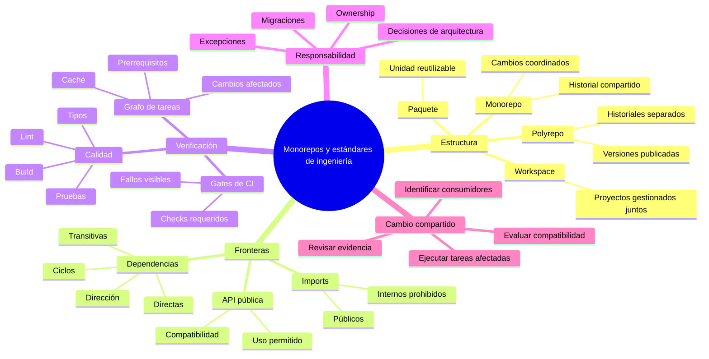
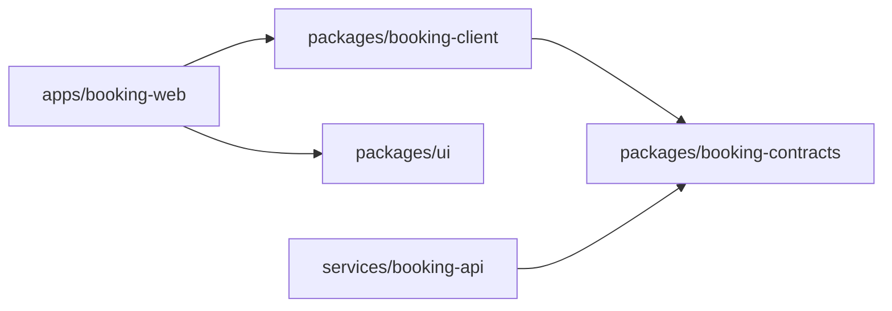
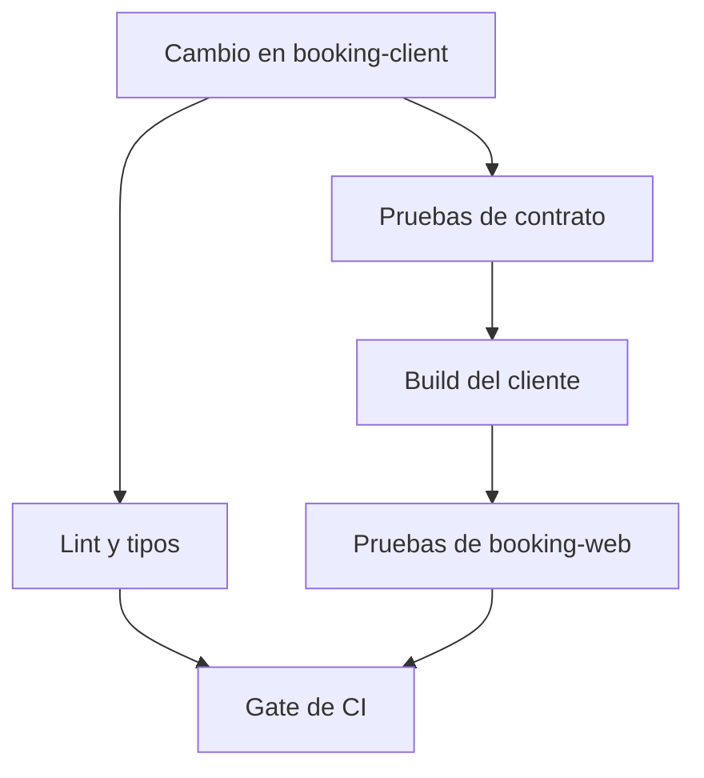
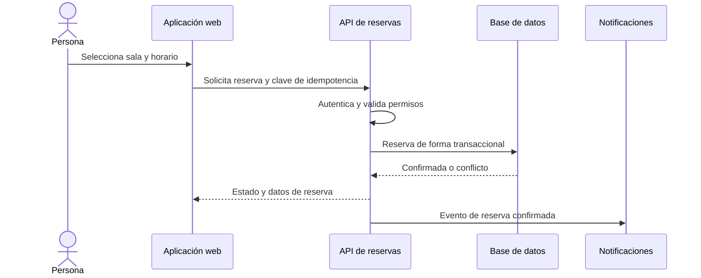
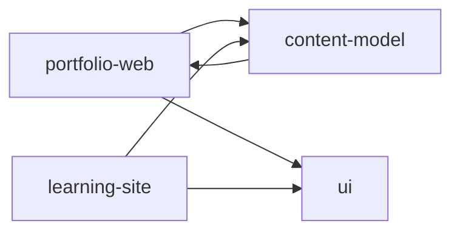

F0 · PA-S002 · Staff → Principal / Arquitectura de Plataforma Frontend / Ingeniería de Productos con IA
**Fase:** inventario editorial · **Estado:** pendiente de revisión

## Conceptos por ámbito profesional

### Staff → Principal

* **Estándar de ingeniería:** acuerdo que define una práctica técnica esperada y cómo comprobarla. Por ejemplo, un equipo puede establecer que los paquetes importen dependencias desde sus APIs públicas y añadir una verificación que detecte imports internos no permitidos.
* **Gobierno técnico:** proceso mediante el cual los equipos proponen, adoptan, revisan y, cuando corresponde, exceptúan estándares. Su propósito es mantener reglas útiles y coherentes a medida que crecen los proyectos y aparecen nuevas necesidades.
* **Responsabilidad de cambio:** claridad sobre quién revisa, mantiene y decide acerca de un componente o contrato. Cuando una modificación afecta a varios paquetes, aplicaciones o equipos, permite identificar a las personas que deben evaluar su impacto.

### Arquitectura de Plataforma Frontend

* **Consumidor:** aplicación o paquete que utiliza una interfaz ofrecida por otro componente. Por ejemplo, una aplicación puede consumir un paquete de componentes visuales o un cliente compartido para comunicarse con una API.
* **Contrato público:** conjunto de entradas, salidas y comportamientos que un paquete declara disponibles para sus consumidores. Si el contrato está bien definido, los consumidores pueden usarlo sin conocer la organización interna del paquete.
* **Compatibilidad:** capacidad de cambiar la implementación de un componente conservando los usos admitidos por sus consumidores. Una reorganización interna puede ser compatible si la API pública mantiene el mismo comportamiento; quitar un campo requerido podría romper a quienes dependían de él.

### Ingeniería de Productos con IA

* **Paquete de evaluación:** conjunto organizado de ejemplos, datos de prueba y criterios que permite comprobar una capacidad de IA. Puede servir para observar si una modificación al modelo, las instrucciones o la integración mantiene resultados adecuados en casos representativos.
* **Límite de datos:** regla que determina qué información puede consultar, transmitir o conservar un componente. En un producto de IA puede precisar qué datos llegan a la función, qué usuario puede acceder a ellos y qué restricciones deben respetarse.
* **Cambio de comportamiento:** variación observable en los resultados de una función, aunque el código compile y las interfaces no hayan cambiado. Por ejemplo, una actualización del modelo o de las instrucciones podría alterar la calidad de un resumen; ese cambio requiere evaluación específica, además de las pruebas habituales de software.

---

# Monorepos y estándares de ingeniería: organizar código, dependencias y calidad

## Síntesis provisional en 30 segundos

1. Un repositorio compartido facilita coordinar cambios, pero su estructura de carpetas no establece por sí sola fronteras arquitectónicas.
2. Las dependencias, las interfaces públicas y las pruebas de límites hacen comprobables esas fronteras.
3. Los estándares y la integración continua necesitan responsables, excepciones y evidencia para sostenerse entre equipos.

**Objetivo.** Poder decidir cuándo conviene reunir proyectos en un monorepo, diseñar sus límites y comprobar que los cambios respetan contratos técnicos sin perder las capacidades existentes.

**Preguntas guía.** ¿Qué se gana y qué se compromete frente a varios repositorios? ¿Qué impide un import indebido? ¿Qué pruebas deben ejecutarse ante un cambio? ¿Quién mantiene las reglas y resuelve sus excepciones?

## Vista previa y conceptos por ámbito

El recorrido será: **conceptos → tema principal → siete subtemas → integración entre ámbitos → teoría a práctica → caso real → diseño de producción → Studio → ejercicios → fuentes, criterios y puente**.

* **Staff → Principal.** «Estándar de ingeniería: acuerdo técnico que define una práctica verificable». «Gobierno técnico: proceso para adoptar, revisar y exceptuar esos acuerdos». «Responsabilidad de cambio: identificación de quién revisa y mantiene un contrato».
* **Arquitectura de Plataforma Frontend.** «Consumidor: aplicación o paquete que utiliza una interfaz compartida». «Contrato público: entradas, salidas y comportamiento que un consumidor puede usar sin depender de detalles internos». «Compatibilidad: capacidad de cambiar una implementación sin romper usos admitidos».
* **Ingeniería de Productos con IA.** «Paquete de evaluación: código y datos de prueba que comprueban una capacidad de IA». «Límite de datos: regla que restringe qué información puede acceder o compartir un componente». «Cambio de comportamiento: variación observable en resultados que requiere evaluación aunque el código compile».

Estas definiciones breves fijan el alcance del inventario. Los conceptos se desarrollarán dentro del tema y los subtemas donde intervienen.

## Tema principal — Del repositorio compartido a los límites comprobables

* «Monorepo: un repositorio que reúne el código de varios proyectos relacionados».
* «Polyrepo: organización en varios repositorios, habitualmente con ciclos y controles propios».
* «Repositorio: unidad de versionado del código y su historial».
* «Frontera arquitectónica: regla que determina qué puede conocer o utilizar un módulo de otro».
* «Estándar verificable: regla cuya aplicación puede observarse mediante revisión o prueba».

El capítulo contrastará ambas organizaciones bajo condiciones concretas y seguirá un cambio desde una interfaz compartida hasta sus consumidores, pruebas y responsables. La comparación no asumirá que una organización es superior en todos los contextos.

## Subtemas previstos

| Subtema                                           | Conceptos locales que se enseñarán                                                                                                                                                                                                                                                                                                                                                                       |
| ------------------------------------------------- | -------------------------------------------------------------------------------------------------------------------------------------------------------------------------------------------------------------------------------------------------------------------------------------------------------------------------------------------------------------------------------------------------------- |
| **1. Repositorios y fronteras**                   | «Visibilidad del código: posibilidad de descubrir implementaciones y usos». «Aislamiento: restricción del acceso o del cambio entre proyectos». «Cambio coordinado: modificación conjunta de productor y consumidores». «Frontera lógica: separación exigida por contratos y reglas, aunque el código comparta repositorio».                                                                             |
| **2. Workspaces, aplicaciones y paquetes**        | «Workspace: proyecto local registrado para gestionarse junto con otros». «Aplicación: producto ejecutable orientado a un uso». «Paquete: unidad reutilizable con nombre, dependencias e interfaz». «API pública: superficie admitida para los consumidores». «Import profundo: acceso directo a un archivo interno que evita la interfaz admitida».                                                      |
| **3. Grafo y dirección de dependencias**          | «Grafo de dependencias: representación de módulos y relaciones de uso». «Dependencia directa: relación declarada por un consumidor con su proveedor». «Dependencia transitiva: relación que llega por medio de otro módulo». «Ciclo: cadena de dependencias que vuelve a su origen». «Regla de dirección: restricción sobre qué capas pueden depender de cuáles».                                        |
| **4. Grafo de tareas y construcción**             | «Tarea de build: operación que produce o verifica un artefacto». «Prerrequisito: tarea cuyo resultado se necesita antes de otra». «Cambio afectado: modificación que puede alterar un consumidor o su salida». «Caché de tareas: reutilización de un resultado bajo condiciones de entrada definidas». «Artefacto reproducible: salida que puede reconstruirse con entradas y herramientas controladas». |
| **5. Políticas y gates de calidad**               | «Lint: comprobación automatizada de reglas de código». «Chequeo de tipos: análisis de compatibilidad entre tipos declarados y usos». «Prueba de límites: verificación de imports y dependencias permitidos». «Integración continua: ejecución automatizada de comprobaciones ante cambios». «Gate: condición que debe cumplirse para avanzar en el flujo de integración».                                |
| **6. Contratos para frontend y productos con IA** | «Compatibilidad del consumidor: conservación de usos admitidos al cambiar un paquete». «Contrato de datos: forma, permisos y significado de la información intercambiada». «Fixture de evaluación: entrada y resultado esperado que permiten revisar un comportamiento». «Prueba de regresión: comprobación de que un cambio conserva una propiedad previa».                                             |
| **7. Ownership y evolución de estándares**        | «Ownership: responsabilidad explícita sobre mantenimiento y revisión». «Excepción documentada: desviación justificada, acotada y revisable de una regla». «Migración: transición planificada de productores y consumidores». «Decisión de arquitectura: registro de contexto, alternativas, elección y consecuencias».                                                                                   |

**Integración prevista.** Una modificación de un paquete frontend puede requerir actualización coordinada de consumidores; si el paquete interviene en una función con IA, también puede requerir pruebas de permisos y evaluación de resultados. Se distinguirán las pruebas que detectan cada clase de cambio.

## Caso real candidato y recursos

**Caso documentado: el repositorio monolítico de Google.** Potvin y Levenberg describen su repositorio y los sistemas de trabajo que lo hacen viable; el estudio de Jaspan y colaboradores examina ventajas y compromisos de monorepo y múltiples repositorios, incluida la visibilidad, la gestión de dependencias, el control de acceso y la flexibilidad de herramientas. El capítulo atribuirá únicamente los mecanismos que respalden esas publicaciones; no trasladará la escala ni las herramientas internas de Google a nuestro proyecto. [Publicación de Google Research: Potvin y Levenberg](https://research.google/pubs/why-google-stores-billions-of-lines-of-code-in-a-single-repository/) · [Publicación de Google Research: Jaspan y colaboradores](https://research.google/pubs/advantages-and-disadvantages-of-a-monolithic-codebase/).

**Lecturas técnicas previstas:** [Documentación de npm Workspaces](https://docs.npmjs.com/cli/using-npm/workspaces/) para la relación entre paquetes locales; [documentación de protección de ramas de GitHub](https://docs.github.com/en/repositories/configuring-branches-and-merges-in-your-repository/managing-protected-branches) para comprobar cómo se exigen status checks. Su aplicación dependerá de las herramientas y del proveedor que revele el repositorio real.

## Diseño de producción y aprendizaje visual previstos

**Diseño de referencia externo, aún no verificado:** una plataforma hipotética de reservas con aplicación web, paquete de componentes, cliente de API y servicio de reservas. Se especificarán actores, contratos de solicitud/respuesta/error, datos e invariante de no duplicar una reserva; autenticación y autorización; concurrencia e idempotencia; fallos de red y dependencias; pruebas de contratos y límites; despliegue, observabilidad y reversión. Su función será probar decisiones de paquetes y gates en un sistema concreto. **Es un diseño propuesto: no hay implementación ni pruebas ejecutadas.**

**Visual Learning Studio previsto:** mapa mental Mermaid que cubra conceptos, tema y todos los subtemas, publicado como SVG accesible; tarjetas con pregunta, respuesta explicada y fuente para la misma cobertura. Se añadirán junto a la explicación una tabla monorepo/polyrepo, un grafo de dependencias y un flujo de tareas. Una actividad de predicción mostrará qué consumidores y comprobaciones resultarían afectados al cambiar una API; su modelo y límites deberán explicarse. Habrá lectura y respuestas disponibles sin JavaScript.

**Ejercicios previstos:** clasificar repositorio frente a frontera; detectar un import indebido y un ciclo; derivar tareas afectadas por un cambio; escoger gates ante un fallo concreto; y defender una excepción de política con condiciones de revisión. Cada ejercicio tendrá solución razonada y criterios observables.

## Teoría → práctica y resultados esperados

**Producto técnico propuesto — extensión:** evolucionar el repositorio del Accelerator hacia workspaces y paquetes con interfaces públicas, reglas de imports, convenciones, lint, chequeo de tipos, pruebas y pipeline de integración continua. Primero se inspeccionarán Git, las aplicaciones y el Technology Radar; se preservarán las capacidades funcionales existentes. El mapa del proyecto asigna explícitamente este resultado a la sesión.

**Publicación separada:** capítulo y página de proyecto en español e inglés dentro de `site/`, una vez redactados y aprobados sus contenidos. La publicación no sustituye el producto técnico. La estructura exacta de paquetes, el gestor de workspaces y el proveedor de CI siguen sin decidirse: no se pueden determinar con la información disponible, porque este espacio contiene documentos fuente, pero no el repositorio Git de la aplicación.

**Evidencia de aceptación prevista:** ejecución local y en CI de lint, tipos, pruebas y build; prueba negativa que falle ante un import prohibido; prueba positiva de consumo por API pública; comprobación de que Portfolio y Learning Site conservan sus funciones; revisión de `git diff` y de resultados reales. Ningún gate se considerará aprobado antes de ejecutarlo.

**Tiempo estimado, no medido:** vista previa 25 min + tema principal 60 min + siete subtemas × 35 min = 245 min + casos 60 min + Studio y ejercicios 45 min + práctica 120 min + revisión 30 min = **585 min (9 h 45 min)**. Supone una base de código accesible y sin migraciones imprevistas; si esa condición falla, la estimación cambia.

## Estado editorial y verificación

| Bloque                                                                                                                        | Estado        |
| ----------------------------------------------------------------------------------------------------------------------------- | ------------- |
| Inventario, conceptos, tema principal y subtemas 1–7                                                                          | **PENDIENTE** |
| Integración, teoría → práctica, tiempo, caso real y diseño de producción                                                      | **PENDIENTE** |
| Studio, ejercicios, fuentes, recursos, checklist, criterios de éxito y puente hacia arquitectura de Portfolio y Learning Site | **PENDIENTE** |

**Conclusión principal:** queda delimitada una sesión sobre decisiones de repositorio, fronteras verificables y estándares sostenibles; todavía no es teoría aprobada ni implementación.

**Hechos confirmados:** el roadmap exige los temas enumerados y el mapa de aplicaciones propone extender el monorepo; las publicaciones citadas documentan el caso de Google. **Supuestos e inferencias:** la división en siete subtemas y la duración son propuestas editoriales. **Incertidumbres y limitaciones:** faltan el repositorio real, sus herramientas y la ejecución de pruebas. **Nivel de confianza: alto** en el alcance documental y la atribución limitada del caso; **bajo** en cualquier detalle de implementación o duración real. **Cómo verificarlo:** revisar el inventario, inspeccionar Git y las herramientas existentes, y ejecutar los gates y pruebas de preservación cuando corresponda.

---

# Del repositorio compartido a los límites comprobables

## Síntesis en 30 segundos

1. Un repositorio compartido facilita coordinar cambios, pero su estructura de carpetas no establece por sí sola fronteras arquitectónicas.
2. Las dependencias, las interfaces públicas y las pruebas de límites hacen comprobables esas fronteras.
3. Los estándares y la integración continua necesitan responsables, excepciones y evidencia para sostenerse entre equipos.

## Objetivo

Poder decidir cuándo conviene reunir proyectos en un monorepo, diseñar sus límites y comprobar que los cambios respetan contratos técnicos sin perder las capacidades existentes.

## Conceptos del tema

**Repositorio** es la unidad de versionado del código y su historial. **Monorepo** reúne en un repositorio el código de varios proyectos. En un modelo **polyrepo**, los proyectos viven en repositorios separados.

La diferencia está en la unidad donde se coordinan el historial y los cambios. Poner proyectos en un repositorio común no define automáticamente cómo se deben relacionar sus módulos. Tampoco mantenerlos separados garantiza que sus contratos estén bien diseñados.

Una **frontera arquitectónica** define qué puede usar un componente de otro y a través de qué contrato. Una carpeta o un repositorio organiza archivos, pero no impone necesariamente esa frontera. Para que la regla tenga efecto, debe poder observarse en el código o en el proceso de cambio.

Un **estándar de ingeniería verificable** es una regla cuya aplicación puede observarse mediante revisión o prueba. Una guía puede explicar el estándar; una verificación asociada permite detectar si un cambio lo incumple.

## Cómo se coordinan productor y consumidor

Imaginemos que una aplicación web consume un paquete de componentes. El paquete es el **productor** de una interfaz compartida; la aplicación es su **consumidor**. Una API pública determina las entradas admitidas y el comportamiento que el productor promete conservar.

* En un monorepo, paquete y aplicación pueden cambiar juntos en una misma revisión.
* En polyrepo, el paquete suele publicarse como una versión y la aplicación actualiza su dependencia en otro repositorio.

El cambio conjunto puede simplificar una actualización coordinada. La actualización mediante versiones puede dar a cada proyecto más independencia de herramientas y ciclo de integración. En los dos casos, hacen falta contratos y verificaciones adecuados.

Un estudio publicado por Google Research identifica beneficios y compromisos de ambos modelos. Entre las ventajas del repositorio monolítico, sus autores describen la visibilidad del código, el descubrimiento de APIs y la gestión centralizada de dependencias. Para múltiples repositorios, mencionan flexibilidad en herramientas, control de acceso y estabilidad. Estos hallazgos documentan experiencias analizadas; no demuestran que un modelo sea siempre mejor. [Potvin y Levenberg, 2016](https://research.google/pubs/why-google-stores-billions-of-lines-of-code-in-a-single-repository/) · [Jaspan y colaboradores, 2018](https://research.google/pubs/advantages-and-disadvantages-of-a-monolithic-codebase/).

## Un contrato público frente a detalles internos

Supongamos que el paquete de componentes expone un botón mediante esta entrada:

```ts
import { Button } from "@acme/ui";
```

La aplicación depende de la interfaz publicada por el paquete. Si importa directamente un archivo interno —por ejemplo, `@acme/ui/src/button/private-renderer`— queda acoplada a una decisión de implementación. Si el productor reorganiza sus archivos internos, ese consumidor podría romperse aunque la API pública siga igual.

Una regla verificable podría establecer que las aplicaciones solo importan paquetes compartidos mediante sus entradas públicas. Para que la frontera sea comprobable, el paquete debe identificar sus entradas admitidas y existir una revisión o prueba automática que detecte el acceso directo a archivos internos.

## Cambio coordinado: añadir una variante

Supongamos que el equipo necesita agregar una propiedad `variant` al componente `Button`. El cambio involucra al paquete que define el componente y a sus consumidores.

1. El productor amplía el contrato público y conserva el comportamiento anterior para consumidores que todavía no envían `variant`.
2. La aplicación actualiza su uso si necesita la nueva variante.
3. Las pruebas del paquete comprueban el comportamiento de las variantes admitidas.
4. Una prueba de límites comprueba que la aplicación no importe la implementación privada.
5. La integración continua informa si el cambio cumple los gates configurados.

El cambio coordinado permite revisar productor y consumidor juntos. La estructura del repositorio, por sí sola, no garantiza compatibilidad ni cobertura de pruebas.

## Elegir la estructura según las condiciones

| Condición           | Un monorepo puede ayudar cuando…                             | Varios repositorios pueden ayudar cuando…                                     |
| ------------------- | ------------------------------------------------------------ | ----------------------------------------------------------------------------- |
| Cambios coordinados | Es frecuente modificar juntos productores y consumidores.    | Los proyectos se integran mediante versiones publicadas y contratos estables. |
| Herramientas        | Tiene sentido compartir convenciones y automatización.       | Los proyectos necesitan herramientas o ritmos distintos.                      |
| Acceso              | Los mismos colaboradores pueden acceder al conjunto.         | Se necesitan permisos separados por proyecto.                                 |
| Integración         | Un grafo de dependencias permite identificar qué validar.    | Cada proyecto se despliega y verifica con independencia.                      |
| Operación           | Existe capacidad para mantener la automatización compartida. | La coordinación centralizada costaría más que integrar por versiones.         |

La tabla ayuda a formular preguntas; no produce una puntuación universal. Reunir repositorios puede simplificar un cambio que atraviesa varios paquetes, pero también ampliar quién puede ver el código y exigir herramientas capaces de ejecutar tareas de forma selectiva. Separarlos puede facilitar permisos independientes, pero requiere coordinar la publicación de paquetes y la actualización de consumidores.

## Fallos que revelan fronteras débiles

**Import interno.** El consumidor depende de un archivo privado. Una reorganización interna rompe la aplicación aunque la interfaz pública siga intacta. Una prueba de límites puede comprobar que los consumidores usen solo entradas admitidas.

**Cambio incompatible.** El productor elimina o renombra una propiedad que un consumidor todavía necesita. Las pruebas del productor pueden pasar si solo verifican su propio código. Hace falta comprobar también los consumidores afectados o aplicar una política de compatibilidad.

**Validación incompleta.** Ejecutar solo una prueba local sin considerar dependencias puede dejar fuera a un consumidor afectado. El sistema de build necesita conocer las relaciones pertinentes para seleccionar trabajo de validación con fundamento.

**Regla sin responsable.** Una política que nadie revisa puede quedar desactualizada o acumular excepciones. Un estándar sostenible identifica quién lo mantiene, cómo se detectan incumplimientos y quién revisa las excepciones.

## Criterio de decisión

Antes de elegir una estructura, identifica los proyectos, sus consumidores y las razones por las que cambian juntos o por separado. Después define las fronteras deseadas —por ejemplo, qué APIs son públicas— y decide cómo verificar esas reglas. Considera quién mantendrá la automatización, atenderá fallos y aprobará excepciones.

## Recuperación

**Pregunta:** Un equipo coloca una aplicación y un paquete compartido en el mismo repositorio, pero permite imports directos desde cualquier archivo interno. ¿Tiene fronteras arquitectónicas comprobables?

**Respuesta razonada:** No necesariamente. Compartir repositorio permite coordinar cambios, pero esos imports hacen que los consumidores dependan de detalles internos. Para hacer comprobable la frontera, el paquete necesita una interfaz pública y el equipo debe detectar o bloquear imports que la evadan.

**Estado editorial de este bloque: EN REVISIÓN.**

---

# Subtema 1. Repositorios y fronteras

**Estado editorial: APROBADO por el usuario.**

## Objetivo

Distinguir la decisión de dónde guardar el código de la decisión sobre cómo deben relacionarse sus componentes, y evaluar qué gana o compromete cada estructura.

## Conceptos del subtema

**Repositorio** es la unidad de versionado que conserva archivos y su historial de cambios.

**Monorepo** reúne en un repositorio el código de varios proyectos. **Polyrepo** mantiene esos proyectos en repositorios separados. Estas definiciones describen dónde se guarda y versiona el código; por sí solas no explican cómo se construyen los proyectos, quién puede acceder a ellos ni qué reglas deben cumplir.

**Visibilidad del código** es la capacidad de descubrir código, APIs y ejemplos disponibles. **Aislamiento** es la separación que permite gestionar de forma independiente aspectos como acceso, herramientas y cambios. Son propiedades que pueden influir en la decisión, pero no vienen garantizadas por el nombre del modelo.

**Cambio coordinado** es una modificación que requiere actualizar más de un proyecto para mantener una función o contrato. **Frontera lógica** es la regla que establece qué puede usar un componente de otro, aunque ambos estén guardados en el mismo lugar.

## Qué decisión resuelve cada estructura

Consideremos un equipo con una aplicación web y un paquete de componentes compartidos. La aplicación consume el paquete para mostrar botones y formularios.

Si ambos proyectos están en un monorepo, el equipo puede cambiar el componente y actualizar la aplicación en una misma revisión. Si están en polyrepos, el equipo puede publicar una nueva versión del paquete y luego actualizar la dependencia en la aplicación.

En ambos casos el objetivo es que la aplicación use una versión compatible del paquete. Lo que cambia es cómo se organizan y coordinan las versiones del código. La separación en repositorios no crea automáticamente independencia: si la aplicación necesita cambios frecuentes en el paquete, los equipos todavía tienen que coordinarse. Y compartir repositorio no obliga a que los proyectos dependan libremente unos de otros.

## Ventajas y compromisos documentados

Un estudio publicado por Google Research comparó experiencias de ingenieros con repositorios monolíticos y múltiples repositorios, junto con análisis de registros de herramientas. Sus autores describen como ventajas del repositorio monolítico la visibilidad del código, el descubrimiento de APIs reutilizables y la gestión centralizada de dependencias. También identifican ventajas de múltiples repositorios, como mayor flexibilidad de herramientas y beneficios de control de acceso y estabilidad. El estudio documenta esos resultados en el contexto investigado; no establece una regla universal para elegir una estructura. [Jaspan y colaboradores, 2018](https://research.google/pubs/advantages-and-disadvantages-of-a-monolithic-codebase/).

Una publicación de Potvin y Levenberg describe el repositorio monolítico de Google como fuente común para decenas de miles de desarrolladores y trata tanto las razones para elegir ese modelo como sus compromisos. La página de publicación, por sí sola, no permite afirmar que otra organización necesite las herramientas internas de Google ni que obtendría los mismos resultados. [Potvin y Levenberg, 2016](https://research.google/pubs/why-google-stores-billions-of-lines-of-code-in-a-single-repository/).

## Repositorio no equivale a frontera arquitectónica

Una frontera debe especificar el uso permitido entre módulos. Por ejemplo, el paquete de componentes puede exponer `Button` a través de una API pública. La aplicación debe depender de esa interfaz estable, no de la ubicación del archivo que contiene su implementación.

Imaginemos que el paquete está en un monorepo y la aplicación importa directamente un archivo interno:

```ts
import { Button } from "../../packages/ui/src/button/internal-renderer";
```

Aunque la importación funcione hoy, la aplicación ahora depende de la estructura interna del paquete. Si los responsables reorganizan esos archivos, la aplicación podría romperse sin que haya cambiado la API pública.

La frontera lógica deseada sería: “la aplicación consume el paquete mediante las entradas públicas declaradas”. Para comprobarla, el equipo necesita identificar esas entradas y tener una revisión o verificación que detecte imports que las evadan. La ubicación común del código ayuda a encontrar los componentes, pero no hace cumplir esta regla por sí misma.

El mismo principio aplica a polyrepos. Mantener el paquete en un repositorio separado tampoco garantiza una frontera clara si su API cambia sin compatibilidad, si no hay un proceso de versiones, o si los consumidores dependen de comportamiento no documentado.

## Comparación según las condiciones del equipo

| Condición               | Monorepo puede convenir cuando…                             | Polyrepo puede convenir cuando…                                            |
| ----------------------- | ----------------------------------------------------------- | -------------------------------------------------------------------------- |
| Cambios entre proyectos | Productor y consumidores suelen actualizarse juntos.        | Los proyectos pueden integrarse mediante versiones con contratos estables. |
| Herramientas y ritmo    | Es útil mantener convenciones y automatización compartidas. | Los proyectos requieren herramientas o ciclos de entrega distintos.        |
| Acceso al código        | Los mismos grupos pueden trabajar con el conjunto.          | Se necesitan permisos separados por proyecto.                              |
| Coordinación            | Los cambios transversales se revisan juntos.                | Los equipos quieren decidir y desplegar con mayor independencia.           |

Esta comparación organiza la discusión, pero no sustituye la evaluación del costo operativo. Un monorepo puede simplificar una actualización transversal y, a la vez, exigir automatización capaz de validar los proyectos afectados. Polyrepos pueden aislar accesos y ciclos, aunque los cambios que cruzan varios repositorios requieren coordinación de versiones.

## Criterio para elegir

Antes de mover código, identifica:

1. Qué proyectos cambian juntos y con qué frecuencia.
2. Qué equipos necesitan acceso a cada proyecto.
3. Qué contratos permiten que los proyectos evolucionen por separado.
4. Qué proceso valida una actualización coordinada o una versión publicada.
5. Quién mantiene las reglas y resuelve los fallos de integración.

La decisión debe responder a esas condiciones concretas. “Todo junto” y “cada proyecto aparte” son estructuras posibles; ninguna reemplaza contratos claros, ownership definido ni verificaciones adecuadas.

## Ejemplo resuelto

El equipo necesita cambiar el formato de un componente compartido. La aplicación consume ese componente.

* **Si el cambio requiere actualizar al mismo tiempo el paquete y la aplicación**, un monorepo puede facilitar que ambos cambios se revisen y versionen en conjunto.
* **Si el paquete tiene una API estable y se publica con versiones**, polyrepos pueden permitir que la aplicación actualice cuando su equipo esté preparado.
* **En cualquiera de los dos modelos**, el equipo debe verificar que la aplicación use la API admitida y que el nuevo comportamiento mantenga compatibilidad con los usos esperados.

La elección no se deduce solo del cambio: habría que conocer las necesidades de acceso, entrega y operación de esos equipos para recomendar una estructura concreta.

## Recuperación

**Pregunta:** Una aplicación y su paquete compartido están en el mismo repositorio. ¿Eso demuestra que tienen una frontera arquitectónica clara?

**Respuesta razonada:** No. Solo confirma que el código comparte una unidad de versionado. Para establecer la frontera, el equipo debe definir qué interfaz puede consumir la aplicación y cómo detectar dependencias sobre detalles internos.

---

# Subtema 2. Workspaces, aplicaciones y paquetes

**Estado editorial: EN REVISIÓN.**

## Objetivo

Distinguir los proyectos que se agrupan en un workspace, las aplicaciones que se ejecutan y los paquetes que comparten una interfaz. Entender qué configura un workspace y qué límites requieren reglas adicionales.

## Conceptos locales

**Workspace** es una forma de gestionar varios proyectos locales desde un proyecto raíz. En npm, el `package.json` raíz declara cuáles son workspaces; npm puede enlazarlos localmente durante la instalación y ejecutar scripts en uno o varios de ellos. Eso describe el comportamiento de npm, no una regla universal de todos los gestores de paquetes.

**Aplicación** es un proyecto que produce una experiencia o servicio ejecutable, como un sitio web o una API.

**Paquete** es una unidad de código que declara un nombre, sus dependencias y, en su caso, una interfaz para otros proyectos. Un paquete puede ser privado y solo compartirse dentro del repositorio, o publicarse para instalarse desde un registro. Llamar “paquete” a una carpeta no basta para que sea consumible: las herramientas y metadatos del proyecto deben definir cómo se resuelve.

**API pública** es la superficie que el paquete ofrece a sus consumidores: por ejemplo, sus exports admitidos, tipos, funciones y comportamiento esperado. **Import profundo** es una referencia directa a un archivo interno del paquete que queda fuera de esa superficie.

## Cómo se relacionan

Consideremos un repositorio JavaScript con una aplicación `web` y un paquete `ui`:

```text
repo/
  package.json
  apps/
    web/
      package.json
  packages/
    ui/
      package.json
```

La estructura de directorios ayuda a las personas a encontrar los proyectos, pero no determina sus responsabilidades por completo. La aplicación contiene el arranque y los flujos de usuario; el paquete `ui` ofrece componentes reutilizables. Para que la aplicación consuma ese paquete, debe existir una dependencia declarada y una interfaz resoluble.

En npm, una configuración de workspaces puede incluir carpetas mediante rutas o patrones glob en el `package.json` raíz. Luego se pueden ejecutar scripts para todos los workspaces o filtrar a uno, por ejemplo con `npm test --workspace=web`. La documentación de npm indica que `npm run` ejecuta el script declarado en el paquete seleccionado y que `--workspaces` selecciona los workspaces configurados. [Documentación oficial de npm sobre `npm run` y workspaces](https://docs.npmjs.com/cli/v11/commands/npm-run/).

Ejemplo conceptual de raíz:

```json
{
  "private": true,
  "workspaces": ["apps/*", "packages/*"]
}
```

Y una aplicación puede declarar el paquete compartido como dependencia:

```json
{
  "name": "web",
  "dependencies": {
    "@acme/ui": "1.0.0"
  }
}
```

La sintaxis concreta y las reglas de enlace dependen del gestor y sus versiones. En npm workspaces, al instalar, los paquetes locales configurados se enlazan dentro del árbol de dependencias; los comandos npm permiten dirigir scripts a workspaces seleccionados. Esto facilita el ciclo local, pero no publica automáticamente una versión estable ni define quién puede cambiar el contrato. [npm Workspaces](https://docs.npmjs.com/cli/using-npm/workspaces/) · [`npm run`](https://docs.npmjs.com/cli/v11/commands/npm-run/).

## De la dependencia a la frontera

Supongamos que `ui` declara como entrada pública:

```ts
export { Button } from "./components/Button.js";
```

La aplicación consume esa entrada:

```ts
import { Button } from "@acme/ui";
```

Si en cambio importa `packages/ui/src/components/Button/internal-state`, se acopla a una ruta interna. Una reorganización del paquete podría romper a `web`, aunque el equipo no haya cambiado intencionalmente la API pública.

La frontera se vuelve clara cuando el paquete define qué exporta y una regla de lint, prueba o revisión evita que los consumidores accedan a rutas internas. El workspace ayuda a instalar y operar proyectos locales en conjunto; la regla de imports establece qué relaciones están permitidas.

## Fallos frecuentes y cómo comprobarlos

**El paquete existe, pero la aplicación no lo declara como dependencia.** Puede funcionar por una resolución accidental de módulos o por configuración local. Comprueba el manifiesto de dependencias y realiza una instalación limpia.

**La aplicación usa archivos internos.** El código compila hasta que cambia la estructura. Busca imports que atraviesen la entrada pública y agrega una comprobación que los rechace.

**Los scripts se ejecutan en el proyecto equivocado.** Un comando puede correr desde la raíz cuando se pretendía ejecutarlo en un solo paquete. npm documenta el uso de `--workspace` y `--workspaces` para seleccionar el contexto de ejecución. Verifica qué paquete ejecuta cada script y cuál es su directorio de trabajo. [Documentación oficial de npm](https://docs.npmjs.com/cli/v11/commands/npm-run/).

**Todos los proyectos comparten una configuración sin atender sus diferencias.** Una aplicación web y un paquete de tipos pueden necesitar comandos distintos. Comparte convenciones cuando aporten coherencia; declara scripts y dependencias donde cada proyecto los necesite.

## Ejemplo resuelto

El equipo modifica `Button` en `ui` y quiere comprobar el resultado en `web`.

1. `ui` declara su nombre y la API pública.
2. `web` declara dependencia de `ui`.
3. El gestor de workspaces enlaza o resuelve `ui` localmente según su configuración.
4. El equipo ejecuta las pruebas de `ui` y luego las verificaciones de `web`.
5. Una regla comprueba que `web` importe `Button` desde la API pública, no desde una ruta interna.

Si las pruebas de `ui` pasan pero las de `web` fallan, el cambio puede haber alterado una expectativa del consumidor. El resultado observable es un fallo de integración; hay que revisar compatibilidad y contrato, no asumir que el problema se resuelve cambiando la estructura del workspace.

## Recuperación

**Pregunta:** Un paquete está dentro de `packages/ui` y npm lo reconoce como workspace. ¿Eso asegura que la aplicación dependa solo de su API pública?

**Respuesta razonada:** No. El workspace permite administrar y ejecutar proyectos locales en conjunto, pero el límite de imports depende de la API definida y de las reglas aplicadas a los consumidores. Para comprobarlo, valida la dependencia declarada y bloquea imports a archivos internos.

---

# Subtema 3. Grafo y dirección de dependencias

**Estado editorial: EN REVISIÓN.**

## Objetivo

Representar qué módulos usan a otros, distinguir dependencias directas y transitivas, e identificar ciclos y direcciones que pueden dificultar cambios.

## Conceptos locales

Un **grafo de dependencias** representa módulos como nodos y sus relaciones de uso como flechas. Si la aplicación `web` importa el paquete `ui`, dibujamos `web → ui`: la flecha apunta hacia lo que el consumidor necesita.

Una **dependencia directa** está declarada por el módulo que la utiliza. Una **dependencia transitiva** llega a través de otra: si `web` depende de `ui`, y `ui` depende de `tokens`, entonces `web` también necesita `tokens` indirectamente.

Una **dirección de dependencia** expresa qué módulos pueden usar a cuáles. En un diseño por capas, por ejemplo, la interfaz puede depender de contratos, mientras que los contratos no importan la interfaz concreta. La dirección correcta depende de las reglas del sistema y debe declararse; el dibujo del grafo no la determina automáticamente.

Un **ciclo** ocurre cuando siguiendo las flechas se puede regresar al módulo inicial. Por ejemplo, `web → ui → web`. Los ciclos pueden hacer que un cambio en un módulo requiera conocer o modificar otro que también depende del primero.

## Construir el grafo desde declaraciones

Supongamos tres paquetes:

```text
web → ui → tokens
```

`web` importa componentes de `ui`; `ui` importa variables de diseño de `tokens`. En `package.json`, cada paquete debe declarar las dependencias que utiliza. npm distingue `dependencies`, necesarias en producción, y `devDependencies`, usadas solo para desarrollo y pruebas. Por tanto, el manifiesto permite identificar relaciones declaradas, aunque no siempre revela imports que el código usa sin declarar. [Documentación oficial de npm](https://docs.npmjs.com/specifying-dependencies-and-devdependencies-in-a-package-json-file/).

Ejemplo simplificado:

```json
{
  "name": "web",
  "dependencies": {
    "@acme/ui": "1.0.0"
  }
}
```

```json
{
  "name": "@acme/ui",
  "dependencies": {
    "@acme/tokens": "1.0.0"
  }
}
```

Con estas declaraciones podemos reconstruir `web → ui → tokens`. La ruta física de `node_modules` podría ser distinta a ese árbol lógico. La documentación de npm aclara que `npm ls` representa el árbol lógico de dependencias y no necesariamente la disposición física instalada. [Documentación de `npm ls`](https://docs.npmjs.com/cli/ls/).

## Dependencias directas y transitivas

La dependencia directa de `web` es `ui`: su propio manifiesto la declara. `tokens` es transitiva para `web`: llega a través de `ui`.

Esto importa porque el consumidor debería declarar lo que realmente usa. Si `web` importa directamente una función de `tokens`, pero no declara `tokens`, puede funcionar por una resolución accidental del gestor o por la estructura instalada en ese momento. Una actualización puede cambiar esa estructura y hacer que la importación falle.

La comprobación consiste en comparar los imports del código con las dependencias declaradas en el manifiesto. `npm ls` puede mostrar el árbol lógico instalado, y `npm explain <paquete>` ayuda a entender por qué un paquete aparece en el árbol. Estas herramientas aportan evidencia sobre la instalación y las declaraciones; no sustituyen el análisis de imports del código fuente. [Documentación de `npm ls`](https://docs.npmjs.com/cli/ls/).

## Ciclos y por qué dificultan el cambio

Ahora imaginemos que `ui` importa una función de `web`:

```text
web → ui
↑     ↓
└─────┘
```

La aplicación necesita el paquete, y el paquete necesita la aplicación. Se formó un ciclo. La relación puede impedir construir o inicializar los módulos en un orden simple; también dificulta determinar qué parte puede cambiar sin afectar a la otra.

Una solución posible es extraer el contrato compartido a un módulo independiente:

```text
web → ui → contracts
└────────→ contracts
```

`contracts` contiene tipos o interfaces que ambos consumen. Así, ninguno necesita importar la implementación del otro. Esta reorganización solo ayuda si el nuevo módulo contiene un contrato estable y no vuelve a importar `web` o `ui`, recreando el ciclo de otra forma.

## Reglas de dirección

Una **regla de dirección** define qué capas pueden depender de cuáles. Por ejemplo:

```text
app → ui → tokens
app → api-client → contracts
```

Una dirección inválida podría ser:

```text
tokens → app
```

Los tokens deberían ser datos de diseño reutilizables, no conocer la aplicación que los consume. Si una capa inferior conoce una capa superior, puede convertirse en un canal de acoplamiento y hacer que cambios de producto se propaguen hacia componentes que deberían permanecer generales.

Una regla útil debe expresarse en términos comprobables: “`packages/tokens` no puede importar desde `apps/*`”. Luego se necesita una prueba, regla de lint o herramienta de arquitectura que busque esas referencias y falle cuando las encuentre. Sin esa verificación, el grafo describe una intención, pero no demuestra que el código la respete.

## Ejemplo resuelto

El paquete `ui` importa `tokens`; `web` importa `ui`; y se detecta que `tokens` también importa un módulo de `web`.

1. Las dependencias declaradas muestran `web → ui → tokens`.
2. El import de `tokens` hacia `web` agrega la flecha `tokens → web`.
3. El recorrido completo vuelve a `tokens`: `tokens → web → ui → tokens`.
4. El ciclo revela que un paquete de base conoce a su consumidor.
5. Se identifica qué contrato necesitan compartir `tokens` y `web`, y se extrae a un módulo que ambos puedan importar sin depender de las implementaciones.

La extracción es una hipótesis de diseño hasta verificar que el nuevo módulo no introduce dependencias indebidas y que las pruebas siguen pasando.

## Fallos y comprobación

* **Dependencia no declarada:** el código importa un paquete que no figura en su manifiesto. Comprueba imports frente a `package.json` y prueba una instalación aislada.
* **Dependencia transitiva usada como si fuera directa:** el paquete funciona por casualidad porque otro la instaló. Declárala directamente donde se usa.
* **Ciclo oculto:** las dependencias aparecen en distintos archivos o a través de varios paquetes. Construye el grafo con imports y manifiestos, y busca caminos que regresen al origen.
* **Dirección invertida:** una capa general importa una aplicación concreta. Define una política de dirección y agrega una verificación automática.

## Recuperación

**Pregunta:** `app` depende de `ui`, `ui` depende de `tokens`, y `tokens` importa un módulo de `app`. ¿Qué problema muestra el grafo y qué cambio investigarías?

**Respuesta razonada:** Hay un ciclo: `app → ui → tokens → app`. También parece que la capa de tokens conoce a la aplicación que la consume. Investigaría qué interfaz necesitan compartir `app` y `tokens`, y si puede vivir en un módulo de contratos independiente. Después comprobaría que ese módulo no dependa de las implementaciones y que los tests cubran a los consumidores.

---

# Subtema 4. Grafo de tareas y construcción

**Estado editorial: EN REVISIÓN.**

## Objetivo

Entender cómo una herramienta de build representa las tareas, sus entradas y sus dependencias para decidir qué ejecutar, en qué orden y cuándo puede reutilizar resultados.

## Conceptos locales

Una **tarea de build** es una operación que produce o verifica algo: compilar código, generar archivos, ejecutar pruebas o empaquetar una aplicación.

Una **entrada** es un archivo, dato o configuración que la tarea necesita. Una **salida** es el artefacto que produce, como un bundle, una biblioteca compilada o un informe de pruebas.

Un **prerrequisito** es una tarea cuyo resultado se necesita antes de ejecutar otra. Si `compile-ui` genera archivos que `build-web` consume, entonces `compile-ui` debe completarse primero.

Un **grafo de tareas** representa esas relaciones como nodos y flechas. Una flecha de `compile-ui` a `build-web` significa que el segundo depende de la salida del primero. Cuando el grafo no tiene ciclos, la herramienta puede ordenar las tareas según sus dependencias y, cuando no hay dependencia entre dos tareas, ejecutarlas en paralelo.

Una **caché de tareas** guarda resultados previos para reutilizarlos cuando la herramienta determina que las entradas y la operación no han cambiado de una forma relevante para el resultado. La decisión depende de la herramienta y de qué datos incluye en su clave de caché.

Un **build reproducible** produce resultados equivalentes cuando se ejecuta de nuevo con las mismas entradas, versiones de herramientas y condiciones relevantes. No basta con que el comando exista: las entradas importantes deben estar declaradas y los factores externos deben controlarse.

## Ejemplo de un grafo de tareas

Supongamos una aplicación que usa un paquete de componentes:

```text
build-tokens → build-ui → build-web
                  ↓
              test-ui
```

`build-ui` necesita los tokens generados. `build-web` necesita el resultado de `build-ui`. `test-ui` también requiere que la biblioteca `ui` esté compilada, pero no tiene por qué bloquear `build-web` si el grafo no declara esa relación. La forma exacta de declarar y ejecutar estas tareas depende de la herramienta.

En npm, los scripts se declaran en `package.json` y se ejecutan mediante `npm run`. Los workspaces permiten ejecutar scripts en un paquete seleccionado o en varios; eso facilita dirigir comandos, pero la selección de workspaces no crea automáticamente un grafo correcto de dependencias de build. La documentación de npm también advierte que ciertos scripts `prepare` de workspaces corren concurrentemente; cuando los paquetes dependen del orden de build de otros, ese orden debe resolverse explícitamente. [npm Workspaces](https://docs.npmjs.com/cli/using-npm/workspaces/) · [npm Scripts](https://docs.npmjs.com/using-npm/scripts.html/).

## Cómo una herramienta decide qué construir

Herramientas como Bazel describen objetivos de build mediante entradas, reglas y dependencias. A partir de ellas forman un grafo de acciones: los pasos que producen las salidas solicitadas y sus prerrequisitos. Bazel puede ejecutar las acciones necesarias para alcanzar las salidas requeridas y reutilizar trabajo previo cuando reconoce que las entradas y acciones coinciden con lo ya calculado. [Introducción oficial a Bazel](https://bazel.build/versions/7.6.0/about/intro).

Consideremos un cambio solo en `Button.tsx`, dentro del paquete `ui`:

1. La herramienta identifica qué tarea consume ese archivo.
2. Sigue las dependencias desde esa tarea hasta los artefactos solicitados, como `build-web`.
3. Ejecuta la compilación de `ui` antes que la de `web`.
4. Puede omitir tareas no afectadas si conoce correctamente sus entradas y dependencias.
5. Si el grafo omite una relación real, podría reutilizar un resultado viejo o dejar sin ejecutar una comprobación necesaria.

Por eso, un build incremental rápido es confiable solo cuando el grafo declara las dependencias relevantes. Si una tarea lee archivos, variables de entorno o herramientas que no están declaradas, la herramienta podría no detectar que su resultado dejó de ser válido.

## Qué puede invalidar una caché

La caché solo es segura en la medida en que la herramienta incluya en su decisión los factores que cambian la salida. Según el diseño, pueden importar:

* contenido de archivos de entrada;
* dependencias o artefactos generados;
* comando y argumentos ejecutados;
* versión del compilador o herramienta;
* variables de entorno que afectan el resultado;
* configuración, flags o plataforma.

En Bazel, las reglas describen acciones con archivos de entrada y salida. La documentación indica que una acción se registra con sus dependencias y se ejecuta cuando sus salidas son necesarias para el objetivo solicitado. [Reglas de Bazel](https://bazel.build/versions/9.2.0/extending/rules).

**Fallo por entrada omitida.** Si `build-web` lee una variable `API_BASE_URL`, pero esa variable no forma parte de las entradas que la herramienta considera, un cambio de URL quizá no invalide la caché. El artefacto reutilizado podría apuntar al entorno incorrecto.

**Fallo por dependencia omitida.** Si `build-web` consume `ui/dist`, pero el grafo no registra que ese directorio depende de `build-ui`, la tarea web puede ejecutarse con una salida antigua.

La comprobación consiste en cambiar una entrada relevante y observar que se ejecuten las tareas que dependen de ella. También conviene revisar los registros de ejecución y confirmar que cada tarea declara sus entradas. Eso demuestra el comportamiento de ese caso probado; no demuestra automáticamente que todas las entradas posibles estén modeladas.

## Paralelismo y orden

Dos tareas pueden ejecutarse en paralelo si ninguna necesita la salida de la otra. Por ejemplo, `test-api` y `lint-ui` podrían correr al mismo tiempo si trabajan sobre conjuntos independientes.

Si `bundle-web` consume la salida de `build-ui`, esas dos no pueden ejecutarse en paralelo sin una dependencia que establezca el orden correcto. Declarar la relación protege la corrección; ejecutar tareas independientes en paralelo puede reducir el tiempo total.

Un error común es confiar en el orden accidental de la lista de scripts. El orden textual puede no representar el prerrequisito verdadero, y algunas herramientas ejecutan tareas concurrentemente. Para npm, los scripts `prepare` de workspaces corren concurrentemente según su documentación; los paquetes interdependientes necesitan una estrategia que imponga el orden requerido. [npm Scripts](https://docs.npmjs.com/using-npm/scripts.html/).

## Ejemplo resuelto: cambio en tokens

`ui` utiliza un archivo de tokens para generar CSS. `web` usa el paquete `ui`.

```text
tokens.json → build-ui → build-web
```

Se cambia `tokens.json`:

1. `build-ui` debe volver a ejecutarse porque cambió una de sus entradas.
2. `build-web` debe volver a ejecutarse porque consume la salida nueva de `build-ui`.
3. Las pruebas que dependen de los estilos o artefactos afectados deben ejecutarse según la política del proyecto.
4. Una tarea independiente, como `lint-api`, podría conservar su resultado si no depende del archivo ni de las salidas modificadas.

Este resultado es válido solo si las relaciones y entradas están declaradas correctamente. Si `build-ui` lee archivos no declarados o `build-web` no depende del artefacto de `ui`, la selección incremental puede ser incorrecta.

## Comprobaciones prácticas

* **Inspeccionar el grafo:** identifica qué tarea produce cada artefacto y quién lo consume.
* **Probar el orden:** limpia las salidas y ejecuta desde cero; confirma que los prerrequisitos ocurren antes de sus consumidores.
* **Probar invalidación:** cambia una entrada y verifica que se reconstruyan las tareas dependientes.
* **Probar independencia:** cambia un archivo ajeno y comprueba que las tareas no relacionadas puedan reutilizar resultados, si la herramienta ofrece esa función.
* **Probar reproducibilidad:** ejecuta el build en un entorno limpio con versiones y dependencias fijadas; compara los resultados relevantes.
* **Revisar registros:** usa el log o la consulta de grafo de la herramienta para confirmar qué se ejecutó, qué se omitió y por qué.

## Recuperación

**Pregunta:** Cambias `tokens.json`, pero `build-web` conserva el bundle anterior aunque `build-ui` se ejecutó de nuevo. ¿Qué relación revisarías?

**Respuesta razonada:** Revisaría si `build-web` depende explícitamente del artefacto producido por `build-ui` y si el grafo conecta el cambio de `tokens.json` con ambas tareas. Si el build web consume una salida generada nueva, debe quedar reflejado como prerrequisito; de lo contrario puede reutilizar un bundle construido con la salida anterior.

---

# Subtema 5. Políticas y gates de calidad

**Estado editorial: EN REVISIÓN.**

## Objetivo

Definir comprobaciones que detecten problemas antes de integrar cambios, asignarles responsables y evitar que un resultado automatizado se interprete como garantía de calidad total.

## Conceptos locales

Una **política de ingeniería** es una regla acordada para realizar o revisar cambios, como exigir pruebas para una biblioteca compartida.

Un **gate de calidad** es una condición que debe cumplirse para avanzar en un flujo. Por ejemplo, bloquear la integración si falla el build o una prueba requerida.

**Integración continua (CI)** automatiza tareas como compilar, analizar código y ejecutar pruebas ante cambios. En GitHub Actions, un workflow agrupa uno o varios jobs; las dependencias entre jobs se declaran y los jobs sin dependencia pueden ejecutarse en paralelo. [Workflows de GitHub Actions](https://docs.github.com/en/actions/concepts/workflows-and-actions/workflows) · [Comprender GitHub Actions](https://docs.github.com/en/actions/get-started/understand-github-actions).

Un **status check** comunica el resultado de una verificación asociada a un commit o solicitud de cambio. Una **regla de protección** puede exigir que determinados checks pasen antes de permitir una integración en una rama protegida. [Status checks](https://docs.github.com/en/pull-requests/reference/status-checks) · [Ramas protegidas](https://docs.github.com/en/repositories/configuring-branches-and-merges-in-your-repository/managing-protected-branches).

## De la regla al gate

Supongamos que un cambio modifica un paquete compartido. El equipo acuerda que antes de integrarlo deben pasar:

1. instalación reproducible de dependencias;
2. lint y chequeo de tipos;
3. build del paquete y sus consumidores afectados;
4. pruebas definidas para ese paquete;
5. revisión requerida para cambios en su API pública.

La política describe qué debe ocurrir. El workflow ejecuta las verificaciones automatizadas. La protección de rama puede exigir los checks seleccionados. La revisión humana evalúa decisiones que no se reducen a un resultado binario, como si un cambio del contrato es adecuado para los consumidores.

Un gate debe tener un propósito observable: qué riesgo intenta detectar, qué resultado lo hace fallar y quién atiende ese fallo. “Ejecutar muchas pruebas” no define por sí solo una política útil.

## Cómo se conectan los jobs

En GitHub Actions, `needs` declara que un job depende de otro. Por ejemplo:

```yaml
jobs:
  lint:
    runs-on: ubuntu-latest
    steps:
      - run: npm run lint

  test:
    runs-on: ubuntu-latest
    steps:
      - run: npm test

  build:
    needs: [lint, test]
    runs-on: ubuntu-latest
    steps:
      - run: npm run build
```

En este ejemplo, `lint` y `test` pueden comenzar en paralelo. `build` espera a que ambos terminen. Así el workflow refleja un orden de verificación, pero la sintaxis del ejemplo no certifica que esos comandos existan o que las pruebas cubran los riesgos del sistema. GitHub documenta que `needs` establece dependencias entre jobs y que los jobs dependientes se omiten cuando falla o se omite un prerrequisito, salvo que se configure una condición que cambie ese comportamiento. [Sintaxis de workflows](https://docs.github.com/en/actions/reference/workflows-and-actions/workflow-syntax).

## El gate debe representar qué se verificó

Un check exitoso solo demuestra que el proceso asociado terminó según las condiciones programadas. No prueba que:

* la prueba cubra todos los usos importantes;
* el workflow se haya ejecutado para el cambio pertinente;
* la política incluya el riesgo adecuado;
* una revisión arquitectónica o de producto sea innecesaria.

Por ejemplo, un build exitoso puede detectar errores de compilación, pero no confirma que una API sea compatible con todos sus consumidores. Para eso hacen falta pruebas de contrato, integración o revisión apropiada al cambio.

## Casos límite en checks requeridos

La configuración de gates puede producir resultados engañosos si no se considera qué pasa cuando se omiten jobs o workflows.

En GitHub Actions, un job omitido por una condición reporta estado “Success”; por eso, un check marcado como requerido podría no bloquear una integración aunque ese job no haya ejecutado la verificación esperada. A su vez, un workflow omitido por filtros de ruta, rama o mensaje de commit puede dejar checks asociados en estado “Pending” y bloquear la integración. Son comportamientos documentados por GitHub; deben considerarse al diseñar filtros y condiciones. [Jobs con condiciones](https://docs.github.com/en/actions/how-tos/write-workflows/choose-when-workflows-run/control-jobs-with-conditions) · [Omitir workflows](https://docs.github.com/en/actions/how-tos/manage-workflow-runs/skip-workflow-runs).

Por eso, al revisar un gate hay que preguntar:

* ¿Se ejecuta para cada cambio que debería controlar?
* ¿Puede omitirse por una condición o filtro?
* Si se omite, ¿eso es válido o debe bloquear?
* ¿Qué ocurre con los jobs dependientes cuando falla un prerrequisito?
* ¿El check requerido corresponde al workflow y proveedor esperados?

GitHub permite seleccionar checks requeridos para ramas protegidas, y su documentación de troubleshooting describe problemas cuando un check no se ejecuta, queda pendiente o no procede de la aplicación esperada. [Checks requeridos](https://docs.github.com/en/repositories/configuring-branches-and-merges-in-your-repository/managing-rulesets/available-rules-for-rulesets) · [Solución de problemas de checks requeridos](https://docs.github.com/en/pull-requests/how-tos/merge-and-close-pull-requests/troubleshooting-required-status-checks).

## Fallos frecuentes y diagnóstico

**Gate demasiado débil.** El pipeline solo compila, pero el cambio puede romper consumidores. Agrega una verificación que observe el contrato afectado.

**Gate demasiado amplio.** Una tarea costosa corre para cualquier cambio, aunque no exista relación de dependencia. Evalúa si puede seleccionarse el trabajo afectado; conserva una verificación más amplia cuando el riesgo o la incertidumbre lo justifiquen.

**Job omitido tratado como éxito.** Revisa las condiciones `if` y confirma que un check requerido no pueda saltarse una validación obligatoria.

**Workflow omitido y check pendiente.** Revisa filtros `paths`, ramas y mensajes de commit. No exijas como requerido un check que puede no generarse para cambios válidos.

**Fallo sin responsable.** Si nadie interpreta o corrige fallos, el gate se vuelve un obstáculo o se ignora. Define quién mantiene la verificación y cómo se solicitan excepciones.

## Ejemplo resuelto

Se cambia una API del paquete `ui`. El workflow ejecuta lint, tipos y build, pero las pruebas de consumidores solo corren si los archivos de `apps/*` cambiaron.

1. El cambio está en `packages/ui`, así que las pruebas de consumidores se omiten.
2. Si el check omitido se informa como exitoso, podría aparentar que la compatibilidad fue validada.
3. El equipo debe verificar si la condición del job refleja el riesgo real: un cambio en `ui` puede afectar consumidores aunque sus archivos no hayan cambiado.
4. La política puede exigir pruebas de los consumidores afectados, una prueba de contrato o una revisión de compatibilidad.
5. Se prueba el workflow con un cambio exclusivo en `ui` y se comprueba que la validación requerida ocurra.

Este ejemplo describe una configuración hipotética. La decisión concreta depende del grafo de paquetes, las herramientas y el costo de las pruebas.

## Recuperación

**Pregunta:** Un status check requerido aparece como exitoso, pero el job que debía ejecutar las pruebas se omitió por una condición. ¿Qué hay que revisar?

**Respuesta razonada:** Hay que revisar la condición de ejecución del job y si el estado de “Success” por omisión satisface el gate sin ejecutar las pruebas. Si esas pruebas son obligatorias para el cambio, la política y el workflow deben asegurar que se ejecuten o que la omisión impida integrar. También debe probarse el caso con un cambio que active la condición problemática.

---

# Subtema 6. Contratos para frontend y productos con IA

**Estado: EN REVISIÓN**

Los contratos describen lo que un componente ofrece y lo que otros pueden esperar de él. En un producto, esto permite cambiar paquetes o servicios con menos sorpresas: el frontend sabe qué datos puede enviar, qué respuesta recibirá y qué permisos se aplican. En una función con IA, el contrato también aclara qué aspectos deben mantenerse estables y cuáles pueden variar.

## Conceptos locales

* **Compatibilidad del consumidor:** conservación de los usos admitidos al cambiar un paquete.
* **Contrato de datos:** forma, permisos y significado de la información intercambiada.
* **Fixture de evaluación:** entrada y resultado esperado que permiten revisar un comportamiento.
* **Prueba de regresión:** comprobación de que un cambio conserva una propiedad previa.

## Qué acordar en un contrato

Para una API o paquete que consume un frontend, el contrato debería aclarar:

1. **Forma de los datos:** campos, tipos, formatos, valores opcionales y límites.
2. **Significado:** qué representa cada campo y qué unidades o convenciones usa.
3. **Permisos:** quién puede acceder a cada recurso y operación.
4. **Errores:** qué situaciones pueden fallar y cómo las identifica el consumidor.
5. **Compatibilidad:** qué cambios se consideran compatibles y cómo se anuncian los incompatibles.

Una especificación de versiones como SemVer presupone que el proyecto declara su API pública: propone incrementar la versión mayor ante cambios incompatibles, la menor ante adiciones compatibles y la de parche ante correcciones compatibles. El número de versión por sí solo no demuestra que el comportamiento siga siendo compatible; hacen falta pruebas que representen los usos reales de los consumidores. [SemVer 2.0.0](https://semver.org/).

El contrato también debe incluir autorización sobre los recursos, no solo autenticación del usuario. OWASP recomienda comprobar que cada solicitud tenga permiso para acceder al objeto identificado; una prueba práctica es repetir solicitudes con dos cuentas y sustituir los identificadores para confirmar que una cuenta no accede a los recursos de la otra. [OWASP API Security: BOLA](https://api-security.owasp.org/editions/2023/en/0xa1-broken-object-level-authorization/) · [OWASP REST Assessment Cheat Sheet](https://cheatsheetseries.owasp.org/cheatsheets/REST_Assessment_Cheat_Sheet.html).

## Cuando el producto incluye IA

Los contratos de una función generativa combinan dos tipos de expectativas:

* **Estables y verificables directamente:** estructura de entrada y salida, campos obligatorios, límites, permisos, manejo de errores y garantías del producto.
* **Variables y evaluables por criterios:** relevancia, cobertura, tono, extracción correcta de datos o cumplimiento de instrucciones.

No siempre conviene comparar la respuesta generada carácter por carácter. Las salidas de IA pueden variar para la misma entrada; las evaluaciones estructuradas permiten medirlas contra criterios y ejemplos representativos. [Buenas prácticas de evaluación](https://developers.openai.com/api/docs/guides/evaluation-best-practices) · [Trabajar con evaluaciones](https://developers.openai.com/api/docs/guides/evals).

## Ejemplo hipotético: resumen de documentos

Supongamos que un producto permite pedir un resumen de un documento:

```json
{
  "document_id": "doc_123",
  "format": "brief"
}
```

El contrato podría requerir que:

* La respuesta incluya `summary` como texto y `document_id` como identificador.
* El servicio rechace formatos no admitidos con un error documentado.
* El usuario solo pueda resumir documentos a los que tiene acceso.
* El resumen no invente valores presentes en los datos fuente; si falta información, debe indicarlo.

Una prueba de regresión determinista puede verificar el esquema de respuesta, el formato y la autorización. Una fixture de evaluación puede incluir un documento, una consigna y criterios como “menciona las tres fechas explícitas” o “no atribuye al documento cifras ausentes”. Para las respuestas generativas, se evalúa si cumplen esos criterios, en vez de exigir que repitan una frase idéntica. Las guías de evaluación de OpenAI describen el uso de conjuntos de datos representativos y criterios o evaluadores para revisar las salidas frente a expectativas definidas. [Trabajar con evaluaciones](https://developers.openai.com/api/docs/guides/evals) · [Primeros pasos con conjuntos de datos](https://developers.openai.com/api/docs/guides/evaluation-getting-started).

Los umbrales de aprobación deben ajustarse al producto y al riesgo. Por ejemplo, el equipo podría exigir que todas las pruebas de permisos pasen y fijar un mínimo de calidad para el conjunto de evaluación antes de publicar un cambio. Ese valor sería una decisión del equipo, no una regla universal.

## Ejercicio

Para una función de tu proyecto, redacta un contrato breve con:

* Una solicitud válida y una respuesta válida.
* Un error esperado.
* Una regla de autorización.
* Una propiedad estable que una prueba automatizada pueda verificar.
* Una fixture de evaluación para cualquier resultado que pueda variar.
* El criterio de aceptación que usarías para comparar una versión nueva con la anterior.

## Conclusión

Un buen contrato hace explícitas las expectativas de cada consumidor y separa las garantías estrictas —como estructura, permisos y errores— de los resultados variables que conviene evaluar con criterios y ejemplos.

**Hechos confirmados:** SemVer define incrementos de versión según compatibilidad declarada; OWASP recomienda autorización por objeto; las evaluaciones de IA pueden usar datos y criterios de prueba.

**Supuestos e inferencias:** el ejemplo del resumen, sus campos, las pruebas y los umbrales son ilustrativos; deben adaptarse al producto.

**Incertidumbres y limitaciones:** no se conocen aquí los consumidores reales de la API, las reglas de acceso, la tolerancia a variación ni los umbrales adecuados.

**Cómo verificarlo:** contrastar el contrato con los consumidores, probar solicitudes entre cuentas y ejecutar un conjunto de evaluación representativo al cambiar modelo, instrucciones o integración.

---

# Subtema 7. Ownership y evolución de estándares

**Estado: EN REVISIÓN**

En un monorepo, muchos equipos pueden compartir código y herramientas. Para que un cambio no quede sin mantenimiento o bloquee a sus consumidores, debe quedar claro quién cuida cada paquete y cómo se pueden actualizar las reglas compartidas sin imponer excepciones invisibles.

## Conceptos locales

* **Ownership:** responsabilidad explícita sobre el mantenimiento y la revisión de un componente.
* **Excepción documentada:** desviación justificada, acotada y revisable de una regla.
* **Migración:** transición planificada de productores y consumidores.
* **Decisión de arquitectura:** registro de contexto, alternativas, elección y consecuencias.

## Qué significa tener ownership

Tener ownership no significa que solo una persona pueda tocar un paquete. Significa que se sabe quién responde por su salud y quién debe participar en cambios que afectan a sus consumidores.

Un acuerdo de ownership debería indicar:

* quién mantiene el componente y quién puede revisar cambios;
* qué partes del componente son públicas para sus consumidores;
* cómo se comunican los cambios incompatibles;
* quién atiende errores y dependencias;
* qué hacer cuando el responsable no está disponible o el paquete queda sin mantenimiento.

La responsabilidad puede pertenecer a un equipo, no necesariamente a una persona. También puede compartirse, siempre que el acuerdo identifique quién decide y quién actúa ante un problema.

## Excepciones con límites claros

Una excepción puede ser útil cuando una regla común no encaja con una necesidad concreta. Para que no se convierta en una segunda norma informal, conviene registrar:

1. qué regla se exceptúa y en qué alcance;
2. por qué la regla general no aplica en este caso;
3. qué riesgos introduce la excepción y quién los acepta;
4. quién es responsable de mantenerla;
5. qué condición o fecha hará que se revise o retire.

La excepción debe ser visible para las personas que mantienen el código afectado. Si su alcance, responsable o motivo no está claro, el equipo no puede evaluar con fiabilidad si sigue siendo necesaria.

## Evolucionar un estándar sin paralizar a los consumidores

Un cambio en un estándar compartido puede requerir trabajo en varios paquetes o aplicaciones. Una migración controlada identifica los consumidores, define el cambio esperado y organiza la transición para que no dependan todos de una actualización simultánea.

Por ejemplo, si un estándar exige que los paquetes exporten sus componentes desde un punto de entrada público:

1. Se acuerda la nueva regla y se explica qué problema resuelve.
2. Se identifica qué paquetes aún usan imports internos.
3. Se actualizan los consumidores y se comprueba que el punto de entrada público cubra sus necesidades.
4. Se habilita una verificación que detecta nuevos imports internos.
5. Se retiran las excepciones temporales cuando los consumidores completan la migración.

Este ejemplo es hipotético. La secuencia adecuada depende de la cantidad de consumidores, de si pueden actualizarse juntos y de las herramientas disponibles.

## Registrar decisiones de arquitectura

Un registro de decisión de arquitectura (ADR) ayuda a conservar el razonamiento detrás de una elección. Puede incluir:

* contexto y problema;
* alternativas consideradas;
* decisión tomada;
* consecuencias conocidas;
* condiciones que justificarían revisarla.

El registro no sustituye al código, las pruebas ni la documentación de uso. Sirve para que las personas que mantienen el sistema entiendan por qué existe una regla o excepción y qué evidencia podría llevar a cambiarla.

## Ejercicio

Elige un paquete o estándar de un proyecto y escribe:

* quién lo mantiene y quién revisa los cambios;
* qué consumidores podrían verse afectados;
* una regla que debería cumplirse automáticamente;
* una excepción posible y cómo se revisaría;
* qué pasos necesitaría una migración;
* qué nueva evidencia justificaría revisar la decisión.

## Conclusión principal

El ownership permite identificar quién mantiene y revisa un componente; las excepciones y migraciones hacen visible cómo evoluciona el sistema y cómo se gestiona el impacto en sus consumidores.

**Hechos confirmados:** la secuencia del temario define este subtema como “Ownership y evolución de estándares” e incluye ownership, excepciones documentadas, migraciones y decisiones de arquitectura.

**Supuestos e inferencias:** el ejemplo de imports internos ilustra una posible migración; no afirma que esa regla exista en el proyecto.

**Incertidumbres y limitaciones:** no se ha identificado aquí la estructura real de equipos, paquetes, responsables ni políticas del repositorio.

**Cómo verificarlo:** contrastar el ejercicio con la estructura del repositorio, los responsables actuales, las reglas automatizadas y los cambios que afectaron a varios consumidores.

---

## Integración entre ámbitos

**Alcance del ejemplo:** el recorrido siguiente es hipotético y sirve para conectar los ámbitos de la sesión. No describe la arquitectura real del proyecto.

Consideremos una aplicación frontend que permite resumir documentos mediante una función con IA. La aplicación consume un paquete compartido de interfaz y un cliente que llama al servicio de resumen. Un cambio en cualquiera de esas piezas puede afectar a contratos, permisos, resultados y responsabilidades de revisión.

### 1. Arquitectura de Plataforma Frontend: definir contratos

La aplicación consume componentes y servicios a través de interfaces acordadas. El paquete de interfaz define propiedades, estados y eventos admitidos; el cliente de API define la forma de la solicitud, la respuesta y los errores que la aplicación debe manejar.

Si cambia el cliente —por ejemplo, `documentId` pasa a llamarse `document_id`— el cambio puede afectar a sus consumidores. El equipo necesita identificar esos consumidores, decidir si la modificación es compatible y coordinar una migración cuando no lo sea.

**Pregunta de arquitectura:** ¿qué interfaz debe ser pública para que la aplicación no dependa de detalles internos del paquete o del servicio?

### 2. Ingeniería de Productos con IA: controlar datos y comportamiento

La función de resumen añade requisitos propios. El servicio debe recibir solo los datos necesarios, aplicar permisos sobre el documento solicitado y devolver un resultado que la aplicación pueda presentar y manejar.

Las verificaciones se separan según lo que comprueban:

* **Contrato de datos:** confirma la estructura de solicitud y respuesta.
* **Autorización:** comprueba que una cuenta no pueda solicitar documentos de otra.
* **Evaluación de resultados:** revisa si los resúmenes cubren información relevante y evitan atribuir al documento datos que no contiene.
* **Regresión:** compara los resultados de una versión nueva con un conjunto de ejemplos representativos.

Una prueba de API puede confirmar que la respuesta tiene el campo `summary`; eso no basta para establecer que el resumen sea fiel al documento. Esa propiedad requiere criterios de evaluación del comportamiento.

**Pregunta de producto con IA:** ¿qué debe ser una garantía estricta del contrato y qué se medirá como calidad variable del resultado?

### 3. Staff → Principal: gobernar el cambio compartido

Cuando la modificación atraviesa el frontend, el cliente y el servicio de IA, el trabajo requiere coordinación entre propietarios de componentes. El ámbito Staff → Principal ayuda a aclarar quién decide sobre cada contrato, quién mantiene las pruebas y cómo se resuelven incompatibilidades o excepciones.

Una decisión de arquitectura útil puede registrar:

* qué problema motiva el cambio;
* qué consumidores y datos pueden verse afectados;
* qué alternativas se evaluaron;
* qué verificaciones actuarán como gates;
* quién acepta una excepción y cuándo debe revisarse.

Así, el gobierno técnico se conecta con evidencia ejecutable: las reglas de imports protegen fronteras entre paquetes, las pruebas de contrato detectan incompatibilidades y las evaluaciones de IA observan cambios de comportamiento.

### Recorrido integrado

1. Se modifica el paquete o cliente frontend.
2. Se identifican los consumidores y contratos afectados.
3. Se verifican la estructura de datos, la compatibilidad y los permisos.
4. Se evalúa el comportamiento de IA con casos representativos.
5. Las personas responsables revisan los resultados y deciden si se avanza o se ajusta el cambio.

**Conclusión principal:** la plataforma frontend define cómo se conectan los componentes; el ámbito de IA agrega límites de datos y evaluación de resultados; la responsabilidad Staff → Principal coordina decisiones, estándares y propietarios para que el cambio sea revisable.

**Hechos confirmados:** el inventario de PA-S002 incluye esos tres ámbitos y propone conectar cambios de paquetes frontend con consumidores, permisos y evaluación de IA.

**Supuestos e inferencias:** la aplicación de resúmenes y los contratos descritos son hipotéticos; ilustran una integración posible.

**Incertidumbres y limitaciones:** no se ha inspeccionado aquí una implementación real, por lo que no se puede determinar qué paquetes, servicios o equipos concretos participarían.

**Cómo verificarlo:** revisar el grafo de dependencias y las APIs del proyecto, rastrear el flujo de datos hasta la función de IA, comprobar permisos con pruebas entre cuentas y ejecutar evaluaciones sobre ejemplos aprobados.

---

# Teoría → práctica

**Estado: EN REVISIÓN**

## Propósito

Convertir los conceptos de repositorios, fronteras, dependencias, contratos y gates en una propuesta técnica que pueda verificarse sobre el repositorio real. El trabajo debe evolucionar la organización del Accelerator sin perder las capacidades actuales de sus aplicaciones.

El inventario plantea como resultado técnico avanzar hacia workspaces y paquetes con interfaces públicas, reglas de imports, convenciones, lint, chequeo de tipos, pruebas e integración continua. También establece que primero deben inspeccionarse Git, las aplicaciones existentes y el Technology Radar.

**Límite de la propuesta:** todavía no se conoce el repositorio Git de la aplicación. Por tanto, no se puede determinar aquí su estructura actual, el gestor de paquetes adecuado ni el proveedor de CI. Las fases siguientes son un plan de trabajo para confirmar decisiones, no una descripción de cambios ya realizados.

## Fase 1. Levantamiento y línea base

Antes de mover archivos o agregar herramientas, documentar el estado actual:

* Repositorios disponibles, ramas de trabajo y estructura de carpetas.
* Aplicaciones ejecutables y capacidades que deben preservarse.
* Dependencias entre aplicaciones, paquetes y servicios.
* Scripts existentes para instalar, compilar, probar y desplegar.
* Herramientas y estándares vigentes, incluidos los definidos por el Technology Radar.
* Estado inicial de los comandos y pruebas que ya existan.

**Entregable:** un mapa inicial de aplicaciones, paquetes, dependencias y comandos, junto con una lista de capacidades que deben seguir funcionando.

**Criterio para avanzar:** identificar cómo se verifica hoy cada aplicación. Si una capacidad no tiene una comprobación reproducible, registrarla como riesgo; no darla por preservada solo porque el código siga presente.

## Fase 2. Elegir una estructura de trabajo

Con la línea base, decidir si los proyectos deben gestionarse como workspaces y qué unidades conviene convertir en paquetes.

Para cada candidato a paquete, responder:

* ¿Tiene consumidores identificables?
* ¿Qué responsabilidad encapsula?
* ¿Qué dependencias necesita?
* ¿Qué API pública ofrecería?
* ¿Qué archivos son detalles internos?
* ¿Qué costo tendría mantenerlo separado?

Una carpeta no se convierte automáticamente en frontera arquitectónica. Para que exista una frontera útil, los consumidores deben utilizar una interfaz admitida y debe poder detectarse el acceso a detalles internos.

**Entregable:** un diagrama propuesto de aplicaciones, paquetes y dependencias, con la razón de cada frontera.

**Criterio para avanzar:** que la estructura propuesta represente dependencias reales y no cree paquetes sin consumidores, responsabilidades o una ventaja verificable.

## Fase 3. Definir contratos y dirección de dependencias

Para cada paquete compartido, documentar:

* Entradas, salidas y comportamientos admitidos.
* Punto de entrada público.
* Dependencias permitidas y prohibidas.
* Consumidores conocidos.
* Estrategia para cambios incompatibles.
* Reglas de acceso a datos y recursos, cuando corresponda.

Las reglas deben expresar una dirección clara. Por ejemplo, una aplicación puede depender de un paquete compartido, mientras que el paquete no importa código privado de la aplicación.

**Entregable:** contratos iniciales y reglas de dependencia para los paquetes prioritarios.

**Criterio para avanzar:** que al menos un consumidor use la API pública y que exista una forma concreta de probar que los imports prohibidos fallan.

## Fase 4. Establecer convenciones y calidad automatizada

Acordar herramientas y convenciones sobre la base de las capacidades existentes. El inventario menciona:

* Formato y convenciones de código.
* Lint.
* Chequeo de tipos.
* Pruebas.
* Build.
* Pipeline de integración continua.

No basta con agregar comandos: hay que comprobar que corran en el entorno de desarrollo y en CI, que informen fallos útiles y que se ejecuten para los cambios pertinentes.

**Entregable:** comandos locales documentados y un pipeline inicial con checks requeridos.

**Criterio para avanzar:** ejecutar un caso que deba pasar y otro que deba fallar —por ejemplo, un import prohibido— para comprobar que el gate detecta la condición prevista.

## Fase 5. Integrar con alcance controlado

Aplicar el diseño en una unidad pequeña: un paquete y uno o más consumidores representativos. Migrar el uso a la API pública y ejecutar las verificaciones.

Al comparar con la línea base, revisar:

* ¿Las aplicaciones siguen iniciando, compilando y ejecutando sus flujos principales?
* ¿Los consumidores usan el contrato público?
* ¿Se detectan los imports internos no permitidos?
* ¿Los checks se ejecutan en CI para este cambio?
* ¿Hay excepciones pendientes, responsables y fecha o condición de revisión?

**Entregable:** una integración vertical acotada que demuestre estructura, consumo, pruebas y CI juntos.

**Criterio para avanzar:** contar con resultados reproducibles y evidencia de que las capacidades incluidas en el alcance se conservaron.

## Fase 6. Ampliar la migración y asignar ownership

Con la integración piloto revisada, priorizar otros paquetes según impacto, dependencias y costo. Para cada uno, asignar un equipo responsable, definir quién revisa cambios y registrar excepciones temporales.

Si aparece una incompatibilidad, planear la migración de productores y consumidores: anunciar el cambio, actualizar usos, ejecutar pruebas y retirar excepciones cuando ya no hagan falta.

**Entregable:** plan priorizado de migración con responsables, dependencias y riesgos explícitos.

## Evidencia de aceptación esperada

La propuesta se considerará demostrada cuando exista evidencia observable de que:

1. Las aplicaciones del alcance conservan sus funciones seleccionadas.
2. Lint, tipos, pruebas y build se ejecutan localmente y en CI.
3. Un uso permitido mediante API pública pasa.
4. Un import prohibido falla en una prueba negativa.
5. Los checks requeridos corresponden al cambio y no pueden omitirse accidentalmente.
6. Las excepciones tienen motivo, alcance, responsable y mecanismo de revisión.
7. `git diff` y los resultados de ejecución reflejan únicamente los cambios previstos.

Estos son criterios propuestos por el inventario; no hay evidencia aquí de que ya se hayan ejecutado.

## Publicación técnica separada

El inventario también propone elaborar un capítulo y una página de proyecto en español e inglés dentro de `site/`, después de redactar y aprobar sus contenidos. Esa publicación explica y presenta el trabajo, pero no reemplaza la implementación ni sus pruebas.

## Hechos, supuestos e incertidumbres

**Hechos confirmados:** el inventario solicita inspeccionar Git, las aplicaciones y el Technology Radar; preservar capacidades funcionales; y producir workspaces, paquetes, interfaces públicas, reglas de imports, estándares de calidad, pruebas y CI. La evidencia de aceptación mencionada también está definida en el inventario.

**Supuestos e inferencias:** las seis fases convierten esos resultados en una secuencia de trabajo propuesta. La estructura concreta, las herramientas, los paquetes prioritarios y el orden de migración dependen del repositorio real.

**Incertidumbres y limitaciones:** no se ha inspeccionado el repositorio de la aplicación ni se han ejecutado comandos. Por ello, no se puede determinar qué tecnología ya existe, qué aplicaciones están funcionando ni cuánto esfuerzo requerirá la migración.

**Cómo verificarlo:** inspeccionar el repositorio y registrar comandos y resultados iniciales; elegir una integración pequeña; ejecutar los checks localmente y en CI; probar tanto un uso público válido como un import prohibido; y comparar las capacidades seleccionadas antes y después del cambio.

---

# Tiempo estimado

**Estimación editorial: 585 minutos (9 h 45 min).** No es una duración medida. El cálculo propuesto para completar la sesión es:

| Actividad                           |               Estimación |
| ----------------------------------- | -----------------------: |
| Vista previa                        |                   25 min |
| Tema principal                      |                   60 min |
| Siete subtemas (7 × 35 min)         |                  245 min |
| Casos                               |                   60 min |
| Visual Learning Studio y ejercicios |                   45 min |
| Práctica técnica                    |                  120 min |
| Revisión                            |                   30 min |
| **Total**                           | **585 min (9 h 45 min)** |

**Cálculo:** 25 + 60 + (7 × 35) + 60 + 45 + 120 + 30 = 25 + 60 + 245 + 60 + 45 + 120 + 30 = **585 minutos**. Conversión: 585 ÷ 60 = 9 horas y sobran 45 minutos.

**Supuesto:** el repositorio está disponible para inspección y no aparecen migraciones imprevistas. La estimación puede cambiar si las aplicaciones no tienen verificaciones reproducibles, si faltan herramientas o si hay dependencias que requieran coordinación adicional.

---

# Caso documentado del mundo real: el repositorio monolítico de Google

## Qué documentan las publicaciones

En su artículo de 2016, Rachel Potvin y Josh Levenberg describen el repositorio monolítico de Google como una fuente común de código y explican los sistemas y flujos de trabajo que permiten trabajar con una base de código de gran escala. El artículo trata tanto las razones para elegir ese modelo como sus ventajas y compromisos. [Potvin y Levenberg, “Why Google Stores Billions of Lines of Code in a Single Repository”, Google Research / Communications of the ACM (2016)](https://research.google/pubs/why-google-stores-billions-of-lines-of-code-in-a-single-repository/).

Un estudio de caso posterior, presentado en ICSE SEIP en 2018, investigó cómo percibían los desarrolladores de Google los repositorios monolíticos y los repositorios separados por proyecto. El equipo combinó una encuesta con análisis de registros de herramientas de desarrollo. Entre las ventajas reportadas del repositorio compartido estaban encontrar APIs reutilizables y ejemplos de uso, actualizar código dependiente durante migraciones de API y centralizar la gestión de dependencias. El estudio también identificó ventajas de los múltiples repositorios: flexibilidad para elegir herramientas, control de acceso y estabilidad de versiones. [Jaspan et al., “Advantages and Disadvantages of a Monolithic Repository: A Case Study at Google”, ICSE SEIP (2018), PDF del sitio de Google Research](https://storage.googleapis.com/gweb-research2023-media/pubtools/4479.pdf).

En el contexto histórico del estudio, los autores describieron para Google un repositorio central compartido, herramientas comunes de build, pruebas, navegación y revisión, y ownership de código basado en rutas. También distinguieron explícitamente un **repositorio monolítico** de una **arquitectura monolítica**: compartir repositorio no significa que todos los proyectos formen una sola aplicación o arquitectura.

## Qué permite aprender el caso

El caso muestra que un monorepo no obtiene sus beneficios solo por reunir archivos. La organización depende también de reglas y herramientas para trabajar con el código compartido: gestionar dependencias, revisar cambios, comprobar builds y pruebas, y asignar ownership.

La visibilidad del código puede ayudar a descubrir y reutilizar APIs, pero también hace necesario definir interfaces públicas y proteger límites entre componentes. Del mismo modo, centralizar dependencias puede facilitar cambios coordinados, mientras que los repositorios separados pueden ofrecer más estabilidad de versiones y autonomía para elegir herramientas.

## Cómo aplicarlo a PA-S002

Para el Accelerator, el caso sirve como **referencia para formular preguntas**, no como receta para copiar la escala ni las herramientas internas de Google. Antes de decidir qué paquetes o workspaces crear, conviene comprobar:

* Qué aplicaciones y paquetes existen, y cuáles son sus dependencias reales.
* Qué cambios necesitan coordinarse entre productor y consumidores.
* Qué APIs deberían ser públicas y qué imports internos deben prohibirse.
* Qué controles de build, pruebas y revisión harían segura la coordinación.
* Si los equipos necesitan herramientas o permisos diferentes que favorezcan mayor separación.

La decisión debería responder a esas necesidades observadas. La evidencia publicada no demuestra que un monorepo sea la mejor opción para todos los proyectos.

## Límites de la evidencia

El artículo de Potvin y Levenberg es de 2016 y el estudio comparativo es de 2018; describen una situación histórica, no la configuración actual de Google. Además, el estudio comparativo se realizó dentro de una sola empresa. Sus autores mencionan posibles sesgos de selección y no respuesta, y reconocen que la satisfacción con las herramientas internas podía influir en las opiniones sobre el repositorio. Por ello, sus resultados ayudan a entender compromisos, pero no predicen automáticamente qué funcionará en otro equipo.

**Conclusión principal:** el caso de Google documenta que la escala de un repositorio compartido requiere workflows y herramientas que sostengan coordinación, visibilidad y calidad. También muestra compromisos frente a múltiples repositorios; no establece que un modelo gane en cualquier contexto.

**Hechos confirmados:** las publicaciones identifican ventajas y compromisos, y el estudio comparativo declara el uso combinado de encuesta y análisis de registros.

**Supuestos e inferencias:** las preguntas de aplicación a PA-S002 son recomendaciones derivadas del caso; no describen el repositorio real del Accelerator.

**Incertidumbres y limitaciones:** la configuración citada es histórica y el estudio de 2018 se limita a Google. No se puede determinar con estas fuentes qué estructura conviene al proyecto actual.

**Nivel de confianza:** alto para resumir el alcance y los resultados declarados en las publicaciones; bajo para trasladarlos directamente a PA-S002 sin inspeccionar su repositorio.

**Cómo verificarlo:** consultar las publicaciones enlazadas y contrastar sus lecciones con el grafo de dependencias, las necesidades de acceso, las herramientas existentes y los flujos de cambio del Accelerator.

---

# Visual Learning Studio — desarrollo didáctico

**Estado: propuesta didáctica; artefactos no creados ni probados.** Esta sección desarrolla las visualizaciones previstas en el inventario. Usa como hilo conductor una aplicación web hipotética para consultar disponibilidad y reservar una sala. El ejemplo enseña los conceptos de PA-S002; no representa una implementación real del Accelerator.

## Objetivo de aprendizaje

Al terminar, el estudiante debería poder seguir un cambio desde un paquete hasta sus consumidores, predecir qué puede romperse y elegir comprobaciones que correspondan al riesgo: contrato, límite de imports, permiso, build o comportamiento.

## 1. Mapa de conceptos

El mapa comienza con la decisión central de la sesión: cómo organizar varios proyectos y hacer comprobables sus fronteras y estándares.

Las ramas agrupan cuatro tipos de decisiones:

* **Estructura:** dónde viven y cómo se agrupan los proyectos.
* **Fronteras:** qué puede consumir cada componente y mediante qué API.
* **Verificación:** qué tareas y pruebas detectan fallos.
* **Responsabilidad:** quién mantiene las reglas y coordina los cambios.

Las ramas se encuentran en un cambio compartido. Por ejemplo, al cambiar el cliente de API, hay que identificar consumidores, revisar la compatibilidad, ejecutar las pruebas pertinentes y saber quién evalúa los resultados.



**En una frase:** el repositorio organiza el código; las fronteras regulan su uso; las verificaciones detectan incumplimientos; el ownership permite mantener y evolucionar esas reglas.

## 2. Comparación monorepo / polyrepo

La tabla no busca elegir un ganador. Ayuda a identificar qué se coordina y qué se mantiene independiente. La elección depende de necesidades observables: acoplamiento entre cambios, versiones, permisos, herramientas y capacidad de mantener controles.

| Pregunta                                                  | Monorepo                                                                                                     | Polyrepo                                                                                                 |
| --------------------------------------------------------- | ------------------------------------------------------------------------------------------------------------ | -------------------------------------------------------------------------------------------------------- |
| ¿Dónde están los proyectos?                               | En un repositorio compartido; pueden seguir siendo aplicaciones y paquetes independientes.                   | En repositorios separados por proyecto o unidad.                                                         |
| ¿Cómo se coordina un cambio entre productor y consumidor? | Puede ocurrir en una misma revisión o conjunto de cambios.                                                   | Suele coordinarse mediante publicación y actualización de versiones.                                     |
| ¿Cómo se gestionan dependencias internas?                 | Pueden declararse como paquetes locales y actualizarse coordinadamente.                                      | Normalmente se consumen mediante versiones publicadas o referencias entre repositorios.                  |
| ¿Qué pasa con las herramientas?                           | Puede compartirse configuración y pipeline, si el equipo así lo decide.                                      | Cada repositorio puede elegir herramientas y ritmos propios; también puede haber estándares compartidos. |
| ¿Cómo se controla el acceso?                              | El acceso suele configurarse por repositorio o mediante controles más finos, si la plataforma los ofrece.    | La separación puede facilitar permisos y visibilidad diferenciados.                                      |
| ¿Cómo se representa una frontera?                         | Requiere contratos y reglas: la carpeta por sí sola no impide imports indebidos.                             | La separación física puede aislar código, pero no garantiza contratos adecuados entre repositorios.      |
| ¿Qué costo operativo aparece?                             | Indexar, construir y probar solo el trabajo afectado; sostener reglas comunes sin volver el pipeline pesado. | Mantener versiones, publicación, automatización y coordinación entre repositorios.                       |
| ¿Cuándo podría encajar?                                   | Cuando los proyectos comparten cambios, herramientas o dependencias y pueden sostener controles comunes.     | Cuando requieren autonomía de versiones, permisos, herramientas o ciclos de publicación diferentes.      |

### Aplicación al ejemplo

Si `booking-client` y `booking-web` cambian juntos con frecuencia, un monorepo podría facilitar una migración coordinada. Si distintos equipos necesitan publicar y desplegar el cliente con ciclos independientes, polyrepo podría encajar mejor. En ambos casos hace falta definir el contrato del cliente y probar consumidores.

**Conclusión visual:** primero se identifican las necesidades; después se escoge la organización. “Todo junto” y “todo separado” no sustituyen el diseño de fronteras.

## 3. Grafo de dependencias

Las flechas significan **“depende de”**: la punta indica el componente proveedor. Si `booking-web` depende de `booking-client`, una modificación del contrato del cliente puede afectar a la aplicación web.



En este grafo:

* `booking-web` consume el cliente y el paquete de interfaz.
* `booking-client` y `booking-api` comparten contratos.
* No se muestra una dependencia de `booking-client` hacia la aplicación web.
* Las flechas de consumo no indican que los componentes deban desplegarse juntos.

### Fronteras y fallos que ayuda a detectar

1. **Cambio del contrato compartido:** puede afectar tanto al cliente como a la API y a consumidores que dependen transitivamente.
2. **Import profundo:** si la web importa un archivo interno de `booking-client`, el grafo permitido no coincide con el uso real.
3. **Dependencia invertida:** si el paquete compartido empieza a importar código de la aplicación, se rompe la dirección prevista.
4. **Ciclo:** si `booking-client` acaba dependiendo de `booking-web` mientras la web ya depende del cliente, el ciclo dificulta aislar y construir componentes.

### Lectura de impacto

Si cambia `packages/booking-contracts`, se revisan sus dependientes directos y los consumidores que pudieran verse afectados. El grafo permite formular el impacto probable; no demuestra por sí solo que todas las pruebas necesarias se hayan ejecutado.

**Pregunta de recuperación:** si cambia la forma de `ReservationResponse`, ¿qué paquetes deberían compilarse y probarse, y qué contrato debe permanecer compatible?

## 4. Flujo de tareas

El grafo de tareas representa **qué se ejecuta y en qué orden**, dado un cambio concreto. No es lo mismo que el grafo de dependencias: el primero relaciona operaciones de build y verificación; el segundo relaciona módulos que se usan.



### Interpretación

* El cambio puede disparar lint y chequeo de tipos.
* Las pruebas de contrato revisan solicitud, respuesta y errores esperados.
* Si el cliente compila, se prueban sus consumidores relevantes.
* El gate espera las verificaciones requeridas antes de permitir avanzar.

En un pipeline real, algunas tareas independientes podrían ejecutarse en paralelo. Las dependencias de tareas deben expresar qué resultados se necesitan antes de otros, y los checks requeridos deben corresponder a pruebas que realmente se ejecutaron para ese cambio.

### Caché y cambios afectados

Una caché puede reutilizar resultados si las entradas relevantes no cambiaron. Para que esa reutilización sea correcta, las entradas de la tarea deben representar el código, configuración, dependencias y herramientas que influyen en el resultado.

El análisis de “cambios afectados” también depende de que el grafo y las reglas de build estén actualizados. Si una dependencia no fue declarada, el sistema podría omitir un consumidor que sí requería verificación.

**Pregunta de recuperación:** si solo cambia `booking-client`, ¿deben correr todas las pruebas de todas las aplicaciones o el subconjunto que depende de ese cliente? Justifica la respuesta a partir del grafo y del riesgo.

## 5. Recorrido de producción

### Escenario

Una persona solicita reservar una sala entre las 10:00 y las 11:00. El navegador envía la petición, la API valida permiso y disponibilidad, la base de datos confirma la reserva y después se programa una notificación.



### Contrato de solicitud y respuesta

Solicitud ilustrativa:

```json
{
  "resourceId": "room-42",
  "startsAt": "2026-12-05T10:00:00Z",
  "endsAt": "2026-12-05T11:00:00Z"
}
```

Respuesta ilustrativa:

```json
{
  "reservationId": "res-901",
  "status": "confirmed",
  "resourceId": "room-42",
  "startsAt": "2026-12-05T10:00:00Z",
  "endsAt": "2026-12-05T11:00:00Z"
}
```

El contrato debe precisar campos obligatorios, formatos de fecha, zona horaria, estados y errores posibles. También debe definir el comportamiento si el cliente no recibe respuesta y reintenta: para evitar reservas duplicadas, puede acordarse el uso de una clave de idempotencia asociada a la misma operación.

### Fallo por concurrencia

Dos personas pueden intentar reservar la última sala disponible al mismo tiempo. Que ambos navegadores hayan visto el horario libre no garantiza que ambos puedan reservarlo. La API debe volver a comprobar la disponibilidad al confirmar la operación y proteger la regla con una escritura atómica y las restricciones que correspondan al modelo de capacidad.

### Fallo de notificación

Si la reserva se confirma, pero falla el correo, la reserva debe seguir teniendo un estado claro. El sistema puede reintentar la notificación sin recrear la reserva. La aplicación debe mostrar el estado de reserva con independencia de que el correo se haya enviado en ese instante.

### Qué se prueba

| Riesgo                                | Comprobación ilustrativa                               |
| ------------------------------------- | ------------------------------------------------------ |
| Solicitud incompatible                | Prueba de contrato de campos, formatos y errores       |
| Acceso a reserva ajena                | Prueba de autorización con cuentas distintas           |
| Reintento tras respuesta perdida      | Prueba de idempotencia                                 |
| Dos solicitudes por el último espacio | Prueba concurrente de no duplicación                   |
| Cambio del cliente compartido         | Build y pruebas de consumidores afectados              |
| Fallo al enviar correo                | Prueba de reintento del evento sin duplicar la reserva |

OWASP recomienda controles de autorización a nivel de objeto cuando una API recibe identificadores y opera sobre recursos. [OWASP API Security: Broken Object Level Authorization](https://api-security.owasp.org/editions/2023/en/0xa1-broken-object-level-authorization/). La idempotencia es una práctica para que los reintentos de solicitudes mutables no dupliquen efectos; la semántica concreta debe formar parte del contrato del servicio. [AWS Well-Architected: idempotent operations](https://docs.aws.amazon.com/wellarchitected/2024-06-27/framework/rel_prevent_interaction_failure_idempotent.html).

## Secuencia didáctica recomendada

Para absorber los conceptos con menos carga, recorrer las visualizaciones en este orden:

1. **Mapa:** ubicar las piezas y sus relaciones.
2. **Comparación:** entender qué decisiones cambian entre monorepo y polyrepo.
3. **Dependencias:** identificar quién consume a quién y dónde están las fronteras.
4. **Tareas:** traducir el impacto del cambio en verificaciones concretas.
5. **Producción:** integrar contratos, permisos, concurrencia, fallos y pruebas en un flujo realista.

Después de cada visualización, responder una pregunta corta antes de avanzar. Esto hace visible qué concepto se comprendió y cuál necesita una segunda explicación.

## Criterios de aceptación del Studio

La propuesta visual se consideraría lista cuando:

* El mapa cubra los conceptos por ámbito, el tema principal y los siete subtemas.
* La comparación de repositorios explique ventajas y costos sin presentar un ganador universal.
* El grafo permita distinguir dirección de dependencias y consumidores afectados.
* El flujo de tareas conecte cambios con verificaciones y gates.
* El recorrido de producción muestre contratos, permisos, concurrencia y fallos.
* Las actividades tengan respuestas razonadas y límites declarados.
* Los diagramas dispongan de una explicación textual y no dependan solo del color.

---

# Tarjetas de estudio — 10

Cada tarjeta presenta primero una pregunta para recordar activamente el concepto; la respuesta puede ocultarse durante el primer intento.

1. **¿Qué organiza un monorepo?**
   Reúne el código y su historial en un repositorio común. No define automáticamente las fronteras arquitectónicas ni obliga a que todo sea una sola aplicación.

2. **¿Qué organiza polyrepo?**
   Mantiene proyectos en repositorios separados, lo que puede dar autonomía de versiones, herramientas o permisos, aunque aumenta la coordinación entre repositorios.

3. **¿Qué es una frontera arquitectónica?**
   Una regla sobre qué puede utilizar un componente de otro y mediante qué interfaz. Una carpeta puede sugerir una frontera, pero se requieren contratos y verificaciones para hacerla cumplir.

4. **¿Qué representa una API pública de paquete?**
   La superficie admitida que sus consumidores pueden utilizar: entradas, salidas y comportamientos definidos. Los archivos internos quedan fuera de ese contrato.

5. **¿Qué distingue el grafo de dependencias del grafo de tareas?**
   El grafo de dependencias conecta componentes que se usan entre sí; el grafo de tareas conecta operaciones de build y prueba con sus prerrequisitos.

6. **¿Qué es una dependencia transitiva?**
   Una dependencia que llega al componente a través de otro componente. Puede afectar al sistema aunque no aparezca como dependencia directa del consumidor.

7. **¿Qué intenta impedir una prueba de límites?**
   Usos no permitidos, como un import profundo hacia un archivo interno o una dependencia que viola la dirección arquitectónica acordada.

8. **¿Por qué revisar disponibilidad desde la interfaz no basta para evitar una doble reserva?**
   Dos solicitudes concurrentes pueden observar el mismo espacio libre. La API y la persistencia deben proteger la operación de forma segura ante concurrencia.

9. **¿Para qué sirve la idempotencia al crear una reserva?**
   Permite que un reintento de la misma operación no cree una segunda reserva, si el contrato define y aplica correctamente la clave de idempotencia.

10. **¿Qué evidencia debe aportar un gate de CI?**
    Checks ejecutados para el cambio pertinente, con resultados visibles. Un estado exitoso no demuestra que la prueba cubra el riesgo si la verificación se omitió o no representa el uso real.

## Hechos, supuestos y límites

**Hechos confirmados:** el inventario de PA-S002 propone mapa de conceptos, comparación monorepo/polyrepo, grafo de dependencias, flujo de tareas, recorrido de producción y una actividad para predecir el impacto de cambios en APIs.

**Supuestos e inferencias:** la plataforma de reservas y sus diagramas son ejemplos didácticos. Las preguntas y tarjetas desarrollan la propuesta para favorecer una secuencia de aprendizaje; no son evidencia de una implementación existente.

**Incertidumbres y limitaciones:** no se conoce la arquitectura real del Accelerator ni se han validado estas visualizaciones con estudiantes. Tampoco se han creado como componentes interactivos.

**Nivel de confianza:** alto en que la secuencia cubre los elementos declarados en el inventario; medio en su utilidad pedagógica, que debe comprobarse con uso real.

**Cómo verificarlo:** pedir al estudiante que explique el impacto de un cambio en `booking-client`, seleccione las pruebas necesarias y justifique el gate. Revisar si puede hacerlo sin pistas y luego identificar qué visualización requiere ajuste.

---

# Práctica y cierre de PA-S002

**Estado editorial:** material complementario propuesto para revisión. Los ejercicios y sus soluciones son escenarios didácticos; no describen ni verifican el repositorio real del Accelerator. Este bloque se añade al inventario como continuación y preserva todo lo anterior.

## Ejercicios desarrollados

Los ejercicios se apoyan en un escenario hipotético común: un producto mantiene un `portfolio-web` y un `learning-site`, comparte algunos contratos y componentes, y ejecuta build y pruebas en CI. Los nombres de carpetas y contratos son ilustrativos. En cada ejercicio se pide producir evidencia concreta, además de explicar la decisión.

### Ejercicio 1 — Repositorio compartido no significa arquitectura compartida

**Propósito:** distinguir la decisión de alojar código de las reglas que limitan las dependencias entre componentes.

**Situación:** ambos sitios están en un monorepo:

```text
apps/
  portfolio-web/
  learning-site/
packages/
  ui/
  content-model/
```

`portfolio-web` importa `@acme/ui`. `learning-site` importa `@acme/ui` y `@acme/content-model`. Sin embargo, también hay un import directo desde `learning-site/src/pages/course.tsx` a `portfolio-web/src/internal/portfolio-layout.tsx`.

**Tareas:**

1. Indica qué hecho demuestra que los proyectos comparten repositorio y qué hecho demuestra una dependencia arquitectónica.
2. Clasifica el import directo: ¿es uso de contrato público o acceso a detalle interno? Explica por qué.
3. Propón una regla de frontera que permita reutilizar UI sin hacer que Learning Site dependa de la implementación interna del Portfolio.
4. Especifica una comprobación automática y un caso positivo que deba seguir pasando.
5. Explica qué ventaja y qué coste tendría mover cada aplicación a repositorios separados sin cambiar antes sus contratos.

**Respuesta razonada:** el monorepo prueba que existe una raíz de control de versiones común; por sí mismo no impone una dirección de dependencias. El import a `portfolio-web/src/internal/...` crea una dependencia de código y cruza la frontera de la aplicación usando una ruta no declarada como API. La regla debe permitir dependencias hacia la superficie pública de `@acme/ui` y prohibir que `learning-site` importe `apps/portfolio-web/**`. Una prueba de límites o regla de lint debe fallar ante el import profundo y pasar para el import público de `@acme/ui`. Separar repositorios puede dar autonomía de release o permisos, pero añade coordinación y publicación/versionado de paquetes; si los límites siguen sin contrato, el acoplamiento queda oculto tras mecanismos de distribución.

**Entregable:** diagrama de módulos, regla de dependencia en lenguaje natural y ejemplo de test que demuestre una infracción y una dependencia permitida.

**Criterio de revisión:** la respuesta no equipara monorepo con monolito, ni polyrepo con arquitectura desacoplada; identifica quién depende de quién y por qué interfaz.

### Ejercicio 2 — Detectar y romper un ciclo de dependencias

**Propósito:** leer la dirección del grafo, encontrar un ciclo y proponer una inversión de dependencia sostenible.

**Grafo actual:** las flechas significan «depende de».



`content-model` define `CaseStudy`. Para mostrar una vista previa, el paquete importa un helper desde `portfolio-web` que construye la URL del caso.

**Tareas:**

1. Traza el ciclo completo y explica por qué complica el orden de construcción y el aislamiento de pruebas.
2. Decide dónde debe vivir la regla de construcción de URL. Considera al menos dos alternativas: en cada aplicación consumidora, o en un paquete neutral que dependa solo del modelo.
3. Dibuja el grafo corregido y define una regla que impida que el ciclo vuelva a aparecer.
4. Indica qué pruebas ejecutarías para comprobar que ambos sitios siguen generando enlaces válidos.
5. Identifica el coste de duplicar el helper en las dos aplicaciones frente al coste de crear una abstracción compartida.

**Respuesta razonada:** el ciclo es `portfolio-web → content-model → portfolio-web`; además, la dependencia de `content-model` hacia la app invierte la dirección esperada de una abstracción compartida. El modelo de contenido debe describir datos, no conocer una aplicación. Si las rutas difieren por sitio, cada app puede convertir el modelo a su ruta local; esto mantiene el paquete neutral y evita una abstracción común prematura. Si ambas necesitan exactamente la misma política y formato de enlace, un paquete independiente `content-links` podría depender de `content-model`, pero nunca de las apps. El grafo resultante sería `portfolio-web → content-model`, `learning-site → content-model`, ambos hacia `ui`, y opcionalmente cada app hacia `content-links`. La prueba de límites prohíbe importaciones desde paquetes hacia `apps/**`; pruebas unitarias verifican la generación de URLs por sitio y una prueba de navegación confirma que cada enlace resuelve.

**Entregable:** grafo antes/después, regla de dirección y tabla breve de alternativas y consecuencias.

**Criterio de revisión:** el ciclo se elimina por un cambio de propiedad de la regla, no por esconderlo con alias, orden de build o imports dinámicos.

### Ejercicio 3 — Predecir el impacto de un cambio de contrato

**Propósito:** aplicar el grafo de dependencias y el conocimiento de consumidores a un cambio de API pública.

**Situación:** `@acme/content-model` publica:

```ts
export type CaseStudy = {
  title: string;
  summary: string;
};
```

Ambas aplicaciones leen `summary`. Una nueva necesidad editorial propone renombrar el campo a `description`.

**Tareas:**

1. Enumera los consumidores directos que deben revisarse y los tipos de impacto indirecto que podrían existir.
2. Diseña una migración que no rompa a todos los consumidores en un único cambio. Explica el orden de commits o etapas.
3. Especifica las verificaciones mínimas: tipo/build, pruebas de consumidores, validación de contenido y revisión visual o funcional pertinente.
4. Indica cuándo el cambio podría considerarse incompatible y qué decisión de versionado/comunicación requiere.
5. Explica por qué compilar el paquete productor no demuestra que el contrato siga funcionando para el producto completo.

**Respuesta razonada:** el grafo identifica como consumidores directos `portfolio-web` y `learning-site`; también se deben buscar serializadores, fixtures, contenido persistido y cualquier consumidor externo al workspace. Una migración compatible puede añadir `description`, mantener `summary` temporalmente con semántica acordada, migrar y probar todos los consumidores, observar usos restantes y retirar `summary` en una versión o cambio incompatible comunicado. Otra opción es un adaptador de lectura durante la migración. La secuencia debe evitar que productor y consumidores interpreten el campo de forma distinta. Las verificaciones cubren tipos/build del paquete, pruebas de integración o contrato de cada app, validación de datos reales/fixtures y una comprobación de presentación para detectar campos vacíos o regresiones. Eliminar `summary` de la API pública rompe consumidores que dependan de él; el versionado debe seguir la política del proyecto y hacer explícita la incompatibilidad. Compilar el paquete solo valida su propio código: no ejecuta necesariamente los consumidores ni comprueba los datos publicados.

**Entregable:** plan de migración en etapas, lista de consumidores y tabla de pruebas con riesgo cubierto.

**Criterio de revisión:** la propuesta trata API, datos y consumidores como parte del contrato y no confunde «el productor compila» con «el cambio es compatible».

### Ejercicio 4 — Corregir un gate de CI que omite consumidores

**Propósito:** comprobar que el grafo de tareas y la selección de cambios no dejan una ruta sin validar.

**Situación:** el pipeline ejecuta pruebas de `learning-site` cuando cambian archivos bajo `apps/learning-site/**`. Un PR cambia solo `packages/ui/src/Button.tsx`, que consume Learning Site.

**Tareas:**

1. Describe por qué el filtro por rutas deja un falso negativo.
2. Determina qué nodos del grafo de dependencias y qué tareas deben considerarse afectadas por el cambio.
3. Propón una estrategia de ejecución selectiva que use el grafo de consumidores y que tenga un modo conservador cuando no se pueda calcular el impacto.
4. Indica cómo asegurar que el check que bloquea el merge es el que realmente ejecutó esas pruebas para el commit evaluado.
5. Explica qué revisarías en el informe del pipeline antes de aceptar el resultado verde.

**Respuesta razonada:** el filtro solo mira la ruta editada y no considera que un paquete compartido tenga consumidores. Si `ui` es dependiente de ambas apps, sus tareas de build y las pruebas relevantes de Portfolio y Learning Site deben incluirse según el grafo; las pruebas no relacionadas pueden omitirse únicamente si la política lo permite y la selección es fiable. La selección debe recorrer dependientes transitivos; si el grafo, el diff o la configuración de la herramienta no se pueden resolver, ejecutar el conjunto completo pertinente o fallar de forma explícita, no declarar «sin cambios afectados». El check requerido debe estar asociado a la revisión correcta del cambio y al commit/estado que se integra; la protección de ramas puede exigir checks exitosos antes de permitir la fusión. genui{"citation":{"ref":"turn16search7"}} El informe debe mostrar qué tareas se seleccionaron, cuáles se omitieron y por qué, su revisión/commit, resultados, duración cuando esté disponible y cualquier caché o fallo de infraestructura que afecte a la confianza.

**Entregable:** grafo paquete→consumidor→tareas y una política de selección expresada como reglas legibles, con camino de fallback.

**Criterio de revisión:** la ruta del cambio no se usa como sustituto del análisis de impacto; un check no ejecutado no aparece como evidencia de calidad.

### Ejercicio 5 — Completar el contrato de una API de producto

**Propósito:** convertir nombres de endpoints en un contrato operativo y comprobar autorización a nivel de objeto.

**Situación:** una aplicación presenta la actividad de aprendizaje `activityId` a un usuario autenticado. Las actividades pertenecen a grupos; un usuario puede estar inscrito en unos grupos y no en otros. El cliente recibe un ID y solicita `/api/activities/{activityId}`.

**Tareas:**

1. Escribe el propósito del endpoint, método, parámetros, forma de éxito y errores esperables. Declara qué campos no deberían enviarse al cliente si son internos.
2. Define dónde se verifica que el usuario puede acceder a la actividad y qué información debe provenir de identidad confiable.
3. Diseña dos pruebas con dos identidades y actividades distintas que detecten acceso indebido aunque el ID sea difícil de adivinar.
4. Explica cómo evitar que el cliente vea accidentalmente diferencias sensibles entre «no existe» y «existe, pero no tienes permiso», de acuerdo con la política del producto.
5. Aclara qué significaría reintentar esta lectura y cómo cambiarían las consideraciones si el endpoint modificara progreso o completara una actividad.

**Respuesta razonada:** el endpoint define un contrato `GET` de lectura con un identificador validado, un esquema explícito de campos visibles y errores como solicitud malformada, no autorizado/no disponible según la política, no encontrado y fallo temporal. La autenticación establece la identidad; el servidor debe consultar la relación entre usuario, grupo y actividad y autorizar cada objeto antes de devolverlo. No se debe confiar en que el cliente oculte botones ni en que el ID sea impredecible: los endpoints que reciben IDs de objetos requieren controles de autorización de nivel de objeto. genui{"citation":{"ref":"turn16search2"}} Las pruebas incluyen (a) la identidad inscrita recibe solo campos permitidos y (b) la identidad no inscrita no obtiene datos al sustituir el ID por uno válido de otro usuario/grupo. La política puede responder 404 para no revelar existencia o 403 para señalar recurso conocido; debe elegirse de manera coherente y probarse. Repetir un `GET` no debe modificar estado. Si la operación mutara progreso, habría que definir autorización, validación de transición, concurrencia, duplicados y semántica de reintentos; si se usa idempotency key, su alcance y almacenamiento deben formar parte del contrato.

**Entregable:** contrato de endpoint y matriz identidad–objeto–resultado con casos autorizados y denegados.

**Criterio de revisión:** el control reside en el servidor y se verifica con IDs válidos ajenos; no se presenta la validación visual como frontera de seguridad.

### Ejercicio 6 — Gobernar una excepción y convertirla en decisión revisable

**Propósito:** practicar ownership y evolución de estándares sin dejar excepciones invisibles.

**Situación:** para una entrega urgente, un equipo propone que `learning-site` importe un componente interno de `portfolio-web`. La abstracción pública de UI no soporta aún el estado requerido. El equipo estima que la excepción será temporal, pero no se define un responsable.

**Tareas:**

1. Decide si rechazar, aceptar temporalmente o cambiar el límite. Justifica la decisión con coste de acoplamiento y fecha/riesgo de entrega.
2. Redacta una mini-ADR: contexto, decisión, alternativas, consecuencias y señal que disparará su revisión.
3. Si se admite la excepción, asigna owner, alcance exacto, registro visible y criterio/eliminación verificable. Evita una autorización global por wildcard.
4. Diseña una prueba o comprobación que mantenga bloqueadas todas las demás importaciones internas.
5. Explica cómo este cambio debe comunicarse a los equipos consumidores.

**Respuesta razonada:** la preferencia sostenible es mover el componente a una superficie compartida si ambos productos poseen de verdad la capacidad; si eso no cabe en la ventana de entrega, una excepción temporal puede tener un alcance exacto, owner nominal/rol, motivo, riesgo, vencimiento o condición de retirada y referencia a la tarea que la elimina. El linter puede permitir una sola ruta explícita y seguir rechazando las demás. La ADR registra por qué se aceptó la deuda y qué cambio revoca la decisión. No se debe llamar estándar a una excepción sin propietario ni mecanismo de salida. La comunicación informa a productores y consumidores qué contrato se permite, por cuánto tiempo y cómo proponer cambios.

**Entregable:** mini-ADR y regla de lint con un caso permitido y dos casos no permitidos.

**Criterio de revisión:** la excepción es limitada, detectable y reversible; no convierte urgencia en dependencia permanente por omisión.

## Fuentes

* Google Research, *Why Google Stores Billions of Lines of Code in a Single Repository* (2016): contexto y trade-offs reportados para una base monolítica a gran escala. No demuestra que un monorepo sea la mejor estructura para cualquier organización. genui{"citation":{"ref":"turn16search0"}}
* npm Docs, *Workspaces*: describe workspaces como gestión de varios paquetes locales desde una raíz y el enlace automático de paquetes del workspace. Es una referencia de comportamiento de npm, no una recomendación para adoptar npm en todo proyecto. genui{"citation":{"ref":"turn16search1"}}
* GitHub Docs, *About protected branches*: documentación sobre requerir revisiones y checks de estado antes de integrar cambios. Las opciones disponibles dependen de la configuración del repositorio. genui{"citation":{"ref":"turn16search7"}}
* OWASP API Security Top 10 (2023), *API1: Broken Object Level Authorization*: fuente para verificar autorización de objeto cuando una API recibe IDs. genui{"citation":{"ref":"turn16search2"}}
* Semantic Versioning 2.0.0: define la importancia del API pública y el incremento de versión mayor para cambios incompatibles bajo el contrato SemVer. Aplicarlo requiere declarar qué constituye API pública en el proyecto. genui{"citation":{"ref":"turn17search2"}}

## Recursos de trabajo

* **Inventario de módulos:** carpeta o paquete, propósito, owner, consumidores, API pública, datos que posee y tareas de CI.
* **Plantilla breve de ADR:** contexto, decisión, alternativas consideradas, consecuencias, riesgos, responsables, fecha/condición de revisión y evidencia de salida.
* **Plantilla de contrato:** consumidor, productor, operación, esquema, invariantes, errores, autorización, compatibilidad, estrategia de evolución y pruebas.
* **Plantilla de análisis de impacto:** cambio → dependientes directos y transitivos → build/tareas → pruebas → riesgo residual y justificación de exclusiones.
* **Herramientas:** el gestor de paquetes/workspaces ya adoptado, visualizador de dependencias, reglas de imports/lint, runner de tareas, CI y verificador de contratos disponible en el proyecto. Elegir según el stack inspeccionado; este inventario no presupone una tecnología concreta.
* **Práctica de recuperación:** responder los ejercicios 2–5 primero sin mirar las soluciones; después comparar cada decisión con el mecanismo y evidencia pedidos.

## Checklist de revisión

* [ ] Distingo ubicación del código de una frontera arquitectónica aplicable.
* [ ] Puedo identificar apps, paquetes, workspaces y API pública en un árbol de ejemplo.
* [ ] Leo flechas de dependencia de forma consistente y detecto ciclos y direcciones invertidas.
* [ ] Identifico consumidores transitivos de un paquete compartido y predigo cambios afectados.
* [ ] Relaciono tareas de build/prueba con prerrequisitos y consumidores del grafo.
* [ ] Justifico qué pruebas ejecuta un cambio y qué fallback se usa cuando el análisis de impacto falla.
* [ ] Defino una política de CI verificable y asociada al cambio evaluado.
* [ ] Especifico contrato, autorización por objeto y fallos observables en una API.
* [ ] Propongo ownership y proceso de evolución para convenciones y excepciones.
* [ ] Separo hechos documentados, escenarios hipotéticos, inferencias y propuestas.

**Uso:** las casillas sirven para autoevaluar cobertura de estudio; no certifican dominio ni aprobación editorial.

## Entregables del estudiante

Esta sección aclara qué productos debes preparar tú para demostrar que puedes aplicar PA-S002. No tienes que construir una herramienta nueva para completar la sesión. Si no cuentas con un repositorio real, puedes trabajar con los escenarios hipotéticos de los ejercicios, identificándolos claramente como prácticas y no como hallazgos de un sistema existente.

| Entregable                                      | Qué preparar                                                                                                                                    | Evidencia que lo respalda                                                                                                                             |
| ----------------------------------------------- | ----------------------------------------------------------------------------------------------------------------------------------------------- | ----------------------------------------------------------------------------------------------------------------------------------------------------- |
| **1. Mapa de módulos y dependencias**           | Identifica aplicaciones y paquetes, su responsabilidad, dependencias directas y transitivas, y ciclos potenciales.                              | Diagrama contrastado con imports y configuración del repositorio; en un ejercicio hipotético, etiqueta el supuesto.                                   |
| **2. Análisis de impacto de un cambio**         | Elige un cambio en un paquete o API y determina qué consumidores, tareas de build y pruebas podrían verse afectados. Justifica las exclusiones. | Tabla `cambio → consumidores → tareas → pruebas → riesgo residual`.                                                                                   |
| **3. Plan de evolución de un contrato**         | Explica cómo cambiarías una API pública conservando compatibilidad, o por qué el cambio sería incompatible y cómo lo comunicarías.              | Contrato actual y propuesto, etapas de migración y pruebas de consumidores.                                                                           |
| **4. Revisión de un gate de CI**                | Identifica qué checks se ejecutan para el cambio y si la selección podría omitir consumidores afectados.                                        | Configuración del pipeline y resultado asociado al cambio evaluado. El estado verde solo cuenta como evidencia si ejecutó verificaciones pertinentes. |
| **5. Contrato de API y matriz de autorización** | Define operación, entradas, respuestas, errores y qué identidad puede acceder a cada objeto.                                                    | Especificación del endpoint y matriz con casos permitidos y denegados.                                                                                |
| **6. Mini-ADR de una decisión o excepción**     | Registra contexto, alternativas, decisión y consecuencias de una frontera, dependencia o excepción.                                             | ADR con responsable y condición para revisar o retirar la decisión.                                                                                   |
| **7. Explicación de decisiones y riesgos**      | Resume por qué elegiste esas fronteras, pruebas y controles y qué riesgo queda sin cubrir.                                                      | Justificación vinculada a los diagramas, contratos y resultados anteriores.                                                                           |

### Secuencia de trabajo sugerida

1. Elige un paquete o módulo y úsalo como hilo conductor.
2. Documenta sus consumidores y dependencias en el mapa.
3. Selecciona un cambio y completa el análisis de impacto.
4. Revisa si el contrato puede evolucionar sin romper consumidores.
5. Comprueba si el pipeline ejecuta las pruebas pertinentes.
6. Registra una decisión importante en la mini-ADR.
7. Cierra explicando la evidencia y las limitaciones del análisis.

**Criterio mínimo de entrega:** cada conclusión debe vincularse con una evidencia observable —diagrama, configuración, prueba, contrato o decisión documentada— o identificarse explícitamente como supuesto del ejercicio.

## Criterios de éxito

La práctica se considera demostrada cuando el estudiante puede, ante un cambio nuevo y con un repositorio de ejemplo:

1. Dibujar el límite y el grafo de dependencias sin confundirlos con la estructura de carpetas.
2. Predecir consumidores directos/transitivos y justificar el conjunto de tareas y pruebas relevantes.
3. Detectar una dependencia inversa, ciclo o gate que omite consumidores y proponer una corrección verificable.
4. Describir un contrato público con semántica de compatibilidad, errores y autorización proporcionados al caso.
5. Atribuir ownership y dejar decisiones/excepciones revisables, con consecuencia y condición de cierre explícitas.
6. Apoyar cada afirmación factual en una fuente o evidencia y etiquetar supuestos cuando el ejemplo sea hipotético.

**Evidencia recomendable:** grafo antes/después, contrato o mini-ADR, selección de tareas, salida de pruebas pertinentes y explicación oral/escrita de un riesgo residual. Un pipeline verde aislado o una lista marcada no bastan para inferir dominio.

## Puente a PA-S003

PA-S002 deja las herramientas para razonar sobre repositorios, contratos, dependencias y gates. PA-S003 aplica ese razonamiento a la arquitectura e información del Portfolio profesional y del Learning Site como superficies diferenciadas: define sus responsabilidades, modelos de contenido, rutas y páginas de casos de estudio, y preserva ambas superficies y su estado previo.

La transferencia concreta será llevar a PA-S003 el mapa de consumidores, la dirección de dependencias y las pruebas de límites; después, decidir qué contenido es compartido mediante un modelo explícito y qué presentación pertenece a cada superficie. El objetivo no es forzar ambas experiencias a una sola aplicación: es hacer visibles los contratos y comprobar navegación, rutas y preservación con evidencia. El roadmap identifica PA-S003 precisamente con esa separación de arquitectura e información, modelos y rutas, casos de estudio y preservación. Este puente es una propuesta didáctica derivada del roadmap, no una afirmación de que el trabajo ya esté implementado o validado.

**Pregunta de recuperación:** si ambos sitios muestran el mismo caso de estudio, ¿qué conviene compartir y qué se debe mantener propio de cada sitio?

**Respuesta razonada:** se puede compartir un modelo de contenido estable y un contrato público para leerlo; cada superficie conserva su arquitectura de navegación, composición visual y rutas si responden a necesidades distintas. La decisión debe confirmarse con los flujos reales, ownership, pruebas de rutas y estado existente, no solo por la similitud del texto.

---

## Fuentes y recursos para profundizar

Esta bibliografía amplía la sección **Fuentes** ya incluida. «Fuente» significa aquí un material para estudiar y contrastar las ideas de la sesión (documentación oficial, investigación, material universitario, caso técnico, libro o charla). Las herramientas y plantillas para hacer los ejercicios permanecen en **Recursos de trabajo**: esta nueva sección no las sustituye.

Los materiales cubren el alcance completo de PA-S002. Los recursos específicos de herramientas (npm, Nx, Bazel y GitHub) explican cómo funcionan esas herramientas; no implican que el Accelerator use ese stack ni que deba adoptarlo. Los videos se enlazan desde páginas oficiales de autores, universidades, conferencias o canales identificables siempre que fue posible. Antes de asignar una charla como lectura obligatoria, conviene comprobar disponibilidad, idioma y subtítulos en la plataforma.

### Ruta de lectura priorizada

| Orden | Recurso                                                                                                                                                                  | Para qué sirve en PA-S002                                                                                                                    |
| ----- | ------------------------------------------------------------------------------------------------------------------------------------------------------------------------ | -------------------------------------------------------------------------------------------------------------------------------------------- |
| 1     | Google, *Why Google Stores Billions of Lines of Code in a Single Repository*                                                                                             | Caso documentado para examinar razones, infraestructura y límites de un monorepo de gran escala; no es una receta universal.                 |
| 2     | MIT OpenCourseWare, *Decoupling and Interfaces*                                                                                                                          | Base universitaria para modularidad, ocultamiento de información, dependencias entre módulos e interfaces.                                   |
| 3     | npm Docs, *Workspaces*, o la documentación equivalente del gestor elegido                                                                                                | Entender el significado operativo de workspace y cómo el gestor configura paquetes locales.                                                  |
| 4     | Nx Docs, *Project Graph*, *Task Graph* y *How Nx Works*                                                                                                                  | Visualizar dependencias entre proyectos, derivar tareas afectadas y entender el alcance de caché; leer como ejemplo de implementación de Nx. |
| 5     | GitHub Docs, *Managing protected branches*                                                                                                                               | Conectar políticas de integración con revisiones y checks requeridos.                                                                        |
| 6     | Google Engineering Practices, *Code Review*                                                                                                                              | Estudiar revisión como práctica para la salud del código, la comunicación y cambios revisables.                                              |
| 7     | OWASP API Security Top 10, *API1:2023 Broken Object Level Authorization*                                                                                                 | Revisar autorización por recurso cuando el contrato de una API recibe identificadores.                                                       |
| 8     | Bass, Clements y Kazman, *Software Architecture in Practice*; después Richards y Ford, *Fundamentals of Software Architecture* o *Software Architecture: The Hard Parts* | Profundizar atributos de calidad, decisiones, límites, acoplamiento, trade-offs y evolución arquitectónica.                                  |
| 9     | Humble y Farley, *Continuous Delivery*; charla de Martin Fowler sobre el tema                                                                                            | Relacionar build, prueba, integración, despliegue y feedback en un flujo que reduce riesgo mediante automatización.                          |

### Artículos, estándares y documentación técnica

#### Repositorio, fronteras y dependencias

* **Google Research — [Why Google Stores Billions of Lines of Code in a Single Repository](https://research.google/pubs/why-google-stores-billions-of-lines-of-code-in-a-single-repository/).** Rachel Potvin y Josh Levenberg describen el repositorio monolítico de Google y las razones del modelo. Úsalo para analizar la relación entre repositorio, herramientas y procesos. No permite inferir que cualquier monorepo tendrá los mismos beneficios o que una base común sea un monolito arquitectónico. genui{"citation":{"ref":"turn18search1"}}
* **Revisión de literatura — [Monorepos: A Multivocal Literature Review](https://arxiv.org/abs/1810.09477).** Síntesis de literatura sobre monorepos; útil para contrastar vocabulario, motivaciones y desafíos con el caso de Google. Es un preprint alojado en arXiv, por lo que conviene distinguirlo de un estándar normativo. genui{"citation":{"ref":"turn19academia55"}}
* **MIT OpenCourseWare — [Decoupling and Interfaces](https://ocw.mit.edu/courses/6-005-elements-of-software-construction-fall-2008/resources/mit6_005f08_lec08/).** Notas universitarias sobre modularidad, desacoplamiento, ocultamiento de información, diagramas de dependencia entre módulos e interfaces. Aunque el curso es de 2008, los fundamentos explicados son aplicables; las herramientas concretas pueden haber cambiado. genui{"citation":{"ref":"turn22search10"}}
* **Open University — [Coupling and cohesion](https://www.open.edu/openlearn/science-maths-technology/approaches-software-development/content-section-1.5.4).** Explicación didáctica de dependencias entre módulos, ciclos, acoplamiento y cohesión, con actividad y respuestas. Sirve como repaso de conceptos y para preparar el análisis de impacto. genui{"citation":{"ref":"turn22search7"}}
* **Università della Svizzera italiana — [Software Architecture](https://search.usi.ch/index.php/en/courses/35278383/software-architecture).** El programa de curso relaciona atributos de calidad, módulos, interfaces, compatibilidad, acoplamiento, deployability y ADR. Es una guía universitaria para organizar estudio, no una especificación técnica. genui{"citation":{"ref":"turn22search6"}}
* **Martin Fowler — [Microservices](https://martinfowler.com/articles/microservices.html) y [Microservices Guide](https://martinfowler.com/microservices/).** Úsalos para estudiar límites de servicio, independencia y compromisos operativos. Son pertinentes para distinguir estructura de repositorio y estilo de arquitectura; no son una comparación exhaustiva de monorepo/polyrepo. genui{"citation":{"ref":"turn19search25"}}genui{"citation":{"ref":"turn22search1"}}

#### Workspaces, APIs y compatibilidad

* **npm Docs — [Workspaces](https://docs.npmjs.com/cli/using-npm/workspaces/).** Referencia primaria de npm para gestionar paquetes locales desde una raíz y trabajar con los paquetes declarados como workspaces. Léela solo como semántica de npm; compara con pnpm, Yarn, Cargo u otra herramienta si esa fuera la del repositorio estudiado. genui{"citation":{"ref":"turn19search0"}}
* **Semantic Versioning — [especificación 2.0.0 en español](https://semver.org/lang/es/).** Establece que un proyecto que sigue SemVer debe declarar su API pública y define cómo comunicar compatibilidad mediante versiones. Primero hay que decidir qué superficie es pública; no todo cambio interno exige automáticamente un cambio de versión pública. genui{"citation":{"ref":"turn21search25"}}
* **Google Engineering Practices — [Code Review](https://google.github.io/eng-practices/).** Guías de autoría y revisión para cambios pequeños, comprensibles y discutibles, con foco en salud del código. Son prácticas de Google y deben adaptarse al contexto del equipo. genui{"citation":{"ref":"turn21search6"}}

#### Grafos de tareas, CI, políticas y gates

* **Nx Docs — [Project Graph](https://nx.dev/docs/features/explore-graph), [How Nx Works](https://nx.dev/docs/getting-started/how-nx-works) y [Task Pipeline](https://nx.dev/docs/kb/defining-task-pipeline).** Conjunto recomendado para distinguir grafo de proyectos/dependencias del grafo de tareas, seleccionar trabajo afectado y entender caché. Los algoritmos, configuración y garantías pertenecen a Nx; si el equipo usa otro runner, estudiar su documentación equivalente. genui{"citation":{"refs":["turn20search0","turn20search1","turn20search5"]}}
* **GitHub Docs — [Managing protected branches](https://docs.github.com/en/repositories/configuring-branches-and-merges-in-your-repository/managing-protected-branches/managing-protected-branches).** Describe reglas que pueden exigir revisiones y checks de estado antes de integrar cambios. La protección de rama es un mecanismo de plataforma: la calidad real depende además de que los checks adecuados se ejecuten y cubran el riesgo. genui{"citation":{"ref":"turn19search17"}}
* **Bazel Docs — [Bazel documentation](https://bazel.build/docs) y [Build Graph](https://trybazel.build/learn/build-graph).** Material para quien quiera profundizar en grafos de construcción, declaraciones de targets y consultas del grafo. Es más especializado; no es requisito para entender los principios de PA-S002 ni presupone migración a Bazel. genui{"citation":{"ref":"turn20search46"}}genui{"citation":{"ref":"turn20search31"}}

#### Contratos, seguridad y calidad

* **OWASP API Security Top 10 2023 — [API1: Broken Object Level Authorization](https://api-security.owasp.org/editions/2023/en/0xa1-broken-object-level-authorization/).** Describe el riesgo de permitir acceso a objetos manipulando un identificador. Úsalo para diseñar casos de prueba negativos y autorización en el servidor. genui{"citation":{"ref":"turn21search4"}}
* **OWASP Web Security Testing Guide — [API Broken Object Level Authorization](https://owasp.org/www-project-web-security-testing-guide/latest/4-Web_Application_Security_Testing/12-API_Testing/02-API_Broken_Object_Level_Authorization.html).** Guía práctica para organizar pruebas de seguridad de este control. Comprobar la versión publicada al usarla, porque el enlace apunta a “latest”. genui{"citation":{"ref":"turn21search14"}}
* **SEI, Carnegie Mellon University — [Software Architecture in Practice, 4th Edition](https://www.sei.cmu.edu/library/software-architecture-in-practice-fourth-edition/).** Referencia de Len Bass, Paul Clements y Rick Kazman para arquitectura, atributos de calidad, análisis, diseño y evolución. Es un texto amplio; para PA-S002 conviene seleccionar capítulos de módulos, decisiones, calidad y evolución en lugar de leerlo linealmente. genui{"citation":{"ref":"turn18search0"}}

### Videos y charlas

Los videos complementan las lecturas: sirven para escuchar decisiones y experiencias, pero una charla no sustituye la documentación del comportamiento de una herramienta ni una fuente de evidencia para una afirmación concreta.

* **MIT OpenCourseWare — [Decoupling and Interfaces](https://ocw.mit.edu/courses/6-005-elements-of-software-construction-fall-2008/resources/mit6_005f08_lec08/).** La página ofrece las notas y recurso de clase sobre modularidad e interfaces; útil como material visual de apoyo universitario. genui{"citation":{"ref":"turn22search10"}}
* **SEI / Carnegie Mellon — [Architecting Software the SEI Way](https://www.sei.cmu.edu/library/architecting-software-the-sei-way-software-architecture-fundamentals-technical-business-and-social-influences/).** Página del SEI con video sobre influencias técnicas, de negocio y sociales en arquitectura. Úsalo para conectar decisiones de límites con contexto y calidad. genui{"citation":{"ref":"turn20search7"}}
* **Nx — [Introducing the Nx Task Graph Visualization](https://www.youtube.com/watch?v=wOE3r4299fs).** Demostración de visualización del grafo de tareas; acompáñala con la documentación de Nx para separar conceptos generales de interfaz específica. genui{"citation":{"ref":"turn20youtube49"}}
* **Nx — [Visualizar y consultar grafos grandes](https://www.youtube.com/watch?v=KTGKpoiLE0k).** Charla sobre reducir la complejidad visual y consultar el grafo mediante JSON cuando la imagen no basta. Especialmente útil para el subtema de impacto y dependencias en repositorios grandes. genui{"citation":{"ref":"turn20youtube48"}}
* **Martin Fowler — [Continuous Delivery (video, 17 min)](https://www.youtube.com/watch?v=aoMfbgF2D_4).** Introduce pipeline de despliegue y distingue continuous delivery de continuous deployment. Complementa el estudio de flujo, feedback y gates, sin ser una guía específica de CI para Nx/Bazel. genui{"citation":{"ref":"turn23youtube35"}}
* **Linux Foundation / BazelCon — [grabaciones de BazelCon](https://events.linuxfoundation.org/bazelcon/).** Catálogo de charlas sobre build y CI a escala. Seleccionar por tema (build graph, caché, hermeticidad, CI); la programación y disponibilidad de cada edición puede cambiar. genui{"citation":{"ref":"turn23search15"}}
* **Airbnb Engineering — [Migrating Airbnb’s JVM Monorepo to Bazel](https://airbnb.tech/infrastructure/migrating-airbnbs-jvm-monorepo-to-bazel/).** Caso técnico escrito que enlaza una charla de BazelCon 2022. Aporta perspectiva de migración y build; no debe generalizarse a otros stacks sin comparar restricciones y costes. genui{"citation":{"ref":"turn23search10"}}

### Libros recomendados

| Libro                                                                                            | Autores                                                     | Profundidad y relación con la sesión                                                                                                                                                                                                                                                      |
| ------------------------------------------------------------------------------------------------ | ----------------------------------------------------------- | ----------------------------------------------------------------------------------------------------------------------------------------------------------------------------------------------------------------------------------------------------------------------------------------- |
| *Software Architecture in Practice*, 4.ª edición                                                 | Len Bass, Paul Clements y Rick Kazman                       | Texto de referencia para fundamentos de arquitectura, atributos de calidad, decisiones y evolución. Es el punto de partida más completo de esta lista para conectar límites con consecuencias de calidad. genui{"citation":{"ref":"turn18search0"}}                                    |
| *Fundamentals of Software Architecture*                                                          | Mark Richards y Neal Ford                                   | Recorrido práctico por estilos, modularidad, trade-offs y habilidades de arquitectura. Adecuado para enlazar decisiones de estructura con responsabilidades profesionales. La ficha del autor permite comprobar la bibliografía del equipo. genui{"citation":{"ref":"turn18search18"}} |
| *Software Architecture: The Hard Parts*                                                          | Neal Ford, Mark Richards, Pramod Sadalage y Zhamak Dehghani | Enfocado en decisiones difíciles, límites, granularidad y compensaciones. Leer después de una base de arquitectura para evaluar opciones concretas. genui{"citation":{"ref":"turn18search11"}}                                                                                         |
| *Continuous Delivery: Reliable Software Releases through Build, Test, and Deployment Automation* | Jez Humble y David Farley                                   | Profundiza en automatización de build, test y release; conecta el grafo de tareas con feedback y entrega de cambios. Complementa, pero no sustituye, la documentación actual del runner/CI usado. genui{"citation":{"ref":"turn23search41"}}                                           |
| *Software Engineering at Google*                                                                 | Titus Winters, Tom Manshreck y Hyrum Wright, eds.           | Visión sobre prácticas de ingeniería a escala, testing, code review, herramientas y cultura. El material del libro incluye contexto del repositorio de Google; leer como experiencia de una organización, no como estándar universal. genui{"citation":{"ref":"turn23search40"}}       |

### Libros adicionales para ampliar el estudio

| Libro                                                                      | Autores                          | Qué aporta a PA-S002                                                                                                                                                                                                                                                                                                                 |
| -------------------------------------------------------------------------- | -------------------------------- | ------------------------------------------------------------------------------------------------------------------------------------------------------------------------------------------------------------------------------------------------------------------------------------------------------------------------------------ |
| *A Philosophy of Software Design*, 2.ª edición                             | John Ousterhout                  | Profundiza en complejidad, modularidad, interfaces, información que debe ocultarse y diseño de módulos. Ayuda a evaluar si un paquete ofrece una abstracción útil o solo añade una capa. [Ficha del autor/editor](https://web.stanford.edu/~ouster/cgi-bin/book.php). genui{"citation":{"ref":"turn25search38"}}                  |
| *Domain-Driven Design: Tackling Complexity in the Heart of Software*       | Eric Evans                       | Referencia clásica para modelado de dominios y límites de contexto. Complementa la decisión de qué conceptos comparten paquetes y dónde empiezan contratos distintos. [Ficha del libro en O’Reilly](https://www.oreilly.com/library/view/domain-driven-design-tackling/0321125215/). genui{"citation":{"ref":"turn25search0"}}    |
| *Clean Architecture: A Craftsman’s Guide to Software Structure and Design* | Robert C. Martin                 | Trata límites, dependencias y dirección de dependencias. Leer críticamente y contrastar sus prescripciones con los requisitos y costes del caso analizado. [Ficha del libro en O’Reilly](https://www.oreilly.com/library/view/clean-architecture-a/9780134494272/). genui{"citation":{"ref":"turn25search8"}}                     |
| *Release It!*, 2.ª edición                                                 | Michael T. Nygard                | Enfoque operativo sobre comportamiento de sistemas en producción, fallos y resiliencia. Complementa el recorrido de producción y la elección de verificaciones. [Ficha editorial](https://pragprog.com/titles/mnee2/release-it-second-edition/). genui{"citation":{"ref":"turn25search3"}}                                        |
| *The Pragmatic Programmer*, 20th Anniversary Edition                       | David Thomas y Andrew Hunt       | Prácticas de diseño, desacoplamiento, contratos, revisión, pruebas y trabajo profesional. Es amplio y práctico, no un manual de monorepos. [Ficha de los autores/editor](https://www.pragmaticprogrammer.com/titles/tpp20/). genui{"citation":{"ref":"turn27search1"}}                                                            |
| *Designing Software Architectures: A Practical Approach*, 2.ª edición      | Humberto Cervantes y Rick Kazman | Método estructurado para diseñar arquitectura y razonar con casos. Es útil para convertir restricciones y atributos en decisiones revisables. [Ficha del Software Engineering Institute, CMU](https://www.sei.cmu.edu/library/designing-software-architectures-a-practical-approach/). genui{"citation":{"ref":"turn28search17"}} |
| *Fundamentals of Software Architecture*, 2.ª edición                       | Mark Richards y Neal Ford        | Edición más reciente en el catálogo consultado; presenta estilos, decisiones y trade-offs de arquitectura. La ficha editorial permite comprobar edición y acceso. [Ficha de O’Reilly](https://www.oreilly.com/library/view/fundamentals-of-the/9798341630505/). genui{"citation":{"ref":"turn25search44"}}                        |

### Videos y charlas adicionales

| Video                                                                      | Plataforma y enlace                                                                                                                                                                              | Enfoque                                                                                                                                               |
| -------------------------------------------------------------------------- | ------------------------------------------------------------------------------------------------------------------------------------------------------------------------------------------------ | ----------------------------------------------------------------------------------------------------------------------------------------------------- |
| **Monorepos: beyond the Technicalities**                                   | [InfoQ](https://www.infoq.com/presentations/monorepo-dev-workflow/) · [YouTube](https://www.youtube.com/watch?v=Cf4ECEZjWeU)                                                                     | Charla de aproximadamente 47 minutos sobre flujos de desarrollo y factores humanos de monorepo/polyrepo.                                              |
| **Monorepos — The Benefits, Challenges and Importance of Tooling Support** | [YouTube](https://youtu.be/15VeTQLnWrs) · [descripción y capítulos](https://confpad.io/conferences/voxxed-days-zurich-2023/monorepos-the-benefits-challenges-and-importance-of-tooling-support)  | Explica modularización, reglas de límites, análisis de cambios afectados y caché con Nx; experiencia específica del ecosistema Nx.                    |
| **GitLab use at CERN: keeping the illusion of a monorepo**                 | [Archivo audiovisual de CERN](https://videos.cern.ch/record/3010640)                                                                                                                             | Caso de CERN sobre administrar numerosos repositorios y conservar coherencia a escala; sirve como contraste frente a un monorepo literal.             |
| **Monorepo — One Repo To Rule Them All**                                   | [PyCon Israel](https://python.org.il/en/presentations/monorepo--one-repo-to-rule-them-all)                                                                                                       | Experiencia de migración a monorepo en Python/GitLab, con decisiones de estructura y transferencia. Tecnología y contexto específicos de la charla.   |
| **Fast/Correct: Choose two using Bazel for a monorepo**                    | [YouTube](https://youtu.be/uCiD26ChP5w) · [ficha de la charla](https://confpad.io/conferences/utahjs-conf-2023/fast-correct-choose-two-using-bazel-for-a-monorepo)                               | Demostración técnica de Bazel en un monorepo políglota; profundiza en build, visibilidad y herramientas. Nivel avanzado y stack específico.           |
| **Building a Monorepo with Bazel**                                         | [Linux Foundation / YouTube](https://www.classcentral.com/course/youtube-building-a-monorepo-with-bazel-445171)                                                                                  | Lecciones de crecimiento y mantenimiento de un monorepo construido con Bazel. La página de curso facilita localizar la grabación y resume el alcance. |
| **Performant Bazel Builds for Web Monorepos at Scale**                     | [Linux Foundation / YouTube](https://www.classcentral.com/course/youtube-performant-bazel-builds-for-web-monorepos-at-scale-sharmila-jesupaul-airbnb-361100)                                     | Migración de un monorepo web TypeScript/JavaScript a Bazel; aborda caché, tamaño de entradas, builds y determinismo.                                  |
| **Automated Design Conformance During Continuous Integration**             | [Carnegie Mellon Software Engineering Institute](https://www.sei.cmu.edu/library/automated-design-conformance-during-continuous-integration-4/)                                                  | Video institucional sobre comprobar automáticamente que los cambios de código respeten la arquitectura prevista; conecta límites con gates de CI.     |
| **Continuous Delivery**                                                    | [YouTube: Martin Fowler](https://www.youtube.com/watch?v=aoMfbgF2D_4)                                                                                                                            | Introducción a pipeline y diferencia entre continuous delivery y continuous deployment. Relaciona construcción, pruebas y entrega.                    |
| **Architecting Software the SEI Way**                                      | [Carnegie Mellon Software Engineering Institute](https://www.sei.cmu.edu/library/architecting-software-the-sei-way-software-architecture-fundamentals-technical-business-and-social-influences/) | Charla sobre influencias técnicas, de negocio y sociales en decisiones arquitectónicas y límites.                                                     |

**Selección sugerida para empezar:** un caso de repositorio (Google o CERN), una clase universitaria (MIT OCW), un libro de modularidad (*A Philosophy of Software Design*) y una charla de flujo/pipeline (Continuous Delivery). Después, consulta material Nx o Bazel solo si quieres practicar esas herramientas o si son las que usa tu entorno.

### Cómo estudiar estos materiales

1. **Construir vocabulario:** MIT OCW u Open University para módulos, interfaces, acoplamiento y cohesión.
2. **Contrastar modelos:** leer el caso de Google y la revisión multivocal; anotar beneficios, costes y condiciones de contexto, sin convertir el caso en receta.
3. **Aterrizar en herramientas:** estudiar la documentación del gestor de paquetes y runner realmente elegido; recorrer un grafo pequeño y luego uno con dependientes transitivos.
4. **Seguir el cambio a CI:** usar GitHub Docs y Continuous Delivery para relacionar selección de tareas, checks obligatorios y evidencia del commit evaluado.
5. **Completar el contrato:** revisar SemVer y OWASP; escribir una migración compatible y pruebas de autorización o consumidores según el caso.
6. **Sintetizar desde libros:** usar *Software Architecture in Practice* como referencia amplia y *The Hard Parts* para comparar alternativas; registrar qué afirmaciones provienen del texto y cuáles son decisiones propias.

**Límite de verificación:** se verificó que los títulos y páginas enlazadas corresponden a las fuentes citadas mediante sus páginas oficiales o institucionales. No se inspeccionó el contenido completo de todos los libros ni se verificó la disponibilidad regional, paywall, subtítulos o idioma de cada video. Los enlaces a herramientas documentan herramientas concretas; comprobar la documentación vigente del stack real antes de trasladar instrucciones operativas.
