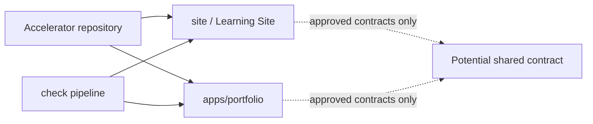
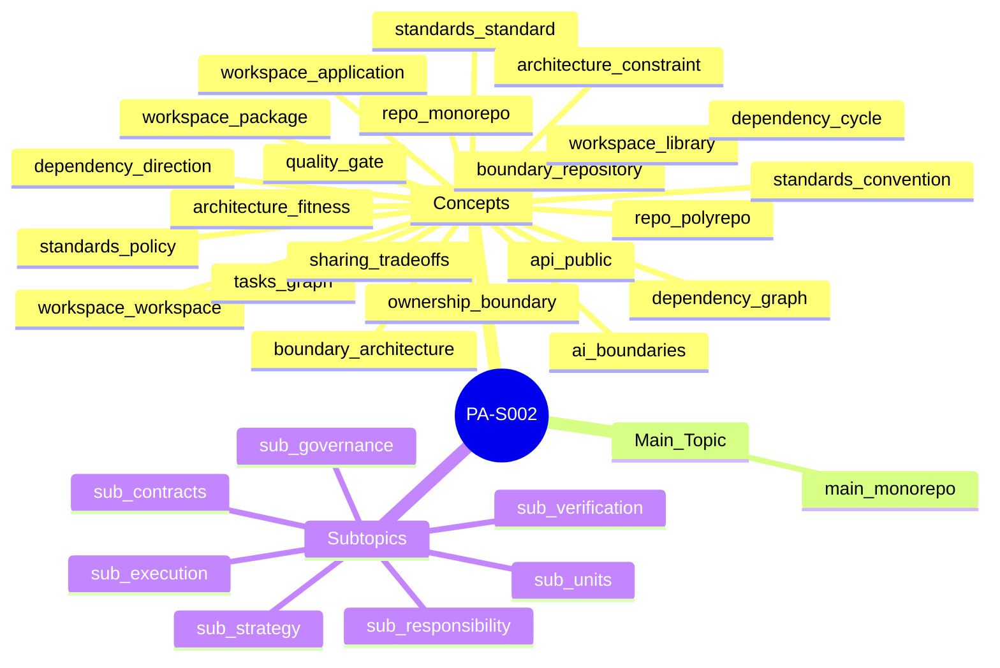

# PA-S002 — Monorepo del Accelerator y estándares de ingeniería
**F0 · PA-S002 · 150–210 min (estimación didáctica)**

> **SÍNTESIS EN 30 SEGUNDOS**
> 1. Repositorio común no significa arquitectura monolítica.
> 2. Las APIs y los grafos delimitan cambios, no los nombres de carpetas.
> 3. Gates y ownership requieren reglas comprobables y evidencia real.

## 1. Objetivo
Definir, contrastar y comprobar límites de paquetes, dependencias y estándares para evolucionar el Accelerator sin romper el Learning Site.

## 2. Learning Preview
El problema central es decidir qué puede compartirse y qué debe permanecer autónomo entre `apps/portfolio/` y `site/`; el resultado es un conjunto pequeño de contratos, gates y decisiones verificables.

## 3. Concepts
### Staff → Principal Software Engineering

<!-- concept: repo.monorepo -->
#### Monorepo (`repo.monorepo`)
##### Nivel 1 — Fundamento
**Definición y alcance.** Un monorepo mantiene varios proyectos relacionados bajo una historia de control de versiones y un ámbito coordinado de cambios. No exige un único despliegue ni una arquitectura monolítica.

##### Nivel 2 — Mecanismo
**Caso explicado.** En el Accelerator, un cambio de contrato compartido podría viajar en un mismo commit con sus consumidores del sitio y del portafolio, siempre que ambos existan como proyectos diferenciados.

**Comprobación.** ¿Un monorepo obliga a desplegar el sitio y el portafolio juntos? **Respuesta y explicación:** No. La ubicación del código y las unidades de despliegue son decisiones independientes.

##### Nivel 3 — Profundización (opcional)
**Límite / trade-off.** Compartir historia facilita cambios atómicos, pero amplía el alcance de herramientas, permisos y pipelines si no se segmentan.
**Lecturas:** [R1], [R2], [R3], [R4], [R5].

<!-- concept: repo.polyrepo -->
#### Polyrepo (`repo.polyrepo`)
##### Nivel 1 — Fundamento
**Definición y alcance.** Un polyrepo distribuye los proyectos en repositorios separados, con historias y permisos que pueden administrarse independientemente.

##### Nivel 2 — Mecanismo
**Caso explicado.** Una biblioteca compartida en un repositorio separado suele publicarse con una versión y ser consumida por cada producto mediante una dependencia declarada.

**Comprobación.** ¿Qué costo adicional surge al cambiar biblioteca y consumidores en polyrepo? **Respuesta y explicación:** Coordinar versiones y cambios entre historias de repositorio independientes.

##### Nivel 3 — Profundización (opcional)
**Límite / trade-off.** Separar repositorios no garantiza desacoplamiento: los consumidores todavía pueden depender de contratos privados o versiones incompatibles.
**Lecturas:** [R1], [R2], [R3], [R4], [R5].

<!-- concept: boundary.repository -->
#### Límite de repositorio (`boundary.repository`)
##### Nivel 1 — Fundamento
**Definición y alcance.** El límite de repositorio delimita dónde se controla una historia de código y cómo se gestionan sus permisos y revisiones.

##### Nivel 2 — Mecanismo
**Caso explicado.** Una pull request sobre la raíz podría modificar sitio y portafolio; los filtros de archivos y CODEOWNERS pueden introducir responsabilidades diferenciadas.

**Comprobación.** ¿Mover código a otra carpeta impide importaciones indebidas? **Respuesta y explicación:** No; hace falta una regla de dependencia verificable.

##### Nivel 3 — Profundización (opcional)
**Límite / trade-off.** No debe usarse una ruta Git como sustituto de un contrato arquitectónico.
**Lecturas:** [R1], [R2], [R3], [R4], [R5].

<!-- concept: boundary.architecture -->
#### Límite arquitectónico (`boundary.architecture`)
##### Nivel 1 — Fundamento
**Definición y alcance.** Un límite arquitectónico separa responsabilidades y define las dependencias e interfaces permitidas entre componentes.

##### Nivel 2 — Mecanismo
**Caso explicado.** El sitio puede consumir un contrato público de contenido mientras la implementación interna del portafolio permanece inaccesible mediante reglas de importación.

**Comprobación.** ¿Qué evidencia confirma un límite arquitectónico? **Respuesta y explicación:** Un contrato declarado y una prueba que rechace una dependencia prohibida.

##### Nivel 3 — Profundización (opcional)
**Límite / trade-off.** La separación de directorios sin comprobación estática ni revisión puede ser únicamente cosmética.
**Lecturas:** [R1], [R2], [R3], [R4], [R5].

<!-- concept: standards.convention -->
#### Convención (`standards.convention`)
##### Nivel 1 — Fundamento
**Definición y alcance.** Una convención es una práctica adoptada por acuerdo o hábito, potencialmente flexible y no necesariamente exigida por herramientas.

##### Nivel 2 — Mecanismo
**Caso explicado.** Nombrar los tests con *.test.ts ayuda a encontrarlos cuando el runner usa ese patrón.

**Comprobación.** ¿Una convención requiere siempre bloquear un merge? **Respuesta y explicación:** No; depende de su criticidad y del acuerdo de gobernanza.

##### Nivel 3 — Profundización (opcional)
**Límite / trade-off.** Si no se documenta ni verifica, equipos nuevos pueden seguir otra convención.
**Lecturas:** [R1], [R2], [R3], [R4], [R5].

<!-- concept: standards.policy -->
#### Política (`standards.policy`)
##### Nivel 1 — Fundamento
**Definición y alcance.** Una política expresa una obligación o restricción organizacional y define quién puede autorizar excepciones.

##### Nivel 2 — Mecanismo
**Caso explicado.** Una política puede prohibir secretos en commits y requerir revisión ante incidentes; el scanner implementa parte del control, no toda la política.

**Comprobación.** ¿Es suficiente un linter para demostrar cumplimiento de política? **Respuesta y explicación:** No; cubre solo los casos que detecta y configura.

##### Nivel 3 — Profundización (opcional)
**Límite / trade-off.** Publicar reglas sin propiedad, mecanismo de excepción y auditoría produce cumplimiento aparente.
**Lecturas:** [R1], [R2], [R3], [R4], [R5].

<!-- concept: standards.standard -->
#### Estándar de ingeniería (`standards.standard`)
##### Nivel 1 — Fundamento
**Definición y alcance.** Un estándar documenta requisitos técnicos y criterios de conformidad aplicables a un alcance definido; puede ser interno o externo.

##### Nivel 2 — Mecanismo
**Caso explicado.** Un estándar de paquete puede exigir exports explícitos y tests de compatibilidad para APIs compartidas.

**Comprobación.** ¿Qué distingue un estándar verificable de una preferencia? **Respuesta y explicación:** Alcance, criterios observables, autoridad y proceso de excepción.

##### Nivel 3 — Profundización (opcional)
**Límite / trade-off.** Estandarizar antes de conocer la variación del piloto S001–S005 puede bloquear soluciones legítimas.
**Lecturas:** [R1], [R2], [R3], [R4], [R5].

<!-- concept: quality.gate -->
#### Quality gate (`quality.gate`)
##### Nivel 1 — Fundamento
**Definición y alcance.** Un quality gate es una condición de aceptación que debe superarse antes de una transición, como integrar una pull request.

##### Nivel 2 — Mecanismo
**Caso explicado.** El script npm run check encadena lint, typecheck, tests, build y pruebas de salida; un branch rule podría requerir su estado correcto si se configura.

**Comprobación.** ¿Un check local aprobado significa que la rama está protegida? **Respuesta y explicación:** No; la protección y sus checks requeridos se configuran aparte.

##### Nivel 3 — Profundización (opcional)
**Límite / trade-off.** La existencia de un script no demuestra que CI lo ejecute, que proteja la rama ni que evalúe calidad pedagógica.
**Lecturas:** [R1], [R2], [R3], [R4], [R5].

<!-- concept: architecture.constraint -->
#### Restricción arquitectónica (`architecture.constraint`)
##### Nivel 1 — Fundamento
**Definición y alcance.** Una restricción arquitectónica limita estructuras o relaciones admisibles del sistema para proteger atributos acordados.

##### Nivel 2 — Mecanismo
**Caso explicado.** No importar apps/portfolio/src desde site/ sería una regla de aislamiento comprobable por análisis estático.

**Comprobación.** ¿Una regla en README demuestra cumplimiento? **Respuesta y explicación:** No; debe contrastarse con el grafo real y revisiones o tests.

##### Nivel 3 — Profundización (opcional)
**Límite / trade-off.** Una prohibición absoluta puede impedir una migración justificada; admitir excepciones trazables evita arbitrariedad.
**Lecturas:** [R1], [R2], [R3], [R4], [R5].

<!-- concept: architecture.fitness -->
#### Architecture fitness function (`architecture.fitness`)
##### Nivel 1 — Fundamento
**Definición y alcance.** Una architecture fitness function evalúa de modo repetible alguna propiedad arquitectónica definida mediante una prueba, medición o análisis.

##### Nivel 2 — Mecanismo
**Caso explicado.** Un test que falla al encontrar imports internos entre paquetes evalúa esa regla concreta; no demuestra que la arquitectura entera sea buena.

**Comprobación.** ¿Qué afirmación valida una prueba de ausencia de ciclos? **Respuesta y explicación:** Solo ausencia de ciclos en el grafo que la herramienta logró analizar.

##### Nivel 3 — Profundización (opcional)
**Límite / trade-off.** Los falsos negativos aparecen si el detector ignora imports dinámicos; los falsos positivos si prohíbe excepciones válidas.
**Lecturas:** [R1], [R2], [R3], [R4], [R5].

<!-- concept: ownership.boundary -->
#### Límite de ownership (`ownership.boundary`)
##### Nivel 1 — Fundamento
**Definición y alcance.** Un límite de propiedad asigna responsabilidad por cambios, revisiones, mantenimiento y respuesta ante fallos; puede atravesar repositorios y paquetes.

##### Nivel 2 — Mecanismo
**Caso explicado.** CODEOWNERS puede solicitar revisores por ruta, mientras un ADR documenta quién aprueba cambios de contratos compartidos.

**Comprobación.** ¿CODEOWNERS demuestra que hubo revisión efectiva? **Respuesta y explicación:** No; hay que inspeccionar reglas activas y pull requests reales.

##### Nivel 3 — Profundización (opcional)
**Límite / trade-off.** Ser dueño de una ruta no equivale a controlar automáticamente permisos de despliegue ni a estar disponible para responder.
**Lecturas:** [R1], [R2], [R3], [R4], [R5].

### Frontend Platform Architecture (FPA)

<!-- concept: workspace.workspace -->
#### Workspace (`workspace.workspace`)
##### Nivel 1 — Fundamento
**Definición y alcance.** Un workspace es un conjunto de proyectos que un gestor de paquetes trata como unidades locales relacionadas y cuyas dependencias puede enlazar durante instalación.

##### Nivel 2 — Mecanismo
**Caso explicado.** El package.json raíz declara apps/portfolio en workspaces; añadir una ruta no convierte automáticamente el sitio estático en un paquete npm.

**Comprobación.** ¿Un directorio site/ pertenece necesariamente a npm workspaces? **Respuesta y explicación:** No; requiere una definición de paquete y su inclusión deliberada.

##### Nivel 3 — Profundización (opcional)
**Límite / trade-off.** Los comandos y semántica dependen del gestor y de sus versiones; mantener el esquema actual evita una migración injustificada.
**Lecturas:** [R1], [R2], [R3], [R4], [R5].

<!-- concept: workspace.application -->
#### Aplicación (`workspace.application`)
##### Nivel 1 — Fundamento
**Definición y alcance.** Una aplicación es una unidad de software orientada a una experiencia o servicio ejecutable, con entradas, comportamiento y ciclo operativo identificables.

##### Nivel 2 — Mecanismo
**Caso explicado.** apps/portfolio es un producto profesional; site/ es otro producto de aprendizaje, aunque su publicación sea estática.

**Comprobación.** ¿Por qué no debe trasladarse toda la teoría a apps/portfolio? **Respuesta y explicación:** Porque portafolio y sitio tienen propósitos y contratos de contenido distintos.

##### Nivel 3 — Profundización (opcional)
**Límite / trade-off.** Aplicación no equivale a paquete npm: puede existir sin manifest propio y consumir bibliotecas compartidas.
**Lecturas:** [R1], [R2], [R3], [R4], [R5].

<!-- concept: workspace.package -->
#### Paquete (`workspace.package`)
##### Nivel 1 — Fundamento
**Definición y alcance.** Un paquete es una unidad identificable para resolución de dependencias o distribución, descrita por metadatos como `name`, `version` y, cuando corresponde, `exports` en `package.json`. Puede contener código, tipos, recursos o herramientas; no tiene por qué ser una biblioteca.

##### Nivel 2 — Mecanismo
**Caso explicado.** Un futuro packages/content-contract podría exportar esquemas compartidos, pero primero debe existir una necesidad repetida y una API estable.

**Comprobación.** ¿Cuándo crear un paquete compartido? **Respuesta y explicación:** Cuando exista contrato y consumidores reales que justifiquen el costo de versionado y mantenimiento.

##### Nivel 3 — Profundización (opcional)
**Límite / trade-off.** Extraer archivos por semejanza visual puede crear una abstracción prematura y propagación de cambios.
**Lecturas:** [R1], [R2], [R3], [R4], [R5].

<!-- concept: workspace.library -->
#### Biblioteca (`workspace.library`)
##### Nivel 1 — Fundamento
**Definición, límites y distinción.** Una biblioteca reúne funcionalidades reutilizables que otros programas invocan, por ejemplo funciones para validar un contrato de sesión. **Biblioteca** describe el papel del código ante sus consumidores; **paquete** describe cómo se empaqueta o resuelve. Una biblioteca puede distribuirse como paquete npm, pero un paquete npm también puede ser una aplicación, una herramienta o recursos sin biblioteca de código. [R2], [R3].

##### Nivel 2 — Mecanismo
**Ejemplo hipotético y recorrido verificable.** `packages/session-schema/src/validate.ts` exporta `validateSession(input)`. El renderer de `site/` importa la función a través de un punto de entrada público. 📥 Entrada: un objeto de sesión. ⚙️ Mecanismo: la biblioteca examina identificadores y campos requeridos y devuelve errores estructurados. 📤 Resultado: el consumidor rechaza una sesión inválida antes de publicar. Un cambio compatible en la función requiere tests de contrato de los consumidores; una modificación incompatible puede romperlos incluso si el paquete sigue instalándose correctamente. No se afirma que esta biblioteca exista hoy en el repositorio.

**Contraejemplo.** Extraer el CSS específico del dashboard a una supuesta biblioteca común sin un segundo consumidor no demuestra reutilización; puede aumentar acoplamiento y mantenimiento.

**Recuperación.** ¿Puede un paquete npm existir sin ofrecer una biblioteca reutilizable? **Respuesta y explicación:** Sí; su función puede ser ejecutar una aplicación o distribuir herramientas. El manifiesto define la unidad de distribución, no su valor de reutilización.

##### Nivel 3 — Profundización (opcional)
**Decisión y verificación.** Antes de extraer una biblioteca, identificar consumidores reales, contrato, semántica de versiones y pruebas de integración. Verificar exports, resolución efectiva de imports y cambios propagados; no inferir beneficio a partir de menos archivos repetidos. [R2], [R3].

<!-- concept: dependency.graph -->
#### Grafo de dependencias (`dependency.graph`)
##### Nivel 1 — Fundamento
**Definición y alcance.** Un grafo de dependencias modela unidades como nodos y relaciones de dependencia dirigidas como aristas.

##### Nivel 2 — Mecanismo
**Caso explicado.** Si portfolio importa contracts, la arista portfolio → contracts expresa que el consumidor necesita el proveedor; recorrer aristas permite identificar impacto.

**Comprobación.** Si contracts cambia, ¿qué dirección se recorre para encontrar consumidores? **Respuesta y explicación:** Las aristas inversas: proyectos que dependen de contracts.

##### Nivel 3 — Profundización (opcional)
**Límite / trade-off.** Un grafo real debe extraerse de imports/manifiestos; un gráfico hipotético no certifica el estado del repositorio.
**Lecturas:** [R1], [R2], [R3], [R4], [R5].

<!-- concept: dependency.direction -->
#### Dirección de dependencias (`dependency.direction`)
##### Nivel 1 — Fundamento
**Definición y alcance.** La dirección de una dependencia indica qué unidad consumidora necesita conocer el contrato de otra unidad proveedora. La flecha `A → B` significa que A depende de B; no demuestra que B dependa de A.

##### Nivel 2 — Mecanismo
**Caso explicado.** Si site → contracts y contracts → site, el ciclo dificulta compilar, aislar y evolucionar las unidades por separado.

**Comprobación.** ¿Qué inversión corrige un paquete de contratos que importa la aplicación? **Respuesta y explicación:** Mover la dependencia concreta hacia el consumidor y mantener contratos independientes de aplicaciones.

##### Nivel 3 — Profundización (opcional)
**Límite / trade-off.** No todo ciclo es inválido en cualquier lenguaje o runtime, pero en paquetes de plataforma suele complicar los límites.
**Lecturas:** [R1], [R2], [R3], [R4], [R5].

<!-- concept: dependency.cycle -->
#### Ciclo de dependencias (`dependency.cycle`)
##### Nivel 1 — Fundamento
**Definición y no-ejemplo.** Un ciclo dirigido existe cuando, siguiendo las dependencias, se puede regresar al nodo inicial: `A → B → C → A`. Dos módulos que usan una misma biblioteca (`A → C ← B`) **no** forman un ciclo. El ciclo es propiedad del grafo, distinta de la dirección individual de cada arista. [R1], [R4].

##### Nivel 2 — Mecanismo
**Ejemplo hipotético y propagación.** `site/renderer` importa `packages/contracts`; una modificación posterior hace que `packages/contracts` importe un helper privado de `site/renderer`. Se forma `renderer → contracts → renderer`. 📥 Entrada: nuevo import desde contracts. ⚙️ Mecanismo: el recorrido de dependencias vuelve a renderer y pierde un orden topológico estricto entre estas unidades. 📤 Resultado: ciertas estrategias de compilación, inicialización o publicación independiente quedan restringidas; el síntoma exacto depende del runtime y de las herramientas. La corrección mantiene el contrato libre de detalles de renderer, o extrae una dependencia inferior realmente estable.

**Contraejemplo y caso borde.** Un ciclo entre imports de módulos no implica necesariamente un error de runtime: ECMAScript admite dependencias circulares, aunque acceder a bindings antes de su inicialización puede fallar según el recorrido. No se debe equiparar automáticamente un ciclo de paquetes con un ciclo de ejecución real.

**Recuperación.** Si `A → B` y `B → C`, ¿hay un ciclo? **Respuesta y explicación:** Todavía no. Se requiere un camino desde C (o B) de regreso a A (o B), por ejemplo `C → A`.

##### Nivel 3 — Profundización (opcional)
**Detección reproducible.** Recorrer el grafo de imports/manifiestos y buscar componentes fuertemente conexas; una componente de más de un nodo evidencia un ciclo en el grafo *analizado*. Verificar también auto-imports según la política. Imports dinámicos, alias y resolución condicional pueden producir falsos negativos si el analizador no los contempla. Usar un fixture positivo `A → B → A` y otro negativo `A → C ← B`. [R1], [R4].

<!-- concept: api.public -->
#### API pública (`api.public`)
##### Nivel 1 — Fundamento
**Definición y alcance.** Una interfaz de programación de aplicaciones (API) pública de paquete declara los símbolos y comportamientos admitidos para consumidores; no implica acceso público por internet.

##### Nivel 2 — Mecanismo
**Caso explicado.** El campo exports de package.json puede limitar rutas importables; el tipado declara formas y pruebas de contrato comprueban comportamientos relevantes.

**Comprobación.** ¿Por qué un import profundo a src/internal es riesgoso? **Respuesta y explicación:** Acopla al consumidor con estructura privada que puede cambiar sin promesa de compatibilidad.

##### Nivel 3 — Profundización (opcional)
**Límite / trade-off.** Una exportación no sustituye la política de compatibilidad ni evita todos los accesos mediante rutas internas fuera del resolver.
**Lecturas:** [R1], [R2], [R3], [R4], [R5].

<!-- concept: tasks.graph -->
#### Grafo de tareas de build (`tasks.graph`)
##### Nivel 1 — Fundamento
**Definición y alcance.** El grafo de tareas representa operaciones como test, typecheck y build, junto con sus dependencias de ejecución; difiere del grafo de módulos.

##### Nivel 2 — Mecanismo
**Caso explicado.** Si build(site) requiere svg(diagrams), la conversión debe terminar antes de publicar HTML; el pipeline actual puede verificarse leyendo scripts reales.

**Comprobación.** ¿Un grafo de imports determina por sí solo el orden de lint y build? **Respuesta y explicación:** No; el grafo de tareas incluye relaciones adicionales entre comandos.

##### Nivel 3 — Profundización (opcional)
**Límite / trade-off.** Una tarea cacheada solo es confiable cuando su clave incluye entradas y configuración relevantes; cache incorrecta oculta cambios.
**Lecturas:** [R1], [R2], [R3], [R4], [R5].

<!-- concept: sharing.tradeoffs -->
#### Trade-offs del código compartido (`sharing.tradeoffs`)
##### Nivel 1 — Fundamento
**Definición y alcance.** Compartir implementación reduce duplicación deliberada, pero crea coordinación y dependencia entre equipos y productos.

##### Nivel 2 — Mecanismo
**Caso explicado.** Un helper de formato verdaderamente estable puede ser compartido; un componente con supuestos específicos del sitio no debe generalizarse antes de observar otros consumidores.

**Comprobación.** ¿Menos archivos duplicados demuestra mejor arquitectura? **Respuesta y explicación:** No; deben medirse autonomía, cambios propagados y contratos efectivos.

##### Nivel 3 — Profundización (opcional)
**Límite / trade-off.** El costo de cambiar una abstracción compartida puede superar el costo de pequeñas implementaciones separadas.
**Lecturas:** [R1], [R2], [R3], [R4], [R5].

### AI Product Engineering (AIPE)

<!-- concept: ai.boundaries -->
#### Límites de producto IA (`ai.boundaries`)
##### Nivel 1 — Fundamento
**Definición y alcance.** Los límites de un producto de inteligencia artificial (IA) separan interfaz, orquestación, proveedor, datos, evaluación y políticas de seguridad cuando esas responsabilidades existen.

##### Nivel 2 — Mecanismo
**Caso explicado.** En un producto hipotético de búsqueda asistida, un contrato de solicitud de evaluación puede ser compartido sin dar a la UI acceso a claves del proveedor.

**Comprobación.** ¿Un monorepo permite al frontend usar secretos del modelo directamente? **Respuesta y explicación:** No; los límites de seguridad y ejecución son independientes del repositorio.

##### Nivel 3 — Profundización (opcional)
**Límite / trade-off.** Extraer ahora un gateway de IA sin consumidores reales sería especulativo; PA-S002 estudia el límite, no construye una plataforma de modelos.
**Lecturas:** [R1], [R2], [R3], [R4], [R5].

## 4. Main Topic
<!-- topic: main.monorepo requires: repo.monorepo,repo.polyrepo,boundary.repository,boundary.architecture,workspace.workspace,workspace.application,workspace.package,workspace.library,dependency.graph,dependency.direction,dependency.cycle,api.public,tasks.graph,sharing.tradeoffs,standards.convention,standards.policy,standards.standard,quality.gate,architecture.constraint,architecture.fitness,ownership.boundary,ai.boundaries -->
**Tesis.** La arquitectura adecuada separa productos y permite cambios conjuntos solo a través de contratos intencionales. El repositorio existente ya declara un workspace npm para el portafolio; no prueba que site/ sea un workspace ni que haya checks de rama obligatorios. El objetivo no es maximizar paquetes, sino impedir dependencias accidentales preservando cambios coordinados. [R1–R5]
<!-- integration: main.monorepo -->

## 5. Subtopics
<!-- topic: sub.strategy requires: repo.monorepo,repo.polyrepo,boundary.repository,boundary.architecture -->
### Topología de repositorios y autonomía
**Fundamentos separados.** Los conceptos `repo.monorepo`, `repo.polyrepo`, `boundary.repository`, `boundary.architecture` se definieron individualmente; aquí se examina cómo sus contratos interactúan en una decisión real.
En un monorepo, una revisión puede abarcar ambos productos, pero cada producto conserva su propio ciclo de publicación. Polyrepo ofrece historial independiente a costa de coordinar cambios interrepositorio. El criterio decisivo es el costo total de evolución, no una supuesta superioridad universal.

**Contraejemplo / prueba:** Un cambio que parece local rompe una importación privada: comparar el grafo antes/después, ejecutar checks y revisar la salida HTML, no inferir éxito por ausencia de errores visibles.
<!-- integration: sub.strategy -->

<!-- topic: sub.units requires: workspace.workspace,workspace.application,workspace.package,workspace.library -->
### Workspaces, aplicaciones y paquetes
**Fundamentos separados.** Los conceptos `workspace.workspace`, `workspace.application`, `workspace.package`, `workspace.library` se definieron individualmente; aquí se examina cómo sus contratos interactúan en una decisión real.
La raíz ya usa npm workspaces para portfolio. Un paquete requiere manifest, nombre y contrato de consumo; una carpeta compartida no necesita convertirse en paquete. Es preferible construir límites reales sobre el gestor existente y añadir workspace solo para consumidores comprobados.

**Contraejemplo / prueba:** Un cambio que parece local rompe una importación privada: comparar el grafo antes/después, ejecutar checks y revisar la salida HTML, no inferir éxito por ausencia de errores visibles.
<!-- integration: sub.units -->

<!-- topic: sub.contracts requires: dependency.graph,dependency.direction,dependency.cycle,api.public -->
### Dependencias, APIs y dirección
**Fundamentos separados.** Los conceptos `dependency.graph`, `dependency.direction`, `dependency.cycle`, `api.public` se definieron individualmente; aquí se examina cómo sus contratos interactúan en una decisión real.
El grafo dirigido identifica consumidores; exports define la superficie admitida; las pruebas impiden imports profundos. Primero identificar imports existentes, luego definir dependencias permitidas y finalmente probar violaciones con fixtures negativos; jamás asumir que los nombres de carpetas bastan.

**Contraejemplo / prueba:** Un cambio que parece local rompe una importación privada: comparar el grafo antes/después, ejecutar checks y revisar la salida HTML, no inferir éxito por ausencia de errores visibles.
<!-- integration: sub.contracts -->

<!-- topic: sub.execution requires: tasks.graph,sharing.tradeoffs -->
### Grafo de tareas y código compartido
**Fundamentos separados.** Los conceptos `tasks.graph`, `sharing.tradeoffs` se definieron individualmente; aquí se examina cómo sus contratos interactúan en una decisión real.
El grafo de proyectos indica quién depende de quién; el de tareas agrega que generar SVG precede al HTML final. Compartir código solo se justifica tras demostrar un contrato repetido. Una optimización de cache debe validar todas las entradas antes de afirmar aceleración.

**Contraejemplo / prueba:** Un cambio que parece local rompe una importación privada: comparar el grafo antes/después, ejecutar checks y revisar la salida HTML, no inferir éxito por ausencia de errores visibles.
<!-- integration: sub.execution -->

<!-- topic: sub.governance requires: standards.convention,standards.policy,standards.standard -->
### Convenciones, políticas y estándares
**Fundamentos separados.** Los conceptos `standards.convention`, `standards.policy`, `standards.standard` se definieron individualmente; aquí se examina cómo sus contratos interactúan en una decisión real.
Convención permite coordinación flexible, política obliga con dueño y excepciones, estándar describe conformidad reproducible. Por ejemplo, nombres de tests pueden ser convención; bloquear secretos es política; exports verificables puede ser estándar. No establecer reglas globales para S006–S120 antes de comparar el piloto.

**Contraejemplo / prueba:** Un cambio que parece local rompe una importación privada: comparar el grafo antes/después, ejecutar checks y revisar la salida HTML, no inferir éxito por ausencia de errores visibles.
<!-- integration: sub.governance -->

<!-- topic: sub.verification requires: quality.gate,architecture.constraint,architecture.fitness -->
### Quality gates, restricciones y fitness
**Fundamentos separados.** Los conceptos `quality.gate`, `architecture.constraint`, `architecture.fitness` se definieron individualmente; aquí se examina cómo sus contratos interactúan en una decisión real.
Gate es el punto de decisión; fitness function mide una propiedad. El check actual combina lint, tipos, tests, build y HTML; la presencia de comandos no acredita resultados. Un test de límites puede pasar aunque no capture un import dinámico; documentar exactamente qué cubre.

**Contraejemplo / prueba:** Un cambio que parece local rompe una importación privada: comparar el grafo antes/después, ejecutar checks y revisar la salida HTML, no inferir éxito por ausencia de errores visibles.
<!-- integration: sub.verification -->

<!-- topic: sub.responsibility requires: ownership.boundary,ai.boundaries -->
### Ownership y límites IA
**Fundamentos separados.** Los conceptos `ownership.boundary`, `ai.boundaries` se definieron individualmente; aquí se examina cómo sus contratos interactúan en una decisión real.
Ownership establece aprobación y operación, no solamente un archivo CODEOWNERS. En IA, la separación de secretos, contratos y evaluaciones es independiente de dónde vive el código. En este piloto, diseñar esos límites no autoriza crear servicios de IA ficticios.

**Contraejemplo / prueba:** Un cambio que parece local rompe una importación privada: comparar el grafo antes/después, ejecutar checks y revisar la salida HTML, no inferir éxito por ausencia de errores visibles.
<!-- integration: sub.responsibility -->

## 6. Integración entre dominios
Staff→Principal decide alcance, riesgos y ownership; FPA materializa límites y grafos del frontend; AIPE aporta la necesidad futura de aislar datos y proveedores. Esta integración no convierte el piloto en una plataforma de IA.

## 7. Theory → Practice Map
| Teoría | Trabajo verificable | Evidencia esperada |
|---|---|---|
| Monorepo/workspace | Inspeccionar package.json, scripts, dependencias | Inventario comprobado |
| Boundaries/API | Reglas de imports + test negativo | Salida del test |
| Gates/ownership | Revisar CI, ADR y protección de rama | Configuración y decisión explícitas |

## 8. Time Breakdown
Inventario 30 min; conceptos 60–90 min; decisiones 30 min; validación 30–60 min. Estimación, no tiempo observado.

## 9. Real-World Example
**Caso verificado en el repositorio conectado:** package.json incluye `workspaces: ["apps/portfolio"]` y `npm run check` encadena lint, typecheck, test, build y prueba de salida. Technology Radar está rotulado como borrador inicial. Eso no demuestra cuáles gates están activos en GitHub ni el estado del árbol de trabajo local.

## 10. Production-Ready Example
**Diseño propuesto, no implementación verificada.** Mantener `site/` y `apps/portfolio/` como productos autónomos. Un contrato futuro `packages/content-contract/` solo se crea si hay dos consumidores reales; exporta únicamente schemas públicos. Antes de fusionar: test de imports, pruebas de contrato, lint, tipos, build y HTML ES/EN. Un import prohibido debe romper el gate; una excepción exige ADR. Si Mermaid falla, detener build y conservar fuente `.mmd`. Nunca publicar un panel vacío como progreso inventado.

## 11. Visual Learning Studio
**Mind map:** el diagrama Mermaid siguiente es fuente canónica para SVG responsive; cada nodo representa una sección enseñada, no una estadística.

**Flashcards:** Cada tarjeta preserva su origen y respuesta explicativa; no representa mastery.

- `fc.repo.monorepo` [repo.monorepo] ¿Un monorepo obliga a desplegar el sitio y el portafolio juntos? — No. La ubicación del código y las unidades de despliegue son decisiones independientes.
- `fc.repo.polyrepo` [repo.polyrepo] ¿Qué costo adicional surge al cambiar biblioteca y consumidores en polyrepo? — Coordinar versiones y cambios entre historias de repositorio independientes.
- `fc.boundary.repository` [boundary.repository] ¿Mover código a otra carpeta impide importaciones indebidas? — No; hace falta una regla de dependencia verificable.
- `fc.boundary.architecture` [boundary.architecture] ¿Qué evidencia confirma un límite arquitectónico? — Un contrato declarado y una prueba que rechace una dependencia prohibida.
- `fc.workspace.workspace` [workspace.workspace] ¿Un directorio site/ pertenece necesariamente a npm workspaces? — No; requiere una definición de paquete y su inclusión deliberada.
- `fc.workspace.application` [workspace.application] ¿Por qué no debe trasladarse toda la teoría a apps/portfolio? — Porque portafolio y sitio tienen propósitos y contratos de contenido distintos.
- `fc.workspace.package` [workspace.package] ¿Cuándo crear un paquete compartido? — Cuando exista contrato y consumidores reales que justifiquen el costo de versionado y mantenimiento.
- `fc.workspace.library` [workspace.library] ¿Una biblioteca es lo mismo que un paquete? — No; biblioteca describe funcionalidad consumida, paquete describe empaquetado y resolución. Un paquete también puede distribuir herramientas.
- `fc.dependency.graph` [dependency.graph] Si contracts cambia, ¿qué dirección se recorre para encontrar consumidores? — Las aristas inversas: proyectos que dependen de contracts.
- `fc.dependency.direction` [dependency.direction] ¿Qué inversión corrige un paquete de contratos que importa la aplicación? — Mover la dependencia concreta hacia el consumidor y mantener contratos independientes de aplicaciones.
- `fc.dependency.cycle` [dependency.cycle] ¿A → B → C basta para demostrar un ciclo? — No. Falta una ruta de regreso, como C → A. Dos consumidores de una misma dependencia no forman ciclo.
- `fc.api.public` [api.public] ¿Por qué un import profundo a src/internal es riesgoso? — Acopla al consumidor con estructura privada que puede cambiar sin promesa de compatibilidad.
- `fc.tasks.graph` [tasks.graph] ¿Un grafo de imports determina por sí solo el orden de lint y build? — No; el grafo de tareas incluye relaciones adicionales entre comandos.
- `fc.sharing.tradeoffs` [sharing.tradeoffs] ¿Menos archivos duplicados demuestra mejor arquitectura? — No; deben medirse autonomía, cambios propagados y contratos efectivos.
- `fc.standards.convention` [standards.convention] ¿Una convención requiere siempre bloquear un merge? — No; depende de su criticidad y del acuerdo de gobernanza.
- `fc.standards.policy` [standards.policy] ¿Es suficiente un linter para demostrar cumplimiento de política? — No; cubre solo los casos que detecta y configura.
- `fc.standards.standard` [standards.standard] ¿Qué distingue un estándar verificable de una preferencia? — Alcance, criterios observables, autoridad y proceso de excepción.
- `fc.quality.gate` [quality.gate] ¿Un check local aprobado significa que la rama está protegida? — No; la protección y sus checks requeridos se configuran aparte.
- `fc.architecture.constraint` [architecture.constraint] ¿Una regla en README demuestra cumplimiento? — No; debe contrastarse con el grafo real y revisiones o tests.
- `fc.architecture.fitness` [architecture.fitness] ¿Qué afirmación valida una prueba de ausencia de ciclos? — Solo ausencia de ciclos en el grafo que la herramienta logró analizar.
- `fc.ownership.boundary` [ownership.boundary] ¿CODEOWNERS demuestra que hubo revisión efectiva? — No; hay que inspeccionar reglas activas y pull requests reales.
- `fc.ai.boundaries` [ai.boundaries] ¿Un monorepo permite al frontend usar secretos del modelo directamente? — No; los límites de seguridad y ejecución son independientes del repositorio.
- `fc.main` [main.monorepo] ¿Cuál es el resultado buscado? — Autonomía de productos y contratos verificables dentro de un repositorio común.

## 12. Exercises
- [ ] `PA-S002:exercise:1` Identificar aristas actuales y posibles ciclos sin inventar imports.
- [ ] `PA-S002:exercise:2` Diseñar una prueba negativa que rechace import privado entre productos.
- [ ] `PA-S002:exercise:3` Comparar conservar npm workspaces frente a instalar un orquestador.
- [ ] `PA-S002:exercise:4` Revisar qué comprobaría y qué no comprobaría npm run check.

## 13. Curated Sources and References
- [R1] https://docs.npmjs.com/cli/v11/using-npm/workspaces
- [R2] https://www.typescriptlang.org/docs/handbook/project-references
- [R3] https://nodejs.org/api/packages.html#package-entry-points
- [R4] https://docs.github.com/en/repositories/configuring-branches-and-merges-in-your-repository/managing-protected-branches/about-protected-branches
- [R5] Principal Accelerator Project Sources 03, 05, 06, 09, 14, 15 (curriculum and accepted project constraints).

## 14. Resources
Leer el `package.json` real, Technology Radar y tests existentes antes de proponer nuevos paquetes; contrastar R1–R4 con versiones instaladas.

## 15. Knowledge Mastery Checklist
- [ ] `PA-S002:mastery:1` Distinguir repositorio y arquitectura.
- [ ] `PA-S002:mastery:2` Explicar el grafo de proyectos y el grafo de tareas.
- [ ] `PA-S002:mastery:3` Defender APIs públicas y ownership.
- [ ] `PA-S002:mastery:4` Diferenciar estándares, políticas y gates.
- [ ] `PA-S002:mastery:5` Explicar qué evidencia valida una fitness function.

## 16. End-of-Session Success Criteria
- [ ] Existe una propuesta de dependencias con riesgos y alternativas.
- [ ] Las pruebas ejecutadas y sus límites están documentados; ningún checkbox concede dominio.

## 17. Bridge to PA-S003
PA-S003 profundiza arquitectura de portafolio y contenido del Learning Site, manteniendo límites entre productos.

