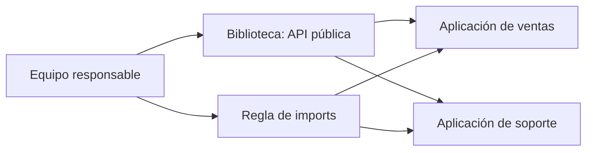

# Ownership y evolución de estándares — muestra editorial v11

**Referencia:** Fase 0 · PA-S002. **Estado:** ejercicio de presentación, NO teoría canónica aprobada. Se basa exclusivamente en el Subtema 7 español existente, conservando su tema y los cuatro conceptos. No sustituye ni altera el texto del repositorio.

## Síntesis en 30 segundos

1. Ownership identifica quién responde por los cambios y mantenimiento de un contrato compartido.
2. Una excepción necesita alcance, responsable y fecha o condición de revisión.
3. Una migración protege a los consumidores cuando evoluciona un estándar.

## Objetivo

Explicar quién mantiene una API compartida, cómo se aprueban excepciones y qué pasos permiten adoptar una nueva regla sin dejar consumidores rotos.

## Conceptos del subtema 7

**Ownership:** responsabilidad explícita del mantenimiento y la revisión de un componente. **Ejemplo:** un equipo responsable de una biblioteca pública revisa cambios en las propiedades consumidas por tres aplicaciones antes de publicar una versión.

**Excepción documentada:** desviación justificada y acotada de una regla, con responsable y revisión. **Ejemplo:** una aplicación heredada conserva temporalmente un import interno; el registro indica por qué, quién lo mantiene y la condición para retirarlo.

**Migración:** transición planificada de productores y consumidores desde una interfaz o regla anterior a otra nueva. **Ejemplo:** una biblioteca publica un nuevo punto de entrada estable mientras los consumidores reemplazan importaciones internas y se habilita la nueva verificación.

**Decisión de arquitectura:** elección cuyo contexto, alternativas y consecuencias se registran para revisión posterior. **Ejemplo:** un equipo adopta exports públicos en vez de imports de rutas privadas y registra el coste de cambiar consumidores antiguos.

## Cómo funciona

Para reemplazar importaciones internas por una API pública, primero se inventarían los consumidores reales. Después el proveedor incorpora exports compatibles y los consumidores migran en un orden acordado. Una vez actualizados, el pipeline activa la regla que rechaza imports internos; las excepciones temporales conservan responsable y revisión.

**Interpretación:** el contrato público es el punto de consumo común; el equipo responsable revisa cambios al proveedor y al control de imports. El diagrama es ilustrativo, no el grafo real del repositorio.

## Ejemplo resuelto

Si `sales` importa `@company/ui/internal/button`, la regla nueva puede fallar. El equipo primero publica `@company/ui` con una exportación compatible, migra `sales` y después activa la regla que prohíbe el acceso interno. La prueba debe comprobar el import real y el comportamiento del botón. Una norma en README no verifica por sí sola los imports.

## Ejercicio del subtema 7

**Consigna:** una app heredada no puede migrar durante este release. Define una excepción que no se convierta en permanente.

**Solución razonada:** registrar el import exacto, motivo de bloqueo, responsable, riesgos, condición de retirada y próxima fecha de revisión. Mantener CI advirtiendo la excepción concreta pero rechazando nuevas rutas internas. No conceder una excepción global sin límite.

## Tarjeta de estudio del subtema 7

**Pregunta:** ¿qué diferencia ownership de una excepción documentada?

**Respuesta:** ownership asigna responsabilidad de mantener y decidir sobre el componente; la excepción autoriza temporalmente una desviación concreta, con alcance y revisión. Uno no sustituye al otro.

## Visual Learning Studio del subtema 7

**Modalidad:** predecir y revelar. ¿Qué ocurrirá si el gate bloquea los imports internos antes de publicar una API alternativa? **Respuesta:** los consumidores actuales pueden fallar en build; la migración debe secuenciar provisión del contrato, actualización de consumidores y activación de la regla. No se simula un CI real.

## Recursos del subtema 7

- [GitHub CODEOWNERS — About code owners](https://docs.github.com/en/repositories/managing-your-repositorys-settings-and-features/customizing-your-repository/about-code-owners): comprender revisión y propiedad de rutas en GitHub; una regla de CODEOWNERS no demuestra por sí sola quién toma decisiones organizacionales.
- [TypeScript Handbook — Modules](https://www.typescriptlang.org/docs/handbook/modules/introduction.html): estudiar importaciones y la separación entre módulos.
- [npm — package.json exports](https://docs.npmjs.com/cli/v11/configuring-npm/package-json#exports): estudiar cómo declarar entradas públicas de paquetes y sus límites.

## Comprueba lo aprendido

**Pregunta:** ¿por qué debe existir un plan de compatibilidad antes de activar la prohibición de imports internos?

**Respuesta razonada:** porque consumidores que dependen de rutas antiguas pueden fallar. El plan debe identificar afectados, ofrecer el contrato nuevo, actualizar clientes y verificar que ninguna dependencia no migrada queda fuera de una excepción revisada.
