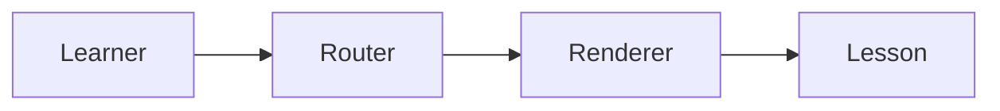

# DEMO — application, system, platform and ecosystem

> **30-SECOND SYNTHESIS**
> 1. An application provides user-facing functions.
> 2. A system explains interacting elements delivering an outcome.
> 3. A platform exposes reusable capabilities; its ecosystem includes dependent actors.

## Objective
Distinguish the four concepts before integrating them.

## Concepts — Staff → Principal Software Engineering

### Application

#### Level 1 — Foundation
**An application** provides functionality to users. Example: `LearningSite` shows lessons and tracks study activity.

#### Level 2 — Mechanism
📥 [INPUT / CAUSE] A learner opens a lesson.
⚙️ [PROCESS / MECHANISM] `Router` selects content and `Renderer` creates the view.
📤 [OUTPUT / RESULT] The learner sees the theory and references.
💡 [INSIGHT / RULE OF THUMB] Identify observable behavior before deciding component boundaries.

**Self-check:** Which element selects the lesson? Answer: `Router` in this example.

#### Level 3 — Deep Dive (optional)
When the content does not exist, routing should display an accessible error state rather than a blank view.

The [routing:: choosing a view based on a route] notation offers optional contextual help.

[Interactive Component Recommendation: Toggle between existing and missing routes to observe the rendered state]

### Concept synthesis
Application is only one of four concepts; system, platform and ecosystem must each be taught before comparison. **This file only demonstrates format, NOT a complete canonical lesson.**
