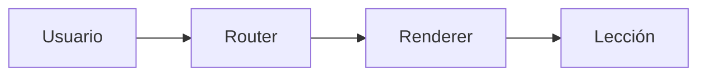

# DEMO — aplicación, sistema, plataforma y ecosistema

> **SÍNTESIS EN 30 SEGUNDOS**
> 1. Una aplicación entrega funciones a usuarios.
> 2. Un sistema explica cómo interactúan los elementos que entregan un resultado.
> 3. Una plataforma expone capacidades reutilizables; su ecosistema incluye actores dependientes.

## Objetivo
Distinguir los cuatro conceptos antes de integrarlos.

## Conceptos — Staff → Principal Software Engineering

### Aplicación

#### Nivel 1 — Fundamento
**Una aplicación** entrega funciones a usuarios. Ejemplo: `LearningSite` muestra lecciones y registra actividad de estudio.

#### Nivel 2 — Mecanismo
📥 [ENTRADA / CAUSA] El usuario abre una lección.
⚙️ [PROCESO / MECANISMO] `Router` selecciona contenido y `Renderer` construye la vista.
📤 [SALIDA / RESULTADO] La persona ve la teoría y sus referencias.
💡 [INSIGHT / REGLA DE ORO] Identifica el comportamiento observable antes de delimitar componentes.

**Autoprueba:** ¿Qué componente selecciona la lección? Respuesta: `Router` en este ejemplo.

#### Nivel 3 — Profundización (opcional)
Si el contenido no existe, el enrutador debe mostrar un estado de error accesible en vez de una vista vacía.

El [enrutamiento:: selección de una vista según una ruta] es un término contextual auxiliar.

[Componente Interactivo Recomendado: Toggle para cambiar entre ruta existente y ruta inexistente y observar la pantalla mostrada]

### Síntesis de conceptos
Aplicación es solo uno de los cuatro conceptos; aquí falta desarrollar sistema, plataforma y ecosistema antes de comparar todos. **Este archivo es exclusivamente una demostración del formato, NO teoría canónica completa.**
