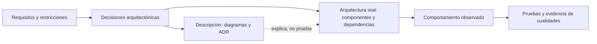
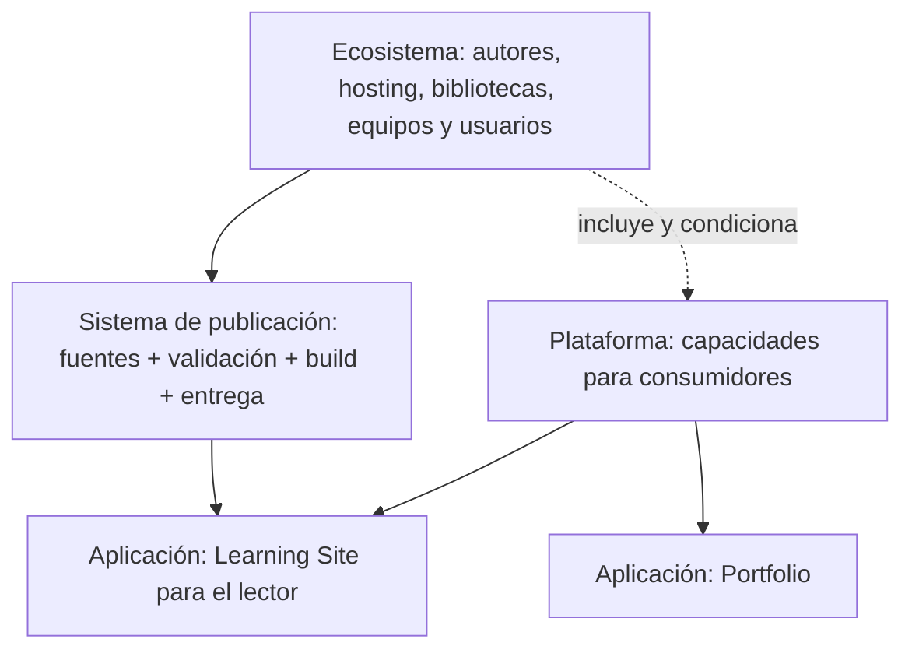
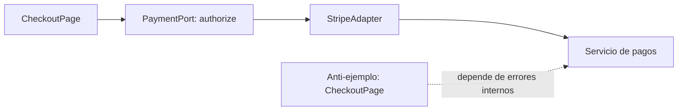
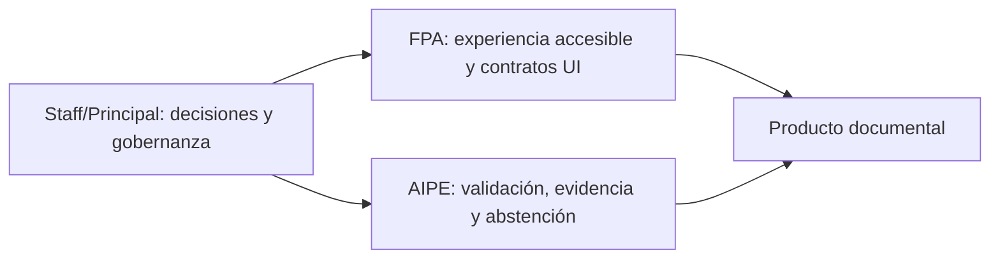
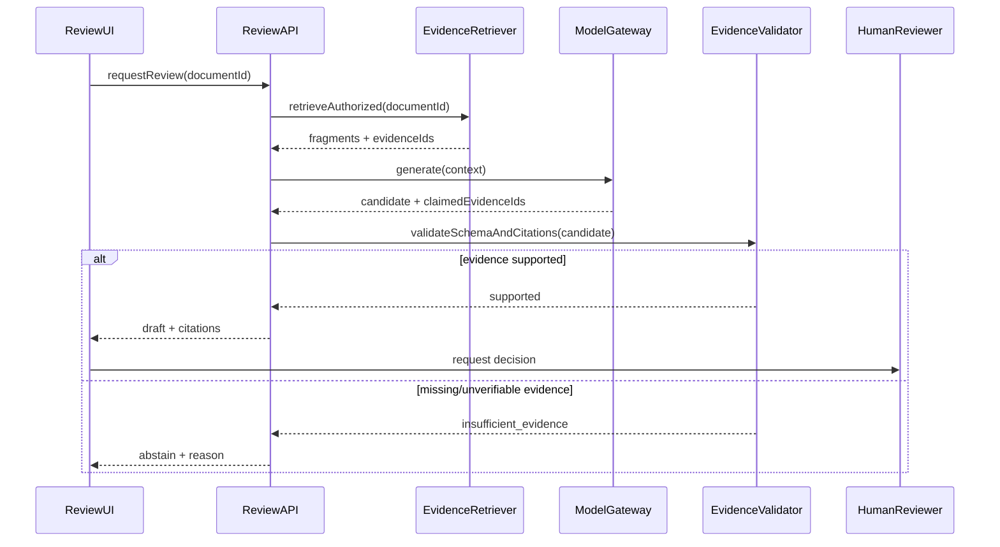
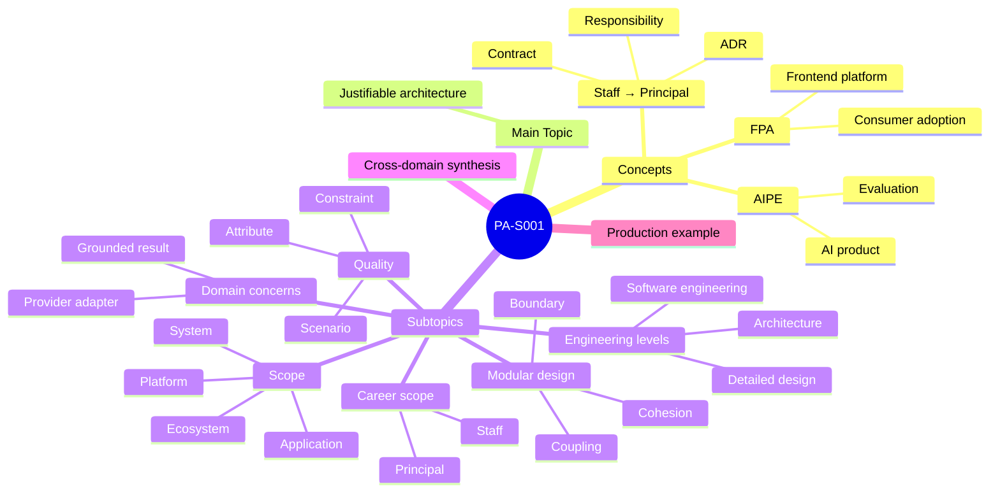

# PA-S001 — Fundamentos de ingeniería de software y arquitectura

**Fase F0 · Engineering foundations + baseline evidence · Modo Study · Teoría canónica ES**  
**Carriles:** Staff → Principal Software Engineering · Frontend Platform Architecture (FPA, arquitectura de plataformas frontend) · AI Product Engineering (AIPE, ingeniería de productos con inteligencia artificial).  
**Estado:** material de estudio, no evidencia de dominio ni implementación realizada.

> **Convención de lectura.** Los identificadores `concept` y `topic` mantienen correspondencia con la edición inglesa y permiten publicar la teoría sin volver a escribirla. Las definiciones citadas se distinguen de las **definiciones operativas** creadas para enseñar esta sesión. Los ejemplos de software son hipotéticos, salvo que se identifique una fuente externa.

## 1. Objetivo

Distinguir ingeniería de software, arquitectura y diseño; delimitar aplicación, sistema, plataforma y ecosistema; razonar sobre atributos de calidad, restricciones y límites; comprender acoplamiento/cohesión; y reconocer cómo cambian esas decisiones entre Staff → Principal, FPA y AIPE. El resultado de estudio es poder **explicar decisiones mediante mecanismos y consecuencias**, sin confundir un diagrama, una implementación o una prueba con evidencia de la cualidad esperada.

## 2. Learning Preview — qué aprenderás

**Pregunta central:** ¿cómo diseñar un sistema cuya estructura, calidad y decisiones puedan explicarse y verificarse, en vez de justificarlo solo porque “funciona”?

| Primero entenderás | Después podrás razonar sobre |
|---|---|
| Ingeniería, arquitectura, diseño, responsabilidad, contrato | Quién decide qué y qué información cruza un límite |
| Aplicación → sistema → plataforma → ecosistema, individualmente | Cómo cambia el alcance del análisis según la pregunta |
| Atributo de calidad → restricción → escenario medible | Por qué “debe ser escalable” no basta |
| Límite → acoplamiento → cohesión | Cómo se propaga un cambio entre módulos |
| FPA y AIPE como disciplinas distintas | Cuándo sus preocupaciones se conectan |
| Staff y Principal | Cómo crece el alcance de una decisión, no solo su complejidad técnica |

### Preentrenamiento: términos necesarios antes de la teoría

- **Módulo:** unidad de software que agrupa responsabilidades tras una interfaz; una carpeta por sí sola no garantiza ese límite.
- **Interfaz:** punto definido por el que un consumidor interactúa con un módulo o servicio; puede ser una función, un tipo o un contrato de red.
- **Contrato:** promesa observable sobre entradas, salidas, condiciones y errores. No equivale simplemente a una interfaz sintáctica.
- **Architecture Decision Record (ADR, registro de decisión arquitectónica):** documento breve que conserva contexto, opciones, decisión y consecuencias. Es evidencia de razonamiento documentado, no prueba de corrección del sistema.
- **International Organization for Standardization / International Electrotechnical Commission / Institute of Electrical and Electronics Engineers (ISO/IEC/IEEE):** organizaciones de normalización identificadas en referencias como ISO/IEC/IEEE 42010:2022. La norma trata **descripciones de arquitectura**, que no son la arquitectura real. [S2]
- **Mapa de rutas:** representación de qué URL o trayecto de navegación conduce a qué página; documenta una vista parcial, no toda la arquitectura.
- **Atributo de calidad:** propiedad de interés, como modificabilidad, seguridad o disponibilidad; requiere un criterio observable para evaluarse. [S3][S9]

## 3. Concepts — fundamentos separados por dominio

### 3A. Staff → Principal Software Engineering

<!-- concept: eng.responsibility -->
#### Concepto: responsabilidad (responsibility)

Una **responsabilidad** es el comportamiento o decisión que un elemento de software debe asumir y por el que se le puede exigir coherencia. Es una noción de diseño: no significa que todo lo que una clase *puede* hacer deba pertenecerle. El diseño de software asigna responsabilidades y define interfaces entre componentes. [S1]

**Ejemplo trabajado.** `ContentValidator` verifica que un capítulo cite referencias existentes; `SessionRenderer` convierte un capítulo validado en HTML. Si el renderer también corrige referencias faltantes, la responsabilidad de integridad queda repartida de manera confusa: algunos errores de contenido se convierten silenciosamente en decisiones de presentación.

**Comprueba:** ¿quién debe rechazar una cita inexistente? **Respuesta:** la responsabilidad de validación, antes de renderizar. La vista puede mostrar el error, pero no decidir que la fuente existe.

<!-- concept: eng.contract -->
#### Concepto: contrato (contract)

Un **contrato de software** define qué puede esperar un consumidor de un proveedor: formato, precondiciones, resultados, errores y compatibilidad. Un tipo de TypeScript puede restringir una forma de datos, pero no demuestra por sí solo que una respuesta de red cumple un acuerdo operativo.

```ts
// Ejemplo hipotético: contrato explícito de lectura, no prueba ejecutada.
type ReadSession = (id: string, lang: 'es' | 'en') =>
  Promise<{ id: string; title: string; sections: readonly Section[] }>;
```

Cuando cambia la forma de `sections`, importa **qué consumidor depende de ella**. Si `SessionRenderer` accede a detalles internos no incluidos en el contrato, aumenta el riesgo de cambios coordinados. **Autoprueba:** ¿por qué el tipo anterior no prueba equivalencia semántica ES/EN? Porque verifica forma, no significado.

<!-- concept: eng.adr -->
#### Concepto: decisión arquitectónica y ADR

Una **decisión arquitectónica** elige una opción que condiciona la estructura, operación o evolución de un sistema. Un **ADR** registra el razonamiento de esa elección; un ADR no es la decisión ejecutándose en producción. ISO/IEC/IEEE 42010 distingue expresamente arquitectura de descripción de arquitectura. [S2][S4]

**Ejemplo:** elegir generación estática para el Learning Site condiciona publicación, manejo de datos y actualización de contenido. Documentarlo en un ADR explica *por qué* se eligió, pero solo una inspección del sitio y sus pruebas puede mostrar lo efectivamente implementado.

> **Distinción crítica:** responsabilidad = quién se encarga; contrato = qué puede esperar otro; decisión = qué alternativa se adopta; ADR = dónde se documenta su fundamento.

### 3B. Frontend Platform Architecture (FPA)

<!-- concept: fpa.platform-architecture -->
#### Concepto: arquitectura de plataforma frontend

**Frontend Platform Architecture (FPA)** organiza capacidades y contratos frontend reutilizables entre productos: componentes, tokens, navegación, accesibilidad, publicación, telemetría y experiencia de integración. No todo conjunto de componentes compartidos constituye una plataforma: la plataforma existe en relación con consumidores, capacidades y responsabilidades de mantenimiento. Esta descripción es una **definición operativa del programa**, respaldada por la noción general de plataforma de la Cloud Native Computing Foundation (CNCF, Fundación de Computación Nativa de la Nube). [S6]

**Ejemplo:** `packages/ui` puede ofrecer `Button` y `ThemeTokens`, pero la plataforma solo resulta útil si dos productos pueden adoptarlos con documentación, compatibilidad, soporte y un procedimiento de actualización. Un paquete duplicado en ambos productos no demuestra adopción.

<!-- concept: fpa.consumer -->
#### Concepto: consumidor y contrato de adopción

Un **consumidor de plataforma** es un producto o equipo que utiliza una capacidad expuesta por la plataforma. El **contrato de adopción** explica cómo instalarla, configurar sus extensiones, recibir cambios y reaccionar ante incompatibilidades.

**Ejemplo:** `apps/portfolio` y el Learning Site podrían consumir un tema común, pero tener interfaces de navegación distintas. Forzar la misma navegación a ambos reduciría autonomía sin una necesidad del producto. **Autoprueba:** ¿tener dos consumidores demuestra automáticamente una buena plataforma? **No:** hace falta estudiar necesidades y costos de adopción.

### 3C. AI Product Engineering (AIPE)

<!-- concept: aipe.product-engineering -->
#### Concepto: ingeniería de productos con inteligencia artificial

**AI Product Engineering (AIPE)** consiste en integrar capacidades de inteligencia artificial (IA) dentro de un producto verificable y operable: comportamiento visible, contratos, control de incertidumbre, evaluación, seguridad y revisión de efectos. Es una **definición curricular**; no debe confundirse con usar un asistente de programación para desarrollar un sitio. El marco de riesgo de IA del National Institute of Standards and Technology (NIST, Instituto Nacional de Estándares y Tecnología) organiza actividades de gobernanza, mapeo, medición y gestión de riesgos. [S7]

**Ejemplo:** un asistente que propone una clasificación fiscal necesita validar la estructura de salida y justificarla con documentos; ejecutar Codex para crear componentes frontend no convierte automáticamente ese producto en un sistema con IA.

<!-- concept: aipe.evaluation -->
#### Concepto: evaluación de comportamiento de IA

Una **evaluación de IA** contrasta salidas con criterios definidos para el caso de uso. Una respuesta JSON válida demuestra conformidad **de formato**, no exactitud, pertinencia ni seguridad. Sin ejemplos evaluados y resultados observados no hay una medida de calidad que publicar.

**Ejemplo:** para 30 preguntas documentales *propuestas* habría que definir qué cuenta como cita válida, abstención correcta y error crítico; aquí no se ha ejecutado ese conjunto. **Autoprueba:** ¿puede un resultado parseable ser incorrecto? **Sí**, porque corrección de contenido y estructura son propiedades diferentes. [S7]

## 4. Main Topic — arquitectura justificable

<!-- topic: main.justifiable-system requires: eng.responsibility,eng.contract,eng.adr,fpa.platform-architecture,aipe.product-engineering -->
**Concepto del tema principal.** La **arquitectura de software** se refiere a las decisiones importantes de organización y comportamiento de un sistema, incluidos sus elementos, relaciones y restricciones de evolución. La **descripción de arquitectura** es el conjunto de representaciones con que se comunica y analiza esa arquitectura. La distinción está recogida por ISO/IEC/IEEE 42010:2022. [S2][S4]

**Pregunta guía:** si tenemos un mapa de rutas, un ADR y pruebas que pasan, ¿hemos demostrado que la arquitectura satisface sus cualidades deseadas?

**Mecanismo.** Una decisión estructural restringe qué partes pueden cambiar de forma independiente. Si `ContentValidator` acepta un capítulo y `SessionRenderer` consume solo el contrato validado, podemos evaluar el costo de sustituir el renderer sin tocar las reglas de contenido. Si ambos acceden a archivos privados directamente, una decisión de publicación puede abrir exposición accidental de datos.



**Cómo leerlo.** La flecha discontinua entre descripción y arquitectura indica una relación representacional, no de equivalencia. La evidencia se obtiene al contrastar el comportamiento real con escenarios definidos; un dibujo correcto sobre el papel no sustituye esa verificación.

**Autoprueba:** ¿qué demuestra `npm run check` cuando pasa? Solo las propiedades que sus verificaciones realmente cubren; no demuestra por sí mismo facilidad de mantenimiento, equivalencia semántica bilingüe ni dominio del estudiante.

**Respuesta a la pregunta guía:** **no**. Mapa, ADR y pruebas son fuentes de información distintas. Para afirmar que se obtuvo modificabilidad o seguridad hay que definir cómo se observará esa cualidad y reunir evidencia válida. [S3][S9]

## 5. Subtopics — conceptos individuales antes de integración

### Subtopic 1 · Ingeniería de software, arquitectura y diseño detallado

<!-- topic: engineering-levels requires: eng.software-engineering,eng.architecture,eng.detailed-design -->
**Pregunta guía:** ¿cómo reconocer si una decisión pertenece a la ingeniería del ciclo completo, a la arquitectura o al diseño interno?

<!-- concept: eng.software-engineering -->
#### 1. Ingeniería de software

La **ingeniería de software** es una disciplina que aplica un enfoque sistemático a la construcción y evolución de software, desde necesidades y requisitos hasta diseño, verificación, entrega, mantenimiento y operación. Este encuadre sintetiza áreas tratadas por el Software Engineering Body of Knowledge (SWEBOK, Cuerpo de Conocimiento de Ingeniería de Software). [S1]

**Ejemplo concreto:** decidir qué requisitos de accesibilidad debe cumplir el portal, programar una validación automatizada y corregir defectos tras su publicación forman parte de la ingeniería de software. Ninguna de esas actividades exige necesariamente cambiar la arquitectura. La disciplina incluye tanto trabajo técnico como acuerdos de proceso y verificación.

**Recuperación:** ¿un test E2E aislado es toda la ingeniería de software? **No:** es una herramienta de verificación dentro de un ciclo mucho más amplio.

<!-- concept: eng.architecture -->
#### 2. Arquitectura de software

La **arquitectura** determina la organización importante para las cualidades y evolución de un sistema: componentes, relaciones, límites y decisiones que restringen alternativas futuras. No equivale al árbol de carpetas ni a una biblioteca elegida. [S2][S4]

**Ejemplo concreto:** separar publicación estática de evaluación de aprendizaje impide que un simple cambio en la interfaz de repaso altere la fuente de evidencia L1–L5. Esa separación afecta confianza y evolución entre partes, por lo que es arquitectónica. Cambiar el icono de un botón normalmente no lo es.

**Recuperación:** ¿cuál es la pista de una decisión arquitectónica? **Respuesta:** altera relaciones, restricciones o cualidades de más de un elemento relevante a lo largo del tiempo.

<!-- concept: eng.detailed-design -->
#### 3. Diseño detallado

El **diseño detallado** especifica cómo un módulo satisface su responsabilidad mediante algoritmos, estructuras de datos e interfaces internas, dentro de los límites arquitectónicos elegidos. SWEBOK distingue el diseño arquitectónico del detallado. [S1]

**Ejemplo concreto:** `SessionRenderer` puede ordenar encabezados con una función pura y decidir si utiliza un diccionario o un array para resolver referencias. Cambiar esa estructura interna sin romper el contrato es diseño detallado, aunque siga afectando rendimiento y pruebas.

**Recuperación:** ¿todo detalle técnico es arquitectura? **No:** importan el alcance, el costo de cambiarlo y las cualidades que condiciona.

<!-- integration: engineering-levels -->
#### Comparación: son escalas relacionadas, no sinónimos

| Concepto | Pregunta que responde | Ejemplo específico | Límite |
|---|---|---|---|
| Ingeniería de software | ¿Cómo producir y evolucionar software confiable? | Requisitos, pruebas, entrega y mantenimiento del site | Incluye muchas decisiones no arquitectónicas |
| Arquitectura | ¿Qué estructura y relaciones condicionan las cualidades? | Separar validación de render y de evidencia | No especifica cada algoritmo |
| Diseño detallado | ¿Cómo implementa un módulo su comportamiento? | Algoritmo de `renderSections()` | No redefine contratos externos sin análisis |

El orden de dependencia es **requisitos → decisiones de organización → mecanismos internos**, pero el trabajo real requiere retroalimentación entre los tres niveles. **Respuesta a la pregunta guía:** clasifica por la clase de consecuencia que la decisión impone, no por la seniority de quien la tomó ni por líneas modificadas.

### Subtopic 2 · Aplicación, sistema, plataforma y ecosistema

<!-- topic: scope-model requires: scope.application,scope.system,scope.platform,scope.ecosystem -->
**Pregunta guía:** ¿cuándo nuestro Learning Site es una aplicación, cuándo analizamos un sistema y qué tendría que ocurrir para considerarlo parte de una plataforma?

<!-- concept: scope.application -->
#### 1. Aplicación (application)

Una **aplicación** es una unidad de software que ofrece funciones a usuarios o a otros sistemas para cumplir una finalidad concreta. En esta sesión la tratamos como **unidad funcional de producto**: una interfaz publicable con usuarios, entradas y comportamientos esperados. Es una definición operativa para delimitar el problema, no una definición normativa universal.

**Ejemplo:** el Learning Site permite seleccionar sesiones, leer teoría y guardar estado local de estudio. Es una aplicación incluso si se sirve como archivos estáticos. Que use `site/es` y `site/en` no la transforma por sí solo en dos aplicaciones diferentes.

**Comprueba:** ¿la aplicación incluye necesariamente todo el proveedor de hosting? **No**; eso depende de la pregunta y del límite de análisis.

<!-- concept: scope.system -->
#### 2. Sistema (system)

Un **sistema** es un conjunto de elementos que interactúan dentro de un límite seleccionado para cumplir una función y responder a un entorno. En ingeniería el sistema de interés se **delimita**, no se descubre simplemente contando directorios. La norma ISO/IEC/IEEE 42010:2022 permite describir arquitecturas de múltiples clases de entidades, incluidos sistemas y productos. [S2]

**Ejemplo:** para estudiar publicación bilingüe, el sistema de interés incluye archivos fuente ES/EN, `ContentValidator`, `SiteGenerator`, contenido SVG, salida generada y hosting. El navegador es consumidor; sus efectos importan, aunque su código no pertenezca al repositorio. El límite escogido depende de la pregunta: tiempo de build, calidad editorial o datos publicados.

**Comprueba:** ¿un sistema requiere necesariamente frontend? **No**; podría ser un proceso batch que produce reportes.

<!-- concept: scope.platform -->
#### 3. Plataforma (platform)

Una **plataforma** ofrece un conjunto de capacidades, herramientas, documentación y contratos que otros consumidores utilizan para construir, operar o entregar sus propios productos. La Cloud Native Computing Foundation (CNCF) describe las plataformas como colecciones de capacidades y recursos para desarrollo y entrega. Una plataforma se evalúa desde las necesidades de sus **consumidores**, no solamente desde la reutilización de código. [S6]

**Ejemplo:** un `packages/ui` con tema, tokens y componentes puede convertirse en capacidad de plataforma cuando Portfolio y Learning Site lo adoptan mediante interfaz pública, versionado, soporte y guía de migración. Un directorio `shared/` por sí solo no demuestra una plataforma con experiencia de adopción.

**Comprueba:** ¿una biblioteca compartida equivale automáticamente a una plataforma? **No:** necesita servicios, garantías o procesos adecuados a los consumidores concretos.

<!-- concept: scope.ecosystem -->
#### 4. Ecosistema (ecosystem)

Un **ecosistema** es la red de productos, equipos, organizaciones, proveedores y convenciones que interactúan alrededor de un sistema o plataforma. Es un **modelo contextual de análisis**, no una cuarta capa de código que debamos desplegar.

**Ejemplo:** el ecosistema del Learning Site incluye quien publica el contenido, el servicio de hosting, bibliotecas de terceros, dispositivos lectores, herramientas de evaluación y los equipos que adoptan paquetes del repositorio. Una caída del hosting puede afectar a la aplicación sin originarse en su código.

**Comprueba:** ¿todas las entidades del ecosistema están bajo un único equipo? **No:** justamente importan las dependencias y controles fuera de su autoridad.

<!-- integration: scope-model -->
#### Ahora sí: cómo se relacionan los cuatro



Las líneas describen **relaciones analíticas**, no una jerarquía obligatoria de despliegue. Una aplicación puede ser parte de un sistema mayor; una plataforma sirve a más de una experiencia; el ecosistema introduce actores y condiciones externas. La plataforma no es necesariamente un subconjunto del sistema de publicación elegido: su límite se decide por consumidores y responsabilidades.

| Dimensión | Aplicación | Sistema | Plataforma | Ecosistema |
|---|---|---|---|---|
| Pregunta principal | ¿Qué hace el producto? | ¿Qué elementos interactúan para entregar su función? | ¿Qué capacidades consumen otros? | ¿Quiénes influyen o dependen del conjunto? |
| Unidad observable | Experiencia o función | Relaciones bajo un límite | Capacidades y contratos | Actores y dependencias externas |
| Ejemplo | Lector bilingüe | Pipeline de publicación | `ThemeTokens` con adopción | Autor, proveedor de hosting y equipos |
| Confusión frecuente | “Es solo el frontend” | “Es todo el repositorio” | “Es cualquier shared package” | “Es otro microservicio” |

**Caso trabajado.** Si falla un enlace de sesión, empieza en la aplicación; si falla la generación de todos los enlaces, inspecciona el sistema; si falla el control común de navegación adoptado por varios productos, revisa la capacidad de plataforma; si cambia una política del hosting, considera la dependencia del ecosistema.

**Ejercicio parcialmente resuelto:** un proveedor de fuentes web deja de responder. ¿Afecta al comportamiento visible de la aplicación? Sí. ¿Se originó necesariamente en tu módulo frontend? **No**. Determina qué contrato de plataforma o dependencia externa absorbe el fallo.

**Respuesta a la pregunta guía:** la clasificación cambia con el **límite, la finalidad y los consumidores**. No son cuatro etiquetas intercambiables para el mismo directorio.

### Subtopic 3 · Atributos de calidad, restricciones y escenarios

<!-- topic: quality-model requires: quality.attribute,quality.constraint,quality.scenario -->
**Pregunta guía:** ¿por qué “el site debe ser confiable y rápido” no es un criterio suficiente de arquitectura?

<!-- concept: quality.attribute -->
#### 1. Atributo de calidad

Un **atributo de calidad** describe una propiedad del producto que interesa especificar y evaluar: seguridad, fiabilidad, modificabilidad, interacción o desempeño, entre otras. ISO/IEC 25010:2023 ofrece un modelo de calidad de producto con nueve características; nombrar la característica no demuestra haberla alcanzado. [S3][S9]

**Ejemplo:** la **modificabilidad** del publicador interesa porque se quieren agregar sesiones sin reescribir el renderer. Para evaluarla hay que definir qué cambio se hará, dónde y con qué criterio de éxito; “arquitectura limpia” no es una medida.

**Autoprueba:** ¿accesibilidad puede ser una preocupación de calidad sin ser un requisito funcional de una pantalla concreta? **Sí:** debe traducirse a criterios verificables según su contexto.

<!-- concept: quality.constraint -->
#### 2. Restricción

Una **restricción** limita las opciones admitidas para diseñar o construir: política, tecnología aceptada, plazo, privacidad o entorno de ejecución. A diferencia del atributo de calidad, suele actuar como una **condición que una solución debe respetar**.

**Ejemplo:** “el Learning Site debe publicarse como HTML estático sin secretos de servidor” elimina arquitecturas que requieren ejecución del servidor para leer teoría. No asegura automáticamente que el sitio sea rápido o seguro; obliga a evaluar opciones dentro del límite.

**Autoprueba:** ¿TypeScript es por sí solo un atributo de calidad? **No:** puede ser una decisión técnica/estándar o una restricción de implementación.

<!-- concept: quality.scenario -->
#### 3. Escenario de calidad

Un **escenario de calidad** convierte una cualidad abstracta en un comportamiento que puede evaluarse. El Software Engineering Institute (SEI, Instituto de Ingeniería de Software de Carnegie Mellon) utiliza escenarios definidos mediante **fuente, estímulo, entorno, artefacto, respuesta y medida de respuesta**. [S10]

**Ejemplo trabajado — integridad de publicación:** durante `npm run build`, un autor introduce una referencia inexistente `[S99]`; `ContentValidator` debe rechazar el build e identificar la sesión, referencia y ubicación antes de reemplazar la salida pública. Es un **criterio propuesto**, no un resultado observado.

<!-- integration: quality-model -->
#### Integración y ejemplo progresivamente menos guiado

| Pieza | Pregunta | Formulación del caso |
|---|---|---|
| Atributo | ¿Qué cualidad interesa? | Integridad de referencias |
| Restricción | ¿Qué opciones quedan excluidas? | Salida estática; no secretos en navegador |
| Escenario | ¿Cuándo ocurre y qué debe observarse? | Referencia inexistente → fallo claro antes de publicar |

**Ejemplo parcialmente resuelto.** Se elimina la versión inglesa de un capítulo. Completa mentalmente el **estímulo** (archivo faltante), el **artefacto** (`ContentValidator`) y la **respuesta esperada** (rechazar publicación). Falta proponer una medida verificable apropiada.

**Autoprueba:** ¿una prueba pasando acredita seguridad general? **Respuesta:** solo el comportamiento y contexto cubiertos por esa prueba. **Respuesta a la pregunta guía:** una cualidad sirve para diseñar cuando se conecta con un escenario suficientemente específico y comprobable. [S3][S10]

### Subtopic 4 · Límites, acoplamiento y cohesión

<!-- topic: module-model requires: design.boundary,design.coupling,design.cohesion -->
**Pregunta guía:** ¿cómo puede una línea de importación revelar una mala división de responsabilidades?

<!-- concept: design.boundary -->
#### 1. Límite (boundary)

Un **límite** es una separación deliberada entre responsabilidades, reglas, dependencias o niveles de confianza. Define qué información puede cruzar y qué decisiones permanecen internas. El criterio de **ocultar decisiones de diseño susceptibles de cambio** proviene de Parnas, que analiza diferentes formas de descomponer sistemas en módulos. [S5]

**Ejemplo:** el renderer recibe `ValidatedSession`, no una ruta arbitraria de archivos. El validador conserva la responsabilidad de comprobar referencias y el renderer no obtiene permiso implícito para publicar contenido privado. Una carpeta llamada `/core` no impone esa separación por sí misma.

**Recuperación:** ¿un límite equivale a una carpeta? **No:** se observa en dependencias permitidas y contratos, no en el nombre de un directorio.

<!-- concept: design.coupling -->
#### 2. Acoplamiento (coupling)

El **acoplamiento** es el grado en que un elemento necesita conocer el formato, comportamiento o detalles de otro para funcionar y evolucionar. Un acoplamiento alto puede propagar cambios; uno menor puede facilitar sustitución, aunque las dependencias útiles no desaparecen por completo. [S1][S5]

**Ejemplo:** `CheckoutPage` importa `StripePaymentClient` directamente y verifica errores específicos del proveedor. Cambiar el proveedor exige modificar la página. Si `CheckoutPage` depende del contrato `PaymentPort`, la selección del proveedor puede cambiar detrás de un adaptador, aunque se introduce una interfaz adicional que hay que mantener.

**Recuperación:** ¿cero dependencias significa siempre mejor arquitectura? **No:** sin dependencias no existe colaboración útil; hay que gestionar cuáles detalles son necesarios.

<!-- concept: design.cohesion -->
#### 3. Cohesión (cohesion)

La **cohesión** expresa cuán relacionadas están las responsabilidades que viven dentro del mismo módulo. Una unidad cohesiva agrupa operaciones que cambian por razones relacionadas; reunir comportamientos no relacionados bajo un nombre genérico dificulta el mantenimiento. [S1]

**Ejemplo:** `PaymentAdapter` conoce autorización, captura y errores de pago; no debería también decidir traducciones del frontend o calcular progreso académico. Un `UtilsService` que hace todo eso ofrece una cohesión débil aunque tenga muchos métodos reutilizados.

**Recuperación:** ¿un módulo con pocas líneas es necesariamente cohesivo? **No:** importa la afinidad de responsabilidades, no el tamaño.

<!-- integration: module-model -->
#### Integración: quién conoce qué, y qué cambia cuando falla



El contrato `PaymentPort` es un **límite explícito**; reduce conocimiento del proveedor en la página (**acoplamiento a detalle**) y deja juntas las operaciones relacionadas con pagos (**cohesión**). No elimina complejidad: añade un adaptador, pruebas de contrato y decisiones de gestión de errores.

| Cambio | Diseño acoplado al proveedor | Diseño tras un puerto |
|---|---|---|
| Nuevo error externo | UI interpreta tipo específico | Adaptador traduce a error público |
| Sustituir proveedor | Cambiar UI y llamadas | Cambiar/adaptar implementación |
| Costo adicional | Menos capas iniciales | Contrato y pruebas que mantener |

**Pregunta de recuperación:** si `PaymentPort` devuelve exactamente objetos privados de Stripe, ¿el límite protege el cambio? **No:** el nombre de la interfaz no evita filtrar detalles; el contrato debe abstraer lo que los consumidores realmente necesitan.

**Respuesta a la pregunta guía:** un import revela conocimiento y posible propagación de cambio; el riesgo se confirma estudiando *qué detalles* cruza y por qué. La propuesta de Parnas es un criterio de descomposición, no una garantía absoluta de menor costo. [S5]

### Subtopic 5 · Arquitectura de plataforma frontend y producto con IA

<!-- topic: fpa-aipe-model requires: fpa.platform-architecture,aipe.product-engineering,aipe.provider-adapter,aipe.grounded-result -->
Los dos primeros conceptos se enseñaron por separado en **Concepts**; ahora se agregan otros dos conceptos específicos antes de conectar los dominios.

<!-- concept: aipe.provider-adapter -->
#### 1. Adaptador de proveedor de modelos

Un **adaptador de proveedor** encapsula detalles de integración con un servicio de modelos: parámetros, autenticación, límites de tamaño, respuestas y fallos. En productos con IA es un límite técnico, no prueba de portabilidad instantánea: distintos proveedores pueden tener semánticas diferentes.

**Ejemplo:** `ModelGateway.generate()` acepta una solicitud interna; `ProviderAdapterA` traduce a una llamada externa; la aplicación recibe un resultado validado. Si la interfaz interna expone opciones exclusivas del proveedor, cambiarlo exige migración de consumidores.

**Recuperación:** ¿un adaptador elimina el riesgo del proveedor? **No:** concentra parte del cambio, pero no elimina costo, latencia, comportamiento ni políticas del servicio.

<!-- concept: aipe.grounded-result -->
#### 2. Resultado sustentado en evidencia

Un **resultado sustentado** es una salida cuyas afirmaciones relevantes pueden contrastarse con evidencia identificable para el caso de uso. Una cita mostrada no garantiza por sí sola que la afirmación esté respaldada; se necesita comprobar vinculación entre el resultado y las fuentes recuperadas. Es una definición operativa del programa para un flujo documental con IA, consistente con la gestión de riesgo y evaluación contextual del NIST. [S7]

**Ejemplo:** el asistente afirma que un documento contiene una fecha e incluye `evidenceIds=['doc:12#p2']`. El sistema debe verificar que el documento recuperado existe y que el contenido realmente sostiene la afirmación antes de mostrarla como respaldada.

**Recuperación:** ¿un esquema JSON válido asegura una cita verdadera? **No:** validación estructural y respaldo factual requieren verificaciones distintas.

<!-- integration: fpa-aipe-model -->
#### Comparación de responsabilidades antes de integrarlas

| Preocupación | FPA | AIPE |
|---|---|---|
| Consumidor | Equipo/app que adopta capacidades frontend | Usuario/servicio que consume resultados de IA |
| Contrato principal | Componentes, tokens, estado y accesibilidad | Solicitud, respuesta, evidencia, abstención y fallos |
| Variabilidad | Temas, marcas, versiones, navegadores | Modelos, proveedores, calidad de datos, incertidumbre |
| Riesgo | Cambios compartidos afectan varios productos | Resultados incorrectos afectan decisiones del usuario |
| Verificación | Pruebas visuales, a11y, contrato, compatibilidad | Validación de salida, evals y casos de fallo definidos |

Las preocupaciones **se conectan** cuando un producto frontend muestra respuestas de IA: la plataforma ofrece una experiencia accesible de carga/error; AIPE define qué respuesta puede considerarse sustentada y cuándo debe abstenerse. Ninguno de esos ámbitos sustituye la evaluación del otro.

### Subtopic 6 · Alcance Staff y Principal

<!-- topic: career-scope requires: career.staff,career.principal -->
**Pregunta guía:** ¿qué cambia cuando una decisión deja de afectar a un equipo y empieza a condicionar varios productos y equipos?

<!-- concept: career.staff -->
#### 1. Staff Software Engineer

En este programa, un **Staff Software Engineer** lidera decisiones técnicas con consecuencias que pueden superar una tarea o un componente: integra perspectivas, revisa trade-offs, acompaña implementación y construye acuerdos entre participantes. La amplitud real varía entre organizaciones; esto es un **modelo curricular**, no una equivalencia universal de títulos.

**Ejemplo:** facilitar un acuerdo entre los propietarios de `ContentValidator` y `SessionRenderer` sobre errores publicados, contrato y cobertura de pruebas. La contribución no es solamente escribir el validador, sino clarificar la decisión y su adopción.

**Recuperación:** ¿Staff implica no implementar? **No:** el valor del rol no se mide por abandonar el código.

<!-- concept: career.principal -->
#### 2. Principal Software Engineer

Un **Principal Software Engineer** suele influir en decisiones que atraviesan varias capacidades, equipos o sistemas, tratando compatibilidad, estrategia de evolución y riesgos organizacionales. Es un modelo contextual: por ejemplo, GitLab describe expectativas de alcance organizacional y coordinación entre equipos para su propio cargo de Principal; otros empleadores pueden usar límites distintos. [S8]

**Ejemplo:** definir una política de compatibilidad de contratos compartidos para Learning Site, Portfolio y futuros laboratorios, con ruta de migración, excepciones y propietarios. Una propuesta sin adopción observada es una decisión diseñada, **no evidencia de liderazgo ejercido**.

**Recuperación:** ¿crear un ADR en un repositorio personal demuestra liderazgo Principal real? **No:** documenta razonamiento; la influencia requiere evidencia contextual.

<!-- integration: career-scope -->
#### Integración de alcance y consecuencias

| Dimensión | Staff (modelo de aprendizaje) | Principal (modelo de aprendizaje) |
|---|---|---|
| Unidad de decisión | Subsistema/producto y colaboraciones cercanas | Conjunto de sistemas y acuerdos entre equipos |
| Producto durable | Contrato, diseño o revisión aplicada | Estándar, estrategia, gobernanza y migración |
| Riesgo típico | Resolver localmente y desplazar el problema | Uniformar demasiado y restringir autonomía |
| Evidencia útil | Pruebas, cambios, acuerdos revisados | Adopción, consecuencias y decisiones sostenidas |

**Respuesta a la pregunta guía:** aumenta el **radio de consecuencia y coordinación**; no basta aumentar la complejidad del código.

## 6. Integración entre dominios — Cross-Domain Synthesis

Solo ahora se mezclan los tres carriles, porque cada uno ya definió sus objetos de decisión.

**Situación hipotética:** un producto documental añade una función de recomendación asistida por IA y reutiliza componentes de plataforma frontend. FPA decide cómo exponer carga, estados, accesibilidad y compatibilidad; AIPE decide contratos de modelo, citas, abstención y evaluación; Staff/Principal decide límites entre equipos, prioridades, decisiones transversales y evolución.



**Fallo compartido:** si un proveedor de modelos no responde, AIPE clasifica la falla y define resultado seguro; FPA presenta un estado comprensible para teclado y lector de pantalla; Staff/Principal acuerda política compartida de degradación y quién mantiene su contrato. Nadie puede afirmar disponibilidad, accesibilidad o exactitud sin pruebas pertinentes.

## 7. Theory → Practice Map (sin implementar todavía)

| Concepto aprendido | Manifestación futura posible | Qué habría que verificar | Dominio principal |
|---|---|---|---|
| Aplicación/sistema/plataforma/ecosistema | `apps/portfolio/`, `site/`, paquetes y hosting | Límites claros, consumidores y dependencias | Staff / FPA |
| Responsabilidad y contrato | `ContentValidator → ValidatedSession → Renderer` | Error de referencia y compatibilidad de datos | Staff |
| Atributo/restricción/escenario | Build estático con referencia inválida | Fallo identificable antes de publicación | Staff / FPA |
| Acoplamiento/cohesión/límite | `PaymentPort`, adaptador y consumidor | Sustitución controlada y pruebas de contrato | Staff / FPA |
| Resultado sustentado y evaluación | Propuesta de revisión documental con IA | Citas, abstención, criterios de evaluación | AIPE |

## 8. Time Breakdown (estimaciones, no mediciones)

| Estudio | Tiempo sugerido |
|---|---|
| Conceptos por dominio | 40–60 min |
| Main Topic y subtemas 1–3 | 60–90 min |
| Subtemas 4–6 e integración | 60–90 min |
| Caso de producción y Visual Learning Studio | 35–50 min |
| Ejercicios, recuperación y revisión de fuentes | 45–75 min |

## 9. Real-World Example — marco publicado, no proyecto del alumno

El handbook público de GitLab describe al nivel Principal con un alcance organizacional, coordinación entre equipos y participación en decisiones de arquitectura. Es un **ejemplo documentado de una empresa concreta**, no una definición universal de Principal ni evidencia del progreso del learner. [S8]

**Lectura arquitectónica:** una misma decisión de contrato puede necesitar una solución técnica local y, cuando se comparte, una política de adopción y excepciones. El marco ayuda a diferenciar la profundidad de una solución y la amplitud de su influencia. No demuestra que un programa personal tenga usuarios internos ni equipos adoptantes.

## 10. Production-Ready Example — diseño construido, no producción verificada

**Contexto hipotético.** Una plataforma de revisión de documentos recibe una solicitud, recupera fragmentos autorizados, solicita a un modelo un borrador, verifica estructura y referencias, y entrega una recomendación a revisión humana. El requisito central es **no mostrar como sustentada una recomendación sin evidencia verificable**.



**Ruta normal.** `ReviewAPI` confirma autorización; `EvidenceRetriever` entrega fragmentos; `ModelGateway` produce una propuesta; `EvidenceValidator` comprueba estructura e identificadores; `ReviewUI` presenta evidencia y conserva una acción explícita del revisor humano.

**Fallo concreto.** Si `EvidenceRetriever` devuelve cero fragmentos o las citas no pertenecen al conjunto autorizado, `ReviewAPI` no publica una conclusión como respaldada. Devuelve `insufficient_evidence` y un motivo no sensible; el usuario puede solicitar información adicional.

```ts
// Ejemplo de contrato propuesto: no implica que exista una implementación.
type ReviewResult =
  | { kind: 'supported'; draft: string; evidenceIds: readonly string[] }
  | { kind: 'insufficient_evidence'; reason: 'no_context' | 'invalid_citation' };
```

**Verificación por ejecutar:** pruebas de contrato para identificadores de cita, aislamiento entre usuarios, ausencia de documentos en telemetría, navegación por teclado y simulación de proveedor no disponible. **Límites:** validar `evidenceIds` no prueba por sí solo que un texto respalde semánticamente cada afirmación; la evaluación contextual sigue siendo necesaria. [S7]

## 11. Visual Learning Studio — representaciones de repaso, no sustitutos de teoría

### Modo obligatorio: mapa mental de toda la sesión



Este Mermaid es la **fuente conceptual** para el futuro SVG durante Build. El mapa cubre los conceptos y seis subtemas, pero la explicación extensa permanece en las secciones anteriores.

### Modo adaptativo: matriz para elegir el límite de análisis

| Problema | Primero analiza | Luego amplía hacia |
|---|---|---|
| El botón no responde | Aplicación | Contrato y comportamiento del módulo |
| No se publican capítulos | Sistema | Generador, fuentes, hosting |
| Tres productos requieren tema común | Plataforma | Adopción, compatibilidad, gobierno |
| El proveedor externo cambia política | Ecosistema | Dependencias, alternativas, contingencia |

### Modo obligatorio: flashcards de recuperación

Las tarjetas tienen **pregunta frontal**, **respuesta y explicación posterior** y **sección fuente**. En `site/`, Codex publicará flip, anterior/siguiente, contador, teclado, fallback sin JavaScript y movimiento reducido usando exactamente estas respuestas; no redactará otras.

| ID estable | Frente | Reverso (respuesta + por qué) | Sección fuente |
|---|---|---|---|
| `fc.eng.responsibility` | ¿Quién debería rechazar una referencia faltante? | ContentValidator. Esa es su responsabilidad; el renderer presenta contenido validado, no inventa fuentes. | Concepts / Staff |
| `fc.eng.contract` | ¿Qué garantiza un contrato que un tipo no puede garantizar por sí solo? | El comportamiento observable y semántico, incluidos errores y compatibilidad; un tipo solo restringe formas estáticas. | Concepts / Staff |
| `fc.eng.adr` | ¿Un ADR demuestra que una decisión funciona? | No. Documenta contexto, opciones y consecuencias; hacen falta pruebas y observación para acreditar comportamiento. | Concepts / Staff |
| `fc.fpa.platform-architecture` | ¿Qué hace que una biblioteca frontend sea capacidad de plataforma? | Consumidores reales, contrato público, adopción, compatibilidad y soporte; no basta compartir archivos. | Concepts / FPA |
| `fc.fpa.consumer` | ¿Por qué dos consumidores no deberían compartir forzosamente toda la navegación? | Pueden tener requisitos de producto diferentes; el contrato compartido debe preservar variaciones legítimas. | Concepts / FPA |
| `fc.aipe.product-engineering` | ¿Por qué usar Codex no convierte automáticamente un producto en IA? | Codex ayuda a desarrollar; un producto de IA integra comportamiento modelado, controles, evaluación y responsabilidad hacia usuarios. | Concepts / AIPE |
| `fc.aipe.evaluation` | ¿Una respuesta JSON válida equivale a una respuesta correcta? | No. Validez de estructura y corrección de contenido se verifican con criterios distintos. | Concepts / AIPE |
| `fc.eng.software-engineering` | ¿Por qué ingeniería de software incluye más que arquitectura? | Abarca requisitos, verificación, entrega, mantenimiento y operación, además de decisiones estructurales. | Subtopic 1 |
| `fc.eng.architecture` | ¿Cómo distinguir arquitectura de un cambio visual menor? | Arquitectura impone relaciones/restricciones de largo alcance; un icono local normalmente no cambia esos acuerdos. | Subtopic 1 |
| `fc.eng.detailed-design` | ¿Cuándo elegir un diccionario frente a array es diseño detallado? | Cuando resuelve un mecanismo interno sin modificar límites o contratos externos relevantes. | Subtopic 1 |
| `fc.scope.application` | ¿Qué convierte al Learning Site en aplicación? | Proporciona una función al lector; servir archivos estáticos no elimina su naturaleza de aplicación. | Subtopic 2 |
| `fc.scope.system` | ¿Por qué el build pertenece al sistema de publicación? | Interactúa con fuentes, validación y entrega para producir salida; el límite depende de la pregunta. | Subtopic 2 |
| `fc.scope.platform` | ¿Por qué shared/ no demuestra una plataforma? | Una plataforma tiene consumidores, capacidades, contratos y adopción; un directorio no establece esas relaciones. | Subtopic 2 |
| `fc.scope.ecosystem` | ¿Qué aporta el ecosistema que el repositorio no muestra? | Proveedores, usuarios, organizaciones y fallos externos al control del equipo. | Subtopic 2 |
| `fc.quality.attribute` | ¿Por qué “modificable” no es todavía una medida? | Nombra una cualidad; faltan cambio, contexto, respuesta y criterio observable. | Subtopic 3 |
| `fc.quality.constraint` | ¿HTML estático es una cualidad o una restricción? | Es una restricción de arquitectura/entrega; no demuestra por sí misma seguridad ni rendimiento. | Subtopic 3 |
| `fc.quality.scenario` | ¿Cuáles son las piezas de un escenario de calidad? | Fuente, estímulo, entorno, artefacto, respuesta y medida; conectan cualidad con verificación. | Subtopic 3 |
| `fc.design.boundary` | ¿Por qué una carpeta core no garantiza un límite? | Los límites se expresan en dependencias, acceso permitido y contratos reales. | Subtopic 4 |
| `fc.design.coupling` | ¿Puede PaymentPort seguir acoplado a Stripe? | Sí: cuando devuelve errores u objetos internos de Stripe filtra detalles del proveedor. | Subtopic 4 |
| `fc.design.cohesion` | ¿Por qué UtilsService puede tener baja cohesión? | Agrupa responsabilidades no relacionadas que cambian por motivos diferentes. | Subtopic 4 |
| `fc.aipe.provider-adapter` | ¿Un adaptador de modelos garantiza cambiar de proveedor sin esfuerzo? | No. Centraliza traducción técnica, pero quedan diferencias semánticas, costos y políticas. | Subtopic 5 |
| `fc.aipe.grounded-result` | ¿Por qué evidenceIds válidos no prueban que una conclusión sea verdadera? | Identifican fuentes; hace falta comprobar que su contenido realmente sustenta la afirmación. | Subtopic 5 |
| `fc.career.staff` | ¿Un Staff necesita dejar de programar para liderar? | No. El alcance viene de decisiones, colaboración y consecuencias, no del abandono del código. | Subtopic 6 |
| `fc.career.principal` | ¿Por qué un ADR personal no prueba influencia Principal? | Registra razonamiento, pero no demuestra adopción y efecto coordinado entre equipos. | Subtopic 6 |
| `fc.main` | ¿Un ADR y un build correcto prueban la cualidad deseada? | No: describen decisiones y pruebas acotadas. Se necesita un escenario con evidencia pertinente. | Main Topic |

**Autoexplicación:** sin mirar arriba, explica en 60 segundos por qué aplicación, sistema, plataforma y ecosistema no se sustituyen entre sí. La respuesta correcta debe mencionar **función, límite, consumidor y actores externos**.

## 12. Exercises — trabajo de estudio (no evidencia ya completada)

- [ ] **`PA-S001:exercise:atomic-scope`** — Escribe cuatro definiciones distintas de aplicación, sistema, plataforma y ecosistema usando el mismo producto documental. Después dibuja sus relaciones.
- [ ] **`PA-S001:exercise:quality-scenario`** — Construye un escenario de calidad con sus seis partes. Clasifica aparte la restricción técnica.
- [ ] **`PA-S001:exercise:contract-change`** — Compara dos diseños de `PaymentClient`: uno acoplado a un proveedor y otro mediante puerto. Di qué cambio afecta a qué módulo.
- [ ] **`PA-S001:exercise:adr-critique`** — Redacta qué demuestra y qué no demuestra un ADR, un build correcto y una prueba de contrato.
- [ ] **`PA-S001:exercise:ai-failure`** — Propón una respuesta de abstención para una recomendación sin evidencia y explica responsabilidades de FPA/AIPE/Staff.
- [ ] **`PA-S001:exercise:teach-back`** — Explica oralmente dos decisiones con ejemplo concreto, mecanismo, trade-off y criterio verificable.

## 13. Curated Sources and References

- **[S1]** IEEE Computer Society, *Guide to the Software Engineering Body of Knowledge (SWEBOK)*, capítulo de diseño de software (consulta de concepto/alcance). https://swebokwiki.org/Chapter_2%3A_Software_Design
- **[S2]** ISO/IEC/IEEE, *42010:2022 — Software, systems and enterprise — Architecture description* (distinción arquitectura/descripción). https://www.iso.org/standard/74393.html
- **[S3]** ISO/IEC, *25010:2023 — Product quality model* (modelo de calidad de producto). https://www.iso.org/standard/78176.html
- **[S4]** Carnegie Mellon Software Engineering Institute, *Software Architecture* (estructura, comportamiento y cualidades). https://www.sei.cmu.edu/software-architecture/
- **[S5]** D. L. Parnas (1972), *On the Criteria to Be Used in Decomposing Systems into Modules*, *Communications of the ACM*, 15(12), 1053–1058. https://doi.org/10.1145/361598.361623
- **[S6]** Cloud Native Computing Foundation, TAG App Delivery, *Platforms Glossary* (plataforma y consumidores). https://tag-app-delivery.cncf.io/wgs/platforms/glossary/
- **[S7]** National Institute of Standards and Technology (2023), *AI Risk Management Framework (AI RMF 1.0)*. https://nvlpubs.nist.gov/nistpubs/ai/NIST.AI.100-1.pdf
- **[S8]** GitLab, *Engineering Career Framework: Principal* (marco contextual, no universal). https://handbook.gitlab.com/handbook/engineering/careers/matrix/principal/
- **[S9]** Software Engineering Institute, *Quality Attributes* (atributos y análisis arquitectónico). https://sei.cmu.edu/library/quality-attributes/
- **[S10]** Carnegie Mellon Software Engineering Institute, *Quality Attribute Workshop and Scenario Documentation*, escenarios de calidad de seis partes. https://www.sei.cmu.edu/documents/2056/2004_004_001_14348.pdf

> **Rigor de fuentes:** aquí se citan las descripciones públicas y documentos identificados; la norma ISO completa puede requerir acceso de pago. Ningún ejemplo hipotético, duración propuesta o diseño futuro se presenta como resultado medido.

## 14. Resources — cómo estudiar sin dispersarse

Empieza por [S1] para diseño, [S2] para separar arquitectura de descripción, [S3] para calidad y [S5] para modularidad. Usa [S6] cuando llegues a plataforma y [S7] para entender por qué los sistemas con IA necesitan evaluación del riesgo. El marco [S8] sirve para comparar alcances profesionales, no para deducir nivel individual.

## 15. Knowledge Mastery Checklist — autoseguimiento, no nivel otorgado

- [ ] **`PA-S001:mastery:distinguish-levels`** — Explico ingeniería, arquitectura y diseño con un cambio concreto de cada tipo.
- [ ] **`PA-S001:mastery:scope-four`** — Defino aplicación, sistema, plataforma y ecosistema por separado y luego los comparo sin confundir sus límites.
- [ ] **`PA-S001:mastery:quality`** — Distingo atributo, restricción y escenario de calidad verificable.
- [ ] **`PA-S001:mastery:modularity`** — Explico un límite y un cambio que revela acoplamiento/cohesión con componentes nombrados.
- [ ] **`PA-S001:mastery:domain-lanes`** — Distingo los objetivos de Staff→Principal, FPA y AIPE antes de integrarlos.
- [ ] **`PA-S001:mastery:evidence`** — Distingo diseño propuesto, prueba ejecutada y evidencia real de una cualidad.

Marcar casillas expresa **estado de estudio**. No adjudica automáticamente L1 Explain, L2 Implement, L3 Operate, L4 Decide ni L5 Lead.

## 16. End-of-Session Success Criteria — para evaluar al terminar el aprendizaje

- [ ] Los conceptos atómicos de cada subtema se pueden explicar sin depender de la tabla integradora.
- [ ] El mapa y las tablas no contradicen las definiciones ni confunden dominio/alcance.
- [ ] Puedo justificar un contrato y su consecuencia ante un cambio o fallo.
- [ ] Puedo proponer cómo verificar una cualidad sin fingir resultados.
- [ ] Distingo resultados de una herramienta de IA de evidencia de calidad del producto.

## 17. Bridge → PA-S002

PA-S002 lleva estas distinciones al repositorio: **monorepo frente a polyrepo**, workspace, aplicación, paquete, grafo de dependencias, interfaces públicas y estándares/quality gates. La sesión siguiente puede iniciarse sin esperar un estado *Completed*; las dudas de PA-S001 quedan abiertas para repaso.
