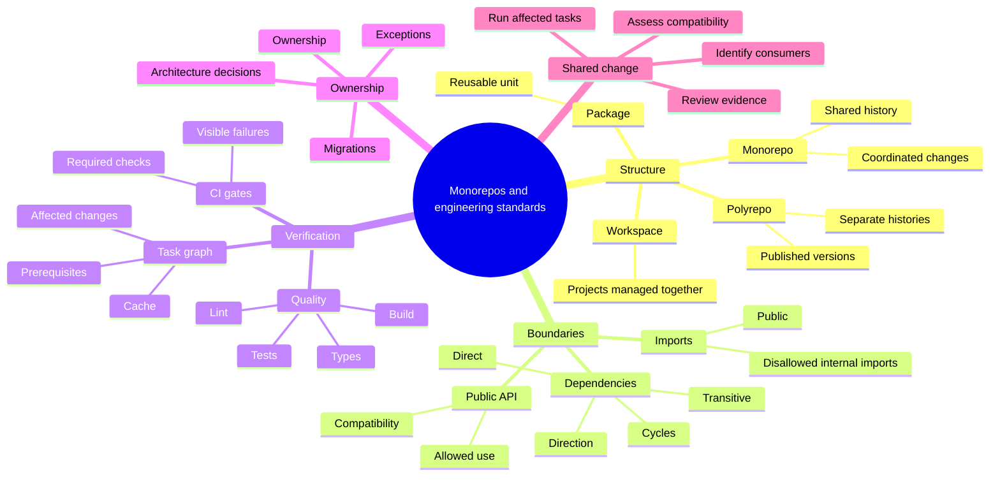
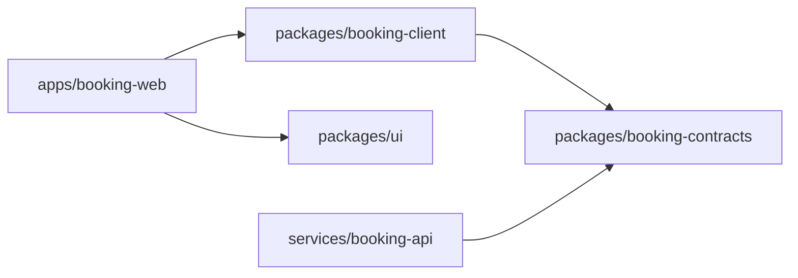
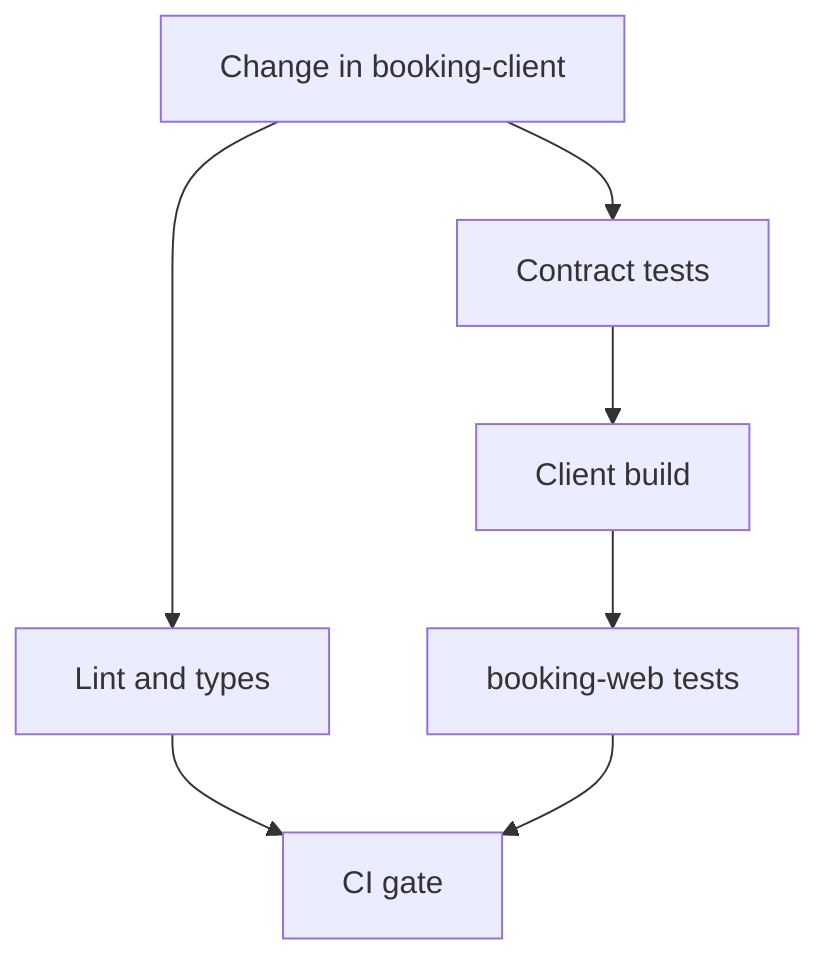
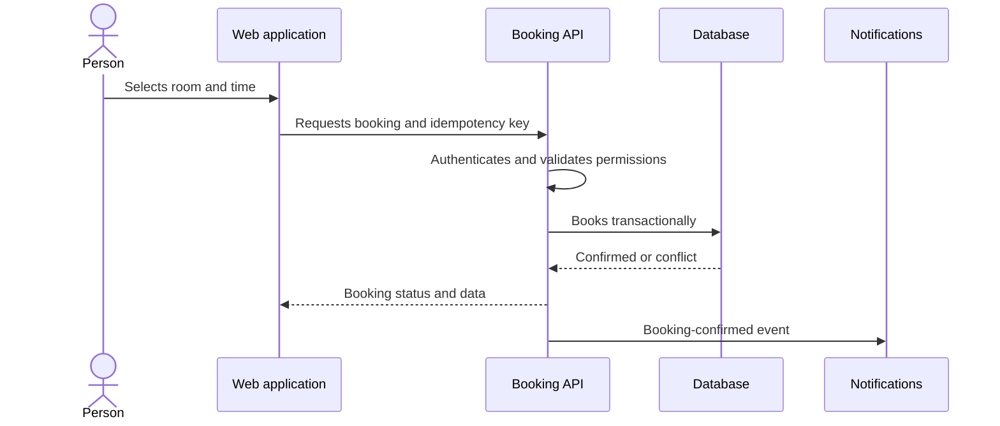
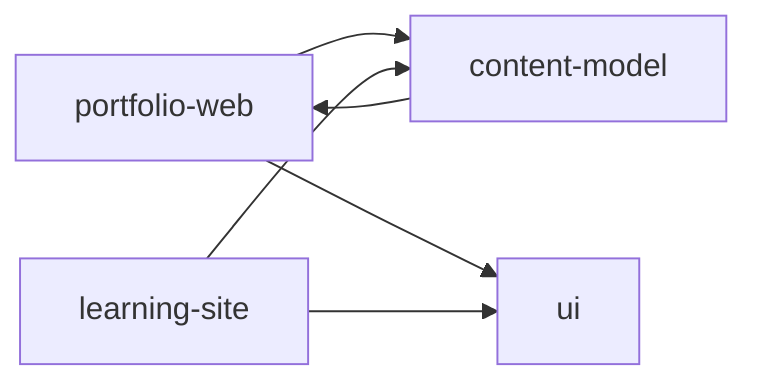

F0 · PA-S002 · Staff → Main / Frontend Platform Architecture / Product Engineering with AI
**Phase:** editorial inventory · **Status:** pending review

## Concepts by professional field

### Staff → Main

* **Engineering standard:** agreement that defines an expected technical practice and how to test it. For example, a team can set packages to import dependencies from their public APIs and add a check that detects disallowed internal imports.
* **Technical governance:** process by which teams propose, adopt, review and, when appropriate, exempt standards. Its purpose is to maintain useful and consistent rules as projects grow and new needs arise.
* **Accountability for change:** clarity on who reviews, maintains and decides on a component or contract. When a modification affects multiple packages, applications, or computers, it allows you to identify the people who must evaluate its impact.

### Frontend Platform Architecture

* **Consumer:** application or package that uses an interface offered by another component. For example, an application can consume a visual component package or a shared client to communicate with an API.
* **Public contract:** set of inputs, outputs and behaviors that a package declares available to its consumers. If the contract is well defined, consumers can use it without knowing the internal organization of the package.
* **Compatibility:** ability to change the implementation of a component while preserving the uses supported by its consumers. An internal reorganization may be supported if the public API maintains the same behavior; removing a required field could break those who depended on it.

### Product Engineering with AI

* **Evaluation Package:** An organized set of examples, test data, and criteria to test an AI capability. It can be used to observe whether a modification to the model, instructions or integration maintains adequate results in representative cases.
* **Data limit:** rule that determines what information a component can query, transmit, or retain. In an AI product, you can specify what data reaches the function, which user can access it, and what restrictions must be respected.
* **Behavior change:** Observable variation in the results of a function, even though the compile code and interfaces have not changed. For example, an update to the model or instructions could alter the quality of a summary; That change requires specific evaluation, in addition to the usual software testing.

---

# Monorepos and engineering standards: organize code, dependencies and quality

## Provisional synthesis in 30 seconds

1. A shared repository makes it easier to coordinate changes, but its folder structure alone does not establish architectural boundaries.
2. Dependencies, public interfaces, and boundary testing make those boundaries testable.
3. Standards and continuous integration need owners, exceptions and evidence to hold up across teams.

**Objective.** To be able to decide when it is appropriate to gather projects in a monorepo, design its limits and verify that the changes respect technical contracts without losing existing capabilities.

**Guiding questions.** What is gained and what is committed against various repositories? What prevents an improper import? What tests should be run when faced with a change? Who maintains the rules and resolves their exceptions?

## Preview and concepts by scope

The route will be: **concepts → main topic → seven subtopics → integration between areas → theory to practice → real case → production design → Studio → exercises → sources, criteria and bridge**.

* **Staff → Main.** "Engineering standard: technical agreement that defines a verifiable practice." "Technical government: process to adopt, review and except these agreements." "Change responsibility: identification of who reviews and maintains a contract."
* **Frontend Platform Architecture.** «Consumer: application or package that uses a shared interface». "Public contract: inputs, outputs and behavior that a consumer can use without depending on internal details." "Compatibility: ability to change an implementation without breaking supported uses."
* **Product Engineering with AI.** «Evaluation package: code and test data that verify an AI capability». “Data limit: A rule that restricts what information a component can access or share.” "Behavior change: observable variation in results that requires evaluation even if the code compiles."

These brief definitions set the scope of the inventory. The concepts will be developed within the topic and the subtopics where they intervene.

## Parent topic — From shared repository to testable limits

* "Monorepo: a repository that brings together the code of several related projects."
* «Polyrepo: organization in several repositories, usually with their own cycles and controls».
* «Repository: code versioning unit and its history».
* «Architectural border: rule that determines what one module can know or use from another».
* "Verifiable standard: rule whose application can be observed by review or testing."

The chapter will contrast both organizations under concrete conditions and will follow a shift from a shared interface to its consumers, tests, and controllers. Comparison will not assume that one organization is superior in all contexts.

## Planned subtopics

| Subtopic | Local concepts to be taught |
| ------------------------------------------------- | ---------------------------------------------------------------------------------------------------------------------------------------------------------------------------------------------------------------------------------------------------------------------------------------------------------------------------------------------------------------------------------------- |
| **1. Repositories and borders** | "Code visibility: ability to discover implementations and uses." "Isolation: restriction of access or change between projects." "Coordinated change: joint modification of producer and consumers." "Logical frontier: separation required by contracts and rules, even if the code shares a repository."                                                                             |
| **2. Workspaces, applications and packages** | "Workspace: local project registered to be managed together with others." «Application: executable product oriented to a use». "Package: reusable unit with name, dependencies and interface." "Public API: surface area allowed for consumers." "Deep import: direct access to an internal file that bypasses the supported interface."                                                      |
| **3. Graph and direction of dependencies** | «Dependency graph: representation of modules and use relationships». "Direct dependence: relationship declared by a consumer with his supplier." "Transitive dependency: relationship that arrives through another module." "Cycle: chain of dependencies that returns to its origin." "Direction rule: restriction on which layers can depend on which."                                        |
| **4. Task and construction graph** | "Build task: operation that produces or verifies an artifact." "Prerequisite: task whose result is needed before another." "Affected change: modification that can alter a consumer or their output." "Task cache: reuse of a result under defined input conditions." "Reproducible artifact: output that can be reconstructed with controlled inputs and tools." |
| **5. Policies and quality gates** | "Lint: automated code rule checking." «Type checking: compatibility analysis between declared types and uses». "Bounds testing: verification of allowed imports and dependencies." "Continuous integration: automated execution of checks for changes." "Gate: condition that must be met to advance in the integration flow."                                |
| **6. Contracts for frontend and products with AI** | "Consumer compatibility: preserving supported uses when changing a package." "Data contract: form, permissions and meaning of the information exchanged." "Evaluation fixture: input and expected result that allow a behavior to be reviewed." "Regression testing: checking that a change preserves a previous property."                                             |
| **7. Ownership and evolution of standards** | "Ownership: explicit responsibility for maintenance and review." "Documented exception: justified, limited and reviewable deviation from a rule." "Migration: planned transition of producers and consumers." "Architectural decision: context registration, alternatives, choice and consequences."                                                                                   |

**Integration planned.** A modification to a frontend package may require coordinated updating of consumers; If the package involves an AI function, it may also require permission testing and results evaluation. The tests that detect each type of change will be distinguished.

## Real candidate case and resources

**Documented case: Google's monolithic repository.** Potvin and Levenberg describe their repository and the working systems that make it viable; The study by Jaspan et al examines advantages and trade-offs of monorepo and multiple repositories, including visibility, dependency management, access control, and tooling flexibility. The chapter will attribute only the mechanisms that support those publications; It will not transfer Google's scale or internal tools to our project. [Google Research Publication: Potvin and Levenberg](https://research.google/pubs/why-google-stores-billions-of-lines-of-code-in-a-single-repository/) · [Google Research Publication: Jaspan et al](https://research.google/pubs/advantages-and-disadvantages-of-a-monolithic-codebase/).

**Planned technical readings:** [npm Workspaces documentation](https://docs.npmjs.com/cli/using-npm/workspaces/) for the relationship between local packages; [GitHub branch protection documentation](https://docs.github.com/en/repositories/configuring-branches-and-merges-in-your-repository/managing-protected-branches) to see how status checks are enforced. Your application will depend on the tools and the provider that reveals the actual repository.

## Production design and visual learning planned

**External reference design, not yet verified:** A hypothetical reservation platform with web application, component package, API client and reservation service. Actors, request/response/error contracts, data and invariant of not duplicating a reservation will be specified; authentication and authorization; concurrence and idempotence; network failures and dependencies; contracts and limits testing; deployment, observability and rollback. Its function will be to test packet and gate decisions in a specific system. **It is a proposed design: there is no implementation or tests executed.**

**Visual Learning Studio intended:** Mermaid mind map covering concepts, topic and all subtopics, published as accessible SVG; cards with question, explained answer and source for the same coverage. A monorepo/polyrepo table, a dependency graph and a task flow will be added along with the explanation. A prediction activity will show which consumers and checks would be affected by changing an API; its model and limits should be explained. There will be reading and responses available without JavaScript.

**Planned exercises:** classify repository versus border; detect an improper import and a cycle; derive tasks affected by a change; choose gates in the face of a specific failure; and defend a policy exception with review conditions. Each exercise will have a reasoned solution and observable criteria.

## Theory → practice and expected results

**Proposed technical product — extension:** evolve the Accelerator repository into workspaces and packages with public interfaces, import rules, conventions, lint, type checking, tests and continuous integration pipeline. Git, applications, and Technology Radar will be inspected first; existing functional capabilities will be preserved. The project map explicitly maps this result to the session.

**Separate publication:** chapter and project page in Spanish and English within `site/`, once its contents have been written and approved. The publication does not replace the technical product. The exact package structure, workspace manager, and CI provider remain undecided: they cannot be determined with the available information, because this space contains source documents, but not the application's Git repository.

**Evidence of intended acceptance:** local and CI execution of lint, types, tests and build; negative test that fails due to a prohibited import; positive proof of consumption by public API; verification that Portfolio and Learning Site retain their functions; `git diff` review and real results. No gate will be considered approved before it is executed.

**Estimated time, not measured:** preview 25 min + main topic 60 min + seven subtopics × 35 min = 245 min + cases 60 min + Studio and exercises 45 min + practice 120 min + review 30 min = **585 min (9 h 45 min)**. It assumes an accessible code base without unforeseen migrations; if that condition fails, the estimate changes.

## Editorial status and verification

| Block | State |
| ----------------------------------------------------------------------------------------------------------------------------- | ------------- |
| Inventory, concepts, main topic and subtopics 1–7 | **PENDING** |
| Integration, theory → practice, time, real case and production design | **PENDING** |
| Studio, exercises, sources, resources, checklist, success criteria and bridge to Portfolio architecture and Learning Site | **PENDING** |

**Main conclusion:** a session on repository decisions, verifiable boundaries and sustainable standards is delimited; It is not yet approved theory or implementation.

**Confirmed facts:** the roadmap requires the listed topics and the application map proposes extending the monorepo; The cited publications document Google's case. **Assumptions and inferences:** The division into seven subtopics and the duration are editorial proposals. **Uncertainties and limitations:** the actual repository, its tools and test execution are missing. **Confidence level: high** in the documentary scope and limited attribution of the case; **low** on any implementation details or actual duration. **How ​​to check:** Review inventory, inspect Git and existing tools, and run gates and preserve tests where appropriate.

---

# From shared repository to testable limits

## Synthesis in 30 seconds

1. A shared repository makes it easier to coordinate changes, but its folder structure alone does not establish architectural boundaries.
2. Dependencies, public interfaces, and boundary testing make those boundaries testable.
3. Standards and continuous integration need owners, exceptions and evidence to hold up across teams.

## Aim

Being able to decide when it is appropriate to gather projects in a monorepo, design its limits and verify that the changes respect technical contracts without losing existing capabilities.

## Theme concepts

**Repository** is the versioning unit of the code and its history. **Monorepo** brings together the code of several projects in a repository. In a **polyrepo** model, projects live in separate repositories.

The difference is in the unit where history and changes are coordinated. Putting projects in a common repository does not automatically define how their modules should be related. Nor does keeping them separate guarantee that your contracts are well designed.

An **architectural boundary** defines what one component can use from another and through what contract. A folder or repository organizes files, but does not necessarily impose that boundary. For the rule to have effect, it must be observable in the code or in the change process.

A **verifiable engineering standard** is a rule whose application can be observed by review or testing. A guide can explain the standard; An associated verification allows detecting if a change violates it.

## How producer and consumer coordinate

Let's imagine that a web application consumes a package of components. The package is the **producer** of a shared interface; the application is your **consumer**. A public API determines the supported inputs and the behavior that the producer promises to preserve.

* In a monorepo, package and application can change together in the same revision.
* In polyrepo, the package is usually published as a version and the application updates its dependency in another repository.

Co-changing can simplify a coordinated upgrade. Updating through releases can give each project more independence from tools and integration cycle. In both cases, appropriate contracts and verifications are needed.

A study published by Google Research identifies benefits and trade-offs of both models. Among the advantages of the monolithic repository, its authors describe code visibility, API discovery and centralized dependency management. For multiple repositories, they mention flexibility in tools, access control, and stability. These findings document analyzed experiences; They do not prove that a model is always better. [Potvin and Levenberg, 2016](https://research.google/pubs/why-google-stores-billions-of-lines-of-code-in-a-single-repository/) · [Jaspan et al., 2018](https://research.google/pubs/advantages-and-disadvantages-of-a-monolithic-codebase/).

## A public contract versus internal details

Suppose the component package exposes a button using this entry:

```ts
import { Button } from "@acme/ui";
```

The application depends on the interface published by the package. If you directly import an internal file—for example, `@acme/ui/src/button/private-renderer`—it is coupled to a deployment decision. If the producer reorganizes its internal files, that consumer could break even though the public API remains the same.

A verifiable rule could state that applications only import shared packages using their public entries. For the boundary to be testable, the package must identify its supported entries and there must be an automatic check or test that detects direct access to internal files.

## Coordinated change: add a variant

Suppose the team needs to add an `variant` property to the `Button` component. The change involves the package that defines the component and its consumers.

1. The producer extends the public contract and preserves the previous behavior for consumers that do not yet send `variant`.
2. The app updates its usage if you need the new variant.
3. Package tests check the behavior of supported variants.
4. A bounds test checks that the application does not import the private implementation.
5. Continuous integration reports whether the change meets the configured gates.

Coordinated change allows producer and consumer to review together. The repository structure alone does not guarantee compatibility or test coverage.

## Choose the structure according to the conditions

| Condition | A monorepo can help when… | Various repositories can help when… |
| ------------------- | ------------------------------------------------------------ | ----------------------------------------------------------------------------- |
| Coordinated changes | It is common to modify producers and consumers together.    | Projects are integrated through published versions and stable contracts. |
| Tools | It makes sense to share conventions and automation.       | Projects need different tools or rhythms.                      |
| Access | The same collaborators can access the set.         | Separate permits are needed per project.                                 |
| Integration | A dependency graph allows you to identify what to validate.    | Each project is deployed and verified independently.                      |
| Operation | There is capacity to maintain shared automation. | Centralized coordination would cost more than integrating by versions.         |

The table helps formulate questions; does not produce a universal score. Bringing together repositories can simplify a change that crosses multiple packages, but also expand who can see the code and require tools capable of selectively executing tasks. Separating them can facilitate independent permissions, but requires coordinating package publishing and consumer updating.

## Bugs that reveal weak boundaries

**Internal import.** The consumer depends on a private file. An internal reorganization breaks the application even though the public interface remains intact. A bounds test can check that consumers use only supported inputs.

**Incompatible change.** The producer removes or renames a property that a consumer still needs. Producer tests can pass if they only check their own code. It is also necessary to check the affected consumers or apply a compatibility policy.

**Incomplete validation.** Running only a local test without considering dependencies may leave out an affected consumer. The build system needs to know the relevant relationships to select validation work wisely.

**No-responsible rule.** A policy that no one reviews may become outdated or accumulate exceptions. A sustainable standard identifies who maintains it, how non-compliance is detected, and who reviews exceptions.

## Decision criterion

Before choosing a structure, identify the projects, their consumers, and the reasons why they change together or separately. Then you define the desired boundaries—for example, which APIs are public—and decide how to verify those rules. Consider who will maintain the automation, address failures, and approve exceptions.

## Recovery

**Question:** A team places an application and a shared package in the same repository, but allows direct imports from any internal file. Does it have verifiable architectural boundaries?

**Reasoned response:** Not necessarily. Repository sharing allows changes to be coordinated, but those imports make consumers dependent on internal details. To make the border verifiable, the package needs a public interface and the computer must detect or block imports that circumvent it.

**Editorial status of this block: UNDER REVIEW.**

---

# Subtopic 1. Repositories and borders

**Editorial status: APPROVED by user.**

## Aim

Distinguish the decision of where to store the code from the decision of how its components should relate, and evaluate what each structure gains or compromises.

## Subtopic concepts

**Repository** is the versioning unit that preserves files and their change history.

**Monorepo** brings together the code of several projects in a repository. **Polyrepo** keeps those projects in separate repositories. These definitions describe where the code is stored and versioned; They alone do not explain how projects are built, who can access them, or what rules they must follow.

**Code Visibility** is the ability to discover available code, APIs, and examples. **Isolation** is the separation that allows aspects such as access, tools and changes to be independently managed. These are properties that can influence the decision, but are not guaranteed by the name of the model.

**Coordinated Change** is a modification that requires updating more than one project to maintain a feature or contract. **Logical boundary** is the rule that establishes what one component can use from another, even if they are both stored in the same place.

## What decision each structure resolves

Let's consider a computer with a web application and a shared component package. The application consumes the package to display buttons and forms.

If both projects are in a monorepo, the team can change the component and update the application in a single revision. If they are on polyrepos, the team can release a new version of the package and then update the dependency in the application.

In both cases the goal is for the application to use a compatible version of the package. What changes is how code versions are organized and coordinated. Separation into repositories does not automatically create independence: if the application needs frequent package changes, teams still have to coordinate. And repository sharing does not force projects to freely depend on each other.

## Documented benefits and commitments

A study published by Google Research compared engineers' experiences with monolithic repositories and multiple repositories, along with tool log analysis. Its authors describe code visibility, the discovery of reusable APIs and centralized dependency management as advantages of the monolithic repository. They also identify advantages of multiple repositories, such as greater tool flexibility and access control and stability benefits. The study documents these results in the context investigated; It does not establish a universal rule for choosing a structure. [Jaspan et al., 2018](https://research.google/pubs/advantages-and-disadvantages-of-a-monolithic-codebase/).

A post by Potvin and Levenberg describes Google's monolithic repository as a common source for tens of thousands of developers and discusses both the reasons for choosing that model and its tradeoffs. The publishing page alone does not support the claim that another organization needs Google's internal tools or would get the same results. [Potvin and Levenberg, 2016](https://research.google/pubs/why-google-stores-billions-of-lines-of-code-in-a-single-repository/).

## Repository is not equivalent to an architectural boundary

A border must specify the permitted usage between modules. For example, the component package can expose `Button` through a public API. The application must depend on that stable interface, not on the location of the file containing its implementation.

Let's imagine that the package is in a monorepo and the application directly imports an internal file:

```ts
import { Button } from "../../packages/ui/src/button/internal-renderer";
```

Although the import works today, the application now depends on the internal structure of the package. If those responsible reorganize those files, the application could break without the public API having changed.

The desired logical boundary would be: “the application consumes the packet using the declared public inputs.” To verify it, the team needs to identify those entries and have a review or verification that detects imports that evade them. Common code placement helps you find components, but it does not enforce this rule by itself.

The same principle applies to polyrepos. Keeping the package in a separate repository also does not guarantee a clear boundary if your API changes without compatibility, if there is no release process, or if consumers rely on undocumented behavior.

## Comparison according to equipment conditions

| Condition | Monorepo may be suitable when… | Polyrepo may be suitable when… |
| ----------------------- | ----------------------------------------------------------- | -------------------------------------------------------------------------- |
| Changes between projects | Producer and consumers usually update together.        | Projects can be integrated using versions with stable contracts. |
| Tools and rhythm | It is useful to maintain shared conventions and automation. | Projects require different tools or delivery cycles.        |
| Code access | The same groups can work with the ensemble.          | Separate permits are needed per project.                              |
| Coordination | Cross-cutting changes are reviewed together.                | Teams want to decide and deploy with greater independence.           |

This comparison organizes the discussion, but does not replace the evaluation of the operating cost. A monorepo can simplify a cross-functional update while requiring automation capable of validating the affected projects. Polyrepos can isolate accesses and cycles, although changes that cross multiple repositories require version coordination.

## Criteria for choosing

Before moving code, identify:

1. What projects change together and how often.
2. Which teams need access to each project.
3. What contracts allow projects to evolve separately.
4. What process validates a coordinated update or published version.
5. Who maintains the rules and resolves integration failures.

The decision must respond to those specific conditions. “Everything together” and “each project apart” are possible structures; none replace clear contracts, defined ownership or adequate verifications.

## Solved example

The team needs to change the format of a shared component. The application consumes that component.

* **If the change requires updating the package and the application at the same time**, a monorepo can make it easier for both changes to be reviewed and versioned together.
* **If the package has a stable API and is released with versions**, polyrepos can allow the application to update when your team is ready.
* **In either model**, the team must verify that the application uses the supported API and that the new behavior maintains compatibility with the expected uses.

The choice is not deduced only from the change: the access, delivery and operation needs of this equipment would have to be known to recommend a specific structure.

## Recovery

**Question:** An application and its shared package are in the same repository. Does that show that they have a clear architectural boundary?

**Reasoned response:** No. It only confirms that the code shares a versioning unit. To establish the boundary, the team must define what interface the application can consume and how to detect dependencies on internal details.

---

# Subtopic 2. Workspaces, applications and packages

**Editorial status: UNDER REVIEW.**

## Aim

Distinguish the projects that are grouped in a workspace, the applications that run, and the packages that share an interface. Understand what configures a workspace and what limits require additional rules.

## Local concepts

**Workspace** is a way to manage multiple local projects from one root project. In npm, the root `package.json` declares which are workspaces; npm can link to them locally during installation and run scripts on one or more of them. That describes the behavior of npm, not a universal rule for all package managers.

**Application** is a project that produces an executable experience or service, such as a website or API.

**Package** is a unit of code that declares a name, its dependencies, and, if applicable, an interface to other projects. A package can be private and only shared within the repository, or published to be installed from a registry. Calling a folder a “package” is not enough to make it consumable: the project's tools and metadata must define how it is resolved.

**Public API** is the surface that the package offers to its consumers: for example, its supported exports, types, functions, and expected behavior. **Deep import** is a direct reference to an internal package file that falls outside of that surface.

## How they are related

Let's consider a JavaScript repository with an `web` application and an `ui` package:

```text
repo/
  package.json
  apps/
    web/
      package.json
  packages/
    ui/
      package.json
```

The directory structure helps people find projects, but it doesn't completely determine their responsibilities. The application contains the bootstrap and user flows; The `ui` package offers reusable components. For the application to consume that package, a declared dependency and resolvable interface must exist.

In npm, a workspace configuration can include folders using paths or glob patterns in the root `package.json`. You can then run scripts for all workspaces or filter to one, for example with `npm test --workspace=web`. The npm documentation indicates that `npm run` runs the script declared in the selected package and that `--workspaces` selects the configured workspaces. [Official npm documentation on `npm run` and workspaces](https://docs.npmjs.com/cli/v11/commands/npm-run/).

Conceptual root example:

```json
{
  "private": true,
  "workspaces": ["apps/*", "packages/*"]
}
```

And an application can declare the shared package as a dependency:

```json
{
  "name": "web",
  "dependencies": {
    "@acme/ui": "1.0.0"
  }
}
```

The specific syntax and binding rules depend on the manager and its versions. In npm workspaces, when installing, configured local packages are linked within the dependency tree; npm commands allow you to direct scripts to selected workspaces. This facilitates the local cycle, but does not automatically release a stable version or define who can change the contract. [npm Workspaces](https://docs.npmjs.com/cli/using-npm/workspaces/) · [`npm run`](https://docs.npmjs.com/cli/v11/commands/npm-run/).

## From dependency to the border

Suppose `ui` declares as public input:

```ts
export { Button } from "./components/Button.js";
```

The application consumes that input:

```ts
import { Button } from "@acme/ui";
```

If you import `packages/ui/src/components/Button/internal-state` instead, it is coupled to an internal path. A package reorganization could break `web`, even if the team did not intentionally change the public API.

The boundary becomes clear when the package defines what it exports and a lint, test, or patch rule prevents consumers from accessing internal routes. The workspace helps install and operate local projects together; The imports rule establishes which relationships are allowed.

## Frequent errors and how to check them

**The package exists, but the application does not declare it as a dependency.** It may work due to accidental module resolution or local configuration. Check the dependency manifest and perform a clean install.

**The application uses internal files.** The code compiles until the structure changes. Look for imports that go through the public input and add a check that rejects them.

**Scripts run in the wrong project.** A command may run from the root when it was intended to run in a single package. npm documents the use of `--workspace` and `--workspaces` to select the execution context. Check which package runs each script and what its working directory is. [Official npm documentation](https://docs.npmjs.com/cli/v11/commands/npm-run/).

**All projects share a configuration regardless of their differences.** A web application and a type package may require different commands. Share conventions when they provide coherence; declare scripts and dependencies where each project needs them.

## Solved example

The computer modifies `Button` into `ui` and wants to check the result in `web`.

1. `ui` declares its name and the public API.
2. `web` declares a dependency on `ui`.
3. The workspace manager binds or resolves `ui` locally according to its configuration.
4. The computer runs the `ui` tests and then the `web` checks.
5. A rule checks that `web` imports `Button` from the public API, not from an internal route.

If tests for `ui` pass but tests for `web` fail, the change may have altered a consumer expectation. The observable result is an integration failure; You have to review compatibility and contract, not assume that the problem is solved by changing the structure of the workspace.

## Recovery

**Question:** A package is inside `packages/ui` and npm recognizes it as a workspace. Does that ensure that the application depends only on your public API?

**Reasoned response:** No. The workspace allows you to manage and execute local projects together, but the import limit depends on the defined API and the rules applied to consumers. To check this, validate the declared dependency and block imports to internal files.

---

# Subtopic 3. Graph and direction of dependencies

**Editorial status: UNDER REVIEW.**

## Aim

Represent which modules use others, distinguish direct and transitive dependencies, and identify cycles and directions that can hinder changes.

## Local concepts

A **dependency graph** represents modules as nodes and their usage relationships as arrows. If the `web` application imports the `ui` package, we draw `web → ui`: the arrow points to what the consumer needs.

A **direct dependency** is declared by the module that uses it. One **transitive dependency** comes through another: if `web` depends on `ui`, and `ui` depends on `tokens`, then `web` also needs

A **dependency address** expresses which modules can use which ones. In a layered design, for example, the interface may depend on contracts, while the contracts do not care about the particular interface. The correct address depends on the system rules and must be declared; the graph drawing does not determine it automatically.

A **cycle** occurs when following the arrows you can return to the initial module. For example, `web → ui → web`. Cycles can mean that a change in one module requires knowing or modifying another that also depends on the first.

## Build the graph from statements

Let's assume three packages:

```text
web → ui → tokens
```

`web` imports components from `ui`; `ui` imports design variables from `tokens`. In `package.json`, each package must declare the dependencies it uses. npm distinguishes `dependencies`, required in production, and `devDependencies`, used only for development and testing. Therefore, the manifest allows you to identify declared relationships, although it does not always reveal imports that the code uses undeclared. [Official npm documentation](https://docs.npmjs.com/specifying-dependencies-and-devdependencies-in-a-package-json-file/).

Simplified example:

```json
{
  "name": "web",
  "dependencies": {
    "@acme/ui": "1.0.0"
  }
}
```

```json
{
  "name": "@acme/ui",
  "dependencies": {
    "@acme/tokens": "1.0.0"
  }
}
```

With these statements we can reconstruct `web → ui → tokens`. The physical path of `node_modules` could be different from that logical tree. The npm documentation clarifies that `npm ls` represents the logical dependency tree and not necessarily the physical installed layout. [`npm ls` documentation](https://docs.npmjs.com/cli/ls/).

## Direct and transitive dependencies

The direct dependency of `web` is `ui`: its own manifest declares it. `tokens` is transitive to `web`: it arrives via `ui`.

This matters because the consumer should declare what he or she actually uses. If `web` directly imports a function from `tokens`, but does not declare An update can change that structure and cause the import to fail.

The check consists of comparing the code imports with the dependencies declared in the manifest. `npm ls` can show the installed logical tree, and `npm explain <paquete>` helps understand why a package appears in the tree. These tools provide evidence about the installation and declarations; They do not replace import analysis of the source code. [`npm ls` documentation](https://docs.npmjs.com/cli/ls/).

## Cycles and why they make change difficult

Now let's imagine that `ui` imports a function from `web`:

```text
web → ui
↑     ↓
└─────┘
```

The application needs the package, and the package needs the application. A cycle was formed. The relationship may prevent modules from being built or initialized in a simple order; It also makes it difficult to determine which part can change without affecting the other.

A possible solution is to extract the shared contract to a separate module:

```text
web → ui → contracts
└────────→ contracts
```

`contracts` contains types or interfaces that consume both. Thus, neither need import the other's implementation. This reorganization only helps if the new module contains a stable contract and does not reimport `web` or `ui`, recreating the cycle in another way.

## Address rules

A **direction rule** defines which layers can depend on which. For example:

```text
app → ui → tokens
app → api-client → contracts
```

An invalid address could be:

```text
tokens → app
```

Tokens should be reusable layout data, not known to the application that consumes them. If a lower layer knows a higher layer, it can become a coupling channel and cause product changes to propagate to components that should remain general.

A useful rule should be expressed in testable terms: “`packages/tokens` cannot import from `apps/*`.” Then you need a test, lint rule, or architectural tool that looks for those references and fails when it finds them. Without this verification, the graph describes an intention, but does not demonstrate that the code respects it.

## Solved example

Package `ui` imports `tokens`; `web` import `ui`; and it is detected that `tokens` also imports a module from `web`.

1. The declared dependencies show `web → ui → tokens`.
2. Importing `tokens` into `web` adds the arrow `tokens → web`.
3. The full path returns to `tokens`: `tokens → web → ui → tokens`.
4. The cycle reveals that a base package knows its consumer.
5. Identify which contract `tokens` and `web` need to share, and extract it to a module that both can import without depending on the implementations.

The extraction is a design hypothesis until it is verified that the new module does not introduce undue dependencies and that the tests continue to pass.

## Failures and verification

* **Undeclared dependency:** The code imports a package that is not listed in its manifest. Check imports against `package.json` and try an isolated installation.
* **Transitive dependency used as if it were direct:** the package works by chance because someone else installed it. Declare it directly where it is used.
* **Hidden loop:** dependencies appear in different files or across several packages. Build the graph with imports and manifests, and look for paths that return to the origin.
* **Inverted direction:** a general layer imports a specific application. Defines a steering policy and adds automatic verification.

## Recovery

**Question:** `app` depends on `ui`, `ui` depends on `tokens`, and What problem does the graph show and what change would you investigate?

**Reasoned response:** There is a cycle: `app → ui → tokens → app`. It also appears that the token layer knows the application that consumes it. I would investigate what interface `app` and `tokens` need to share, and whether it can live in a separate contracts module. Then I would check that this module does not depend on the implementations and that the tests cover the consumers.

---

# Subtopic 4. Task and construction graph

**Editorial status: UNDER REVIEW.**

## Aim

Understand how a build tool represents tasks, their inputs, and their dependencies to decide what to run, in what order, and when you can reuse results.

## Local concepts

A **build task** is an operation that produces or verifies something: compiling code, generating files, running tests, or packaging an application.

An **entry** is a file, data, or configuration that the task needs. An **output** is the artifact you produce, such as a bundle, compiled library, or test report.

A **prerequisite** is a task whose result is needed before executing another. If `compile-ui` generates files that `build-web` consumes, then `compile-ui` must complete first.

A **task graph** represents those relationships as nodes and arrows. An arrow from `compile-ui` to `build-web` means that the latter depends on the output of the former. When the graph does not have cycles, the tool can sort the tasks according to their dependencies and, when there is no dependency between two tasks, execute them in parallel.

A **task cache** stores previous results for reuse when the tool determines that the inputs and operation have not changed in a way relevant to the result. The decision depends on the tool and what data it includes in its cache key.

A **reproducible build** produces equivalent results when run again with the same inputs, tool versions, and relevant conditions. It is not enough for the command to exist: important inputs must be declared and external factors must be controlled.

## Example of a task graph

Let's assume an application that uses a component package:

```text
build-tokens → build-ui → build-web
                  ↓
              test-ui
```

`build-ui` needs the generated tokens. `build-web` needs the result of `build-ui`. `test-ui` also requires the `ui` library to be compiled, but does not have to block `build-web` if the graph does not declare that relationship. The exact way to declare and execute these tasks depends on the tool.

In npm, scripts are declared in `package.json` and executed using `npm run`. Workspaces allow you to run scripts in a selected package or in several; This makes it easier to direct commands, but selecting workspaces does not automatically create a correct graph of build dependencies. The npm documentation also warns that certain workspace `prepare` scripts run concurrently; when packages depend on each other's build order, that order must be resolved explicitly. [npm Workspaces](https://docs.npmjs.com/cli/using-npm/workspaces/) · [npm Scripts](https://docs.npmjs.com/using-npm/scripts.html/).

## How a tool decides what to build

Tools like Bazel describe build goals through inputs, rules, and dependencies. From them they form a graph of actions: the steps that produce the requested outputs and their prerequisites. Bazel can execute the necessary actions to achieve the required outputs and reuse previous work when it recognizes that the inputs and actions match what has already been calculated. [Official introduction to Bazel](https://bazel.build/versions/7.6.0/about/intro).

Let's consider a change only in `Button.tsx`, within the `ui` package:

1. The tool identifies which task consumes that file.
2. Trace dependencies from that task to the requested artifacts, such as `build-web`.
3. Run the `ui` build before the `web` build.
4. You can skip unaffected tasks if you know their inputs and dependencies correctly.
5. If the graph omits a real relationship, it might reuse an old result or leave a necessary check unexecuted.

Therefore, a fast incremental build is reliable only when the graph declares the relevant dependencies. If a task reads files, environment variables, or tools that are not declared, the tool might not detect that its result is no longer valid.

## What can invalidate a cache

The cache is only secure to the extent that the tool includes in its decision the factors that change the output. Depending on the design, they can import:

* input file content;
* generated dependencies or artifacts;
* command and arguments executed;
* compiler or tool version;
* environment variables that affect the result;
* configuration, flags or platform.

In Bazel, rules describe actions with input and output files. The documentation indicates that an action is registered with its dependencies and is executed when its outputs are necessary for the requested goal. [Bazel's Rules](https://bazel.build/versions/9.2.0/extending/rules).

**Missed entry failure.** If `build-web` reads an `API_BASE_URL` variable, but that variable is not part of the entries the tool considers, a URL change may not invalidate the cache. The reused artifact could point to the wrong environment.

**Skipped dependency failure.** If `build-web` consumes `ui/dist`, but the graph does not register that that directory depends on `build-ui`, the web task may run with old output.

Testing consists of changing a relevant input and observing that the tasks that depend on it are executed. It is also a good idea to review the execution logs and confirm that each task declares its inputs. That demonstrates the behavior of that proven case; it does not automatically prove that all possible inputs are modeled.

## Parallelism and order

Two tasks can run in parallel if neither needs the output of the other. For example, `test-api` and `lint-ui` could run at the same time if they work on independent sets.

If `bundle-web` consumes the output of `build-ui`, those two cannot run in parallel without a dependency establishing the correct order. Declaring the relationship protects correctness; Running independent tasks in parallel can reduce the overall time.

A common mistake is to rely on the accidental order of the script list. The textual order may not represent the true prerequisite, and some tools execute tasks concurrently. For npm, the `prepare` workspace scripts run concurrently according to their documentation; interdependent packages need a strategy that enforces the required order. [npm Scripts](https://docs.npmjs.com/using-npm/scripts.html/).

## Solved example: change in tokens

`ui` uses a token file to generate CSS. `web` uses the `ui` package.

```text
tokens.json → build-ui → build-web
```

`tokens.json` is changed:

1. `build-ui` needs to be run again because one of its entries changed.
2. `build-web` must be run again because it consumes the new output of `build-ui`.
3. Tests that depend on affected styles or artifacts should be run according to project policy.
4. An independent task, such as `lint-api`, could preserve its result if it does not depend on the file or modified outputs.

This result is valid only if the relationships and inputs are declared correctly. If `build-ui` reads undeclared files or `build-web` does not depend on the `ui` artifact, the incremental selection may be incorrect.

## Practical checks

* **Inspect the graph:** identify which task produces each artifact and who consumes it.
* **Test order:** clear outputs and run from scratch; confirms that the prerequisites occur before its consumers.
* **Test override:** Changes an input and verifies that dependent tasks are rebuilt.
* **Test independence:** Change a foreign file and check that unrelated tasks can reuse results, if the tool offers that function.
* **Test reproducibility:** run the build in a clean environment with fixed versions and dependencies; Compare relevant results.
* **Review Logs:** Uses the tool's log or graph query to confirm what was executed, what was skipped, and why.

## Recovery

**Question:** You change `tokens.json`, but `build-web` keeps the previous bundle even though `build-ui` was run again. What relationship would you review?

**Reasoned response:** I would check if `build-web` explicitly depends on the artifact produced by `build-ui` and if the graph connects the change of `tokens.json` with both tasks. If the web build consumes new generated output, it must be reflected as a prerequisite; otherwise you can reuse a bundle built with the previous output.

---

# Subtopic 5. Policies and quality gates

**Editorial status: UNDER REVIEW.**

## Aim

Define checks that detect problems before integrating changes, assign them responsible and prevent an automated result from being interpreted as a guarantee of total quality.

## Local concepts

An **engineering policy** is an agreed upon rule for making or reviewing changes, such as requiring testing for a shared library.

A **quality gate** is a condition that must be met to advance a flow. For example, blocking the integration if the build or a required test fails.

**Continuous Integration (CI)** automates tasks such as compiling, analyzing code, and testing for changes. In GitHub Actions, a workflow groups one or more jobs; Dependencies between jobs are declared and jobs without dependencies can be executed in parallel. [GitHub Actions Workflows](https://docs.github.com/en/actions/concepts/workflows-and-actions/workflows) · [Understanding GitHub Actions](https://docs.github.com/en/actions/get-started/understand-github-actions).

A **status check** communicates the result of a check associated with a commit or change request. A **protection rule** may require certain checks to pass before allowing a merge into a protected branch. [Status checks](https://docs.github.com/en/pull-requests/reference/status-checks) · [Protected branches](https://docs.github.com/en/repositories/configuring-branches-and-merges-in-your-repository/managing-protected-branches).

## From the rule to the gate

Suppose a change modifies a shared package. The team agrees that before being integrated they must pass:

1. reproducible installation of dependencies;
2. lint and type checking;
3. build of the package and its affected consumers;
4. tests defined for that package;
5. review required for changes to your public API.

The policy describes what must happen. The workflow runs the automated checks. Branch protection may require selected checks. Human review evaluates decisions that don't boil down to a binary outcome, such as whether a contract change is appropriate for consumers.

A gate must have an observable purpose: what risk it is trying to detect, what result makes it fail, and who addresses that failure. “Run lots of tests” does not by itself define a useful policy.

## How jobs are connected

In GitHub Actions, `needs` declares that one job depends on another. For example:

```yaml
jobs:
  lint:
    runs-on: ubuntu-latest
    steps:
      - run: npm run lint

  test:
    runs-on: ubuntu-latest
    steps:
      - run: npm test

  build:
    needs: [lint, test]
    runs-on: ubuntu-latest
    steps:
      - run: npm run build
```

In this example, `lint` and `test` can start in parallel. `build` waits for both of them to finish. Thus, the workflow reflects an order of verification, but the syntax of the example does not certify that these commands exist or that the tests cover the risks of the system. GitHub documents that `needs` establishes dependencies between jobs and that dependent jobs are skipped when a prerequisite fails or is skipped, unless a condition is configured that changes that behavior. [Workflow syntax](https://docs.github.com/en/actions/reference/workflows-and-actions/workflow-syntax).

## The gate should represent what was verified

A successful check only demonstrates that the associated process finished according to the programmed conditions. It does not prove that:

* The test covers all important applications;
* the workflow has been executed for the relevant change;
* the policy includes appropriate risk;
* an architectural or product review is unnecessary.

For example, a successful build may detect compilation errors, but does not confirm that an API is supported by all of its consumers. This requires contract, integration or review testing appropriate to the change.

## Borderline cases in required checks

Configuring gates can produce misleading results if you do not consider what happens when jobs or workflows are skipped.

In GitHub Actions, a job skipped by a condition reports status “Success”; Therefore, a check marked as required may not block an integration even if that job has not executed the expected verification. In turn, a workflow omitted by path, branch or commit message filters can leave associated checks in “Pending” status and block the integration. They are behaviors documented by GitHub; should be considered when designing filters and conditions. [Jobs with conditions](https://docs.github.com/en/actions/how-tos/write-workflows/choose-when-workflows-run/control-jobs-with-conditions) · [Skip workflows](https://docs.github.com/en/actions/how-tos/manage-workflow-runs/skip-workflow-runs).

Therefore, when reviewing a gate you must ask:

* Does it run for every change it should track?
* Can it be skipped by a condition or filter?
* If omitted, is that valid or should it block?
* What happens to dependent jobs when a prerequisite fails?
* Does the required check correspond to the expected workflow and supplier?

GitHub allows you to select required checks for protected branches, and its troubleshooting documentation describes problems when a check does not run, is left pending, or does not come from the expected application. [Required Checks](https://docs.github.com/en/repositories/configuring-branches-and-merges-in-your-repository/managing-rulesets/available-rules-for-rulesets) · [Troubleshooting Required Checks](https://docs.github.com/en/pull-requests/how-tos/merge-and-close-pull-requests/troubleshooting-required-status-checks).

## Frequent faults and diagnosis

**Gate too weak.** The pipeline only compiles, but the change can break consumers. Add a check that looks at the affected contract.

**Gate too wide.** An expensive task is incurred for any change, even if there is no dependency relationship. Evaluates whether the affected job can be selected; retains broader verification where risk or uncertainty warrants it.

**Omitted job treated as success.** Review the `if` conditions and confirm that a required check cannot bypass a mandatory validation.

**Workflow omitted and check pending.** Check `paths` filters, branches and commit messages. Do not demand as required a check that may not be generated for valid changes.

**Failure without responsibility.** If no one interprets or corrects failures, the gate becomes an obstacle or is ignored. Defines who maintains verification and how exceptions are requested.

## Solved example

An API of the `ui` package is changed. The workflow runs lint, types and build, but the consumer tests only run if the `apps/*` files changed.

1. The change is in `packages/ui`, so consumer tests are skipped.
2. If the skipped check is reported as successful, it may appear that the compatibility was validated.
3. The team must verify if the job condition reflects the real risk: a change in `ui` can affect consumers even if their files have not changed.
4. The policy may require testing from affected consumers, a contract test, or a compatibility review.
5. Test the workflow with an exclusive change in `ui` and verify that the required validation occurs.

This example describes a hypothetical configuration. The specific decision depends on the package graph, the tools, and the cost of testing.

## Recovery

**Question:** A required status check appears as successful, but the job that was supposed to run the tests was skipped due to a condition. What needs to be checked?

**Reasoned response:** You must review the execution condition of the job and whether the default status of “Success” satisfies the gate without executing the tests. If those tests are required for the change, the policy and workflow must ensure that they are executed or that the omission prevents integration. The case must also be tested with a change that activates the problematic condition.

---

# Subtopic 6. Contracts for frontend and products with AI

**Status: UNDER REVIEW**

Contracts describe what a component offers and what others can expect from it. In a product, this allows you to change packages or services with fewer surprises: the frontend knows what data it can send, what response it will receive, and what permissions apply. In an AI role, the contract also clarifies which aspects must remain stable and which can vary.

## Local concepts

* **Consumer Compatibility:** Retaining supported uses when changing a package.
* **Data contract:** form, permissions and meaning of the information exchanged.
* **Evaluation fixture:** input and expected result that allow a behavior to be reviewed.
* **Regression test:** checking that a change preserves a previous property.

## What to agree on in a contract

For an API or package that consumes a frontend, the contract should clarify:

1. **Form of data:** fields, types, formats, optional values ​​and limits.
2. **Meaning:** what each field represents and what units or conventions it uses.
3. **Permissions:** who can access each resource and operation.
4. **Errors:** what situations can fail and how the consumer identifies them.
5. **Compatibility:** what changes are considered compatible and how incompatible ones are announced.

A version specification like SemVer presupposes that the project declares its API public: it proposes to increase the major version for incompatible changes, the minor one for compatible additions, and the patch version for compatible fixes. The version number alone does not prove that the behavior is still supported; Evidence is needed that represents actual consumer uses. [SemVer 2.0.0](https://semver.org/).

The contract must also include authorization over the resources, not just user authentication. OWASP recommends checking that each request has permission to access the identified object; A practical test is to repeat requests with two accounts and replace the identifiers to confirm that one account does not access the resources of the other. [OWASP API Security: BOLA](https://api-security.owasp.org/editions/2023/en/0xa1-broken-object-level-authorization/) · [OWASP REST Assessment Cheat Sheet](https://cheatsheetseries.owasp.org/cheatsheets/REST_Assessment_Cheat_Sheet.html).

## When the product includes AI

The contracts of a generative function combine two types of expectations:

* **Stable and directly verifiable:** input and output structure, required fields, limits, permissions, error handling and product guarantees.
* **Variable and evaluable by criteria:** relevance, coverage, tone, correct data extraction or compliance with instructions.

It is not always convenient to compare the generated response character by character. AI outputs may vary for the same input; Structured evaluations allow them to be measured against criteria and representative examples. [Good evaluation practices](https://developers.openai.com/api/docs/guides/evaluation-best-practices) · [Working with evaluations](https://developers.openai.com/api/docs/guides/evals).

## Hypothetical example: document summary

Suppose a product allows you to request a summary of a document:

```json
{
  "document_id": "doc_123",
  "format": "brief"
}
```

The contract may require that:

* The response includes `summary` as text and `document_id` as identifier.
* The service rejects unsupported formats with a documented error.
* The user can only summarize documents to which they have access.
* The summary does not invent values ​​present in the source data; If information is missing, you must indicate it.

A deterministic regression test can verify the response schema, format, and authorization. An evaluation fixture can include a document, a slogan and criteria such as “mentions the three explicit dates” or “does not attribute missing figures to the document.” For generative responses, we evaluate whether they meet these criteria, rather than requiring them to repeat an identical phrase. OpenAI's evaluation guidelines outline the use of representative data sets and criteria or evaluators to review outputs against defined expectations. [Working with assessments](https://developers.openai.com/api/docs/guides/evals) · [Getting started with data sets](https://developers.openai.com/api/docs/guides/evaluation-getting-started).

Approval thresholds must be tailored to the product and risk. For example, the team could require that all permissions tests pass and set a quality minimum for the evaluation set before releasing a change. That value would be a team decision, not a universal rule.

## Exercise

For a feature in your project, write a short contract with:

* A valid request and a valid response.
* An expected error.
* An authorization rule.
* A stable property that an automated test can verify.
* An evaluation fixture for any results that may vary.
* The acceptance criteria you would use to compare a new version with the previous one.

## Conclusion

A good contract makes explicit the expectations of each consumer and separates strict guarantees - such as structure, permissions and errors - from variable results that should be evaluated with criteria and examples.

**Confirmed facts:** SemVer defines version increments according to declared compatibility; OWASP recommends per-object authorization; AI evaluations can use data and test criteria.

**Assumptions and inferences:** The summary example, its fields, tests and thresholds are illustrative; They must adapt to the product.

**Uncertainties and limitations:** The actual API consumers, access rules, variation tolerance, and appropriate thresholds are not known here.

**How ​​to check:** Check the contract with consumers, test requests between accounts, and run a representative evaluation set when changing model, instructions, or integration.

---

# Subtopic 7. Ownership and evolution of standards

**Status: UNDER REVIEW**

In a monorepo, many teams can share code and tools. For a change to not go unmaintained or lock out its consumers, it must be clear who looks after each package and how shared rules can be updated without imposing invisible exceptions.

## Local concepts

* **Ownership:** explicit responsibility for the maintenance and review of a component.
* **Documented exception:** justified, limited and reviewable deviation from a rule.
* **Migration:** planned transition of producers and consumers.
* **Architecture decision:** record of context, alternatives, choice and consequences.

## What it means to have ownership

Having ownership does not mean that only one person can touch a package. It means that you know who is responsible for your health and who should participate in changes that affect your consumers.

An ownership agreement should indicate:

* who maintains the component and who can review changes;
* which parts of the component are public to its consumers;
* how incompatible changes are communicated;
* who addresses errors and dependencies;
* what to do when the person in charge is not available or the package is left without maintenance.

The responsibility may belong to a team, not necessarily to one person. It can also be shared, as long as the agreement identifies who decides and who acts on a problem.

## Exceptions with clear limits

An exception can be useful when a common rule does not fit a specific need. So that it does not become a second informal rule, it is advisable to record:

1. what rule is excepted and to what extent;
2. why the general rule does not apply in this case;
3. what risks the exception introduces and who accepts them;
4. who is responsible for maintaining it;
5. what condition or date will cause it to be reviewed or withdrawn.

The exception must be visible to the people who maintain the affected code. If its scope, responsibility or reason is unclear, the team cannot reliably assess whether it is still necessary.

## Evolve a standard without paralyzing consumers

A change to a shared standard may require work on multiple packages or applications. A controlled migration identifies consumers, defines the expected change, and orchestrates the transition so that they are not all dependent on a simultaneous update.

For example, if a standard requires packages to export their components from a public entry point:

1. The new rule is agreed upon and what problem it solves is explained.
2. Identify which packages still use internal imports.
3. Consumers are updated and it is verified that the public entry point meets their needs.
4. A check is enabled that detects new internal imports.
5. Temporary exceptions are removed when consumers complete the migration.

This example is hypothetical. The appropriate sequence depends on the number of consumers, whether they can be updated together, and the tools available.

## Record architectural decisions

An architectural decision record (ADR) helps preserve the reasoning behind a choice. May include:

* context and problem;
* alternatives considered;
* decision made;
* known consequences;
* conditions that would justify reviewing it.

Logging is not a substitute for code, testing, or usage documentation. It helps the people who maintain the system understand why a rule or exception exists and what evidence could lead to changing it.

## Exercise

Choose a package or standard for a project and write:

* who maintains it and who reviews changes;
* which consumers could be affected;
* a rule that should be fulfilled automatically;
* a possible exception and how it would be reviewed;
* what steps a migration would need;
* what new evidence would justify revising the decision.

## Main conclusion

Ownership allows you to identify who maintains and reviews a component; Exceptions and migrations make visible how the system evolves and how the impact on its consumers is managed.

**Confirmed facts:** The agenda sequence defines this subtopic as “Ownership and evolution of standards” and includes ownership, documented exceptions, migrations and architectural decisions.

**Assumptions and inferences:** The internal imports example illustrates a possible migration; It does not claim that such a rule exists in the project.

**Uncertainties and limitations:** The actual structure of teams, packages, managers, and repository policies has not been identified here.

**How ​​to verify:** Contrast the exercise with the repository structure, current owners, automated rules, and changes that affected multiple consumers.

---

## Integration between areas

**Scope of the example:** The following path is hypothetical and serves to connect the areas of the session. It does not describe the actual architecture of the project.

Let's consider a frontend application that allows you to summarize documents using an AI function. The application consumes a shared interface package and a client that calls the digest service. A change in any of those pieces can affect contracts, permits, results, and review responsibilities.

### 1. Frontend Platform Architecture: define contracts

The application consumes components and services through agreed upon interfaces. The interface package defines supported properties, states, and events; The API client defines the form of the request, response, and errors that the application must handle.

If you change the client—for example, `documentId` is renamed `document_id`—the change may affect your consumers. The team needs to identify those consumers, decide if the modification is supported, and coordinate a migration when it is not.

**Architectural question:** Which interface should be public so that the application does not depend on internal details of the package or service?

### 2. Product Engineering with AI: control data and behavior

The summary function adds its own requirements. The service should receive only the necessary data, apply permissions on the requested document, and return a result that the application can present and handle.

The verifications are separated according to what they check:

* **Data contract:** confirms the request and response structure.
* **Authorization:** checks that one account cannot request documents from another.
* **Evaluation of results:** checks whether the summaries cover relevant information and avoid attributing data to the document that it does not contain.
* **Regression:** compares the results of a new version with a set of representative examples.

An API test can confirm that the response has the `summary` field; that is not enough to establish that the summary is faithful to the document. That property requires behavioral evaluation criteria.

**AI Product Question:** What should be a strict contract guarantee and what will be measured as variable quality of the result?

### 3. Staff → Main: govern shared change

When the modification crosses the frontend, client, and AI service, the work requires coordination between component owners. The Staff → Principal scope helps clarify who decides on each contract, who maintains the tests, and how incompatibilities or exceptions are resolved.

A useful architectural decision can record:

* what problem motivates the change;
* which consumers and data may be affected;
* what alternatives were evaluated;
* which checks will act as gates;
* who accepts an exception and when it should be reviewed.

Thus, technical governance is connected to executable evidence: import rules protect boundaries between packages, contract tests detect incompatibilities, and AI evaluations observe behavioral changes.

### Integrated tour

1. The frontend package or client is modified.
2. Affected consumers and contracts are identified.
3. Data structure, compatibility and permissions are checked.
4. The behavior of AI is evaluated with representative cases.
5. The responsible people review the results and decide whether to advance or adjust the change.

**Main takeaway:** The frontend platform defines how components are connected; the AI ​​scope adds data limits and results evaluation; The Staff → Principal responsibility coordinates decisions, standards and owners so that the change is reviewable.

**Confirmed Facts:** PA-S002's inventory includes all three of these areas and proposes connecting frontend package changes with consumers, permissions, and AI evaluation.

**Assumptions and inferences:** The application of summaries and the contracts described are hypothetical; illustrate a possible integration.

**Uncertainties and limitations:** An actual implementation has not been inspected here, so it cannot be determined which specific packages, services, or teams would be involved.

**How ​​to check:** Review the project's dependency graph and APIs, trace data flow to the AI ​​function, check permissions with cross-account testing, and run assessments on approved examples.

---

# Theory → practice

**Status: UNDER REVIEW**

## Purpose

Convert the concepts of repositories, borders, dependencies, contracts and gates into a technical proposal that can be verified on the real repository. The work must evolve the Accelerator organization without losing the current capabilities of its applications.

The inventory proposes as a technical result moving towards workspaces and packages with public interfaces, import rules, conventions, lint, type checking, tests and continuous integration. It also states that Git, existing applications, and Technology Radar should be inspected first.

**Proposal limit:** The application's Git repository is not yet known. Therefore, your current structure, the appropriate package manager, or the CI provider cannot be determined here. The following phases are a work plan to confirm decisions, not a description of changes already made.

## Phase 1. Survey and baseline

Before moving files or adding tools, document the current state:

* Available repositories, working branches and folder structure.
* Executable applications and capabilities that must be preserved.
* Dependencies between applications, packages and services.
* Existing scripts to install, compile, test and deploy.
* Current tools and standards, including those defined by Technology Radar.
* Initial state of commands and tests that already exist.

**Deliverable:** an initial map of applications, packages, dependencies and commands, along with a list of capabilities that must continue to work.

**Criteria for advancement:** Identify how each application is verified today. If a capability does not have a reproducible test, record it as a risk; Do not consider it preserved just because the code is still present.

## Phase 2. Choose a work structure

With the baseline, decide if the projects should be managed as workspaces and which units should be converted into packages.

For each package candidate, answer:

* Do you have identifiable consumers?
* What responsibility does it encapsulate?
* What dependencies do you need?
* What public API would you offer?
* Which files are internal details?
* What would it cost to keep it separate?

A folder does not automatically become an architectural border. For a useful boundary to exist, consumers must use a supported interface and access to internal details must be detectable.

**Deliverable:** a proposed diagram of applications, packages and dependencies, with the reason for each boundary.

**Criteria for advancement:** that the proposed structure represents real dependencies and does not create packages without consumers, responsibilities or a verifiable advantage.

## Phase 3. Define contracts and dependency management

For each shared package, document:

* Entries, exits and behaviors supported.
* Public entry point.
* Allowed and prohibited dependencies.
* Known consumers.
* Strategy for incompatible changes.
* Data and resource access rules, where applicable.

Rules should express clear direction. For example, an application may depend on a shared package, while the package does not import the application's private code.

**Deliverable:** initial contracts and dependency rules for priority packages.

**Criteria for advancement:** that at least one consumer uses the public API and that there is a concrete way to prove that prohibited imports fail.

## Phase 4. Establish conventions and automated quality

Agree tools and conventions based on existing capabilities. The inventory mentions:

* Formatting and code conventions.
* Lint.
* Type check.
* Tests.
* Build.
* Continuous integration pipeline.

It's not enough to just add commands: you need to make sure they run in the development environment and CI, report useful bugs, and run for the relevant changes.

**Deliverable:** documented local commands and an initial pipeline with required checks.

**Criteria for advancing:** execute one case that should pass and one that should fail—for example, a prohibited import—to verify that the gate detects the expected condition.

## Phase 5. Integrate with controlled scope

Apply the design in a small unit: a package and one or more representative consumers. Migrate the usage to the public API and run the checks.

When comparing to the baseline, check:

* Do applications still start, compile and run their main flows?
* Do consumers use public contract?
* Are illegal internal imports detected?
* Are checks run in CI for this change?
* Are there pending exceptions, responsible parties and review date or condition?

**Deliverable:** A bounded vertical integration that demonstrates structure, consumption, testing, and CI together.

**Criteria for advancement:** have reproducible results and evidence that the capabilities included in the scope were preserved.

## Phase 6. Extend the migration and assign ownership

With the revised pilot integration, prioritize other packages based on impact, dependencies, and cost. For each one, assign a responsible team, define who reviews changes and record temporary exceptions.

If an incompatibility appears, plan the migration of producers and consumers: announce the change, update uses, run tests and remove exceptions when they are no longer needed.

**Deliverable:** Prioritized migration plan with explicit owners, dependencies and risks.

## Evidence of expected acceptance

The proposal will be considered proven when there is observable evidence that:

1. Scope apps retain their selected features.
2. Lint, types, tests and build are executed locally and in CI.
3. A use allowed via public API passes.
4. A forbidden import fails a negative test.
5. The required checks correspond to the change and cannot be accidentally omitted.
6. Exceptions have reason, scope, person responsible and review mechanism.
7. `git diff` and execution results reflect only the expected changes.

These are criteria proposed by the inventory; there is no evidence here that they have already been executed.

## Separate technical publication

The inventory also proposes to prepare a chapter and a project page in Spanish and English within `site/`, after writing and approving its contents. That post explains and presents the work, but does not replace the implementation and its testing.

## Facts, assumptions and uncertainties

**Confirmed Facts:** Inventory requests to inspect Git, Applications, and Technology Radar; preserve functional capabilities; and produce workspaces, packages, public interfaces, import rules, quality standards, tests and CI. The aforementioned evidence of acceptance is also defined in the inventory.

**Assumptions and inferences:** The six phases convert those results into a proposed work sequence. The specific structure, tools, priority packages, and migration order depend on the actual repository.

**Uncertainties and limitations:** The application repository has not been inspected and no commands have been executed. Therefore, it cannot be determined what technology already exists, what applications are working, or how much effort the migration will require.

**How ​​to check:** inspect the repository and log initial commands and results; choose a small integration; execute the checks locally and in CI; prove both a valid public use and a prohibited import; and compare the selected capabilities before and after the change.

---

# Estimated time

**Editorial estimate: 585 minutes (9 h 45 min).** This is not a measured duration. The proposed calculation to complete the session is:

| Activity |               Estimation |
| ----------------------------------- | -----------------------: |
| Preview |                   25 min |
| Main topic |                   60 min |
| Seven subtopics (7 × 35 min) |                  245 min |
| Cases |                   60 min |
| Visual Learning Studio and exercises |                   45 min |
| Technical practice |                  120 min |
| Review |                   30 min |
| **Total** | **585 min (9 h 45 min)** |

**Calculation:** 25 + 60 + (7 × 35) + 60 + 45 + 120 + 30 = 25 + 60 + 245 + 60 + 45 + 120 + 30 = **585 minutes**. Conversion: 585 ÷ 60 = 9 hours and 45 minutes left.

**Assumption:** The repository is available for inspection and no unexpected migrations appear. The estimate may change if the applications do not have reproducible checks, if tools are missing, or if there are dependencies that require additional coordination.

---

# Documented real-world case: Google's monolithic repository

## What the publications document

In their 2016 article, Rachel Potvin and Josh Levenberg describe Google's monolithic repository as a common source of code and explain the systems and workflows that enable working with a large-scale code base. The article discusses both the reasons for choosing this model as well as its advantages and compromises. [Potvin and Levenberg, “Why Google Stores Billions of Lines of Code in a Single Repository”, Google Research / Communications of the ACM (2016)](https://research.google/pubs/why-google-stores-billions-of-lines-of-code-in-a-single-repository/).

A subsequent case study, presented at ICSE SEIP in 2018, investigated how Google developers perceived monolithic repositories and project-separate repositories. The team combined a survey with log analysis from development tools. Among the reported advantages of the shared repository were finding reusable APIs and usage examples, updating dependent code during API migrations, and centralizing dependency management. The study also identified advantages of multiple repositories: flexibility in choosing tools, access control, and version stability. [Jaspan et al., “Advantages and Disadvantages of a Monolithic Repository: A Case Study at Google”, ICSE SEIP (2018), PDF from Google Research site](https://storage.googleapis.com/gweb-research2023-media/pubtools/4479.pdf).

In the historical context of the study, the authors described for Google a shared central repository, common build, testing, navigation and review tools, and path-based code ownership. They also explicitly distinguished a **monolithic repository** from a **monolithic architecture**: repository sharing does not mean that all projects form a single application or architecture.

## What the case allows us to learn

The case shows that a monorepo does not gain its benefits just by pooling files. The organization also depends on rules and tools to work with shared code: manage dependencies, review changes, verify builds and tests, and assign ownership.

Code visibility can help discover and reuse APIs, but it also requires defining public interfaces and protecting boundaries between components. Similarly, centralizing dependencies can facilitate coordinated changes, while separate repositories can offer more version stability and autonomy in choosing tools.

## How to apply it to PA-S002

For the Accelerator, the case serves as a **reference for asking questions**, not a recipe for copying Google's scale or internal tools. Before deciding which packages or workspaces to create, it is worth checking:

* What applications and packages exist, and what their actual dependencies are.
* What changes need to be coordinated between producer and consumers.
* Which APIs should be public and which internal imports should be prohibited.
* What build, testing and review controls would make coordination safe.
* If teams need different tools or permissions that favor greater separation.

The decision should respond to these observed needs. Published evidence does not demonstrate that a monorepo is the best option for all projects.

## Limits of evidence

Potvin and Levenberg's article is from 2016 and the comparative study is from 2018; They describe a historical situation, not Google's current configuration. Furthermore, the comparative study was conducted within a single company. Its authors mention possible selection and non-response biases, and recognize that satisfaction with the internal tools could influence opinions about the repository. Therefore, its results help understand compromises, but do not automatically predict what will work on another team.

**Main conclusion:** The Google case documents that the scale of a shared repository requires workflows and tools that sustain coordination, visibility and quality. It also shows commits against multiple repositories; It does not establish that a model wins in any context.

**Confirmed facts:** the publications identify advantages and trade-offs, and the comparative study states the combined use of survey and record analysis.

**Assumptions and inferences:** the application questions to PA-S002 are recommendations derived from the case; they do not describe the actual Accelerator repository.

**Uncertainties and limitations:** The configuration cited is historical and the 2018 study is limited to Google. It cannot be determined from these sources which structure suits the current project.

**Confidence level:** high to summarize the scope and results stated in the publications; low to move them directly to PA-S002 without inspecting your repository.

**How ​​to verify:** Consult the linked publications and contrast their lessons with the Accelerator's dependency graph, access needs, existing tools, and change flows.

---

# Visual Learning Studio — educational development

**Status: didactic proposal; artifacts not created or tested.** This section develops the visualizations provided in the inventory. Use a hypothetical web application as a common thread to check availability and reserve a room. The example teaches the concepts of PA-S002; does not represent a real implementation of the Accelerator.

## Learning objective

Upon completion, the student should be able to follow a change from a package to its consumers, predict what may break, and choose checks that correspond to the risk: contract, import limit, permission, build, or behavior.

## 1. Concept map

The map begins with the central decision of the session: how to organize various projects and make their boundaries and standards testable.

The branches group four types of decisions:

* **Structure:** where they live and how the projects are grouped.
* **Borders:** what each component can consume and through which API.
* **Verification:** which tasks and tests detect errors.
* **Responsibility:** who maintains the rules and coordinates changes.

The branches meet in a shared change. For example, when changing the API client, you must identify consumers, review compatibility, run relevant tests, and know who evaluates the results.



**In a sentence:** the repository organizes the code; borders regulate their use; verifications detect non-compliance; Ownership allows those rules to be maintained and evolved.

## 2. Monorepo/polyrepo comparison

The table does not seek to choose a winner. It helps identify what is coordinated and what remains independent. The choice depends on observable needs: coupling between changes, versions, permissions, tools and the ability to maintain controls.

| Question | Monorepo | Polyrepo |
| --------------------------------------------------------- | ------------------------------------------------------------------------------------------------------------ | -------------------------------------------------------------------------------------------------------- |
| Where are the projects?                               | In a shared repository; they can remain stand-alone applications and packages.                   | In separate repositories per project or unit.                                                         |
| How is a change coordinated between producer and consumer? | It can occur in the same revision or change set.                                                   | It is usually coordinated by publishing and updating versions.                                     |
| How are internal dependencies managed?                 | They can be declared as local packages and updated in a coordinated manner.                                      | They are typically consumed through published versions or references between repositories.                  |
| What about the tools?                           | Configuration and pipeline can be shared, if the team so decides.                                      | Each repository can choose its own tools and rhythms; there may also be shared standards. |
| How is access controlled?                              | Access is usually configured per repository or through finer controls if the platform offers them.    | Separation can facilitate differentiated permissions and visibility.                                      |
| How is a border represented?                         | Requires contracts and rules: the folder alone does not prevent improper imports.                             | Physical separation can isolate code, but it does not guarantee proper contracts between repositories.      |
| What operating cost appears?                             | Index, build, and test only the affected work; maintain common rules without making the pipeline heavy. | Maintain versions, publishing, automation and coordination between repositories.                       |
| When could it fit?                                   | When projects share changes, tools or dependencies and can sustain common controls.     | When they require autonomy from different versions, permissions, tools or publication cycles.      |

### Application to example

If `booking-client` and `booking-web` change together frequently, a monorepo could facilitate a coordinated migration. If different teams need to publish and deploy the client with separate cycles, polyrepo might be a better fit. In both cases it is necessary to define the client contract and test consumers.

**Visual conclusion:** first the needs are identified; Then the organization is chosen. “Everything together” and “everything separated” do not replace border design.

## 3. Dependency graph

The arrows mean **“depends on”**: the point indicates the supplier component. If `booking-web` depends on `booking-client`, a modification to the customer contract may affect the web application.



In this graph:

* `booking-web` consumes the client and interface packet.
* `booking-client` and `booking-api` share contracts.
* A dependency of `booking-client` towards the web application is not shown.
* The consumption arrows do not indicate that the components must be deployed together.

### Borders and faults that help to detect

1. **Shared contract change:** May affect both the client and the API and transitively dependent consumers.
2. **Deep import:** If the website imports an internal file from `booking-client`, the allowed graph does not match the actual use.
3. **Inverted dependency:** If the shared package starts importing application code, the intended direction is broken.
4. **Cycle:** If `booking-client` ends up depending on `booking-web` while the website already depends on the client, the cycle makes it difficult to isolate and build components.

### Impact reading

If you change `packages/booking-contracts`, your direct dependents and any consumers who may be affected are reviewed. The graph allows the probable impact to be formulated; it does not by itself prove that all necessary tests have been executed.

**Recovery question:** If you change the form of `ReservationResponse`, what packages should be compiled and tested, and what contract should remain supported?

## 4. Task flow

The task graph represents **what is executed and in what order**, given a specific change. It is not the same as the dependency graph: the first relates build and verification operations; the second relates modules that are used.



### Interpretation

* The change can trigger lint and type checking.
* Contract testing checks request, response, and expected errors.
* If the client compiles, its relevant consumers are tested.
* The gate waits for the required verifications before allowing progress.

In a real pipeline, some independent tasks could run in parallel. Task dependencies should express which results are needed before others, and required checks should correspond to tests that were actually run for that change.

### Cache and changes affected

A cache can reuse results if the relevant entries did not change. For this reuse to be successful, the task inputs must represent the code, configuration, dependencies, and tools that influence the result.

The “changes affected” analysis also depends on the graph and build rules being up to date. If a dependency was not declared, the system could skip a consumer that did require verification.

**Recovery question:** If only `booking-client` changes, should all tests for all applications run or the subset that depends on that client? Justify the answer based on the graph and the risk.

## 5. Production tour

### Scenery

A person requests to reserve a room between 10:00 and 11:00. The browser sends the request, the API validates permission and availability, the database confirms the reservation and then a notification is scheduled.



### Request and Response Contract

Illustrative request:

```json
{
  "resourceId": "room-42",
  "startsAt": "2026-12-05T10:00:00Z",
  "endsAt": "2026-12-05T11:00:00Z"
}
```

Illustrative answer:

```json
{
  "reservationId": "res-901",
  "status": "confirmed",
  "resourceId": "room-42",
  "startsAt": "2026-12-05T10:00:00Z",
  "endsAt": "2026-12-05T11:00:00Z"
}
```

The contract must specify mandatory fields, date formats, time zone, statuses and possible errors. You must also define the behavior if the client does not receive a response and retries: to avoid duplicate reservations, the use of an idempotence key associated with the same operation can be agreed.

### Concurrency failure

Two people can try to reserve the last available room at the same time. Just because both navigators have seen the free time does not guarantee that both can book it. The API should recheck availability by committing the operation and protect the rule with an atomic write and constraints that correspond to the capacity model.

### Notification failure

If the reservation is confirmed, but the email fails, the reservation should still have a clear status. The system can retry the notification without recreating the reservation. The application must show the reservation status regardless of whether the email has been sent at that moment.

### What is tested

| Risk | Illustrative check |
| ------------------------------------- | ------------------------------------------------------ |
| Incompatible request | Contract testing of fields, formats and errors |
| Access to someone else's reservation | Authorization test with different accounts |
| Retry after lost response | Idempotence test |
| Two requests for the last space | Concurrent non-duplication testing |
| Shared Client Change | Build and testing of affected consumers |
| Failed to send mail | Test retrying the event without duplicating the reservation |

OWASP recommends object-level authorization controls when an API receives identifiers and operates on resources. [OWASP API Security: Broken Object Level Authorization](https://api-security.owasp.org/editions/2023/en/0xa1-broken-object-level-authorization/). Idempotence is a practice so that retries of mutable requests do not duplicate effects; the concrete semantics must be part of the service contract. [AWS Well-Architected: idempotent operations](https://docs.aws.amazon.com/wellarchitected/2024-06-27/framework/rel_prevent_interaction_failure_idempotent.html).

## Recommended teaching sequence

To absorb the concepts with less load, go through the visualizations in this order:

1. **Map:** locate the pieces and their relationships.
2. **Comparison:** understand what decisions change between monorepo and polyrepo.
3. **Dependencies:** identify who consumes whom and where the borders are.
4. **Tasks:** translate the impact of the change into concrete verifications.
5. **Production:** integrate contracts, permissions, concurrency, failures and tests in a realistic flow.

After each viewing, answer a short question before moving forward. This makes it visible which concept was understood and which one needs a second explanation.

## Studio Acceptance Criteria

The visual proposal would be considered ready when:

* The map covers the concepts by area, the main theme and the seven subthemes.
* Repository comparison explains advantages and costs without presenting a universal winner.
* The graph allows you to distinguish the address of affected dependencies and consumers.
* Task flow connects changes with checks and gates.
* The production path shows contracts, permits, concurrency and failures.
* Activities have reasoned responses and stated limits.
* The diagrams have a textual explanation and do not depend only on the color.

---

# Study cards — 10

Each card first presents a question to actively remember the concept; The answer may be hidden during the first attempt.

1. **What organizes a monorepo?**
Gathers the code and its history in a common repository. It does not automatically define architectural boundaries or force everything to be a single application.

2. **What does polyrepo organize?**
Maintains projects in separate repositories, which can provide autonomy of versions, tools or permissions, although it increases coordination between repositories.

3. **What is an architectural boundary?**
A rule about what one component can use from another and through what interface. A portfolio may suggest a boundary, but contracts and verifications are required to enforce it.

4. **What does a public package API represent?**
The supported surface that your consumers can use: inputs, outputs, and defined behaviors. Internal files are outside that contract.

5. **What distinguishes the dependency graph from the task graph?**
The dependency graph connects components that are used with each other; The task graph connects build and test operations with their prerequisites.

6. **What is a transitive dependency?**
A dependency that reaches the component through another component. It can affect the system even if it does not appear as a direct dependency of the consumer.

7. **What is a bounds test trying to prevent?**
Illegal uses, such as a deep import into an internal file or a dependency that violates the agreed upon architectural direction.

8. **Why checking availability from the interface is not enough to avoid a double reservation?**
Two concurrent requests can observe the same free space. The API and persistence must protect the operation safely against concurrency.

9. **What is idempotence for when creating a reservation?**
Allows a retry of the same operation not to create a second reservation, if the contract correctly defines and applies the idempotence key.

10. **What evidence should an IC gate provide?**
Checks executed for the relevant change, with visible results. A successful status does not demonstrate that the test covers the risk if the verification was skipped or does not represent actual use.

## Facts, assumptions and limits

**Confirmed facts:** The PA-S002 inventory proposes a concept map, monorepo/polyrepo comparison, dependency graph, task flow, production journey and an activity to predict the impact of changes in APIs.

**Assumptions and inferences:** The reservation platform and its diagrams are didactic examples. The questions and cards develop the proposal to promote a learning sequence; they are not evidence of an existing implementation.

**Uncertainties and limitations:** The actual architecture of the Accelerator is not known nor have these visualizations been validated with students. They are also not created as interactive components.

**Confidence level:** high that the sequence covers the items declared in the inventory; medium in its pedagogical usefulness, which must be verified with real use.

**How ​​to check:** Ask the student to explain the impact of a change in `booking-client`, select the necessary evidence, and justify the gate. Check if you can do it without hints and then identify which visualization requires adjustment.

---

# Practice and closure of PA-S002

**Editorial status:** Supplementary material proposed for review. The exercises and their solutions are didactic scenarios; they do not describe or verify the actual Accelerator repository. This block is added to the inventory as a continuation and preserves everything before it.

## Exercises developed

The exercises are based on a common what-if scenario: a product maintains an `portfolio-web` and an `learning-site`, shares some contracts and components, and runs builds and tests in CI. The names of folders and contracts are illustrative. In each exercise you are asked to produce concrete evidence, in addition to explaining the decision.

### Exercise 1 — Shared repository does not mean shared architecture

**Purpose:** to distinguish the decision to host code from the rules that limit dependencies between components.

**Situation:** both sites are in a monorepo:

```text
apps/
  portfolio-web/
  learning-site/
packages/
  ui/
  content-model/
```

`portfolio-web` imports `@acme/ui`. `learning-site` imports `@acme/ui` and `@acme/content-model`. However, there is also a direct import from `learning-site/src/pages/course.tsx` to `portfolio-web/src/internal/portfolio-layout.tsx`.

**Tasks:**

1. Indicate what fact demonstrates that the projects share a repository and what fact demonstrates an architectural dependency.
2. Classify the direct import: is it use of public contract or access to internal details? Explain why.
3. Propose a boundary rule that allows UI reuse without making Learning Site dependent on the internal Portfolio implementation.
4. Specifies an automatic check and a positive case that should continue to pass.
5. Explain what advantage and what cost it would have to move each application to separate repositories without first changing their contracts.

**Reasoned response:** The monorepo proves that a common version control root exists; by itself it does not impose a direction of dependencies. Importing `portfolio-web/src/internal/...` creates a code dependency and crosses the application boundary using a path not declared as an API. The rule must allow dependencies towards the public surface of `@acme/ui` and prohibit `learning-site` from importing `apps/portfolio-web/**`. A bounds test or lint rule must fail the deep import and pass for the public import of `@acme/ui`. Separating repositories can provide release autonomy or permissions, but adds coordination and publishing/versioning of packages; If the limits remain without contract, the coupling is hidden behind distribution mechanisms.

**Deliverable:** module diagram, dependency rule in natural language and test example that demonstrates a violation and an allowed dependency.

**Review criteria:** the answer does not equate monorepo with monolith, nor polyrepo with decoupled architecture; identifies who depends on whom and through what interface.

### Exercise 2 — Detect and break a cycle of dependencies

**Purpose:** read the direction of the graph, find a cycle and propose a sustainable dependency inversion.

**Current graph:** the arrows mean “depends on”.



`content-model` defines `CaseStudy`. To show a preview, the package imports a helper from `portfolio-web` that constructs the case URL.

**Tasks:**

1. Map out the complete cycle and explain why it complicates build order and test isolation.
2. Decide where the URL construction rule should live. Consider at least two alternatives: in each consuming application, or in a neutral package that depends only on the model.
3. Draw the corrected graph and define a rule that prevents the cycle from appearing again.
4. Indicate what tests you would run to verify that both sites continue to generate valid links.
5. Identify the cost of duplicating the helper in the two applications versus the cost of creating a shared abstraction.

**Reasoned response:** the cycle is `portfolio-web → content-model → portfolio-web`; Furthermore, the dependency of `content-model` on the app reverses the expected direction of a shared abstraction. The content model should describe data, not know an application. If the routes differ by site, each app can convert the model to its local route; this keeps the package neutral and avoids premature common abstraction. If both require exactly the same policy and binding format, a separate package `content-links` could depend on `content-model`, but never on the apps. The resulting graph would be `portfolio-web → content-model`, `learning-site → content-model`, both towards `ui`, and optionally each app towards `content-links`. Bounds testing prohibits imports from packages into `apps/**`; Unit tests verify the generation of URLs per site and a navigation test confirms that each link resolves.

**Deliverable:** before/after graph, direction rule and brief table of alternatives and consequences.

**Review criteria:** The loop is eliminated by a rule property change, not by hiding it with aliases, build order or dynamic imports.

### Exercise 3 — Predict the impact of a contract change

**Purpose:** apply the dependency graph and consumer knowledge to a public API change.

**Status:** `@acme/content-model` publishes:

```ts
export type CaseStudy = {
  title: string;
  summary: string;
};
```

Both applications read `summary`. A new editorial need proposes renaming the field to `description`.

**Tasks:**

1. List the direct consumers that need to be reviewed and the types of indirect impacts that could exist.
2. Design a migration that does not break all consumers in a single change. Explain the order of commits or stages.
3. Specify the minimum verifications: type/build, consumer testing, content validation, and relevant visual or functional review.
4. Indicates when the change could be considered incompatible and what versioning/communication decision it requires.
5. Explain why compiling the producer package does not prove that the contract still works for the entire product.

**Reasoned response:** the graph identifies `portfolio-web` and `learning-site` as direct consumers; You should also look for serializers, fixtures, persisted content and any consumer external to the workspace. A compatible migration can add `description`, maintain `summary` temporarily with agreed semantics, migrate and test all consumers, observe remaining uses, and retire Another option is a read adapter during migration. The sequence must prevent producer and consumers from interpreting the field differently. The checks cover package types/builds, integration or contract testing of each app, validation of real data/fixtures, and a presentation check to detect empty fields or regressions. Removing `summary` from the public API breaks consumers that depend on it; versioning must follow the project policy and make the incompatibility explicit. Compiling the package only validates its own code: it does not necessarily run consumers or check published data.

**Deliverable:** phased migration plan, list of consumers and testing table with risk covered.

**Review Criteria:** The proposal treats APIs, data, and consumers as part of the contract and does not confuse “the producer compiles” with “the change is supported.”

### Exercise 4 — Correct a CI gate that skips consumers

**Purpose:** check that the task graph and change selection do not leave an unvalidated route.

**Situation:** The pipeline runs `learning-site` tests when files under `apps/learning-site/**` change. A PR changes only `packages/ui/src/Button.tsx`, which consumes Learning Site.

**Tasks:**

1. Describe why the route filter leaves a false negative.
2. Determines which nodes in the dependency graph and which tasks should be considered affected by the change.
3. Propose a selective execution strategy that uses the consumer graph and has a conservative mode when the impact cannot be calculated.
4. Indicates how to ensure that the check that blocks the merge is the one that actually executed those tests for the evaluated commit.
5. Explain what you would review in the pipeline report before accepting the green result.

**Reasoned response:** The filter only looks at the edited route and does not consider that a shared package has consumers. If `ui` is dependent on both apps, its build tasks and relevant Portfolio and Learning Site tests must be included depending on the graph; unrelated tests may be omitted only if policy allows and the selection is reliable. The selection must go through transitive dependents; If the graph, diff, or tool configuration cannot be resolved, execute the entire relevant set, or fail explicitly, do not declare "no changes affected." The required check must be associated with the correct review of the change and the commit/state that is integrated; branch protection may require successful checks before allowing merging. genui{"citation":{"ref":"turn16search7"}} The report should show which tasks were selected, which were skipped and why, their review/commit, results, duration when available, and any cache or infrastructure failures that affect trust.

**Deliverable:** package→consumer→task graph and a selection policy expressed as readable rules, with a fallback path.

**Review Criteria:** The change path is not used as a substitute for impact analysis; a check not executed does not appear as evidence of quality.

### Exercise 5 — Complete the contract for a product API

**Purpose:** Convert endpoint names into an operational contract and check object-level authorization.

**Scenario:** An application presents the learning activity `activityId` to an authenticated user. The activities belong to groups; A user may be registered in some groups and not in others. The client receives an ID and requests `/api/activities/{activityId}`.

**Tasks:**

1. Write the purpose of the endpoint, method, parameters, form of success and expected errors. Declares which fields should not be sent to the client if they are internal.
2. Defines where it is verified that the user can access the activity and what information must come from a trusted identity.
3. Design two tests with two different identities and activities that detect improper access even if the ID is difficult to guess.
4. Explain how to prevent the customer from accidentally seeing sensitive differences between “does not exist” and “exists, but you do not have permission,” according to the product policy.
5. Clarify what it would mean to retry this read and how considerations would change if the endpoint modified progress or completed an activity.

**Reasoned Response:** The endpoint defines a read `GET` contract with a validated identifier, an explicit scheme of visible fields, and errors such as malformed request, unauthorized/unavailable per policy, not found, and temporary failure. Authentication establishes identity; the server must query the relationship between user, group, and activity and authorize each object before returning it. The client should not be relied upon to hide buttons or the ID to be unpredictable: endpoints that receive object IDs require object-level authorization controls. genui{"citation":{"ref":"turn16search2"}} Tests include (a) the enrolled identity receives only allowed fields and (b) the unenrolled identity does not obtain data by replacing the ID with a valid one from another user/group. The policy can respond 404 to not reveal existence or 403 to indicate known resource; it must be chosen consistently and tested. Repeating an `GET` should not modify state. If the operation were to mutate progress, authorization, transition validation, concurrency, duplicates, and retry semantics would need to be defined; if idempotency key is used, its scope and storage must be part of the contract.

**Deliverable:** endpoint contract and identity–object–result matrix with authorized and denied cases.

**Review criteria:** control resides on the server and is verified with valid third-party IDs; Visual validation is not presented as a security boundary.

### Exercise 6 — Govern an exception and turn it into a reviewable decision

**Purpose:** practice ownership and evolution of standards without leaving invisible exceptions.

**Situation:** For an urgent delivery, a team proposes that `learning-site` import an internal component of `portfolio-web`. The public UI abstraction does not yet support the required state. The team estimates that the exception will be temporary, but a person responsible has not been defined.

**Tasks:**

1. Decide whether to reject, temporarily accept, or change the limit. Justify the decision with coupling cost and delivery date/risk.
2. Write a mini-ADR: context, decision, alternatives, consequences and signal that will trigger its review.
3. If the exception is supported, assign owner, exact scope, visible record, and verifiable criteria/elimination. Avoid global wildcard authorization.
4. Design a test or check that keeps all other internal imports blocked.
5. Explain how this change should be communicated to the consuming equipment.

**Reasoned response:** The sustainable preference is to move the component to a shared surface if both products truly have the capacity; If that doesn't fit in the delivery window, a temporary exception can have an exact scope, nominal owner/role, reason, risk, expiration or withdrawal condition, and reference to the task that removes it. The linter can allow only one explicit route and still reject the others. The ADR records why the debt was accepted and what change reverses the decision. An exception without an owner or exit mechanism should not be called standard. The communication informs producers and consumers what contract is allowed, for how long, and how to propose changes.

**Deliverable:** mini-ADR and lint rule with one allowed case and two disallowed cases.

**Review Criteria:** the exception is limited, detectable and reversible; It does not convert urgency into permanent dependence by omission.

## Sources

* Google Research, *Why Google Stores Billions of Lines of Code in a Single Repository* (2016): context and trade-offs reported for a large-scale monolithic database. It does not prove that a monorepo is the best structure for any organization. genui{"citation":{"ref":"turn16search0"}}
* npm Docs, *Workspaces*: Describes workspaces as managing multiple local packages from a root and automatic binding of workspace packages. It is a reference of npm behavior, not a recommendation to adopt npm in every project. genui{"citation":{"ref":"turn16search1"}}
* GitHub Docs, *About protected branches*: Documentation on requiring revisions and status checks before integrating changes. The available options depend on the repository configuration. genui{"citation":{"ref":"turn16search7"}}
* OWASP API Security Top 10 (2023), *API1: Broken Object Level Authorization*: Source for checking object authorization when an API receives IDs. genui{"citation":{"ref":"turn16search2"}}
* Semantic Versioning 2.0.0: Defines the importance of the public API and the major version increment for incompatible changes under the SemVer contract. Applying it requires declaring what constitutes public API in the project. genui{"citation":{"ref":"turn17search2"}}

## Job resources

* **Module inventory:** folder or package, purpose, owner, consumers, public API, data it owns and CI tasks.
* **Brief ADR template:** context, decision, alternatives considered, consequences, risks, responsible parties, review date/condition and output evidence.
* **Contract template:** consumer, producer, operation, schema, invariants, errors, authorization, compatibility, evolution strategy and testing.
* **Impact analysis template:** change → direct and transitive dependents → build/tasks → tests → residual risk and justification of exclusions.
* **Tools:** the already adopted package/workspace manager, dependency viewer, import/lint rules, task runner, CI and contract verifier available in the project. Choose based on the inspected stack; This inventory does not presuppose a specific technology.
* **Recovery Practice:** answer exercises 2–5 first without looking at the solutions; then compare each decision with the requested mechanism and evidence.

## Review checklist

* [ ] I distinguish code location from an applicable architectural boundary.
* [ ] I can identify apps, packages, workspaces, and public APIs in an example tree.
* [ ] I read dependency arrows consistently and detect cycles and reversed directions.
* [ ] I identify transitive consumers of a shared package and predict affected changes.
* [ ] I relate build/test tasks with prerequisites and graph consumers.
* [ ] I justify which tests a change runs and which fallback is used when the impact analysis fails.
* [ ] I define a verifiable CI policy associated with the evaluated change.
* [ ] I specify contract, authorization by object and observable failures in an API.
* [ ] I propose ownership and evolution process for conventions and exceptions.
* [ ] I separate documented facts, hypothetical scenarios, inferences and proposals.

**Use:** The boxes are used to self-evaluate study coverage; They do not certify mastery or editorial approval.

## Student Deliverables

This section clarifies which products you must prepare to demonstrate that you can apply PA-S002. You don't have to build a new tool to complete the session. If you don't have a real repository, you can work with the hypothetical scenarios of the exercises, clearly identifying them as practices and not as findings of an existing system.

| Deliverable | What to prepare | Evidence supporting it |
| -------------------------------------------- | ----------------------------------------------------------------------------------------------------------------------------------------------- | ----------------------------------------------------------------------------------------------------------------------------------------------------- |
| **1. Map of modules and dependencies** | Identifies applications and packages, their responsibility, direct and transitive dependencies, and potential cycles.                              | Diagram contrasted with imports and repository configuration; In a hypothetical exercise, label the assumption.                                   |
| **2. Impact analysis of a change** | Choose a change to a package or API and determine which consumers, build tasks, and tests might be affected. Justify the exclusions. | Table `cambio → consumidores → tareas → pruebas → riesgo residual`.                                                                                   |
| **3. Contract evolution plan** | Explain how you would change a public API while maintaining compatibility, or why the change would be incompatible and how you would communicate it.              | Current and proposed contract, migration stages and consumer testing.                                                                           |
| **4. Review of a CI gate** | Identifies which checks are executed for the change and whether the selection could skip affected consumers.                                        | Pipeline configuration and result associated with the evaluated change. The green status only counts as evidence if you ran relevant checks. |
| **5. API Contract and Authorization Matrix** | Defines operation, inputs, responses, errors and what identity can access each object.                                                    | Endpoint specification and matrix with allowed and denied cases.                                                                                |
| **6. Mini-ADR of a decision or exception** | It records context, alternatives, decision and consequences of a boundary, dependency or exception.                                             | ADR with person responsible and condition to review or withdraw the decision.                                                                                   |
| **7. Explanation of decisions and risks** | Summarize why you chose those borders, tests and controls and what risk remains uncovered.                                                      | Justification linked to previous diagrams, contracts and results.                                                                           |

### Suggested work sequence

1. Choose a package or module and use it as a common thread.
2. Document your consumers and dependencies on the map.
3. Select a change and complete the impact analysis.
4. Check if the contract can evolve without breaking consumers.
5. Check if the pipeline executes the relevant tests.
6. Record an important decision in the mini-ADR.
7. Close by explaining the evidence and limitations of the analysis.

**Minimum delivery criteria:** Each conclusion must be linked to observable evidence—diagram, configuration, test, contract, or documented decision—or explicitly identified as an assumption of the exercise.

## Success criteria

The practice is considered demonstrated when the student can, faced with a new change and with an example repository:

1. Draw the boundary and the dependency graph without confusing them with the folder structure.
2. Predict direct/transitive consumers and justify the set of relevant tasks and tests.
3. Detect a reverse dependency, cycle or gate that omits consumers and propose a verifiable correction.
4. Describe a public contract with semantics of compatibility, errors and authorization proportionate to the case.
5. Attribute ownership and leave reviewable decisions/exceptions, with explicit consequences and closing conditions.
6. Support each factual statement with a source or evidence and label assumptions when the example is hypothetical.

**Recommended evidence:** before/after graph, contract or mini-ADR, selection of tasks, output of relevant evidence and oral/written explanation of a residual risk. An isolated green pipeline or a checked list is not enough to infer dominance.

## Jumper to PA-S003

PA-S002 leaves the tools to reason about repositories, contracts, dependencies and gates. PA-S003 applies this reasoning to the architecture and information of the Professional Portfolio and the Learning Site as differentiated surfaces: it defines their responsibilities, content models, routes and case study pages, and preserves both surfaces and their previous state.

The specific transfer will be to bring the consumer map, the dependency address and the limit tests to PA-S003; then decide what content is shared through an explicit model and what presentation belongs to each surface. The goal is not to force both experiences into a single application: it is to make contracts visible and verify navigation, routes and preservation with evidence. The roadmap identifies PA-S003 precisely with that separation of architecture and information, models and routes, case studies and preservation. This bridge is a didactic proposal derived from the roadmap, not an affirmation that the work has already been implemented or validated.

**Recovery question:** If both sites show the same case study, what should be shared and what should be kept unique to each site?

**Reasoned response:** a stable content model and a public contract can be shared to read it; Each surface retains its navigation architecture, visual composition and routes if they respond to different needs. The decision must be confirmed with actual flows, ownership, evidence of routes, and existing status, not just by text similarity.

---

## Sources and resources to delve deeper

This bibliography expands the **Sources** section already included. "Source" here means a material to study and contrast the ideas of the session (official documentation, research, university material, technical case, book or talk). The tools and templates to do the exercises remain in **Work resources**: this new section does not replace them.

The materials cover the full scope of PA-S002. Tool-specific resources (npm, Nx, Bazel, and GitHub) explain how those tools work; They do not imply that the Accelerator uses that stack or that it should adopt it. Videos are linked from official author pages, universities, conferences or identifiable channels whenever possible. Before assigning a talk as required reading, it is advisable to check availability, language and subtitles on the platform.

### Prioritized reading path

| Order | Resource | What is it for in PA-S002 |
| ----- | ------------------------------------------------------------------------------------------------------------------------------------------------------------------------ | -------------------------------------------------------------------------------------------------------------------------------------------- |
| 1 | Google, *Why Google Stores Billions of Lines of Code in a Single Repository* | Documented case to examine reasons, infrastructure and limits of a large-scale monorepo; It is not a universal recipe.                 |
| 2 | MIT OpenCourseWare, *Decoupling and Interfaces* | University basis for modularity, information hiding, dependencies between modules and interfaces.                                   |
| 3 | npm Docs, *Workspaces*, or the equivalent documentation of the chosen manager | Understand the operational meaning of workspace and how the manager configures local packages.                                                  |
| 4 | Nx Docs, *Project Graph*, *Task Graph* and *How Nx Works* | Visualize dependencies between projects, derive affected tasks and understand cache scope; read as an example of Nx implementation. |
| 5 | GitHub Docs, *Managing protected branches* | Connect integration policies with required reviews and checks.                                                                        |
| 6 | Google Engineering Practices, *Code Review* | Study review as a practice for code health, communication, and reviewable changes.                                              |
| 7 | OWASP API Security Top 10, *API1:2023 Broken Object Level Authorization* | Review authorization by resource when an API contract receives identifiers.                                                       |
| 8 | Bass, Clements and Kazman, *Software Architecture in Practice*; later Richards and Ford, *Fundamentals of Software Architecture* or *Software Architecture: The Hard Parts* | Deepen quality attributes, decisions, limits, coupling, trade-offs and architectural evolution.                                  |
| 9 | Humble and Farley, *Continuous Delivery*; Martin Fowler's talk on the subject | Relate build, testing, integration, deployment and feedback in a flow that reduces risk through automation.                          |

### Articles, standards and technical documentation

#### Repository, borders and dependencies

* **Google Research — [Why Google Stores Billions of Lines of Code in a Single Repository](https://research.google/pubs/why-google-stores-billions-of-lines-of-code-in-a-single-repository/).** Rachel Potvin and Josh Levenberg describe Google's monolithic repository and the reasons for the model. Use it to analyze the relationship between repository, tools and processes. It does not allow us to infer that any monorepo will have the same benefits or that a common basis is an architectural monolith. genui{"citation":{"ref":"turn18search1"}}
* **Literature review — [Monorepos: A Multivocal Literature Review](https://arxiv.org/abs/1810.09477).** Literature synthesis on monorepos; useful to contrast vocabulary, motivations and challenges with the case of Google. It is a preprint hosted on arXiv, so it should be distinguished from a normative standard. genui{"citation":{"ref":"turn19academia55"}}
* **MIT OpenCourseWare — [Decoupling and Interfaces](https://ocw.mit.edu/courses/6-005-elements-of-software-construction-fall-2008/resources/mit6_005f08_lec08/).** University notes on modularity, decoupling, information hiding, dependency diagrams between modules and interfaces. Although the course is from 2008, the fundamentals explained are applicable; the specific tools may have changed. genui{"citation":{"ref":"turn22search10"}}
* **Open University — [Coupling and cohesion](https://www.open.edu/openlearn/science-maths-technology/approaches-software-development/content-section-1.5.4).** Didactic explanation of dependencies between modules, cycles, coupling and cohesion, with activity and answers. It serves as a review of concepts and to prepare the impact analysis. genui{"citation":{"ref":"turn22search7"}}
* **Università della Svizzera Italiana — [Software Architecture](https://search.usi.ch/index.php/en/courses/35278383/software-architecture).** The course program relates quality attributes, modules, interfaces, compatibility, docking, deployability and ADR. It is a university guide to organize study, not a technical specification. genui{"citation":{"ref":"turn22search6"}}
* **Martin Fowler — [Microservices](https://martinfowler.com/articles/microservices.html) and [Microservices Guide](https://martinfowler.com/microservices/).** Use these to study service limits, independence, and operational commitments. They are relevant to distinguish repository structure and architectural style; They are not an exhaustive comparison of monorepo/polyrepo. genui{"citation":{"ref":"turn19search25"}}genui{"citation":{"ref":"turn22search1"}}

#### Workspaces, APIs and compatibility

* **npm Docs — [Workspaces](https://docs.npmjs.com/cli/using-npm/workspaces/).** Primary npm reference for managing local packages from a root and working with packages declared as workspaces. Read it only as npm semantics; compare with pnpm, Yarn, Cargo or another tool if that was the one of the repository studied. genui{"citation":{"ref":"turn19search0"}}
* **Semantic Versioning — [specification 2.0.0 in Spanish](https://semver.org/lang/es/).** Establishes that a project that follows SemVer must declare its API public and defines how to communicate compatibility through versions. First you have to decide which surface is public; Not every internal change automatically requires a public version change. genui{"citation":{"ref":"turn21search25"}}
* **Google Engineering Practices — [Code Review](https://google.github.io/eng-practices/).** Authoring and review guides for small, understandable and debatable changes, with a focus on code health. These are Google practices and must be adapted to the team context. genui{"citation":{"ref":"turn21search6"}}

#### Task graphs, CIs, policies and gates

* **Nx Docs — [Project Graph](https://nx.dev/docs/features/explore-graph), [How Nx Works](https://nx.dev/docs/getting-started/how-nx-works) and [Task Pipeline](https://nx.dev/docs/kb/defining-task-pipeline).** Recommended set to distinguish project graph/task graph dependencies, select affected work, and understand cache. Algorithms, configuration and guarantees belong to Nx; If the team uses another runner, study its equivalent documentation. genui{"citation":{"refs":["turn20search0","turn20search1","turn20search5"]}}
* **GitHub Docs — [Managing protected branches](https://docs.github.com/en/repositories/configuring-branches-and-merges-in-your-repository/managing-protected-branches/managing-protected-branches).** Describes rules that may require reviews and status checks before integrating changes. Branch protection is a platform mechanism: the actual quality further depends on the appropriate checks being executed and covering the risk. genui{"citation":{"ref":"turn19search17"}}
* **Bazel Docs — [Bazel documentation](https://bazel.build/docs) and [Build Graph](https://trybazel.build/learn/build-graph).** Material for those who want to delve deeper into construction graphs, target declarations and graph queries. It is more specialized; It is not a requirement to understand the principles of PA-S002 nor does it presuppose migration to Bazel. genui{"citation":{"ref":"turn20search46"}}genui{"citation":{"ref":"turn20search31"}}

#### Contracts, safety and quality

* **OWASP API Security Top 10 2023 — [API1: Broken Object Level Authorization](https://api-security.owasp.org/editions/2023/en/0xa1-broken-object-level-authorization/).** Describes the risk of allowing access to objects by manipulating an identifier. Use it to design negative test cases and authorization on the server. genui{"citation":{"ref":"turn21search4"}}
* **OWASP Web Security Testing Guide — [API Broken Object Level Authorization](https://owasp.org/www-project-web-security-testing-guide/latest/4-Web_Application_Security_Testing/12-API_Testing/02-API_Broken_Object_Level_Authorization.html).** Practical guide to organize security tests of this control. Check the published version when using it, because the link points to “latest”. genui{"citation":{"ref":"turn21search14"}}
* **SEI, Carnegie Mellon University — [Software Architecture in Practice, 4th Edition](https://www.sei.cmu.edu/library/software-architecture-in-practice-fourth-edition/).** Reference by Len Bass, Paul Clements, and Rick Kazman for architecture, quality attributes, analysis, design, and evolution. It is a broad text; For PA-S002 it is advisable to select chapters of modules, decisions, quality and evolution instead of reading it linearly. genui{"citation":{"ref":"turn18search0"}}

### Videos and talks

The videos complement the readings: they serve to listen to decisions and experiences, but a talk does not replace the documentation of the behavior of a tool or a source of evidence for a specific statement.

* **MIT OpenCourseWare — [Decoupling and Interfaces](https://ocw.mit.edu/courses/6-005-elements-of-software-construction-fall-2008/resources/mit6_005f08_lec08/).** The page offers the class notes and resource on modularity and interfaces; useful as visual university support material. genui{"citation":{"ref":"turn22search10"}}
* **SEI / Carnegie Mellon — [Architecting Software the SEI Way](https://www.sei.cmu.edu/library/architecting-software-the-sei-way-software-architecture-fundamentals-technical-business-and-social-influences/).** SEI page with video on technical, business and social influences in architecture. Use it to connect boundary decisions with context and quality. genui{"citation":{"ref":"turn20search7"}}
* **Nx — [Introducing the Nx Task Graph Visualization](https://www.youtube.com/watch?v=wOE3r4299fs).** Task graph visualization demo; Accompany it with the Nx documentation to separate general concepts from specific interfaces. genui{"citation":{"ref":"turn20youtube49"}}
* **Nx — [Visualize and query large graphs](https://www.youtube.com/watch?v=KTGKpoiLE0k).** Talk about reducing visual complexity and querying the graph using JSON when the image is not enough. Especially useful for the impact and dependencies subtopic in large repositories. genui{"citation":{"ref":"turn20youtube48"}}
* **Martin Fowler — [Continuous Delivery (video, 17 min)](https://www.youtube.com/watch?v=aoMfbgF2D_4).** Introduces deployment pipeline and distinguishes continuous delivery from continuous deployment. It complements the study of flow, feedback and gates, without being a specific CI guide for Nx/Bazel. genui{"citation":{"ref":"turn23youtube35"}}
* **Linux Foundation / BazelCon — [BazelCon recordings](https://events.linuxfoundation.org/bazelcon/).** Catalog of talks on build and CI at scale. Select by topic (build graph, cache, tightness, CI); The programming and availability of each edition may change. genui{"citation":{"ref":"turn23search15"}}
* **Airbnb Engineering — [Migrating Airbnb’s JVM Monorepo to Bazel](https://airbnb.tech/infrastructure/migrating-airbnbs-jvm-monorepo-to-bazel/).** Written technical case that links to a talk from BazelCon 2022. Provides migration and build perspective; It should not be generalized to other stacks without comparing constraints and costs. genui{"citation":{"ref":"turn23search10"}}

### Recommended books

| Book | Authors | Depth and relationship with the session |
| ------------------------------------------------------------------------------------------------ | ----------------------------------------------------------- | ----------------------------------------------------------------------------------------------------------------------------------------------------------------------------------------------------------------------------------------------------------------------------------------- |
| *Software Architecture in Practice*, 4th edition | Len Bass, Paul Clements and Rick Kazman | Reference text for architectural fundamentals, quality attributes, decisions and evolution. It is the most comprehensive starting point on this list for connecting boundaries with quality consequences. genui{"citation":{"ref":"turn18search0"}} |
| *Fundamentals of Software Architecture* | Mark Richards and Neal Ford | Practical tour of styles, modularity, trade-offs and architectural skills. Suitable for linking structural decisions with professional responsibilities. The author file allows you to check the team's bibliography. genui{"citation":{"ref":"turn18search18"}} |
| *Software Architecture: The Hard Parts* | Neal Ford, Mark Richards, Pramod Sadalage and Zhamak Dehghani | Focused on difficult decisions, limits, granularity and trade-offs. Read after an architectural base to evaluate specific options. genui{"citation":{"ref":"turn18search11"}} |
| *Continuous Delivery: Reliable Software Releases through Build, Test, and Deployment Automation* | Jez Humble and David Farley | Delve into build, test and release automation; connects the task graph with feedback and delivery of changes. It complements, but does not replace, the current documentation of the runner/CI used. genui{"citation":{"ref":"turn23search41"}} |
| *Software Engineering at Google* | Titus Winters, Tom Manshreck, and Hyrum Wright, eds.           | Vision on engineering practices at scale, testing, code review, tools and culture. Book material includes context from the Google repository; read as an organization's experience, not as a universal standard. genui{"citation":{"ref":"turn23search40"}} |

### Additional books to expand your study

| Book | Authors | What does it contribute to PA-S002 |
| -------------------------------------------------------------------------- | -------------------------------- | -------------------------------------------------------------------------------------------------------------------------------------------------------------------------------------------------------------------------------------------------------------------------------------------------------------------- |
| *A Philosophy of Software Design*, 2nd edition | John Ousterhout | It delves into complexity, modularity, interfaces, information that needs to be hidden, and module design. It helps evaluate whether a package provides a useful abstraction or just adds a layer. [Author/editor file](https://web.stanford.edu/~ouster/cgi-bin/book.php). genui{"citation":{"ref":"turn25search38"}} |
| *Domain-Driven Design: Tackling Complexity in the Heart of Software* | Eric Evans | Classic reference for modeling domains and context boundaries. It complements the decision of which concepts share packages and where different contracts begin. [Book profile on O'Reilly](https://www.oreilly.com/library/view/domain-driven-design-tackling/0321125215/). genui{"citation":{"ref":"turn25search0"}} |
| *Clean Architecture: A Craftsman’s Guide to Software Structure and Design* | Robert C. Martin | It deals with boundaries, dependencies, and direction of dependencies. Read critically and contrast its prescriptions with the requirements and costs of the case analyzed. [Book file on O'Reilly](https://www.oreilly.com/library/view/clean-architecture-a/9780134494272/). genui{"citation":{"ref":"turn25search8"}} |
| *Release It!*, 2nd Edition | Michael T. Nygard | Operational approach on behavior of systems in production, failures and resilience. Complements the production journey and the choice of verifications. [Editorial file](https://pragprog.com/titles/mnee2/release-it-second-edition/). genui{"citation":{"ref":"turn25search3"}} |
| *The Pragmatic Programmer*, 20th Anniversary Edition | David Thomas and Andrew Hunt | Design practices, decoupling, contracts, review, testing and professional work. It is comprehensive and practical, not a monorepo manual. [Authors/editor file](https://www.pragmaticprogrammer.com/titles/tpp20/). genui{"citation":{"ref":"turn27search1"}} |
| *Designing Software Architectures: A Practical Approach*, 2nd edition | Humberto Cervantes and Rick Kazman | Structured method for designing architecture and reasoning with cases. It is useful for converting constraints and attributes into reviewable decisions. [File of the Software Engineering Institute, CMU](https://www.sei.cmu.edu/library/designing-software-architectures-a-practical-approach/). genui{"citation":{"ref":"turn28search17"}} |
| *Fundamentals of Software Architecture*, 2nd edition | Mark Richards and Neal Ford | Most recent edition in the catalog consulted; presents architectural styles, decisions and trade-offs. The editorial file allows you to check edition and access. [O’Reilly file](https://www.oreilly.com/library/view/fundamentals-of-the/9798341630505/). genui{"citation":{"ref":"turn25search44"}} |

### Additional videos and talks

| Video | Platform and link | Focus |
| -------------------------------------------------------------------------- | ------------------------------------------------------------------------------------------------------------------------------------------------------------------------------------------------ | ----------------------------------------------------------------------------------------------------------------------------------------------------- |
| **Monorepos: beyond the Technicalities** | [InfoQ](https://www.infoq.com/presentations/monorepo-dev-workflow/) · [YouTube](https://www.youtube.com/watch?v=Cf4ECEZjWeU) | Approximately 47 minute talk on monorepo/polyrepo development flows and human factors.                                              |
| **Monorepos — The Benefits, Challenges and Importance of Tooling Support** | [YouTube](https://youtu.be/15VeTQLnWrs) · [description and chapters](https://confpad.io/conferences/voxxed-days-zurich-2023/monorepos-the-benefits-challenges-and-importance-of-tooling-support) | Explains modularization, boundary rules, change-affected analysis, and caching with Nx; specific experience of the Nx ecosystem.                    |
| **GitLab use at CERN: keeping the illusion of a monorepo** | [CERN Audiovisual Archive](https://videos.cern.ch/record/3010640) | CERN case on managing numerous repositories and maintaining consistency at scale; It serves as a contrast to a literal monorepo.             |
| **Monorepo — One Repo To Rule Them All** | [PyCon Israel](https://python.org.il/en/presentations/monorepo--one-repo-to-rule-them-all) | Experience migrating to monorepo in Python/GitLab, with structure and transfer decisions. Specific technology and context of the talk.   |
| **Fast/Correct: Choose two using Bazel for a monorepo** | [YouTube](https://youtu.be/uCiD26ChP5w) · [chat file](https://confpad.io/conferences/utahjs-conf-2023/fast-correct-choose-two-using-bazel-for-a-monorepo) | Bazel's technical demonstration on a polyglot monorepo; delves into build, visibility and tools. Advanced level and specific stack.           |
| **Building a Monorepo with Bazel** | [Linux Foundation / YouTube](https://www.classcentral.com/course/youtube-building-a-monorepo-with-bazel-445171) | Lessons on growing and maintaining a monorepo built with Bazel. The course page makes it easy to locate the recording and summarizes the scope. |
| **Performant Bazel Builds for Web Monorepos at Scale** | [Linux Foundation / YouTube](https://www.classcentral.com/course/youtube-performant-bazel-builds-for-web-monorepos-at-scale-sharmila-jesupaul-airbnb-361100) | Migration of a TypeScript/JavaScript web monorepo to Bazel; addresses cache, entry size, builds, and determinism.                                  |
| **Automated Design Conformance During Continuous Integration** | [Carnegie Mellon Software Engineering Institute](https://www.sei.cmu.edu/library/automated-design-conformance-during-continuous-integration-4/) | Institutional video on automatically checking that code changes respect the intended architecture; connects limits with IC gates.     |
| **Continuous Delivery** | [YouTube: Martin Fowler](https://www.youtube.com/watch?v=aoMfbgF2D_4) | Introduction to pipeline and difference between continuous delivery and continuous deployment. Relates construction, testing and delivery.                    |
| **Architecting Software the SEI Way** | [Carnegie Mellon Software Engineering Institute](https://www.sei.cmu.edu/library/architecting-software-the-sei-way-software-architecture-fundamentals-technical-business-and-social-influences/) | Talk about technical, business and social influences on architectural decisions and boundaries.                                                     |

**Suggested selection to start:** a repository case (Google or CERN), a university class (MIT OCW), a modularity book (*A Philosophy of Software Design*) and a flow/pipeline talk (Continuous Delivery). Then, consult Nx or Bazel material only if you want to practice those tools or if they are the ones your environment uses.

### How to study these materials

1. **Build vocabulary:** MIT OCW or Open University for modules, interfaces, coupling and cohesion.
2. **Contrast models:** read the Google case and the multivocal review; write down benefits, costs and contextual conditions, without turning the case into a recipe.
3. **Land on tools:** study the documentation of the package manager and runner actually chosen; traverse a small graph and then one with transitive dependents.
4. **Follow the change to CI:** use GitHub Docs and Continuous Delivery to relate task selection, mandatory checks and evidence of the evaluated commit.
5. **Complete the contract:** review SemVer and OWASP; write a compatible migration and authorization or consumer tests as the case may be.
6. **Synthesize from books:** use *Software Architecture in Practice* as a broad reference and *The Hard Parts* to compare alternatives; Record which statements come from the text and which are your own decisions.

**Verification limit:** It was verified that the titles and linked pages correspond to the sources cited through their official or institutional pages. Not all books were inspected for full content, nor were each videos checked for regional availability, paywall, subtitles, or language. Tool links document specific tools; Check the current documentation of the actual stack before transferring operating instructions.
