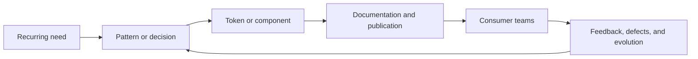
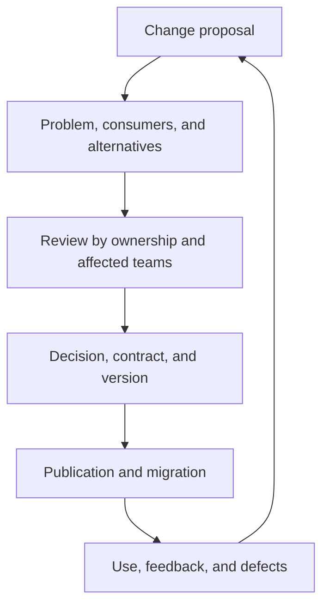
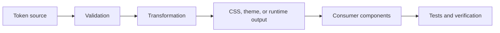
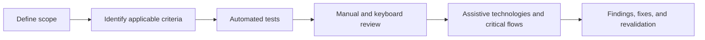
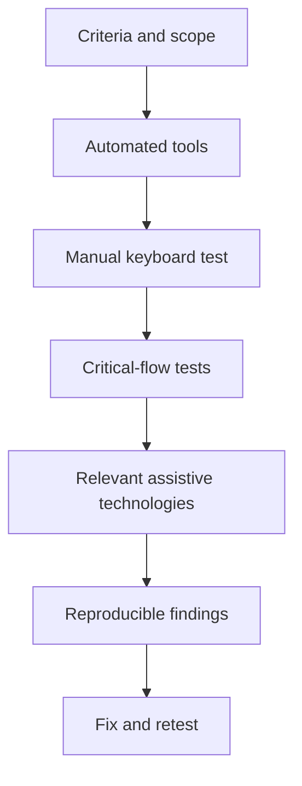
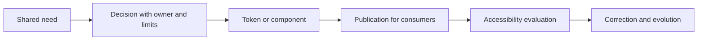

# PA-S004 — Design systems, tokens, and accessibility foundations

**Phase:** F0 — Accelerator Platform  
**Areas:** Frontend Platform Architecture (FPA) and Staff → Principal Software Engineering  
**Status:** canonical theory; it is not evidence of mastery.

> **30-SECOND SYNTHESIS**
>
> 1. A design system coordinates decisions, components, tokens, documentation, and governance to keep products coherent.
> 2. Tokens name reusable decisions and connect base values to semantic intent and components.
> 3. Accessibility must be part of the contract and verification; sharing a component does not prove that it is accessible.

## Objective

By the end of this session, you can distinguish a design system from a visual guide and a component library; explain how tokens represent design decisions and reach an interface; and establish verifiable accessibility foundations for components and frontend platforms.

You can also separate Staff-scope decisions from those that need Principal-scale influence and governance.

## Preview

This session answers three questions:

1. What organizational problem does a design system solve?
2. How does a design value travel from its definition to an interface?
3. What evidence allows a claim that an interface is usable with different abilities and input methods?

**Prior vocabulary.** A component is a reusable interface unit. An application programming interface (API) is the contract through which software is configured or consumed. A Web Content Accessibility Guidelines (WCAG) success criterion is a verifiable accessibility condition. A token is a design value identified by a name with intent rather than a literal copied in many places.

## Concepts

| ID | Area | Concept |
| --- | --- | --- |
| `S004-STAFF-C01` | Staff → Principal | Design system, visual guide, and component library |
| `S004-STAFF-C02` | Staff → Principal | Platform product: ownership, contribution, and governance |
| `S004-FPA-C01` | FPA | Tokens: primitive, semantic, and component |
| `S004-FPA-C02` | FPA | Token flow, formats, and implementation |
| `S004-A11Y-C01` | FPA | Accessibility, WCAG, and conformance limits |
| `S004-A11Y-C02` | FPA | HTML semantics, name, role, and state |
| `S004-A11Y-C03` | FPA | Keyboard, order, and focus visibility |
| `S004-A11Y-C04` | FPA | Contrast, color, zoom, reflow, and target size |
| `S004-A11Y-C05` | FPA + Staff | Accessibility verification, evidence, and governance |

## Staff → Principal Software Engineering

### Design system

#### Level 1 — Foundation

A design system is a coordinated set of principles, decisions, patterns, components, tokens, documentation, and practices for designing and building coherent product experiences.

It is not synonymous with a visual guide or a component library:

| Artifact | Function |
| --- | --- |
| Visual guide | Communicates brand, color, typography, and visual-use rules. |
| Component library | Distributes reusable implementations, such as `Button` or `Modal`. |
| Design system | Connects principles, tokens, components, documentation, maintenance, adoption, and governance. |

**Example.** Two products need a primary button. The guide can define its appearance and the library can publish `<Button>`. The design system also explains when to use it, its states, keyboard requirements, how to propose changes, and how to avoid incompatible variants.

#### Level 2 — Mechanism

A recurring need becomes a principle or pattern. The team defines a contract, expresses it through tokens or components, documents purpose and limits, and consumer teams apply it.



If there is a shared component but every team changes it locally, there is distributed code, but not necessarily an effective design system.

**Retrieval.** A company publishes common CSS, but each product defines its own variants, semantics, and maintenance. Is that enough to call it a design system?

**Answer.** No. Shared implementation exists, but common contracts, documentation, contribution, maintenance, and a coordinated design language are missing.

#### Level 3 — Deepening

A system with more components is not automatically better. An excessive catalog raises choice, maintenance, and coordination costs. The aim is to reduce duplication and ambiguity without preventing legitimate product needs.

### Platform, ownership, and governance

#### Level 1 — Foundation

An internal platform turns shared capabilities into something other teams can discover, adopt, and maintain.

* **Ownership:** explicit responsibility for decisions, quality, support, and evolution.
* **Contribution:** the process through which consumers propose, discuss, and improve capabilities.
* **Governance:** rules for accepting, reviewing, excepting, deprecating, and migrating decisions.

None requires a central team to decide every detail of every product.

#### Level 2 — Mechanism



**Example.** Changing the global focus token can improve contrast in new products but make a state in an existing theme illegible. The platform team must identify consumers, review themes, test the change, and publish a migration path.

**Retrieval.** Three teams duplicate a component because the shared package does not support a valid need. Is it enough to require them to stop duplicating it?

**Answer.** No. Investigate the contract, contribution path, and constraints. A policy can encourage adoption, but it cannot repair a platform that does not meet real needs.

#### Level 3 — Deepening

Staff scope commonly makes contracts, quality, integration, and adoption concrete across one or several teams. Principal scope includes steering standards and evolution across organizations, managing compatibility and migration costs, and aligning technical investment with product goals. These are not title-based authority levels: evidence comes from decision scope and achieved influence.

## Frontend Platform Architecture

### Tokens and layers of intent

#### Level 1 — Foundation

A design token names a reusable, portable decision: color, dimension, typography, elevation, duration, or another interface value. A token is not only a Cascading Style Sheets (CSS) variable. Its name communicates its role in the system.

| Type | Example | Purpose |
| --- | --- | --- |
| Primitive | `blue.700` | Expresses a base value. |
| Semantic | `color.text.primary` | Expresses interface intent. |
| Component | `button.primary.background` | Expresses a specific, limited use. |

This classification is a useful architectural choice. The token-format standard does not require exactly these three layers.

#### Level 2 — Mechanism

A base value feeds a semantic reference. A theme can redirect that reference to another value. The component consumes the semantic name or a component-specific token.

```text
Light theme:
blue.900 → color.text.primary → text

Dark theme:
gray.050 → color.text.primary → text
```

This permits a change to primary text color without replacing every use of the same blue that could serve another purpose.

**Example.** `button.primary.background` communicates one concrete function. Putting `blue.900` directly in twenty components does not say whether it is text, background, border, or decoration.

**Counterexample.** A button and link use the same blue by coincidence. Changing that blue globally could alter both even though their intent differs.

**Retrieval.** Which token best supports changing all links without touching buttons?

**Answer.** A semantic token representing link intent and consumed by link components. Sharing a value does not prove that they share a role.

#### Level 3 — Deepening

Every layer adds indirection and maintenance. A small system may need primitives and semantics but not component tokens. Adding layers without consumers, rules, or a clear purpose creates needless complexity. Names should describe stable intent, not the literal value that could change.

### Token flow and interchange format

#### Level 1 — Foundation

A token flow describes how a named decision travels from a maintained source to outputs consumed by tools or products. The **Design Tokens Format Module** from the Design Tokens Community Group defines a format for exchanging tokens among tools. It does not itself prescribe a complete architecture, a particular pipeline, or accessibility.

#### Level 2 — Mechanism



The source defines names, values, references, and groups. Validation checks structure, types, and references. Transformation generates outputs for agreed consumers. Tests find broken references, stale results, or differences between themes.

**Example.** If `color.text.primary` points to a missing reference, validation can block publication before a product receives an invalid value.

**Limit.** Generating valid CSS does not demonstrate sufficient contrast, correct meaning, or appropriate use in an interface.

**Retrieval.** What can a format validator demonstrate, and what can it not demonstrate?

**Answer.** It can demonstrate conformance to the format rules it implements. It cannot demonstrate that a visual decision is usable, accessible, or appropriate in every context.

#### Level 3 — Deepening

Choosing JSON, CSS, or other outputs depends on consumers, tooling, runtime, publication, and maintenance. Do not introduce a transformation chain simply because a standard permits it. First define consumer contracts and how divergent results will be detected.

## Accessibility foundations

### Accessibility and WCAG

#### Level 1 — Foundation

Accessibility seeks to reduce barriers so people with different abilities can perceive, understand, navigate, and interact with a product. WCAG 2.2 is a W3C Recommendation with verifiable success criteria and A, AA, and AAA conformance levels. A conformance claim depends on the content, technologies, and scope actually evaluated; it does not demonstrate that every person can use every part of a product.

#### Level 2 — Mechanism



An automatic result with no errors does not certify complete conformance.

**Example.** A button can have correct contrast and still lack an accessible name or be operable only with a mouse.

**Retrieval.** If a page meets some AA criteria, can you claim the whole product conforms to WCAG 2.2 AA?

**Answer.** No. The claim requires meeting relevant requirements throughout the declared scope. A sample, route, or isolated criterion is not enough.

#### Level 3 — Deepening

WCAG is a technical standard, not a complete inclusive-design method or a usability evaluation with people. Mature practice combines normative criteria, manual review, assistive technologies, and user participation when context permits.

### HTML semantics, name, role, and state

#### Level 1 — Foundation

Semantic HyperText Markup Language (HTML) communicates an element’s function to browsers and assistive technologies.

* **Accessible name:** identifies the control.
* **Role:** expresses its control type.
* **State:** communicates properties such as expanded, selected, or disabled.

Visual appearance does not automatically provide this information.

#### Level 2 — Mechanism

The browser interprets native HTML and exposes it through accessibility application programming interfaces. An assistive technology communicates name, role, and state to the user.

```html
<button
  type="button"
  aria-expanded="false"
  aria-controls="session-index">
  Open index
</button>
```

A native `<button>` provides basic focus and keyboard behavior. A `<div>` styled as a button does not acquire it through appearance.

**Retrieval.** A `<div role="button">` declares a role. Does that demonstrate that it works as a button?

**Answer.** No. The author must still implement focus, keyboard activation, name, and states. Prefer the appropriate native HTML element.

#### Level 3 — Deepening

Accessible Rich Internet Applications (ARIA) changes how semantics are exposed. It does not automatically add behavior. Redundant or incorrect roles and states, or ones that contradict visible behavior, can confuse users and tests.

### Keyboard, order, and focus

#### Level 1 — Foundation

A keyboard-operable interface lets a person reach and use all functions without focus traps. Focus identifies the element that will receive interaction. Focus order and reading order must make the work sequence understandable.

#### Level 2 — Mechanism

* `Tab` moves focus among controls.
* `Enter` or `Space` activates controls according to their pattern.
* A visible indicator lets people locate focus.
* Opening or closing content updates state and retains a logical focus location.

```css
.button:focus-visible {
  outline: 3px solid var(--focus-ring);
  outline-offset: 2px;
}
```

**Example.** An open dialog must let people identify and use its controls with a keyboard. When it closes, focus should return to a reasonable context.

**Retrieval.** If `Tab` reaches every control but no focus indicator is visible, can navigation be visually verified?

**Answer.** No. Moving focus and perceiving where it is are separate conditions.

#### Level 3 — Deepening

Custom widgets should follow appropriate interaction patterns, such as those in the WAI-ARIA Authoring Practices Guide. Not every component needs to capture arrows or `Tab`. Avoid positive `tabindex` values because they can break logical interaction order.

### Contrast, color, zoom, reflow, and targets

#### Level 1 — Foundation

These concepts are related but distinct:

| Aspect | Question answered |
| --- | --- |
| Contrast | Does text or a control stand out from its background? |
| Use of color | Is information understandable without distinguishing color? |
| Zoom | Can content increase without losing function? |
| Reflow | Can it be read without unnecessary two-dimensional scrolling? |
| Target size | Can the control be touched or selected precisely enough? |

#### Level 2 — Mechanism

WCAG has distinct criteria for contrast, color, reflow, and target size. WCAG 2.2 AA success criterion 2.5.8 generally sets a minimum target size of **24 × 24 CSS px** for pointer input, with exceptions defined by the criterion. ([www.w3.org][1])

```text
Weak error state:
red only

More robust error state:
icon + explanatory text + semantic association + checked contrast
```

**Example.** A red-only error state may not communicate the issue to people who do not distinguish that color or who use a screen reader.

**Retrieval.** An alert uses red and green for error and success. What must you check in addition to color?

**Answer.** Each state needs another signal, such as text, an icon, or shape, and semantic exposure. Also review contrast, accessible name or state, and contextual use.

#### Level 3 — Deepening

WCAG minimums do not automatically make an experience optimal. Target minimums have exceptions and are not universal ergonomic goals. Consider density, use context, device, and real tolerances.

### Accessibility verification and governance

#### Level 1 — Foundation

Accessibility verification gathers evidence that applicable criteria, behavior, and content work within a declared scope. Automated tools find some defects, but do not completely review navigation, comprehension, assistive-technology experience, or contextual fit.

#### Level 2 — Mechanism



**Example.** Axe can identify a button without an accessible name on a tested route. It does not by itself demonstrate logical heading hierarchy or that a dialog flow is understandable with a screen reader.

**Retrieval.** An automated test passes in continuous integration (CI). What claim is valid?

**Answer.** That test passed in the executed environment and routes. It does not demonstrate that the whole product is accessible or fully conforms to WCAG.

#### Level 3 — Deepening

Staff can establish acceptance criteria, useful automation, ownership, and correction of recurring defects. At Principal scale, governance includes resources, standards, explicit exceptions, maintenance, and adoption across teams. Measuring adoption is not the same as measuring every user’s experience.

## Main topic

**How does a frontend platform turn design decisions into a coherent and accessible experience?**

The platform connects semantic intent, tokens, component contracts, ownership, and evidence. Reuse reduces duplicate decisions but multiplies the impact of a bad one: an incorrect token or faulty keyboard pattern can spread to all consumers.



Every arrow is a contract that can fail. Sharing a dependency alone does not complete this chain.

**Answer.** A decision is reusable when consumers can understand, adopt, and correct it through a visible channel. It is accessible when its contract is verified in behavior and content, not only appearance.

## Subtopics

### Design system as an internal product

Consumers need more than files. They need purpose, limits, versions, compatibility, and support. If the system does not cover a recurring case or its contribution process is opaque, teams can create private variants.

Governance has a cost. Compare it with the cost of divergence, duplication, and distributed maintenance.

### Tokens as the interface between intent and value

Token layers separate physical values from interface roles. A reference can enable themes and brands, but adds dependencies that must be validated.

Semantic names make intent-driven changes easier. Color-bound names can be useful as primitives, but should not be the contract an interface consumes directly when the relevant concern is its role.

### Accessibility as a platform contract

A shared component can provide consistent semantics, focus, states, contrast, and behavior. The consumer must still configure and place it correctly.

Documentation, examples, automated tests, and manual walkthroughs cover different risks. No layer replaces the others.

## Theory → practice

Take a shared open/close control:

1. Define its purpose and contract.
2. Name tokens by intent, not incidental color.
3. Choose native HTML or the appropriate pattern.
4. Verify name, role, state, keyboard, and focus.
5. Review contrast, zoom, reflow, target size, and theme.
6. Record tests and reproducible failures.

Reading the walkthrough is not implementation or mastery evidence.

## Time

Estimated study time: **45–60 minutes**.

| Activity | Estimated time |
| --- | ---: |
| Reading and vocabulary | 10 min |
| Concepts and mechanisms | 25–30 min |
| Retrieval and comparison | 10–15 min |

This is a study estimate, not a performance measurement.

## Real-world example

An educational platform provides light and dark themes, a collapsible index, and shared buttons. The semantic token `color.text.primary` points to different values by theme. The index uses a native button and communicates whether it is expanded. Focus indicators and error states are verified in both themes.

Testing only the light theme does not cover dark-theme contrast or focus visibility.

## Production-ready example

```css
:root {
  --color-action-primary: #174ea6;
  --color-on-action-primary: #ffffff;
  --focus-ring: #111111;
}

.button-primary {
  color: var(--color-on-action-primary);
  background: var(--color-action-primary);
}

.button-primary:focus-visible {
  outline: 3px solid var(--focus-ring);
  outline-offset: 2px;
}
```

The example shows intent-based names and a focus indicator, but **does not certify** contrast or conformance. Verify computed values, hover and disabled states, keyboard behavior, theme context, and effective control size before production use.

## Visual Learning Studio

### Mind map

The map covers the nine identified concepts, the main topic, the three subtopics, and relationships among design systems, tokens, components, and accessibility verification. It is compiled as responsive Mermaid to SVG, with an accessible title, description, and textual fallback.

### Flashcards

Flashcards cover every concept, the main topic, and every subtopic. Each has a shared ES/EN stable ID, a concrete retrieval question, an explained answer, a source-section reference, keyboard navigation, flip, previous, next, and counter controls, reduced-motion support, and a no-JavaScript fallback.

### Recommended comparison

A static comparison can show:

| Primitive | Semantic | Component |
| --- | --- | --- |
| `blue.700` | `color.text.primary` | `button.primary.background` |
| Base value | Interface intent | Limited component use |

No simulator is necessary: there is no numeric variable that can automatically demonstrate accessibility outcomes.

## Exercises

* [ ] `PA-S004:exercise:01` S004-EX01 — Classify a brand guide, a component library, and a system with contribution rules. Explain what evidence distinguishes them.
* [ ] `PA-S004:exercise:02` S004-EX02 — Describe the path of `color.text.primary` from theme values to consumption by a component. Identify two validations and one failure the format alone would not detect.
* [ ] `PA-S004:exercise:03` S004-EX03 — Review a visually correct button: name, role, state, keyboard, focus, contrast, zoom, and target. Separate automatable from manual evidence.
* [ ] `PA-S004:exercise:04` S004-EX04 — Two teams duplicate a component. Write what information you would request, who should participate, and what contract, migration, and governance decisions you would consider.

## Sources

1. [W3C — Web Content Accessibility Guidelines 2.2](https://www.w3.org/TR/WCAG22/)
2. [Design Tokens Community Group — Design Tokens Format Module 2025.10](https://www.designtokens.org/TR/2025.10/format/)
3. [W3C WAI — ARIA Authoring Practices Guide: Keyboard Interface](https://www.w3.org/WAI/ARIA/apg/practices/keyboard-interface/)
4. [W3C WAI — Evaluating Web Accessibility: Involving Users](https://www.w3.org/WAI/test-evaluate/combined-expertise/)

## Study checklist

This checklist records study, not evidence for levels L1–L5.

* [ ] `PA-S004:check:01` S004-MC01 — I can distinguish a design system, visual guide, and component library.
* [ ] `PA-S004:check:02` S004-MC02 — I can explain ownership, contribution, and governance without reducing them to centralization.
* [ ] `PA-S004:check:03` S004-MC03 — I can distinguish primitive, semantic, and component tokens and explain their trade-offs.
* [ ] `PA-S004:check:04` S004-MC04 — I can trace token source, validation, transformation, and consumer.
* [ ] `PA-S004:check:05` S004-MC05 — I can explain what WCAG or an automated test does and does not guarantee.
* [ ] `PA-S004:check:06` S004-MC06 — I can review a control’s semantics, name, role, state, keyboard operation, and focus.
* [ ] `PA-S004:check:07` S004-MC07 — I can identify checks for contrast, color, zoom, reflow, and target size.
* [ ] `PA-S004:check:08` S004-MC08 — I can propose accessibility evidence and governance appropriate to scope.

## Session success criteria

The session meets its academic purpose if you can:

* [ ] `PA-S004:success:01` Answer the retrieval questions.
* [ ] `PA-S004:success:02` Explain at least one failure path between a token and consumer.
* [ ] `PA-S004:success:03` Design a plan that distinguishes automated tests, manual review, and limitations.
* [ ] `PA-S004:success:04` Propose a platform decision without inventing adoption or conformance evidence.

This does not declare L1–L5 mastery. Those levels require separate real evidence.

## Bridge

PA-S005 deepens ES/EN content architecture and internationalization. S004 token and accessibility contracts become technical dependencies: semantic names, localized content, focus, and text direction must coexist without assuming translated labels solve the whole accessible experience.

## Main conclusion

S004 establishes the foundations of a reusable design-system platform: contracts, tokens, components, and accessibility verification.
