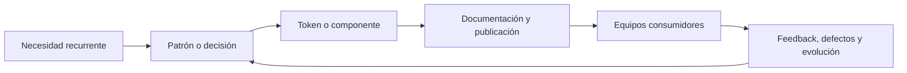
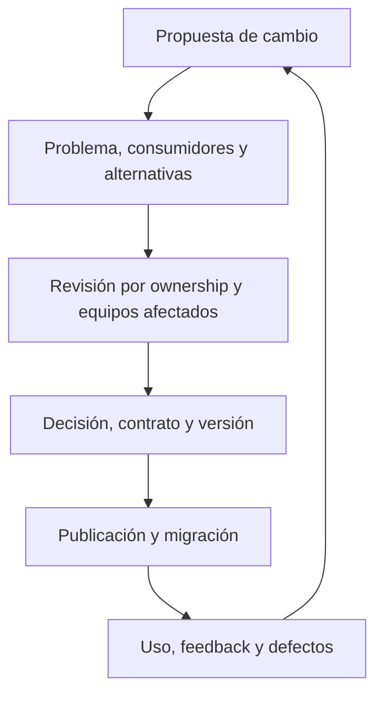
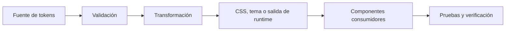
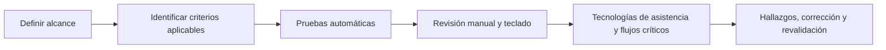
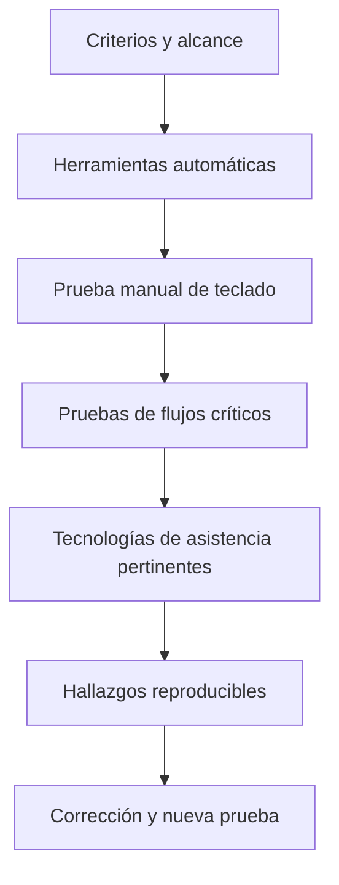
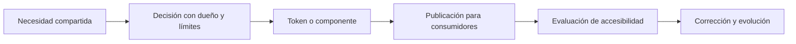

# PA-S004 — Sistemas de diseño, tokens y fundamentos de accesibilidad

**Fase:** F0 — Accelerator Platform
**Áreas:** Frontend Platform Architecture (FPA) y Staff → Principal Software Engineering
**Estado:** teoría canónica; no constituye evidencia de dominio.

> **SÍNTESIS EN 30 SEGUNDOS**
>
> 1. Un sistema de diseño coordina decisiones, componentes, tokens, documentación y gobernanza para mantener coherencia entre productos.
> 2. Los tokens nombran decisiones reutilizables y conectan valores base con intención semántica y componentes.
> 3. La accesibilidad debe ser parte del contrato y la verificación; compartir un componente no demuestra que sea accesible.

## Objetivo

Al terminar la sesión, podrás distinguir un sistema de diseño de una guía visual y una biblioteca de componentes; explicar cómo los tokens representan decisiones de diseño y llegan a una interfaz; y establecer fundamentos verificables de accesibilidad para componentes y plataformas frontend.

También podrás separar decisiones de alcance Staff de las que necesitan influencia y gobernanza a escala Principal.

## Vista previa

La sesión responde tres preguntas:

1. ¿Qué problema organizacional resuelve un sistema de diseño?
2. ¿Cómo llega un valor de diseño desde su definición hasta una interfaz?
3. ¿Qué evidencia permite afirmar que una interfaz es utilizable con diferentes capacidades y métodos de entrada?

**Vocabulario previo.** Un componente es una unidad reutilizable de interfaz. Una API es el contrato mediante el cual se configura o consume software. Un criterio de éxito WCAG define una condición verificable de accesibilidad. Un token es un valor de diseño identificado por un nombre con intención, en vez de copiar un valor literal en muchos lugares.

## Conceptos

| ID               | Área              | Concepto                                                     |
| ---------------- | ----------------- | ------------------------------------------------------------ |
| `S004-STAFF-C01` | Staff → Principal | Sistema de diseño, guía visual y biblioteca de componentes   |
| `S004-STAFF-C02` | Staff → Principal | Producto de plataforma: ownership, contribución y gobernanza |
| `S004-FPA-C01`   | FPA               | Tokens: primitivos, semánticos y de componente               |
| `S004-FPA-C02`   | FPA               | Flujo de tokens, formatos e implementación                   |
| `S004-A11Y-C01`  | FPA               | Accesibilidad, WCAG y límites de conformidad                 |
| `S004-A11Y-C02`  | FPA               | Semántica HTML, nombre, rol y estado                         |
| `S004-A11Y-C03`  | FPA               | Teclado, orden y visibilidad del foco                        |
| `S004-A11Y-C04`  | FPA               | Contraste, color, ampliación, reflow y tamaño de objetivos   |
| `S004-A11Y-C05`  | FPA + Staff       | Verificación, evidencia y gobernanza de accesibilidad        |

## Staff → Principal Software Engineering

### Sistema de diseño

#### Nivel 1 — Fundamento

Un sistema de diseño es un conjunto coordinado de principios, decisiones, patrones, componentes, tokens, documentación y prácticas para diseñar y construir experiencias de producto coherentes.

No es sinónimo de guía visual ni de biblioteca de componentes:

| Artefacto                 | Función                                                                                       |
| ------------------------- | --------------------------------------------------------------------------------------------- |
| Guía visual               | Comunica reglas de marca, color, tipografía y uso visual.                                     |
| Biblioteca de componentes | Distribuye implementaciones reutilizables, como `Button` o `Modal`.                           |
| Sistema de diseño         | Conecta principios, tokens, componentes, documentación, mantenimiento, adopción y gobernanza. |

**Ejemplo.** Dos productos necesitan un botón principal. La guía puede definir su apariencia y la biblioteca puede publicar `<Button>`. El sistema de diseño además explica cuándo usarlo, sus estados, requisitos de teclado, cómo proponer cambios y cómo evitar variantes incompatibles.

#### Nivel 2 — Mecanismo

Una necesidad recurrente se convierte en un principio o patrón. El equipo define un contrato, lo expresa mediante tokens o componentes, documenta el propósito y límites, y los equipos consumidores lo aplican.



Si existe un componente compartido, pero cada equipo lo modifica localmente, hay código distribuido, pero no necesariamente un sistema de diseño efectivo.

**Recuperación.** Una empresa publica CSS común, pero cada producto define sus propias variantes, semántica y mantenimiento. ¿Eso basta para llamarlo sistema de diseño?

**Respuesta.** No. Existe implementación compartida, pero faltan contratos comunes, documentación, contribución, mantenimiento y un lenguaje de diseño coordinado.

#### Nivel 3 — Profundización

Un sistema con más componentes no es automáticamente mejor. Un catálogo excesivo aumenta costo de elección, mantenimiento y coordinación. El objetivo es reducir duplicación y ambigüedad sin impedir necesidades legítimas del producto.

### Plataforma, ownership y gobernanza

#### Nivel 1 — Fundamento

Una plataforma interna convierte capacidades compartidas en algo que otros equipos pueden descubrir, adoptar y mantener.

* **Ownership:** responsabilidad explícita sobre decisiones, calidad, soporte y evolución.
* **Contribución:** proceso por el cual consumidores proponen, discuten y mejoran capacidades.
* **Gobernanza:** reglas para aceptar, revisar, excepcionar, deprecar y migrar decisiones.

Ninguno exige que un equipo central decida todos los detalles de cada producto.

#### Nivel 2 — Mecanismo



**Ejemplo.** Cambiar el token global de foco puede mejorar contraste en productos nuevos, pero hacer ilegible un estado de tema existente. El equipo de plataforma debe identificar consumidores, revisar temas, probar el cambio y publicar una ruta de migración.

**Recuperación.** Tres equipos duplican un componente porque el paquete compartido no admite una necesidad válida. ¿Basta con exigir que dejen de duplicarlo?

**Respuesta.** No. Hay que investigar el contrato, el flujo de contribución y las restricciones. Una política puede fomentar adopción, pero no arregla una plataforma que no satisface necesidades reales.

#### Nivel 3 — Profundización

El alcance Staff suele volver concretos los contratos, calidad, integración y adopción entre uno o varios equipos. El alcance Principal incluye orientar estándares y evolución entre organizaciones, manejar compatibilidad y costos de migración, y alinear inversión técnica con objetivos del producto.

No son niveles de autoridad automática por título: se demuestran mediante evidencia del alcance de las decisiones y de la influencia lograda.

## Frontend Platform Architecture

### Tokens y niveles de intención

#### Nivel 1 — Fundamento

Un token de diseño nombra una decisión reutilizable y transportable: color, dimensión, tipografía, elevación, duración u otro valor de interfaz.

Un token no es solamente una variable CSS. Su nombre comunica el rol que tiene dentro del sistema.

| Tipo          | Ejemplo                     | Propósito                             |
| ------------- | --------------------------- | ------------------------------------- |
| Primitivo     | `blue.700`                  | Expresa un valor base.                |
| Semántico     | `color.text.primary`        | Expresa intención de interfaz.        |
| De componente | `button.primary.background` | Expresa un uso específico y limitado. |

Esta clasificación es una decisión arquitectónica útil. El estándar de formato de tokens no obliga a usar exactamente estas tres capas.

#### Nivel 2 — Mecanismo

Un valor base alimenta una referencia semántica. Un tema puede redirigir esa referencia a otro valor. El componente consume el nombre semántico o el token específico.

```text
Tema claro:
blue.900 → color.text.primary → texto

Tema oscuro:
gray.050 → color.text.primary → texto
```

Esto permite cambiar el color de texto principal sin reemplazar todos los usos del mismo azul que puedan tener otra función.

**Ejemplo.** `button.primary.background` comunica una función concreta. En cambio, colocar `blue.900` directamente en veinte componentes no dice si ese valor representa texto, fondo, borde o decoración.

**Contraejemplo.** Un botón y un enlace usan el mismo azul por coincidencia. Cambiar ese azul globalmente podría alterar ambos, aunque su intención sea distinta.

**Recuperación.** ¿Qué token ayuda más a cambiar todos los enlaces sin tocar botones?

**Respuesta.** Un token semántico que represente la intención de enlace y sea consumido por componentes de enlace. Compartir un valor no prueba que compartan un rol.

#### Nivel 3 — Profundización

Cada capa añade indirección y mantenimiento. Un sistema pequeño puede requerir primitivas y semánticos, sin tokens de componente. Agregar niveles sin consumidores, reglas o propósito claro produce complejidad innecesaria.

Los nombres deberían describir intención estable, no el valor literal que podría cambiar.

### Flujo de tokens y formato de intercambio

#### Nivel 1 — Fundamento

Un flujo de tokens describe cómo una decisión nombrada pasa de una fuente mantenida hacia salidas que consumen herramientas o productos.

El **Design Tokens Format Module** del Design Tokens Community Group define un formato para intercambiar tokens entre herramientas. No prescribe por sí solo una arquitectura completa, un pipeline específico ni garantiza accesibilidad.

#### Nivel 2 — Mecanismo



La fuente define nombres, valores, referencias y grupos. La validación comprueba estructura, tipos y referencias. La transformación genera salidas para consumidores acordados. Las pruebas detectan referencias rotas, resultados obsoletos o diferencias entre temas.

**Ejemplo.** Si `color.text.primary` apunta a una referencia inexistente, la validación puede bloquear la publicación antes de que un producto reciba un valor inválido.

**Límite.** Generar CSS válido no demuestra contraste suficiente, significado correcto ni uso apropiado en una interfaz.

**Recuperación.** ¿Qué puede demostrar un validador de formato y qué no puede demostrar?

**Respuesta.** Puede demostrar conformidad con las reglas del formato que implementa. No puede demostrar que una decisión visual sea usable, accesible o apropiada para cada contexto.

#### Nivel 3 — Profundización

Elegir JSON, CSS u otras salidas depende de consumidores, herramientas, runtime, publicación y mantenimiento. No se debe introducir una cadena de transformación solo porque un estándar permita hacerlo. Primero se define el contrato de los consumidores y cómo se detectarán resultados divergentes.

## Fundamentos de accesibilidad

### Accesibilidad y WCAG

#### Nivel 1 — Fundamento

La accesibilidad busca reducir barreras para que personas con diferentes capacidades puedan percibir, comprender, navegar e interactuar con un producto.

WCAG 2.2 es una Recomendación del W3C con criterios de éxito verificables y niveles de conformidad A, AA y AAA. Una declaración de conformidad depende del contenido, tecnologías y alcance realmente evaluados; no demuestra que todas las personas puedan usar todo el producto.

#### Nivel 2 — Mecanismo



Un resultado automático sin errores no certifica conformidad completa.

**Ejemplo.** Un botón puede tener contraste correcto y aun así no tener nombre accesible o ser operable únicamente con mouse.

**Recuperación.** Si una página cumple algunos criterios AA, ¿puedes afirmar que todo el producto cumple WCAG 2.2 AA?

**Respuesta.** No. La declaración requiere cumplir los requisitos pertinentes en todo el alcance declarado. Una muestra, una ruta o un criterio aislado no basta.

#### Nivel 3 — Profundización

WCAG es un estándar técnico, no una metodología completa de diseño inclusivo ni una evaluación de usabilidad con personas. La práctica madura combina criterios normativos, revisión manual, tecnologías de asistencia y participación de usuarios cuando el contexto lo permite.

### Semántica HTML, nombre, rol y estado

#### Nivel 1 — Fundamento

HTML semántico comunica la función de un elemento a navegadores y tecnologías de asistencia.

* **Nombre accesible:** identifica el control.
* **Rol:** expresa qué tipo de control es.
* **Estado:** comunica propiedades como expandido, seleccionado o deshabilitado.

La apariencia visual no proporciona automáticamente esa información.

#### Nivel 2 — Mecanismo

El navegador interpreta HTML nativo y lo expone mediante APIs de accesibilidad. Una tecnología de asistencia comunica nombre, rol y estado al usuario.

```html
<button
  type="button"
  aria-expanded="false"
  aria-controls="session-index">
  Abrir índice
</button>
```

Un `<button>` nativo ofrece comportamiento base de foco y teclado. Un `<div>` estilizado como botón no lo obtiene por apariencia.

**Recuperación.** Un `<div role="button">` declara un rol. ¿Eso demuestra que funciona como botón?

**Respuesta.** No. El autor aún debe implementar foco, activación por teclado, nombre y estados. Debe preferirse el elemento HTML nativo cuando corresponda.

#### Nivel 3 — Profundización

ARIA modifica cómo se expone la semántica. No agrega automáticamente comportamiento. Roles o estados redundantes, incorrectos o que contradicen el comportamiento visible pueden confundir a usuarios y pruebas.

### Teclado, orden y foco

#### Nivel 1 — Fundamento

Una interfaz operable por teclado permite alcanzar y usar todas las funciones sin trampas de foco. El foco identifica el elemento que recibirá interacción.

El orden de foco y el orden de lectura deben permitir comprender la secuencia de trabajo.

#### Nivel 2 — Mecanismo

* `Tab` desplaza el foco entre controles.
* `Enter` o `Space` activan controles según su patrón.
* Un indicador visible permite localizar el foco.
* Abrir o cerrar contenido actualiza estado y conserva una ubicación lógica del foco.

```css
.button:focus-visible {
  outline: 3px solid var(--focus-ring);
  outline-offset: 2px;
}
```

**Ejemplo.** Un diálogo abierto debe permitir identificar y utilizar sus controles con teclado. Al cerrarse, el foco debe volver a un contexto razonable.

**Recuperación.** Si `Tab` llega a todos los controles, pero no existe indicador visible de foco, ¿puede verificarse visualmente la navegación?

**Respuesta.** No. Mover el foco y poder percibir dónde está son condiciones distintas.

#### Nivel 3 — Profundización

Los widgets personalizados deben seguir patrones de interacción apropiados, como los de WAI-ARIA APG. No todos los componentes necesitan capturar flechas o `Tab`. Evita `tabindex` positivos porque pueden romper el orden lógico de interacción.

### Contraste, color, ampliación, reflow y objetivos

#### Nivel 1 — Fundamento

Estos conceptos están relacionados, pero son diferentes:

| Aspecto            | Pregunta que responde                                               |
| ------------------ | ------------------------------------------------------------------- |
| Contraste          | ¿El texto o control se distingue del fondo?                         |
| Uso del color      | ¿La información sigue siendo comprensible sin distinguir color?     |
| Ampliación         | ¿Puede aumentarse el contenido sin perder funcionalidad?            |
| Reflow             | ¿Puede leerse sin desplazamiento bidireccional innecesario?         |
| Tamaño de objetivo | ¿El control puede tocarse o seleccionarse con suficiente precisión? |

#### Nivel 2 — Mecanismo

WCAG contiene criterios específicos para contraste, color, reflow y tamaño de objetivo. El criterio 2.5.8 de WCAG 2.2 AA establece, en general, un tamaño mínimo de objetivo de **24 × 24 CSS px** para entrada de puntero, con excepciones definidas por el criterio. ([www.w3.org][1])

```text
Estado de error insuficiente:
solo rojo

Estado de error más robusto:
icono + texto explicativo + asociación semántica + contraste comprobado
```

**Ejemplo.** Un estado de error solo rojo puede no comunicar el problema a personas que no distinguen ese color o usan lector de pantalla.

**Recuperación.** Una alerta usa rojo y verde para distinguir error y éxito. ¿Qué debes verificar además del color?

**Respuesta.** Que cada estado tenga una señal adicional, como texto, icono o forma, y que se exponga semánticamente. También se revisan contraste, nombre o estado accesible y uso en contexto.

#### Nivel 3 — Profundización

Los mínimos WCAG no convierten automáticamente una experiencia en óptima. El tamaño mínimo tiene excepciones y no es una meta universal de ergonomía. Deben considerarse densidad, contexto de uso, dispositivo y tolerancias reales.

### Verificación y gobernanza de accesibilidad

#### Nivel 1 — Fundamento

La verificación de accesibilidad reúne evidencia de que criterios aplicables, comportamiento y contenido funcionan dentro de un alcance declarado.

Las herramientas automáticas detectan ciertos defectos, pero no revisan por completo navegación, comprensión, experiencia con tecnologías de asistencia ni adecuación al contexto.

#### Nivel 2 — Mecanismo



**Ejemplo.** Axe puede identificar un botón sin nombre accesible en una ruta probada. No demuestra por sí mismo que la jerarquía de encabezados sea lógica o que un flujo de diálogo resulte comprensible con lector de pantalla.

**Recuperación.** Un test automatizado pasa en CI. ¿Qué afirmación es válida?

**Respuesta.** Que ese test pasó en el entorno y rutas ejecutados. No demuestra que todo el producto sea accesible ni que exista conformidad completa con WCAG.

#### Nivel 3 — Profundización

Staff puede establecer criterios de aceptación, automatización útil, ownership y corrección de defectos recurrentes. A escala Principal, la gobernanza incluye recursos, estándares, excepciones explícitas, mantenimiento y adopción entre equipos.

Medir adopción no equivale a medir la experiencia de cada usuario.

## Tema principal

**¿Cómo convierte una plataforma frontend decisiones de diseño en una experiencia coherente y accesible?**

La plataforma conecta intención semántica, tokens, contratos de componentes, ownership y evidencia. La reutilización reduce decisiones duplicadas, pero multiplica el impacto de una mala decisión: un token incorrecto o un patrón de teclado defectuoso puede propagarse a todos sus consumidores.



Cada flecha representa un contrato que puede fallar. Compartir una dependencia no completa por sí solo esta cadena.

**Respuesta.** Una decisión es reutilizable cuando los consumidores pueden entenderla, adoptarla y corregirla mediante un canal visible. Es accesible cuando su contrato se verifica en comportamiento y contenido, no solo en apariencia.

## Subtemas

### Sistema de diseño como producto interno

Los consumidores necesitan más que archivos. Necesitan propósito, límites, versiones, compatibilidad y soporte. Si el sistema no cubre un caso recurrente o su proceso de contribución es opaco, los equipos pueden crear variantes privadas.

La gobernanza tiene costo. Debe compararse contra el costo de divergencia, duplicación y mantenimiento distribuido.

### Tokens como interfaz entre intención y valor

Las capas de token separan valores físicos de roles de interfaz. Una referencia puede habilitar temas y marcas, pero añade dependencias que deben validarse.

Los nombres semánticos facilitan cambios por intención. Los nombres ligados a color pueden ser útiles como primitivas, pero no deberían ser el contrato que consume directamente una interfaz cuando lo relevante es su rol.

### Accesibilidad como contrato de plataforma

Un componente compartido puede ofrecer semántica, foco, estados, contraste y comportamiento consistentes. El consumidor aún debe configurarlo y colocarlo correctamente.

La documentación, ejemplos, pruebas automáticas y recorridos manuales cubren riesgos distintos. Ninguna capa sustituye a las demás.

## Teoría → práctica

Toma un control compartido de “abrir/cerrar”:

1. Define su propósito y contrato.
2. Nombra tokens por intención, no por color incidental.
3. Elige HTML nativo o el patrón apropiado.
4. Verifica nombre, rol, estado, teclado y foco.
5. Revisa contraste, zoom, reflow, tamaño y tema.
6. Registra pruebas y fallos reproducibles.

Leer el recorrido no constituye evidencia de implementación ni dominio.

## Tiempo

Estimación de estudio: **45–60 minutos**.

| Actividad                  | Tiempo estimado |
| -------------------------- | --------------: |
| Lectura y vocabulario      |          10 min |
| Conceptos y mecanismos     |       25–30 min |
| Recuperación y comparación |       10–15 min |

Es una estimación de estudio, no una medición de desempeño.

## Ejemplo del mundo real

Una plataforma educativa ofrece tema claro y oscuro, un índice colapsable y botones compartidos.

El token semántico `color.text.primary` apunta a valores diferentes según el tema. El índice usa un botón nativo y comunica si está expandido. Los indicadores de foco y estados de error se verifican en ambos temas.

Probar solo el tema claro no cubre contraste ni visibilidad de foco del tema oscuro.

## Ejemplo listo para producción

```css
:root {
  --color-action-primary: #174ea6;
  --color-on-action-primary: #ffffff;
  --focus-ring: #111111;
}

.button-primary {
  color: var(--color-on-action-primary);
  background: var(--color-action-primary);
}

.button-primary:focus-visible {
  outline: 3px solid var(--focus-ring);
  outline-offset: 2px;
}
```

El ejemplo muestra nombres con intención y un indicador de foco, pero **no certifica** contraste ni conformidad. Deben verificarse valores calculados, estados hover y disabled, teclado, contexto de tema y tamaño efectivo del control antes de usarlo en producción.

## Visual Learning Studio

### Mapa mental

El mapa debe cubrir:

* los nueve conceptos identificados;
* el tema principal;
* los tres subtemas;
* relaciones entre sistema de diseño, tokens, componentes y verificación de accesibilidad.

Debe compilarse como Mermaid → SVG responsive, con título, descripción accesible y fallback textual.

### Flashcards

Las flashcards deben cubrir cada concepto, el tema principal y cada subtema. Cada una necesita:

* ID estable compartido ES/EN;
* pregunta de recuperación concreta;
* respuesta explicada;
* referencia a su sección fuente;
* navegación por teclado;
* flip, anterior, siguiente y contador;
* soporte para reduced motion;
* fallback sin JavaScript.

### Comparador recomendado

Un comparador estático puede mostrar:

| Primitivo  | Semántico             | Componente                  |
| ---------- | --------------------- | --------------------------- |
| `blue.700` | `color.text.primary`  | `button.primary.background` |
| Valor base | Intención de interfaz | Uso limitado del componente |

No es necesario crear un simulador: no hay una variable numérica que permita demostrar automáticamente resultados de accesibilidad.

## Ejercicios

* [ ] `PA-S004:exercise:01` S004-EX01 — Clasifica una guía de marca, una biblioteca de componentes y un sistema con reglas de contribución. Explica qué evidencia permite distinguirlos.
* [ ] `PA-S004:exercise:02` S004-EX02 — Describe el recorrido de `color.text.primary` desde sus valores por tema hasta su consumo por un componente. Identifica dos validaciones y una falla que el formato por sí solo no detectaría.
* [ ] `PA-S004:exercise:03` S004-EX03 — Revisa un botón visualmente correcto: nombre, rol, estado, teclado, foco, contraste, ampliación y objetivo. Separa evidencia automatizable y manual.
* [ ] `PA-S004:exercise:04` S004-EX04 — Dos equipos duplican un componente. Escribe qué información solicitarías, quién debe participar y qué decisiones de contrato, migración y gobernanza considerarías.

## Fuentes

1. [W3C — Web Content Accessibility Guidelines 2.2](https://www.w3.org/TR/WCAG22/)
2. [Design Tokens Community Group — Design Tokens Format Module 2025.10](https://www.designtokens.org/TR/2025.10/format/)
3. [W3C WAI — ARIA Authoring Practices Guide: Keyboard Interface](https://www.w3.org/WAI/ARIA/apg/practices/keyboard-interface/)
4. [W3C WAI — Evaluating Web Accessibility: Involving Users](https://www.w3.org/WAI/test-evaluate/combined-expertise/)

## Lista de comprobación de estudio

Esta lista registra estudio, no evidencia de niveles L1–L5.

* [ ] `PA-S004:check:01` S004-MC01 — Puedo distinguir sistema de diseño, guía visual y biblioteca de componentes.
* [ ] `PA-S004:check:02` S004-MC02 — Puedo explicar ownership, contribución y gobernanza sin reducirlos a centralización.
* [ ] `PA-S004:check:03` S004-MC03 — Puedo distinguir token primitivo, semántico y de componente, y explicar sus trade-offs.
* [ ] `PA-S004:check:04` S004-MC04 — Puedo trazar fuente, validación, transformación y consumidor de tokens.
* [ ] `PA-S004:check:05` S004-MC05 — Puedo explicar qué garantiza y qué no garantiza WCAG o un test automático.
* [ ] `PA-S004:check:06` S004-MC06 — Puedo revisar semántica, nombre, rol, estado, teclado y foco de un control.
* [ ] `PA-S004:check:07` S004-MC07 — Puedo identificar verificaciones para contraste, color, ampliación, reflow y tamaño de objetivo.
* [ ] `PA-S004:check:08` S004-MC08 — Puedo proponer evidencia y gobernanza de accesibilidad acordes al alcance.

## Criterios de éxito de la sesión

La sesión cumple su propósito académico si puedes:

* [ ] `PA-S004:success:01` Responder las preguntas de recuperación.
* [ ] `PA-S004:success:02` Explicar al menos una ruta de falla entre token y consumidor.
* [ ] `PA-S004:success:03` Diseñar un plan que distinga pruebas automáticas, revisión manual y limitaciones.
* [ ] `PA-S004:success:04` Proponer una decisión de plataforma sin inventar evidencia de adopción o conformidad.

Esto no declara dominio L1–L5. Esos niveles requieren evidencia real separada.

## Puente

PA-S005 profundiza la arquitectura de contenido ES/EN e internacionalización. Los contratos de tokens y accesibilidad de S004 serán dependencias técnicas: nombres semánticos, contenido localizado, foco y dirección del texto deben coexistir sin asumir que traducir etiquetas resuelve toda la experiencia accesible.

## Conclusión principal

S004 establece los fundamentos de una plataforma de design system reutilizable: contratos, tokens, componentes y verificación de accesibilidad.
