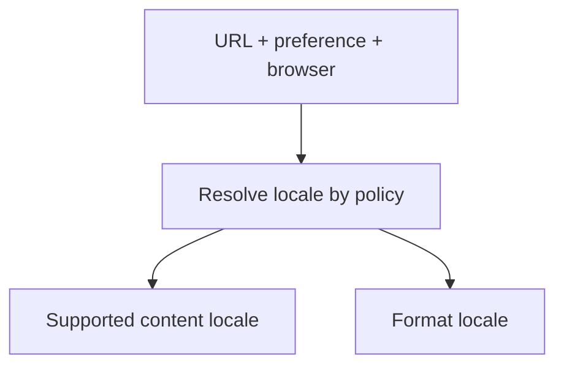
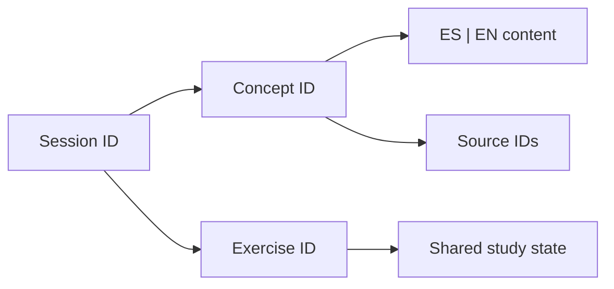
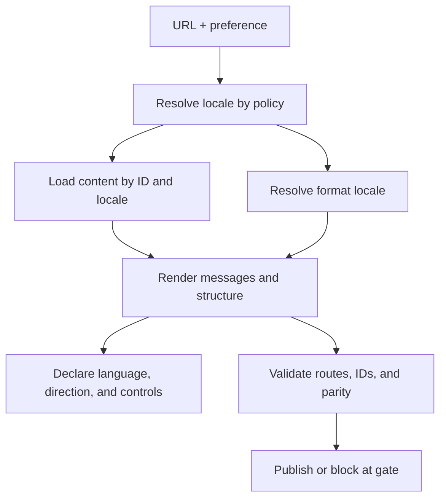

# PA-S005 — ES/EN content architecture and internationalization (i18n)

**Phase:** F0 — Accelerator Platform
**Lanes:** Frontend Platform Architecture (FPA) and Staff → Principal Software Engineering
**Status:** canonical theory; it is not evidence of mastery.

> **30-SECOND SYNTHESIS**
>
> 1. A bilingual experience separates content, identity, domain data, locale, formatting, and presentation.
> 2. Resolving language, applying fallback, and formatting data are separate decisions; messages need context and stable IDs.
> 3. Routes, accessibility, ES/EN parity, tests, and ownership are platform and product contracts; translating strings is insufficient.

## Objective

Design and evaluate a bilingual architecture that preserves meaning, identity, stable routes, accessibility, and shared state between Spanish and English. By the end, you can explain how a request obtains localized content, where locale is resolved, how data is formatted, and how coverage is checked before publication.

## Learning preview

**Frontend Platform Architecture (FPA)** covers the content model, locale resolution, boundaries, rendering, routes, persistence, and parity. **Staff → Principal Software Engineering** covers ownership, governance, compatibility, coordination, and decisions. AI Product Engineering is not added: the roadmap does not assign that lane to S005.

The example is a static site with `/es/`, `/en/`, sessions, and exercises. The target repository shape must be inspected; example routes, types, and names are hypothetical.

## Concepts

| ID | Lane | Concept |
| --- | --- | --- |
| `S005-C01` | FPA | Internationalization and localization |
| `S005-C02` | FPA | Message, editorial content, and domain data |
| `S005-C03` | FPA | Stable keys and semantic context |
| `S005-C04` | FPA | Language tag, locale, and negotiation |
| `S005-C05` | FPA | Fallback as an observable contract |
| `S005-C06` | FPA | Variables, pluralization, and grammar |
| `S005-C07` | FPA | Translation versus data formatting |
| `S005-C08` | FPA | Translatable content model |
| `S005-C09` | FPA | Localized routes and state |
| `S005-C10` | FPA | Language and direction accessibility |
| `S005-C11` | FPA | Parity and validation |
| `S005-C12` | Staff → Principal | Ownership and lifecycle |
| `S005-C13` | Staff → Principal | Platform contract and boundary |
| `S005-C14` | Staff → Principal | Decision, compatibility, and risk |

## Frontend Platform Architecture

### S005-C01 — Internationalization and localization

#### Level 1 — Foundation

**Internationalization (i18n)** prepares software for language, format, script, and convention differences without redesigning each screen. **Localization (l10n)** adapts an experience to a concrete language and context: it translates, applies conventions, and reviews content. Prepared capability is not completed translation [R8].

#### Level 2 — Mechanism

Text, data, locale, and presentation are separated; the same operation retains identity when language changes. i18n does not decide what missing translation does: block, hide, or fallback is product policy.

**Retrieval.** If the system supports `fr` but has no French text, is that language localized?

**Answer.** No; prepared capability does not mean reviewed translation.

#### Level 3 — Deep dive

External files aid editing but need context, integrity control, and publishing. Separate documents and localized schemas are both auditable alternatives.

### S005-C02 — Message, editorial content, and domain data

#### Level 1 — Foundation

**A message** is a user-interface unit; **editorial content** is a teaching piece with structure, intention, and sources; **domain data** keeps meaning independent from a visible label, such as `PA-S005` or `exercise-locale-resolution`.

#### Level 2 — Mechanism

The renderer combines resource, blocks, locale, and data. An exercise ID does not change between ES/EN even when its title does. Storing “Exercise 2” as a key loses tracking when copy changes; a stable ID avoids coupling state to translation.

**Retrieval.** Does the checkbox use “Analyze fallback” or the stable ID?

**Answer.** The ID; text is presentation.

#### Level 3 — Deep dive

Long theory with hierarchy and sources need not be reduced to a string catalog. Markdown, AST, or typed structure depends on editorial lifecycle; the project requires shared ES/EN tracking IDs [PS].

### S005-C03 — Stable keys and semantic context

#### Level 1 — Foundation

**A key** identifies a unit; **context** explains intent, location, and user. “Open” may be an action, case status, or available course; textual equality is not semantic equality.

#### Level 2 — Mechanism

A key such as `session.s005.objective` can point to ES/EN text and translation description. Resource, concept, and block IDs retain relationships. Semantic keys are readable; opaque IDs can reduce editing diffs. Evaluate extraction, collisions, changes, review, and tools [R8].

**Retrieval.** Two controls say “Continue”; one advances a course and one resumes video. Do they share a key?

**Answer.** Only if function, context, and grammar are equivalent.

#### Level 3 — Deep dive

Different keys can have the same text when context or grammar changes. Reusing a key can impose a wrong translation; an intent change can require new identity.

### S005-C04 — Language tag, locale, and negotiation

#### Level 1 — Foundation

**A language tag** expresses language and variants, such as `es`, `es-MX`, and `en-GB`. **A locale** configures conventions used by internationalization services. It is neither translated text nor a persisted value. BCP 47 defines tags and RFC 4647 defines matching [R1, R2].

#### Level 2 — Mechanism

📥 **INPUT / CAUSE:** URL, stored preference, and browser signal.
⚙️ **PROCESS / MECHANISM:** a policy compares supported locales and returns a decision; ECMA-402 negotiates locales for `Intl` services [R5].
📤 **OUTPUT / RESULT:** a content locale and a format locale, which may coincide but serve different purposes.
💡 **INSIGHT / RULE OF THUMB:** `Accept-Language` signals preference, not location.



**Retrieval.** The browser requests `es-MX`, but only `/es/` and `/en/` exist. What decides?

**Answer.** The product's matching and fallback policy.

#### Level 3 — Deep dive

RFC 4647 distinguishes filtering (a set of matches) from lookup (one choice). Explicit URL plus selector suits a static site; redirecting from root is a UX and hosting decision [R2].

### S005-C05 — Fallback as an observable contract

#### Level 1 — Foundation

**Fallback** defines what happens when language or translation is missing: base variant, source language, hiding, blocking, or index. There is no universal choice.

#### Level 2 — Mechanism

A hypothetical policy tries `es-MX`, `es`, and `en`, then returns requested locale, used locale, and reason. The renderer updates page or passage `lang`. Mixing languages without declaring them can make assistive technologies pronounce them incorrectly [R3, R4].

**Retrieval.** A Spanish page has a fallback English paragraph: what must the model do?

**Answer.** Report the fragment's real language and make the absence traceable.

#### Level 3 — Deep dive

Fallback favors availability but can hide incomplete translation; fail-closed protects integrity but can block secondary content. A critical section can block while labeled fallback is permitted in metadata.

### S005-C06 — Variables, pluralization, and grammar

#### Level 1 — Foundation

**Interpolation** inserts variables; **pluralization** selects grammatical forms by locale. It cannot universally become “one/many”; CLDR provides rules and categories [R6, R7].

#### Level 2 — Mechanism

A formatter receives a number and variables, selects a variant, and inserts values. Translating the whole message avoids concatenating quantity plus noun, which fails across order, gender, or inflection.

**Retrieval.** Why not concatenate a number and a noun?

**Answer.** Form, order, and grammar depend on language.

#### Level 3 — Deep dive

MessageFormat supports selection and plurals when the chosen library implements it. Rules do not automatically resolve gender, case, tone, or context; verify engine, versions, and variable limits [R7].

### S005-C07 — Translation versus data formatting

#### Level 1 — Foundation

**Translating a label** and **formatting a number** are distinct operations. Canonical data retains type and value; formatter uses locale and options. ECMA-402 defines `Intl`; CLDR documents conventions [R5, R6].

#### Level 2 — Mechanism

`1234.5` remains numeric; `Intl.NumberFormat` represents it by locale. A date requires deciding instant or civil date, time zone, and calendar before display. Localized display does not alter persisted data or calculation.

**Retrieval.** Should `1.234,50` be stored as an amount?

**Answer.** No; store typed value and currency, then format in presentation.

#### Level 3 — Deep dive

Runtime and CLDR data may change outputs. Relevant quantities fix currency, precision, and rules; linguistic order can require collation.

### S005-C08 — Translatable content model

#### Level 1 — Foundation

**A content model** defines pieces, IDs, relationships, locales, and metadata. A session includes objectives, concepts, examples, sources, and exercises; it is not only a dictionary.

#### Level 2 — Mechanism

Options are per-locale fields, separate documents with shared IDs, or a UI catalog plus editorial documents. This project requires equivalent ES/EN theory and shared IDs, not one storage format [PS].



**Retrieval.** Must EN break paragraphs exactly like ES?

**Answer.** No; retain meaning and function, not literal syntax.

#### Level 3 — Deep dive

Languages vary in syntax and length; compare IDs, relations, and coverage, not bytes or word count. Separate documents need a manifest; a common schema must allow idiomatic writing.

### S005-C09 — Localized routes and state

#### Level 1 — Foundation

**A localized route** addresses content by language, for example `/es/sessions/PA-S005/`, and retains language when shared or reopened.

#### Level 2 — Mechanism

A selector maps an entity by ID to the equivalent route; if absent, it uses explicit fallback or an index. A deep link normally honors URL language. Replacing a prefix without a map can break slugs and routes.

**Retrieval.** When language changes from an exercise, where does navigation go?

**Answer.** To the same entity by ID in the other locale, if it exists.

#### Level 3 — Deep dive

A static site needs base-path, deep-route refresh, error, and link checks. Header-based redirect affects hosting and cache; inspect the real implementation.

### S005-C10 — Language and direction accessibility

#### Level 1 — Foundation

**HTML `lang`** identifies a page or passage language for presentation and pronunciation. WCAG 2.2 3.1.1 requires a determinable page language (A), and 3.1.2 language of parts (AA) [R3, R4]. `dir` expresses direction, not language.

#### Level 2 — Mechanism

A Spanish page declares `lang=es`; an English passage declares `lang=en`. The selector needs accessible name, clear destination, keyboard, and focus. Alt text and errors are content too. RTL needs logical CSS, order, and mixed-text review.

**Retrieval.** Is translating an “English” button enough?

**Answer.** No; real language, fragments, and controls must be exposed correctly.

#### Level 3 — Deep dive

WCAG does not prescribe a particular widget. A flag represents country, not language; incorrect `lang` can cause wrong pronunciation.

### S005-C11 — Parity and validation

#### Level 1 — Foundation

**ES/EN parity** retains semantic and functional scope; it does not require identical words or length. Concepts, examples, answers, sources, exercises, and IDs correspond.

#### Level 2 — Mechanism

An automated gate compares IDs, order, links, fields, and routes; human review validates mechanism, meaning, and naturalness. Equal headings do not prove equivalence.

**Retrieval.** Same titles but missing EN answer: parity?

**Answer.** No.

#### Level 3 — Deep dive

Structure, linguistic quality, runtime, and learning each need different evidence. A snapshot can change with CLDR; a presence test can pass with erroneous theory. Report only run checks; a checkbox is not mastery.

## Staff → Principal Software Engineering

### S005-C12 — Ownership and lifecycle

#### Level 1 — Foundation

**Ownership** assigns who creates, reviews, approves, and maintains content. Technical author, translator, reviewer, and publisher can be separate roles.

#### Level 2 — Mechanism

Changing a concept affects ES/EN, diagrams, cards, sources, IDs, and tests. A versionable flow moves through canonical authoring, translation, review, validation, and publishing; `translated=true` does not demonstrate review when the process does not record it.

**Retrieval.** Who validates a technical meaning change?

**Answer.** Content authority and reviewers; pipeline does not replace expert judgment.

#### Level 3 — Deep dive

Staff coordinates owners and change. Principal chooses which policy to share and how to avoid bottlenecks. An SLA or metric exists only when agreed and instrumented.

### S005-C13 — Platform contract and boundary

#### Level 1 — Foundation

**An i18n platform** can share resolution, loading, formatting, or validation. It does not require shared editorial policy or a global package for everything.

#### Level 2 — Mechanism

An illustrative contract accepts locales and availability, then returns content locale, format locale, and fallback reason. React, Angular, or HTML consumers can vary. An abstraction decouples only when it models actual needs.

**Retrieval.** Is a global service always the right boundary?

**Answer.** No; justify it through consumers and observed costs.

#### Level 3 — Deep dive

Sharing early adds configuration and dependencies; duplicated divergent policies create inconsistency. Compare consumers, variation, and cost before fixing minimal API, extensions, and deprecation.

### S005-C14 — Decision, compatibility, and risk

#### Level 1 — Foundation

**An architectural decision** records context, options, criteria, consequences, and review. Routes and storage affect translation, cache, SEO, accessibility, and editing.

#### Level 2 — Mechanism

Choosing localized URL or local state evaluates deep links, hosting, indexing, preference, content, and compatibility. Tests and prototypes check assumptions; include fallback, approval, and adding languages later.

**Retrieval.** What evidence guides catalogs versus documents?

**Answer.** Content type and size, authorship, tools, sources, build, and change frequency.

#### Level 3 — Deep dive

Stable IDs reduce copy coupling, although migration costs. Explicit URL improves addressability but requires equivalent routes. Recording uncertainty separates fact from preference.

## Main topic

### Bilingual architecture as a system of contracts

**Two dictionaries are not enough.** First classify each piece: short interface text, editorial content, domain data, format, route, or evidence. Each has identity, source, and change lifecycle. If a card title is also a persistence and analytics key, translating it changes several contracts.

A robust model preserves IDs and relations, stores expression per language, resolves locale explicitly, and formats typed data at display. `PA-S005` identifies the session in both languages; `exercise-locale-resolution` retains state. Progress remains a number, not a localized string.



This is a decision model, not guaranteed framework behavior. Renderer knows the actually used language and reflects it in metadata. Checks validate coverage and routes; study state uses an ID and never becomes evidence.

## Subtopics

### 1. Model and identity

**Identity describes entity and relations; text expresses it by language.** A short catalog does not replace theory structure: headings, examples, code, sources, and questions. A schema can retain `session.id`, `concept.id`, `section.order`, `sourceRefs`, `contentByLocale`, `exercise.id`, and `checklist.id`.

Translated labels do not ensure complete answers, alt text, diagrams, or sources. Validation checks function and section, not key count.

**Retrieval.** A title changes without meaning changing. Does tracking reset?

**Answer.** No; retain the ID when entity and evaluated meaning remain.

### 2. Locale, fallback, and formatting

**Content resolution, fallback, and formatting are separate operations.** A policy receives signals and returns decision and reason. A catalog uses content locale; `Intl` displays typed values; CLDR documents conventions [R5–R7].

`routeLocale=es; preference=en; browser=es-MX` with `supportedContent={es,en}` can return `{contentLocale: es, formatLocale: es-MX, reason: "explicit route"}`. This is a hypothetical example, not a rule.

**Retrieval.** A date falls on another day in another zone: failed translation?

**Answer.** Not necessarily; inspect date semantics and time zone before formatting.

### 3. Routes, accessibility, and rendering

**A shareable URL retains language.** A selector maps entity by ID; replacing prefixes without a map fails with varied slugs. Static hosting serves deep routes. Page and passage `lang` guide pronunciation; controls need name, keyboard, and focus. A flag is not a language.

**Failure.** `/es/` with an English fallback fragment and Spanish `lang` can cause wrong pronunciation. The model returns locale per fragment and renderer marks it.

**Retrieval.** Why test a deep link?

**Answer.** It checks entity map, fallback, and navigation beyond the home page.

### 4. Parity, validation, and operation

**Automation detects structure; human review detects meaning.** Gates compare IDs, references, links, routes, and fields; semantic review catches missing mechanisms or answers; linguistic review checks naturalness. No test proves learning.

Test case: load `/es/`, mark `exercise-fallback-policy`, switch to `/en/`, verify ID and state, equivalent content, sources, and `lang`; then test unsupported locale and missing translation. It tests a contract, not mastery.

**Retrieval.** Counts match but an EN answer is missing: what was tested?

**Answer.** Only count, not semantic parity.

## Theory → practice map

| Understanding | Application | IDs |
| --- | --- | --- |
| Identity, content, and data | Model with separate ID and label | C01–C03, C08 |
| Locale and fallback | Prioritize URL, preference, browser, and support | C04–C05, C09 |
| Formatting and plurals | Fix concatenation and persisted strings | C06–C07 |
| Accessibility and routes | Define `lang`, routes, and selector | C09–C10 |
| Quality and governance | Gates, human review, decision | C11–C14 |

## Time breakdown

Estimate, not measurement: concepts 20 min; architecture and subtopics 35; example 25; exercises 30; revisit 10. Estimated total: 120 min. Familiarity may change it.

## Real-world example

A person opens `/en/sessions/PA-S005/` from a link even though they prefer Spanish. Route fixes English content; selector moves to the same ES session; `exercise-locale-resolution` retains state. `Intl.DateTimeFormat` displays a date with defined locale and zone without persisting its string. The page exposes language, and a Spanish fragment in English prose is marked. Build checks concepts, answers, sources, and routes. If a critical part is absent, it blocks or presents indicated fallback. This is an RFC/ECMA/CLDR/W3C-based example, not a claim about existing code [R1–R7].

## Production-ready example

### Context and contract

A static ES/EN Learning Site has sessions, exercises, and dashboard. URL opens locale; selector maps entity; state uses ID; assistive technologies receive correct language. Preserve dashboard, navigation, tracking, Studio, responsive SVG, theme, accessibility, and `site/`/`apps/portfolio/` separation [PS].

### Conceptual components

`LocalePolicy` resolves requested, content, format, and fallback. `ContentRepository` loads `resourceId + contentLocale` and source IDs. `MessageFormatter` resolves whole messages and formats types. `LocalizedRouteMap` maps resource to routes. `StudyStateStore` stores `itemId: checked`, never mastery. `ParityGate` compares coverage and declares limits. These are teaching contracts, not mandatory folders.

### Illustrative flow, failure, and contract

`GET /en/sessions/PA-S005/` → `locale=en`, `resource=PA-S005` → load English sections and shared IDs → format typed values → render `lang=en` and enabled study control. A critical EN section is missing → policy blocks build or identifies explicit fallback → never silently claims complete EN.

```ts
type LocaleResolution = {
  requestedLocale: string;
  contentLocale: string;
  formatLocale: string;
  fallbackReason?: "unsupported-locale" | "missing-content";
};
type LocalizedExercise = {
  id: string; // stable across ES/EN
  title: string;
  prompt: string;
  answer: string;
  sourceSectionIds: string[];
};
```

This example does not prescribe the real model. Do not assume fallback is acceptable or a checkbox proves mastery.

## Verification

- Compare ES/EN manifests, order, and source IDs.
- Validate equivalent routes, language switching, unsupported locale, missing text, and fallback policy.
- Test variables and plurals with the real engine; retain typed dates and numbers, including applicable time zone.
- Inspect rendered HTML: `lang`, fragments, labels, keyboard, and focus.
- Confirm state across languages without changing mastery or `Completed`; validate Mermaid→SVG, flashcards, and no-JS fallback.
- Run existing commands, report real results, and inspect `git diff`.

## Visual Learning Studio

Mind map and flashcards complement theory. A static comparison distinguishes locale and fallback; no simulator is proposed without a policy and data that make it truthful. Responsive SVG has accessible title and description; a textual alternative works without JavaScript.

## Exercises

- [ ] `PA-S005:exercise:01` **Classify.** Classify `exercise-fallback-policy`, “Validate fallback”, `es-MX`, `1.234,50`, `checked=true`. Answer: ID, text, locale by context, formatted string, and state tied to ID.
- [ ] `PA-S005:exercise:02` **Diagnose.** URL `/es/`, HTML `lang=en`, fallback English paragraphs, and title-based keys. Align actual language, use IDs, define policy, and test parity/routes.
- [ ] `PA-S005:exercise:03` **Decide.** Compare per-language documents, catalog, and structured content for articles, exercises, cards, and sources. Justify criteria, two risks, and tests; there is no single answer.
- [ ] `PA-S005:exercise:04` **Test.** Design ES→EN from a deep link with state and missing translation. Automate routes/HTML, ID, state, links, `lang`, and policy; human review compares explanation, example, and answer. It does not measure mastery.

## Sources and references

- [R1] Phillips et al., [RFC 5646, Tags for Identifying Languages (BCP 47)](https://www.rfc-editor.org/rfc/rfc5646.html).
- [R2] Phillips & Davis, [RFC 4647, Matching of Language Tags](https://www.rfc-editor.org/rfc/rfc4647.html): filtering/lookup; it does not define product priority.
- [R3] W3C, [Authoring HTML: Language declarations](https://www.w3.org/TR/i18n-html-tech-lang/).
- [R4] W3C WAI, [WCAG 2.2: Language of Page](https://www.w3.org/WAI/WCAG22/Understanding/language-of-page.html) and [Language of Parts](https://www.w3.org/WAI/WCAG22/Understanding/language-of-parts.html).
- [R5] Ecma International, [ECMA-402](https://tc39.es/ecma402/): negotiation and `Intl` services; output depends on runtime.
- [R6] Unicode Consortium, [UTS #35 / CLDR](https://www.unicode.org/reports/tr35/), [numbers](https://www.unicode.org/reports/tr35/tr35-numbers.html), and [dates](https://www.unicode.org/reports/tr35/tr35-dates.html).
- [R7] Unicode Consortium, [UTS #35 Part 9 MessageFormat](https://www.unicode.org/reports/tr35/tr35-messageFormat.html).
- [R8] Angular Team, [official i18n guide](https://angular.dev/guide/i18n): framework example, not an Angular mandate.
- [PS] Project Sources 03–15: Accelerator contracts, not external standards.

## Resources

Primary standards: RFC 5646/4647, ECMA-402, UTS #35, and WCAG 2.2. Framework implementation: Angular i18n. Before Build, inspect the repository, `/ui-reference/`, routes, content, persistence, and real validators.

## Study checklist

- [ ] `PA-S005:check:01` I distinguish i18n, l10n, tag, and locale.
- [ ] `PA-S005:check:02` I separate ID, localized content, and data.
- [ ] `PA-S005:check:03` I explain URL/preference/browser/availability priority.
- [ ] `PA-S005:check:04` I define fallback and its linguistic and accessibility effects.
- [ ] `PA-S005:check:05` I distinguish translation, plural, and typed formatting.
- [ ] `PA-S005:check:06` I design equivalent routes and state by ID.
- [ ] `PA-S005:check:07` I explain page/fragment `lang` and flag limits.
- [ ] `PA-S005:check:08` I separate automated gates from human review.
- [ ] `PA-S005:check:09` I defend a boundary or decision with trade-offs and evidence.

Checks are reversible and record study; they do not certify L1–L5 or `Completed`.

## End-of-session success criteria

You can map content, IDs, locales, formatting, routes, and state; predict unsupported locale and missing text under a policy; specify metadata and navigation when language changes; propose gates and their limits; and defend a decision with trade-offs and needed evidence. These are criteria, not a claim of demonstrated mastery.

## Bridge to PA-S006

S006 deepens dashboard, theme, and visualization. A dashboard consumes localized labels and activity/evidence values, while categories, IDs, and data are language-independent. Bridge question: which real data and empty states should each dashboard show without turning study into mastery?
