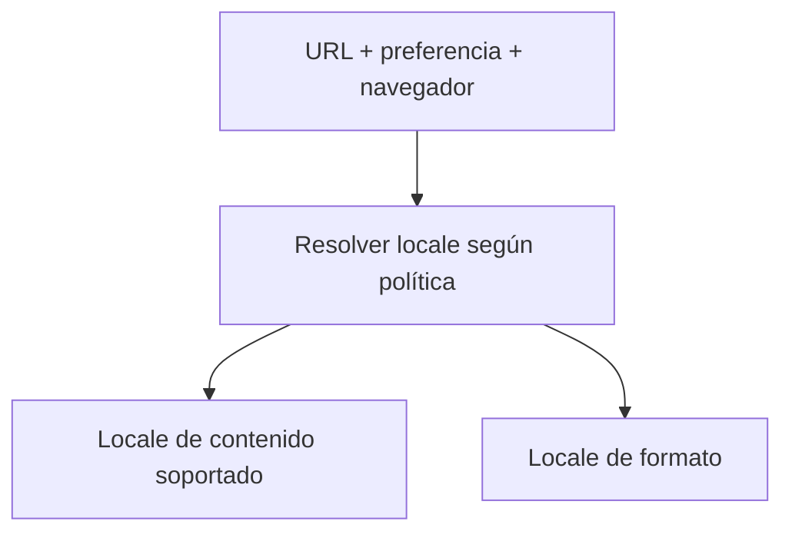
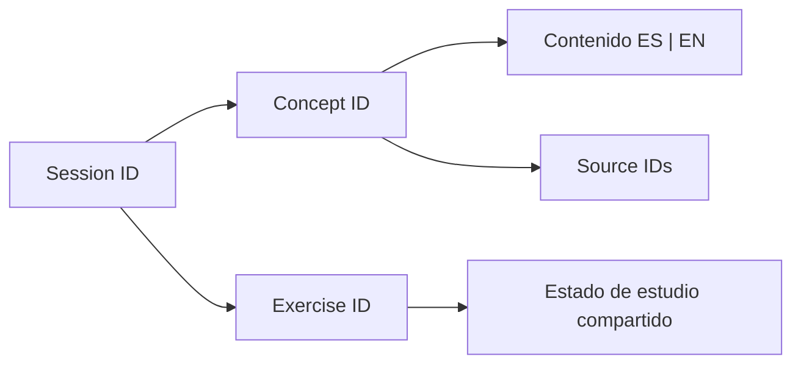
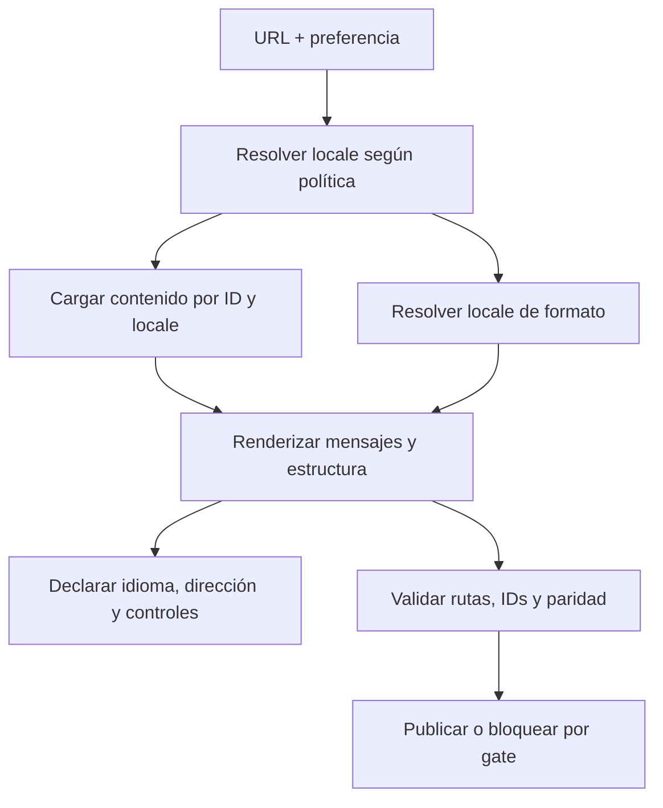

# PA-S005 — Arquitectura de contenido ES/EN e internacionalización (i18n)

**Fase:** F0 — Accelerator Platform
**Carriles:** Frontend Platform Architecture (FPA) y Staff → Principal Software Engineering
**Estado:** teoría canónica; no constituye evidencia de dominio.

> **SÍNTESIS EN 30 SEGUNDOS**
>
> 1. Una experiencia bilingüe separa contenido, identidad, datos de dominio, locale, formato y presentación.
> 2. Resolver idioma, aplicar fallback y formatear datos son decisiones distintas; mensajes requieren contexto e IDs estables.
> 3. Rutas, accesibilidad, paridad ES/EN, pruebas y ownership son contratos de plataforma y producto; traducir cadenas no basta.

## Objetivo

Diseñar y evaluar una arquitectura bilingüe que preserve significado, identidad, rutas estables, accesibilidad y estado compartido entre español e inglés. Al terminar, se puede explicar cómo una solicitud obtiene contenido localizado, dónde se resuelve locale, cómo se formatean datos y cómo validar cobertura antes de publicar.

## Vista previa

**Frontend Platform Architecture (FPA)** estudia modelo de contenido, resolución de locale, límites, rendering, rutas, persistencia y paridad. **Staff → Principal Software Engineering** estudia ownership, gobernanza, compatibilidad, coordinación y decisiones. AI Product Engineering no se agrega: el roadmap no asigna ese carril a S005.

El ejemplo es un sitio estático con `/es/`, `/en/`, sesiones y ejercicios. La forma exacta del repositorio de destino se debe inspeccionar; rutas, tipos y nombres de ejemplo son hipotéticos.

## Conceptos

| ID | Carril | Concepto |
| --- | --- | --- |
| `S005-C01` | FPA | Internacionalización y localización |
| `S005-C02` | FPA | Mensaje, contenido editorial y dato de dominio |
| `S005-C03` | FPA | Claves estables y contexto semántico |
| `S005-C04` | FPA | Etiqueta de idioma, locale y negociación |
| `S005-C05` | FPA | Fallback como contrato observable |
| `S005-C06` | FPA | Variables, pluralización y gramática |
| `S005-C07` | FPA | Traducción frente a formato de datos |
| `S005-C08` | FPA | Modelo de contenido traducible |
| `S005-C09` | FPA | Rutas localizadas y estado |
| `S005-C10` | FPA | Accesibilidad de idioma y dirección |
| `S005-C11` | FPA | Paridad y validación |
| `S005-C12` | Staff → Principal | Ownership y ciclo de vida |
| `S005-C13` | Staff → Principal | Contrato y límite de plataforma |
| `S005-C14` | Staff → Principal | Decisión, compatibilidad y riesgo |

## Frontend Platform Architecture

### S005-C01 — Internacionalización y localización

#### Nivel 1 — Fundamento

**Internacionalización (i18n)** prepara software para admitir diferencias de idioma, formato, escritura y convenciones sin rediseñar cada pantalla. **Localización (l10n)** adapta una experiencia a una lengua y contexto concretos: traduce, aplica convenciones y revisa contenido. Preparar capacidad no equivale a completar traducciones [R8].

#### Nivel 2 — Mecanismo

Se separan textos, datos, locale y presentación; la misma operación conserva identidad al cambiar idioma. i18n no decide qué hacer con una traducción faltante: bloquear, ocultar o aplicar fallback es política del producto.

**Recuperación.** Si el sistema admite `fr` pero no existe texto francés, ¿está localizada esa lengua?

**Respuesta.** No; capacidad preparada no significa traducción revisada.

#### Nivel 3 — Profundización

Archivos externos facilitan edición, pero requieren contexto, control de integridad y publicación. Documentos separados o esquema localizado son alternativas auditables.

### S005-C02 — Mensaje, contenido editorial y dato de dominio

#### Nivel 1 — Fundamento

**Un mensaje** es una unidad de interfaz; **contenido editorial** es una pieza de enseñanza con estructura, intención y fuentes; **dato de dominio** conserva significado independiente de su etiqueta visible, como `PA-S005` o `exercise-locale-resolution`.

#### Nivel 2 — Mecanismo

El renderer combina recurso, bloques, locale y datos. El ID del ejercicio no cambia entre ES/EN aunque cambie el título. Guardar “Ejercicio 2” como clave pierde seguimiento cuando cambia el copy; persistir un ID estable evita acoplar estado a traducción.

**Recuperación.** ¿El checkbox usa “Analizar fallback” o el ID estable?

**Respuesta.** El ID; el texto es presentación.

#### Nivel 3 — Profundización

Teoría extensa con jerarquía y fuentes no siempre debe reducirse a catálogo de cadenas. Markdown, AST o estructura tipada dependen del ciclo editorial; el proyecto exige IDs de tracking ES/EN compartidos [PS].

### S005-C03 — Claves estables y contexto semántico

#### Nivel 1 — Fundamento

**Una clave** identifica una unidad; **el contexto** explica intención, lugar y usuario. “Open” puede ser una acción, un estado de caso o un curso disponible; igualdad textual no implica igualdad semántica.

#### Nivel 2 — Mecanismo

Una clave como `session.s005.objective` puede apuntar a texto ES/EN y descripción de traducción. IDs de recurso, concepto y bloque preservan relaciones. Claves semánticas son legibles; IDs opacos pueden reducir diffs. Se evalúan extracción, colisiones, cambios, revisión y herramientas [R8].

**Recuperación.** Dos controles dicen “Continuar”, uno avanza el curso y otro reanuda video. ¿Comparten clave?

**Respuesta.** Solo si función, contexto y gramática son equivalentes.

#### Nivel 3 — Profundización

Claves distintas pueden tener mismo texto si contexto o gramática cambian. Reutilizar una clave puede imponer una traducción incorrecta; cambiar intención puede requerir nueva identidad.

### S005-C04 — Etiqueta de idioma, locale y negociación

#### Nivel 1 — Fundamento

**Una etiqueta de idioma** expresa lengua y variantes, como `es`, `es-MX`, `en-GB`. **Un locale** configura convenciones usadas por servicios de internacionalización. No es sinónimo de texto traducido ni valor persistido. BCP 47 define etiquetas y RFC 4647 matching [R1, R2].

#### Nivel 2 — Mecanismo

📥 **ENTRADA / CAUSA:** URL, preferencia guardada y señal del navegador.
⚙️ **PROCESO / MECANISMO:** una política compara locales soportados y devuelve una decisión; ECMA-402 negocia locales con servicios `Intl` [R5].
📤 **SALIDA / RESULTADO:** locale de contenido y locale de formato, que pueden coincidir pero tienen propósitos distintos.
💡 **INSIGHT / REGLA DE ORO:** `Accept-Language` comunica preferencia, no ubicación.



**Recuperación.** El navegador pide `es-MX`, pero solo hay `/es/` y `/en/`. ¿Qué decide?

**Respuesta.** La política de matching y fallback del producto.

#### Nivel 3 — Profundización

RFC 4647 distingue filtering (conjunto de matches) y lookup (una opción). URL explícita con selector es una opción para sitio estático; redirigir desde raíz es una decisión UX/hosting [R2].

### S005-C05 — Fallback como contrato observable

#### Nivel 1 — Fundamento

**Fallback** define qué sucede si falta idioma o traducción: variante base, fuente, ocultamiento, bloqueo o índice. No existe una opción universal.

#### Nivel 2 — Mecanismo

Una política hipotética intenta `es-MX`, `es`, `en` y devuelve locale solicitado, usado y motivo. El renderer actualiza `lang` de página o pasaje. Mezclar idiomas sin declararlos puede hacer que tecnologías asistivas pronuncien mal [R3, R4].

**Recuperación.** Página española con párrafo fallback inglés: ¿qué debe hacer el modelo?

**Respuesta.** Informar el idioma real del fragmento y dejar trazable la carencia.

#### Nivel 3 — Profundización

Fallback favorece disponibilidad, pero puede ocultar traducción incompleta; fail-closed protege integridad y puede bloquear contenido secundario. Puede bloquearse una sección crítica y permitir fallback etiquetado en metadatos.

### S005-C06 — Variables, pluralización y gramática

#### Nivel 1 — Fundamento

**Interpolación** inserta variables; **pluralización** selecciona formas gramaticales según locale. No se reduce universalmente a “uno/muchos”; CLDR provee reglas y categorías [R6, R7].

#### Nivel 2 — Mecanismo

Un motor recibe número y variables, selecciona variante e inserta valores. Traducir mensaje completo evita concatenar cantidad + sustantivo, que falla por orden, género o inflexión.

**Recuperación.** ¿Por qué no concatenar número y sustantivo?

**Respuesta.** La forma, orden y gramática dependen de la lengua.

#### Nivel 3 — Profundización

MessageFormat permite selección y plurales si la librería elegida lo implementa. Las reglas no resuelven automáticamente género, caso, tono ni contexto; se verifican motor, versiones y límites de variables [R7].

### S005-C07 — Traducción frente a formato de datos

#### Nivel 1 — Fundamento

**Traducir una etiqueta** y **formatear un número** son operaciones distintas. El dato canónico mantiene tipo y valor; el formateador usa locale y opciones. ECMA-402 define `Intl`; CLDR documenta convenciones [R5, R6].

#### Nivel 2 — Mecanismo

`1234.5` sigue siendo numérico; `Intl.NumberFormat` lo representa según locale. Una fecha exige decidir instante o fecha civil, zona horaria y calendario antes de mostrar. Localizar display no cambia dato persistido ni cálculo.

**Recuperación.** ¿Guardar la cadena `1.234,50` como monto?

**Respuesta.** No; guardar dato tipado y moneda, y formatear en presentación.

#### Nivel 3 — Profundización

Runtime y datos CLDR pueden cambiar salidas. Para cantidades relevantes se fijan moneda, precisión y reglas; orden lingüístico puede requerir collation.

### S005-C08 — Modelo de contenido traducible

#### Nivel 1 — Fundamento

**Un modelo de contenido** define piezas, IDs, relaciones, locales y metadatos. Una sesión incluye objetivos, conceptos, ejemplos, fuentes y ejercicios; no es solo diccionario.

#### Nivel 2 — Mecanismo

Opciones: campos por locale, documentos separados con IDs comunes o catálogo UI más documentos editoriales. El proyecto requiere teoría ES/EN equivalente e IDs compartidos, no un formato único [PS].



**Recuperación.** ¿EN debe cortar párrafos como ES?

**Respuesta.** No; conserva significado y función, no sintaxis literal.

#### Nivel 3 — Profundización

Idiomas varían en sintaxis y extensión; se comparan IDs, relaciones y cobertura, no bytes o palabras. Documento separado requiere manifest; esquema común debe permitir redacción idiomática.

### S005-C09 — Rutas localizadas y estado

#### Nivel 1 — Fundamento

**Una ruta localizada** direcciona contenido por idioma, por ejemplo `/es/sessions/PA-S005/`, y conserva lengua al compartir o reabrir.

#### Nivel 2 — Mecanismo

El selector mapea entidad mediante ID a ruta equivalente; si no existe, aplica fallback explícito o lleva a índice. Un deep link normalmente respeta la lengua de URL. Reemplazar prefijo sin mapa puede romper slugs y rutas.

**Recuperación.** Al cambiar idioma desde ejercicio, ¿a dónde ir?

**Respuesta.** A la misma entidad por ID en el otro locale, si existe.

#### Nivel 3 — Profundización

Sitio estático requiere comprobar base path, refresh de rutas profundas, errores y enlaces. Redirección por header afecta hosting y cache; se comprueba la implementación real.

### S005-C10 — Accesibilidad de idioma y dirección

#### Nivel 1 — Fundamento

**`lang` de HTML** identifica idioma de página o pasaje para presentación y pronunciación. WCAG 2.2 3.1.1 requiere lengua de página determinable (A) y 3.1.2 lengua de partes (AA) [R3, R4]. `dir` expresa dirección, no idioma.

#### Nivel 2 — Mecanismo

Página española declara `lang=es`; un pasaje inglés declara `lang=en`. El selector necesita nombre accesible, destino claro, teclado y foco. Alt text y errores también son contenido. RTL requiere CSS lógico, orden y texto mixto.

**Recuperación.** ¿Traducir botón “English” basta?

**Respuesta.** No; idioma real, fragmentos y controles deben estar expuestos adecuadamente.

#### Nivel 3 — Profundización

WCAG no dicta un widget particular. Una bandera representa país, no idioma; `lang` incorrecto puede causar pronunciación errónea.

### S005-C11 — Paridad y validación

#### Nivel 1 — Fundamento

**Paridad ES/EN** conserva alcance semántico y funcional; no exige mismas palabras o longitud. Corresponden conceptos, ejemplos, respuestas, fuentes, ejercicios e IDs.

#### Nivel 2 — Mecanismo

Un gate automático compara IDs, orden, links, campos y rutas; revisión humana valida mecanismo, sentido y naturalidad. Encabezados iguales no prueban equivalencia.

**Recuperación.** Mismos títulos pero falta respuesta EN. ¿Paridad?

**Respuesta.** No.

#### Nivel 3 — Profundización

Estructura, calidad lingüística, runtime y aprendizaje requieren evidencia distinta. Snapshot puede cambiar con CLDR; test de presencia puede pasar con teoría errónea. Se reportan solo checks corridos; checkbox no equivale a mastery.

## Staff → Principal Software Engineering

### S005-C12 — Ownership y ciclo de vida

#### Nivel 1 — Fundamento

**Ownership** asigna quién crea, revisa, aprueba y mantiene contenido. Autor técnico, traductor, revisor y publicador pueden ser roles distintos.

#### Nivel 2 — Mecanismo

Cambiar un concepto impacta ES/EN, diagramas, tarjetas, fuentes, IDs y tests. Un flujo versionable pasa por autoría canónica, traducción, revisión, validación y publicación; `translated=true` no prueba revisión si el proceso no la registra.

**Recuperación.** ¿Quién valida cambio de significado técnico?

**Respuesta.** Autoridad de contenido y revisores; el pipeline no sustituye juicio experto.

#### Nivel 3 — Profundización

Staff coordina dueños y cambios; Principal decide qué política compartir y cómo evitar cuello de botella. SLA o métrica solo si se acordaron e instrumentaron.

### S005-C13 — Contrato y límite de plataforma

#### Nivel 1 — Fundamento

**Una plataforma i18n** puede compartir resolución, carga, formato o validación. No obliga a compartir política editorial ni a volver todo paquete global.

#### Nivel 2 — Mecanismo

Un contrato ilustrativo acepta locales y disponibilidad, y retorna locale de contenido, formato y razón de fallback. Consumidores React, Angular o HTML pueden variar. La abstracción desacopla solo si modela necesidades reales.

**Recuperación.** ¿Servicio global siempre es frontera correcta?

**Respuesta.** No; se justifica por consumidores y costos observados.

#### Nivel 3 — Profundización

Compartir temprano agrega configuración y dependencias; duplicar políticas divergentes crea inconsistencias. Se comparan consumidores, variación y costo antes de fijar API mínima, extensiones y deprecación.

### S005-C14 — Decisión, compatibilidad y riesgo

#### Nivel 1 — Fundamento

**Una decisión arquitectónica** documenta contexto, opciones, criterios, consecuencias y revisión. Rutas y almacenamiento inciden en traducción, cache, SEO, accesibilidad y edición.

#### Nivel 2 — Mecanismo

Elegir URL localizada o estado local exige evaluar deep links, hosting, indexación, preferencias, contenido y compatibilidad. Tests y prototipos comprueban supuestos; incluyen fallback, aprobación y futura adición de idiomas.

**Recuperación.** ¿Qué evidencia guía catálogos vs documentos?

**Respuesta.** Tipo y tamaño de contenido, autoría, herramientas, fuentes, build y frecuencia de cambios.

#### Nivel 3 — Profundización

IDs estables reducen acoplamiento con copy, aunque migrar cuesta. URL explícita mejora direccionabilidad pero exige rutas equivalentes. Registrar incertidumbre separa hecho de preferencia.

## Tema principal

### Arquitectura bilingüe como sistema de contratos

**No basta reunir cadenas** en dos diccionarios. Primero se clasifica cada pieza: interfaz breve, contenido editorial, dato de dominio, formato, ruta o evidencia. Cada clase tiene identidad, fuente y ciclo de cambio. Si el título de tarjeta también es clave de persistencia y analítica, traducirlo cambia varios contratos.

Un modelo robusto preserva IDs y relaciones, guarda expresión por idioma, resuelve locale explícitamente y formatea datos tipados al mostrar. `PA-S005` identifica la sesión en ambas lenguas; `exercise-locale-resolution` conserva estado. El progreso continúa como número, no como cadena localizada.



Es un modelo de decisión, no comportamiento garantizado de framework. Renderer conoce idioma realmente usado y lo refleja en metadatos. Checks validan cobertura y rutas; estado de estudio usa ID y no se convierte en evidencia.

## Subtemas

### 1. Modelo e identidad

**Identidad describe entidad y relaciones; texto la expresa por idioma.** Catálogo breve no reemplaza estructura de teoría: encabezados, ejemplos, código, fuentes y preguntas. Un esquema puede mantener `session.id`, `concept.id`, `section.order`, `sourceRefs`, `contentByLocale`, `exercise.id` y `checklist.id`.

Tener labels traducidos no asegura respuestas, alt text, diagramas o fuentes completas. La validación mira función y sección, no conteo de claves.

**Recuperación.** Cambia título sin cambiar significado. ¿Se reinicia seguimiento?

**Respuesta.** No; se mantiene ID si entidad y significado evaluado permanecen.

### 2. Locale, fallback y formato

**Resolución de contenido, fallback y formato son operaciones separadas.** Una política recibe señales y retorna decisión y motivo. Catálogo usa locale de contenido; `Intl` presenta valor tipado; CLDR documenta convenciones [R5–R7].

`routeLocale=es; preference=en; browser=es-MX` con `supportedContent={es,en}` puede devolver `{contentLocale: es, formatLocale: es-MX, reason: "explicit route"}`. Es ejemplo hipotético, no norma.

**Recuperación.** Fecha cae otro día en otra zona: ¿traducción fallida?

**Respuesta.** No necesariamente; se revisan semántica de fecha y zona antes de formatear.

### 3. Rutas, accesibilidad y rendering

**Una URL compartible conserva idioma.** Selector mapea entidad por ID; reemplazar prefijo sin mapa falla con slugs variados. Hosting estático sirve deep routes. `lang` de página y pasaje guía pronunciación; controles requieren nombre, teclado y foco. Bandera no equivale a lengua.

**Fallo.** URL `/es/` con fragmento fallback inglés y `lang` español puede provocar pronunciación incorrecta. El modelo devuelve locale por fragmento y renderer lo marca.

**Recuperación.** ¿Por qué probar deep link?

**Respuesta.** Comprueba mapa de entidad, fallback y navegación fuera de portada.

### 4. Paridad, validación y operación

**Automatización detecta estructura; revisión humana detecta significado.** Gates comparan IDs, referencias, links, rutas y campos; revisión semántica detecta mecanismo o respuestas perdidas; revisión lingüística valida naturalidad. Ninguna prueba aprendizaje.

Caso de test: cargar `/es/`, marcar `exercise-fallback-policy`, alternar `/en/`, verificar ID y estado, contenido equivalente, fuentes y `lang`; luego probar locale no soportado y traducción faltante. Comprueba contrato, no mastery.

**Recuperación.** Conteos iguales pero falta respuesta EN: ¿qué se probó?

**Respuesta.** Solo conteo, no paridad semántica.

## Mapa teoría → práctica

| Comprensión | Aplicación | IDs |
| --- | --- | --- |
| Identidad, contenido y dato | Modelo con ID y etiqueta independientes | C01–C03, C08 |
| Locale y fallback | Priorizar URL, preferencia, navegador y soporte | C04–C05, C09 |
| Formato y plurales | Corregir concatenación y strings persistidas | C06–C07 |
| Accesibilidad y rutas | Definir `lang`, rutas y selector | C09–C10 |
| Calidad y gobernanza | Gates, revisión humana y decisión | C11–C14 |

## Distribución de tiempo

Estimación, no medición: conceptos 20 min; arquitectura y subtemas 35; ejemplo 25; ejercicios 30; revisit 10. Total estimado: 120 min. La familiaridad puede cambiarlo.

## Ejemplo del mundo real

Una persona abre `/en/sessions/PA-S005/` desde un enlace aunque prefiera español. La ruta fija contenido inglés; el selector lleva a la misma sesión ES; `exercise-locale-resolution` conserva estado. `Intl.DateTimeFormat` muestra una fecha con locale y zona definidos sin persistir la cadena. La página expone idioma, y un fragmento español en prosa inglesa se marca. Build comprueba conceptos, respuestas, fuentes y rutas. Si falta parte crítica, bloquea o muestra fallback indicado. Es ejemplo basado en RFC/ECMA/CLDR/W3C, no afirmación de código existente [R1–R7].

## Ejemplo listo para producción

### Contexto y contrato

Learning Site estático ES/EN con sesiones, ejercicios y dashboard. URL abre locale; selector mapea entidad; estado usa ID; tecnologías asistivas reciben lengua correcta. Se preservan dashboard, navegación, tracking, Studio, SVG responsive, tema, accesibilidad y separación `site/`/`apps/portfolio/` [PS].

### Componentes conceptuales

`LocalePolicy` resuelve solicitado, contenido, formato y fallback. `ContentRepository` carga `resourceId + contentLocale` y source IDs. `MessageFormatter` resuelve mensajes completos y formatea tipos. `LocalizedRouteMap` mapea recurso a rutas. `StudyStateStore` guarda `itemId: checked`, nunca mastery. `ParityGate` compara cobertura y declara límites. Son contratos de enseñanza, no carpetas obligatorias.

### Flujo, falla y contrato ilustrativo

`GET /en/sessions/PA-S005/` → `locale=en`, `resource=PA-S005` → cargar secciones inglesas e IDs compartidos → formatear valores tipados → renderizar `lang=en` y control de estudio. Falta una sección crítica EN → política bloquea build o identifica fallback explícito → nunca declara EN completo silenciosamente.

```ts
type LocaleResolution = {
  requestedLocale: string;
  contentLocale: string;
  formatLocale: string;
  fallbackReason?: "unsupported-locale" | "missing-content";
};
type LocalizedExercise = {
  id: string; // estable entre ES/EN
  title: string;
  prompt: string;
  answer: string;
  sourceSectionIds: string[];
};
```

Ejemplo no prescribe modelo real. No asumir que fallback es aceptable ni que checkbox prueba mastery.

## Verificación

- Comparar manifests ES/EN, orden e IDs de fuente.
- Validar rutas equivalentes, cambio de idioma, locale no soportado, texto ausente y política de fallback.
- Probar variables y plurales con motor real; mantener fechas y números tipados, incluida zona horaria aplicable.
- Inspeccionar HTML renderizado: `lang`, fragmentos, labels, teclado y foco.
- Confirmar estado entre idiomas sin alterar mastery o `Completed`; validar Mermaid→SVG, flashcards y fallback sin JavaScript.
- Correr comandos existentes, reportar resultados reales y revisar `git diff`.

## Visual Learning Studio

Mind map y flashcards complementan teoría. La comparación estática distingue locale y fallback; no se propone simulador sin política y datos que lo hagan veraz. SVG responsive tendrá título y descripción accesibles; alternativa textual sirve sin JavaScript.

## Ejercicios

- [ ] `PA-S005:exercise:01` **Clasificar.** Clasifica `exercise-fallback-policy`, “Validar fallback”, `es-MX`, `1.234,50`, `checked=true`. Respuesta: ID, texto, locale según contexto, string formateada y estado ligado a ID.
- [ ] `PA-S005:exercise:02` **Diagnóstico.** URL `/es/`, HTML `lang=en`, párrafos fallback ingleses y claves basadas en títulos. Alinea idioma real, usa IDs, define política y prueba paridad/rutas.
- [ ] `PA-S005:exercise:03` **Decidir.** Compara documentos por idioma, catálogo y contenido estructurado para artículos, ejercicios, tarjetas y fuentes. Justifica criterios, dos riesgos y tests; no hay respuesta única.
- [ ] `PA-S005:exercise:04` **Test.** Diseña ES→EN desde deep link con estado y traducción faltante. Automatiza rutas/HTML, ID, estado, links, `lang` y política; revisión humana compara explicación, ejemplo y respuesta. No mide mastery.

## Fuentes y referencias

- [R1] Phillips et al., [RFC 5646, Tags for Identifying Languages (BCP 47)](https://www.rfc-editor.org/rfc/rfc5646.html).
- [R2] Phillips & Davis, [RFC 4647, Matching of Language Tags](https://www.rfc-editor.org/rfc/rfc4647.html): filtering/lookup; no define prioridad de producto.
- [R3] W3C, [Authoring HTML: Language declarations](https://www.w3.org/TR/i18n-html-tech-lang/).
- [R4] W3C WAI, [WCAG 2.2: Language of Page](https://www.w3.org/WAI/WCAG22/Understanding/language-of-page.html) y [Language of Parts](https://www.w3.org/WAI/WCAG22/Understanding/language-of-parts.html).
- [R5] Ecma International, [ECMA-402](https://tc39.es/ecma402/): negociación y servicios `Intl`; salida depende del runtime.
- [R6] Unicode Consortium, [UTS #35 / CLDR](https://www.unicode.org/reports/tr35/), [números](https://www.unicode.org/reports/tr35/tr35-numbers.html) y [fechas](https://www.unicode.org/reports/tr35/tr35-dates.html).
- [R7] Unicode Consortium, [UTS #35 Part 9 MessageFormat](https://www.unicode.org/reports/tr35/tr35-messageFormat.html).
- [R8] Angular Team, [guía oficial i18n](https://angular.dev/guide/i18n): ejemplo de framework, no mandato Angular.
- [PS] Project Sources 03–15: contratos del Accelerator, no estándares externos.

## Recursos

Normativa primaria: RFC 5646/4647, ECMA-402, UTS #35 y WCAG 2.2. Implementación de framework: Angular i18n. Antes de Build se inspeccionan repo, `/ui-reference/`, rutas, contenido, persistencia y validadores reales.

## Lista de estudio

- [ ] `PA-S005:check:01` Distingo i18n, l10n, etiqueta y locale.
- [ ] `PA-S005:check:02` Separo ID, contenido localizado y dato.
- [ ] `PA-S005:check:03` Explico prioridad URL/preferencia/navegador/disponibilidad.
- [ ] `PA-S005:check:04` Defino fallback y sus efectos lingüísticos y accesibles.
- [ ] `PA-S005:check:05` Distingo traducción, plural y formato tipado.
- [ ] `PA-S005:check:06` Diseño rutas equivalentes y estado por ID.
- [ ] `PA-S005:check:07` Explico `lang` de página/fragmento y límites de banderas.
- [ ] `PA-S005:check:08` Separo gates automáticos de revisión humana.
- [ ] `PA-S005:check:09` Defiendo límites o decisión con trade-offs y evidencia.

Los checks son reversibles y reflejan estudio; no certifican L1–L5 ni `Completed`.

## Criterios de éxito de la sesión

Se puede mapear contenido, IDs, locales, formato, rutas y estado; predecir locale no soportado y texto faltante bajo una política; especificar metadata y navegación al cambiar idioma; proponer gates y sus límites; y defender una decisión con trade-offs y evidencia requerida. Son criterios, no afirmación de mastery demostrado.

## Puente a PA-S006

S006 profundiza dashboard, tema y visualización. El dashboard consume etiquetas localizadas y valores de actividad/evidencia, mientras categorías, IDs y datos son independientes de idioma. Pregunta puente: ¿qué datos reales y estados vacíos debe mostrar cada dashboard sin convertir estudio en mastery?
