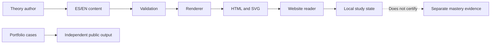
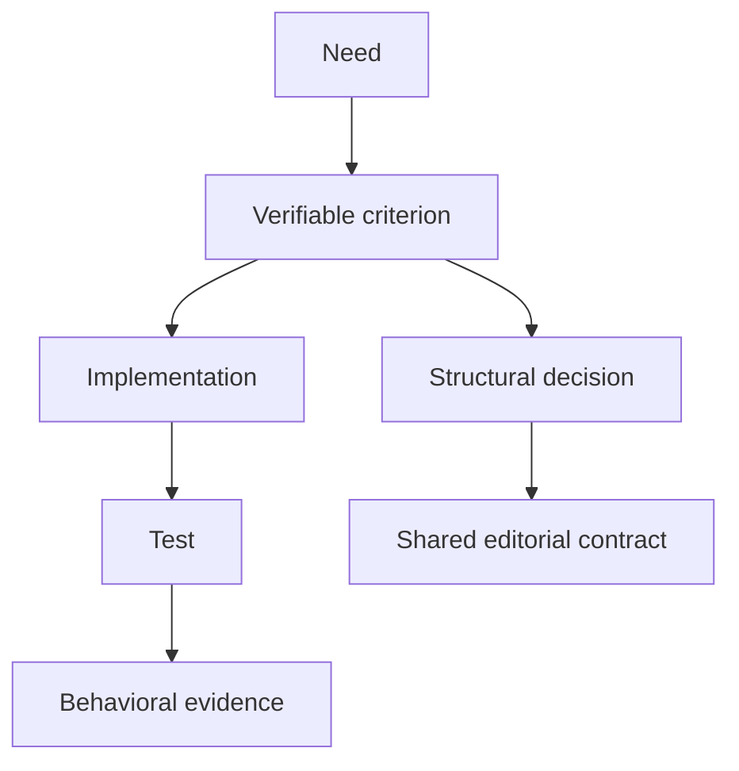
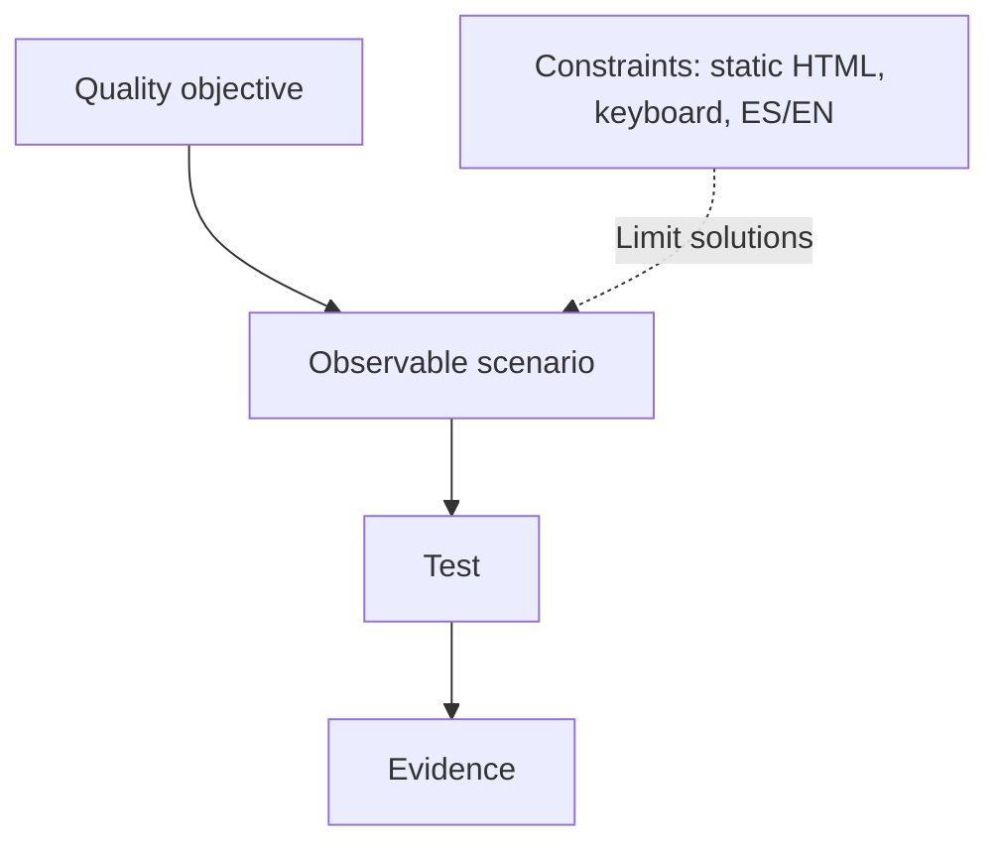
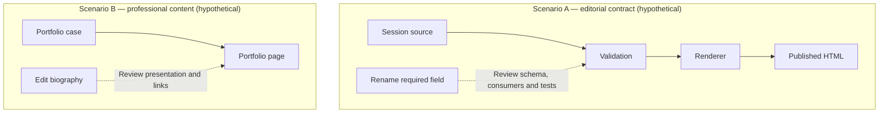
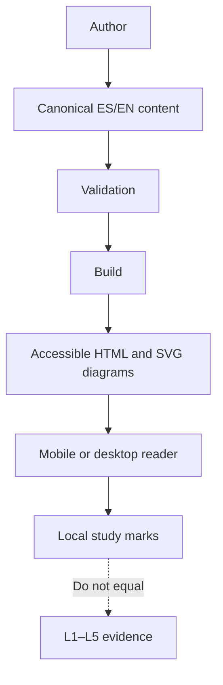
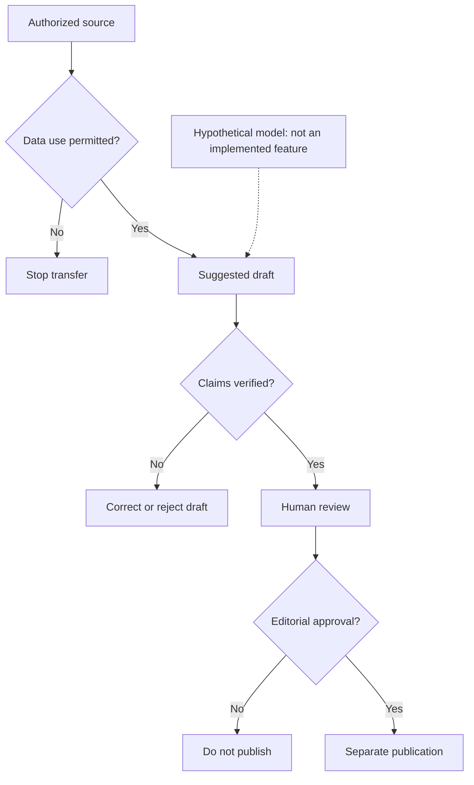
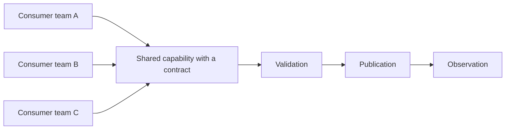

# PA-S001 — Engineering foundations, frontend platform architecture, and AI product engineering

**Phase:** F0 — Accelerator Platform. **Lanes:** Staff→Principal, Frontend Platform Architecture (FPA), AI Product Engineering (AIPE). **Prerequisite:** basic familiarity with components, routes, and application programming interfaces; no earlier session must be certified. **Longitudinal system:** P0, the professional portfolio at `apps/portfolio/` and the separate learning site at `site/`. **Expected study outcome:** explain, test, and defend P0 boundaries with evidence separated from personal study tracking. **Indicative study and practice time:** 3 h 20 min–5 h 10 min; an estimate, not an observation.

> **30-SECOND SYNTHESIS**
> 1. Software engineering spans the life cycle; architecture concerns structural decisions that shape change and quality attributes.
> 2. An application delivers a use case, a system coordinates elements, a platform offers reusable capabilities, and an ecosystem includes external actors and relationships.
> 3. In P0, boundaries among the portfolio, learning site, and possible AI functions need evidence and constraints; job titles and checked boxes cannot justify them.

## Objective

Explain and distinguish the scope concepts, identify a boundary and its dependencies, reason about a quality attribute under a constraint, and defend an initial P0 boundary. Future evidence must show decisions, working behavior, and checked outcomes; reading this theory does not certify mastery.

## Learning Preview

**Before you begin.** A *dependency* is a relationship in which an element relies on another element's contract; a *consumer* uses that contract. A *quality attribute* describes an observable property, whereas a *constraint* limits acceptable solutions. No previous session must be completed: these terms are taught below.

First you will study engineering, architecture, four scopes, quality, constraints, boundaries, coupling, and cohesion in the Staff→Principal lane. Then you will study the frontend platform and, independently, the AI product. The guiding question is: **which responsibilities should be grouped, and which should be separated, when several products start?** The application exercise examines `apps/portfolio/`, `site/`, and a hypothetical assisted-summary function, without assuming that the last one exists. Here, a “contract” means an observable expectation between components, such as input, output, and error behavior.

## Concepts

### Staff → Principal lane: engineering and scope foundations

#### `engineering.software` — Software engineering

**Level 1 — Foundation.** The discipline of specifying, designing, building, verifying, operating, and maintaining software using defensible methods; this scope synthesizes SWEBOK's knowledge areas [R1]. Example: adding a `/en/projects/` route involves more than writing HTML; requirements, accessibility, tests, and evolution also belong to engineering. A list of technologies does not define a life cycle.

**Level 2 — Mechanism: How a need becomes verifiable software.**

**Purpose.** Understand how a need becomes verifiable software and what must be checked before claiming a result.

**Starting situation and causal sequence.** A need to navigate projects becomes a route contract, an implementation and checks of observable behavior. Compilation establishes limited code properties; it does not show that navigation satisfies the need or works with a keyboard.

**Limits and production implication.** Inspect a route that loads but whose link cannot receive focus: the engineering cycle is not complete.

**Retrieval.** Explain the mechanism in your own words and identify one observation needed to verify its outcome. **Explanatory feedback:** distinguish the triggering change from the contract or dependency through which its effect can propagate; do not present hypothetical outcomes as observed facts.

**Level 3 — Deep Dive (optional).** More checks cost time; select those addressing actual risks. A route test does not establish keyboard usability. Type: procedural; objective: trace change to verification; technique: worked walkthrough followed by independent practice; source [R1]; revisit: explain again after building P0. Interaction: not applicable, since a textual sequence and real test suffice.

#### `engineering.architecture` — Software architecture

**Level 1 — Foundation.** Reasoning about a system's elements, relationships, and structural principles; an *architecture description* documents such reasoning and concerns, but is not the executed structure itself [R2]. Example: separating `apps/portfolio/` from `site/` prevents a decision about editorial navigation from automatically determining professional navigation. A diagram without correspondence to actual dependencies is an inaccurate description, not proven architecture.

**Level 2 — Mechanism: How structural decisions bound change.**

**Purpose.** Understand how structural decisions bound change and what must be checked before claiming a result.

**Starting situation and causal sequence.** Assigning responsibilities to the site and portfolio determines which contracts can be shared and which evolve independently. An internal import between them may introduce a dependency that folder diagrams conceal.

**Limits and production implication.** Inspect actual imports before asserting independence; a shared repository proves neither coupling nor isolation.

**Retrieval.** Explain the mechanism in your own words and identify one observation needed to verify its outcome. **Explanatory feedback:** distinguish the triggering change from the contract or dependency through which its effect can propagate; do not present hypothetical outcomes as observed facts.

**Level 3 — Deep Dive (optional).** Record context, alternatives, consequences, and ways to check a decision; distinct folders alone cannot prove quality. Type: structural and decisional; objective: connect boundaries to propagation; technique: dependency map and counterexample; sources [R1, R2]; revisit: inspect imports and routes after P0. Suggested interaction: select a dependency to highlight reachable consumers *only if* derived from a real graph; no-JavaScript alternative: static map.

#### `scope.application` — Application

**Level 1 — Foundation.** Software assembled to support users' tasks in a defined context; this is an **operational definition for this program**, not an ISO normative taxonomy. `apps/portfolio/` presents work and contact information to a visitor. A button library used by several interfaces, without a user task of its own, is not therefore another application.

**Level 2 — Mechanism: How a request becomes a user experience.**

**Purpose.** Understand how a request becomes a user experience and what must be checked before claiming a result.

**Starting situation and causal sequence.** A URL reaches the router, resolves to a view and the browser presents a visitor task. Changing the route can affect inbound links even when the view still works.

**Limits and production implication.** A style package does not become an application merely by having development routes.

**Retrieval.** Explain the mechanism in your own words and identify one observation needed to verify its outcome. **Explanatory feedback:** distinguish the triggering change from the contract or dependency through which its effect can propagate; do not present hypothetical outcomes as observed facts.

**Level 3 — Deep Dive (optional).** An application may include services, and organizations use the word differently; declare the analytical scope before drawing it. Type: conceptual; objective: identify user responsibility; technique: contrast with a library; sources [R1, R2] and P0 convention [P1]; revisit: classify `apps/portfolio/` during implementation. Interaction: not applicable.

#### `scope.system` — System

**Level 1 — Foundation.** A bounded set of interacting elements serving a purpose; the boundary depends on the analytical question [R2]. For publishing, the generator, content files, and generated HTML may form a system; for the visitor's experience, browser and network also matter. A folder alone does not define this boundary.

**Level 2 — Mechanism: How components cooperate to publish a session.**

**Purpose.** Understand how components cooperate to publish a session and what must be checked before claiming a result.

**Starting situation and causal sequence.** Content enters validation; the renderer and diagram compiler generate HTML and SVG for the browser. The outcome depends on each stage producing its required artifact.

**Limits and production implication.** If Mermaid fails, publishing a page without its diagram violates the publishing contract.

**Retrieval.** Explain the mechanism in your own words and identify one observation needed to verify its outcome. **Explanatory feedback:** distinguish the triggering change from the contract or dependency through which its effect can propagate; do not present hypothetical outcomes as observed facts.

**Level 3 — Deep Dive (optional).** Make inclusions, exclusions, and environment explicit to avoid assigning external failures to the wrong component. Type: structural; objective: draw the publication-system boundary; technique: element and failure map; sources [R2, P1]; revisit: redraw for an actual failure. Interaction: not applicable.

#### `scope.platform` — Platform

**Level 1 — Foundation.** In this program, a product offering shared capabilities with contracts and consumers; CNCF describes internal platforms as self-service offerings for teams [R4]. A bilingual content layer, visual tokens, and a Mermaid→SVG pipeline could serve many sessions; a component copied once does not yet demonstrate a useful platform.

**Level 2 — Mechanism: How a shared capability serves consumers.**

**Purpose.** Understand how a shared capability serves consumers and what must be checked before claiming a result.

**Starting situation and causal sequence.** An author supplies a session matching the schema; the common renderer validates and publishes it without copying session-specific code. Reuse is demonstrated through real consumers and compatible changes.

**Limits and production implication.** A single session demonstrates a reusable prototype, not platform adoption or productivity.

**Retrieval.** Explain the mechanism in your own words and identify one observation needed to verify its outcome. **Explanatory feedback:** distinguish the triggering change from the contract or dependency through which its effect can propagate; do not present hypothetical outcomes as observed facts.

**Level 3 — Deep Dive (optional).** Premature abstraction can impose expensive conventions; a divergent consumer may need an extension or different boundary. Type: structural and decisional; objective: weigh reuse against cost; technique: consumer/trade-off matrix; sources [R4, P1]; revisit: observe a second session before generalizing. Interaction: not applicable.

#### `scope.ecosystem` — Ecosystem

**Level 1 — Foundation.** The network of products, people, teams, rules, and integrations shaping a solution; this is an **analytical abstraction**, not a formal hierarchy guaranteed by [R2]. P0 might include the content author, learner, hosting, browser, test tools, and portfolio visitors. It is not synonymous with “a very large repository.”

**Level 2 — Mechanism: How change crosses actors without shared code.**

**Purpose.** Understand how change crosses actors without shared code and what must be checked before claiming a result.

**Starting situation and causal sequence.** A schema change can require coordination among authors, translators, renderer maintainers and deployment. Dependencies can be contractual or operational even when actors use different repositories.

**Limits and production implication.** Do not confuse repository boundaries with the ecosystem of people and services.

**Retrieval.** Explain the mechanism in your own words and identify one observation needed to verify its outcome. **Explanatory feedback:** distinguish the triggering change from the contract or dependency through which its effect can propagate; do not present hypothetical outcomes as observed facts.

**Level 3 — Deep Dive (optional).** The ecosystem boundary is a modeling choice: including everything makes the model useless; excluding critical dependencies hides risks. Type: structural; objective: identify actors and contracts; technique: change map; sources [R2, P1]; revisit: add real dependencies when they exist. Interaction: not applicable.

#### `quality.attribute` — Quality attribute

**Level 1 — Foundation.** A quality property to specify and evaluate for a product; ISO/IEC 25010:2023 supplies a reference model, not an automatic score for this site [R3]. In P0, accessibility and performance are distinct concerns: a page may load quickly yet have controls impossible to operate by keyboard [R5, R6].

**Level 2 — Mechanism: How a property becomes an observable criterion.**

**Purpose.** Understand how a property becomes an observable criterion and what must be checked before claiming a result.

**Starting situation and causal sequence.** Specify context, stimulus and observable result: navigate the outline by keyboard on mobile without losing focus. Record a real test rather than inferring its outcome from a screenshot.

**Limits and production implication.** A fast page may be inaccessible; one attribute does not guarantee another.

**Retrieval.** Explain the mechanism in your own words and identify one observation needed to verify its outcome. **Explanatory feedback:** distinguish the triggering change from the contract or dependency through which its effect can propagate; do not present hypothetical outcomes as observed facts.

**Level 3 — Deep Dive (optional).** Attributes may conflict: loading widgets may affect responsiveness; measure both before optimizing. Type: decisional; objective: state a test scenario; technique: worked example and comparison; sources [R3, R5, R6]; revisit: revalidate after site changes. Interaction: not applicable.

#### `quality.constraint` — Engineering constraint

**Level 1 — Foundation.** A condition limiting admissible solutions, distinct from an attribute we aim to achieve. “Publish as static HTML readable without JavaScript” constrains the design of `site/`; “be accessible” names a property that needs concrete criteria. A team's preference does not automatically become a constraint.

**Level 2 — Mechanism: How a constraint eliminates design alternatives.**

**Purpose.** Understand how a constraint eliminates design alternatives and what must be checked before claiming a result.

**Starting situation and causal sequence.** Requiring reading without JavaScript means explanations and answers must exist in initial HTML; scripts may enhance presentation only. A solution generating all theory on the client violates that condition.

**Limits and production implication.** Choosing React is neither a quality attribute nor a constraint without justification.

**Retrieval.** Explain the mechanism in your own words and identify one observation needed to verify its outcome. **Explanatory feedback:** distinguish the triggering change from the contract or dependency through which its effect can propagate; do not present hypothetical outcomes as observed facts.

**Level 3 — Deep Dive (optional).** Record each constraint's origin and owner; a false constraint may discard a better option. Type: decisional; objective: separate aim from condition; technique: justified classification; sources [R3, P1]; revisit: consult real repository criteria. Interaction: not applicable.

#### `design.boundary` — Boundary

**Level 1 — Foundation.** A delineation of responsibility and permitted interaction between parts [R2]. `apps/portfolio/` holds professional communication; `site/` holds full theory and study state. A public link may be suitable; importing private study state into the portfolio could violate its purpose.

**Level 2 — Mechanism: How a boundary limits change propagation.**

**Purpose.** Understand how a boundary limits change propagation and what must be checked before claiming a result.

**Starting situation and causal sequence.** A boundary allows public links between portfolio and site while preventing the portfolio from depending on the site's private flashcard schema. Editorial schema changes should affect the renderer and its tests.

**Limits and production implication.** A boundary does not forbid communication; it specifies permitted contracts.

**Retrieval.** Explain the mechanism in your own words and identify one observation needed to verify its outcome. **Explanatory feedback:** distinguish the triggering change from the contract or dependency through which its effect can propagate; do not present hypothetical outcomes as observed facts.

**Level 3 — Deep Dive (optional).** Separation may duplicate styles and deployment work; share tokens only when their contract is stable. Type: structural; objective: anticipate propagation; technique: hypothetical change and map; sources [R2, P1]; revisit: inspect actual import differences. Interaction: not applicable.

#### `design.coupling` — Coupling

**Level 1 — Foundation.** [Coupling:: Dependency between parts that propagates changes] is the degree and kind of dependency between elements; this exercise asks **which change forces a consumer change**, without inventing a numeric index [R1]. If the portfolio directly reads the site's internal JSON, renaming a field could break it.

**Level 2 — Mechanism: How a contract change affects a consumer.**

**Purpose.** Understand how a contract change affects a consumer and what must be checked before claiming a result.

**Starting situation and causal sequence.** Initially a producer provides `page.title` and a consumer reads that field. If the producer switches to `page.heading` without adapting the consumer or preserving compatibility, rendering may fail or omit content. The architectural cause is dependency on the internal contract, not the rename itself.

**Limits and production implication.** Compare coordinated updates, a temporary alias and an adapter; each has migration costs.

**Retrieval.** Explain the mechanism in your own words and identify one observation needed to verify its outcome. **Explanatory feedback:** distinguish the triggering change from the contract or dependency through which its effect can propagate; do not present hypothetical outcomes as observed facts.

**Level 3 — Deep Dive (optional).** Dependency direction and stability matter more than counting imports; verify breakage with a contract test before concluding. Type: causal/structural; objective: predict change impact; technique: predict→reveal with two graphs; sources [R1, R2]; revisit: run a controlled change. Editorial interaction possible: choose an edge to highlight transitive consumers of an explicit graph; without a real graph, use two static drawings.

#### `design.cohesion` — Cohesion

**Level 1 — Foundation.** How closely a module's responsibilities contribute to a recognizable purpose [R1]. A `session-renderer` module organizing sections, citations, and session diagrams has related work; if it also manages portfolio contacts and AI provider secrets, it mixes independent reasons for change.

**Level 2 — Mechanism: How reasons for change reveal cohesion.**

**Purpose.** Understand how reasons for change reveal cohesion and what must be checked before claiming a result.

**Starting situation and causal sequence.** A renderer handling sections, citations and diagrams groups related editorial responsibilities. If it also handles portfolio contacts, unrelated changes force edits to the same module.

**Limits and production implication.** Splitting everything into tiny files does not guarantee cohesion and can increase coordination.

**Retrieval.** Explain the mechanism in your own words and identify one observation needed to verify its outcome. **Explanatory feedback:** distinguish the triggering change from the contract or dependency through which its effect can propagate; do not present hypothetical outcomes as observed facts.

**Level 3 — Deep Dive (optional).** Excessive splitting creates more interfaces and coordination; examine real cases before extraction. Type: conceptual/decisional; objective: group responsibilities; technique: contrast change reasons; source [R1]; revisit: review P0's first diff. Interaction: not applicable.

#### `role.staff` — Staff scope

**Level 1 — Foundation.** In this program, Staff means resolving problems spanning teams or domains through explainable technical decisions, delivery, and mentorship. This is a **curriculum convention**, not a universal job definition [P1]. Example: agree on the site's navigation contract and help two authors use it.

**Level 2 — Mechanism: How a technical decision reaches other teams.**

**Purpose.** Understand how a technical decision reaches other teams and what must be checked before claiming a result.

**Starting situation and causal sequence.** An incompatibility leads to options, ownership agreement, a documented contract and observed adoption. Staff impact depends on collaboration and outcomes, not lines of code.

**Limits and production implication.** A proposal without adoption demonstrates reasoning, not verified leadership.

**Retrieval.** Explain the mechanism in your own words and identify one observation needed to verify its outcome. **Explanatory feedback:** distinguish the triggering change from the contract or dependency through which its effect can propagate; do not present hypothetical outcomes as observed facts.

**Level 3 — Deep Dive (optional).** A title does not certify competence; distinguish proposal from actual adoption to avoid claiming unobserved leadership. Type: decisional; objective: frame evidence; technique: case analysis; source [P1]; revisit: document a decision and real feedback. Interaction: not applicable.

#### `role.principal` — Principal scope

**Level 1 — Foundation.** In the program's model, Principal adds technical direction and decisions across multiple systems, with explicit consequences for evolution and governance [P1]. Example: assess whether P0's bilingual contract can serve 120 chapters without forcing a tool on unrelated projects.

**Level 2 — Mechanism: How a decision evolves across systems.**

**Purpose.** Understand how a decision evolves across systems and what must be checked before claiming a result.

**Starting situation and causal sequence.** Comparing alternatives, constraints and migration costs supports a revisable rule across systems. Revisit it as new consumers emerge.

**Limits and production implication.** Choosing a framework for one page does not demonstrate Principal scope.

**Retrieval.** Explain the mechanism in your own words and identify one observation needed to verify its outcome. **Explanatory feedback:** distinguish the triggering change from the contract or dependency through which its effect can propagate; do not present hypothetical outcomes as observed facts.

**Level 3 — Deep Dive (optional).** Scope depends on organization and context; here it is a learning aim, not a career prediction. Type: decisional; objective: compare decision radius; technique: scope matrix; source [P1]; revisit: compare P0's decision with its evolution in PA-S002. Interaction: not applicable.

### Frontend Platform Architecture (FPA) lane

#### `fpa.frontend-platform` — Frontend platform architecture

**Level 1 — Foundation.** Design of shared frontend capabilities, contracts, consumers, and evolution: for example navigation shell, session schema, theme, accessible components, and diagram compilation. This is a **program synthesis** of platform [R4], architecture [R2], and accessibility [R5]. An isolated marketing page can use a shared component without itself becoming a platform.

**Level 2 — Mechanism: How a session publishes and preserves bilingual state.**

**Purpose.** Understand how a session publishes and preserves bilingual state and what must be checked before claiming a result.

**Starting situation and causal sequence.** An author defines stable section IDs; the renderer produces navigation and HTML; study marks use the same IDs in ES/EN. Translation changes labels, not exercise identity.

**Limits and production implication.** Checking a box records activity and never certifies L1–L5.

**Retrieval.** Explain the mechanism in your own words and identify one observation needed to verify its outcome. **Explanatory feedback:** distinguish the triggering change from the contract or dependency through which its effect can propagate; do not present hypothetical outcomes as observed facts.

**Level 3 — Deep Dive (optional).** Consider JavaScript failure, schema compatibility, focus, contrast, and script weight; do not call a page “accessible” based solely on a scanner. Type: structural/procedural; objective: follow author→reader contract; technique: diagram and keyboard check; sources [R2, R4, R5, P1]; revisit: second bilingual session. Interaction: language selector showing that ID and state persist, only if the site implements actual persistence; no-JavaScript alternative: ID table.

### AI Product Engineering (AIPE) lane

#### `aipe.ai-product` — AI product engineering

**Level 1 — Foundation.** Treats an AI function as part of a product flow with usage context, permitted inputs, output, risks, and evaluation; NIST's voluntary AI RMF organizes risk management as Govern, Map, Measure, and Manage [R7]. **Hypothetical** example: an assisted summary of a public portfolio case study; there is no evidence that P0 has or needs this feature.

**Level 2 — Mechanism: How an AI draft reaches—or fails to reach—publication.**

**Purpose.** Understand how an ai draft reaches—or fails to reach—publication and what must be checked before claiming a result.

**Starting situation and causal sequence.** First verify permission to use data; a model may then propose a draft checked against sources and submitted for human review. Missing permission or evidence stops the flow; publishing requires a separate editorial decision.

**Limits and production implication.** This is a hypothetical model, not a deployed AI feature or measured accuracy evaluation.

**Retrieval.** Explain the mechanism in your own words and identify one observation needed to verify its outcome. **Explanatory feedback:** distinguish the triggering change from the contract or dependency through which its effect can propagate; do not present hypothetical outcomes as observed facts.

**Level 3 — Deep Dive (optional).** Outputs may vary or be wrong; bound privacy, failure, cost, and evaluation before deployment. Type: causal/decisional; objective: distinguish demo from product; technique: failure walkthrough and criteria-based decision; sources [R7, R8]; revisit: only if a real use case emerges. Interaction: not applicable now; no model or approved dataset exists to simulate quality.

### Learning and evidence mechanics (auxiliary, separate from the lanes)

#### `learning.evidence` — Evidence and study state

**Level 1 — Foundation.** In the program, evidence is an artifact or observation traceable to a capability claim; an exercise checkbox indicates declared activity, not a validated outcome [P1]. Example: “I read about keyboard navigation” is study state; a test record plus human review of the route is evidence.

**Level 2 — Mechanism: How activity stays separate from evidence.**

**Purpose.** Understand how activity stays separate from evidence and what must be checked before claiming a result.

**Starting situation and causal sequence.** Checking an exercise changes only reversible study state. An executed, reviewed test is recorded elsewhere with context and result; the dashboard does not infer mastery from a mark.

**Limits and production implication.** A checked box does not equal demonstrated implementation.

**Retrieval.** Explain the mechanism in your own words and identify one observation needed to verify its outcome. **Explanatory feedback:** distinguish the triggering change from the contract or dependency through which its effect can propagate; do not present hypothetical outcomes as observed facts.

**Level 3 — Deep Dive (optional).** Without an artifact or observable criterion, the level remains pending; “cannot be determined” is valid. Type: conceptual/decisional; objective: separate states; technique: classification and feedback; source [P1]; revisit: after building and review. Interaction: reversible study controls because the variable is a tracking declaration; without JS show readable non-editable state, without false claims.

#### `learning.levels` — L1–L5 levels

**Level 1 — Foundation.** The program distinguishes L1 Explain, L2 Implement, L3 Operate, L4 Decide, and L5 Lead [P1]. They are not percentages and are not the three **reading depth levels** of a concept. Explaining why a map distinguishes site from portfolio may support L1 but does not prove that the boundary exists in code.

**Level 2 — Mechanism: How each level maps to different proof.**

**Purpose.** Understand how each level maps to different proof and what must be checked before claiming a result.

**Starting situation and causal sequence.** L1 requires explanation; L2 implementation; L3 operation; L4 decisions with alternatives; L5 leadership with verified adoption. These are distinct claims, not levels inferred from exercise counts.

**Limits and production implication.** Completing a tutorial does not demonstrate leadership or production operation.

**Retrieval.** Explain the mechanism in your own words and identify one observation needed to verify its outcome. **Explanatory feedback:** distinguish the triggering change from the contract or dependency through which its effect can propagate; do not present hypothetical outcomes as observed facts.

**Level 3 — Deep Dive (optional).** Evidence can be partial or contradictory; record its scope and do not infer higher levels. Type: structural; objective: link claim to proof; technique: evidence→level matrix; source [P1]; revisit: reevaluate after new artifacts. Interaction: not applicable until real records exist.

### Atomic coverage manifest

**How to use this map.** The concepts are taught in the order below. Prerequisites are suggested reading sequences, not access gates. Each concept has a stable internal identifier for links and state tracking; this table presents **readable names**, not software keys. Techniques indicate ways to practise a kind of knowledge; they do not certify that a widget has been deployed.

| Concept | Lane | Knowledge type | Suggested prerequisite | Learning method |
|---|---|---|---|---|
| Software engineering | Staff → Principal | Procedural | None | SWEBOK; guided change walkthrough |
| Software architecture | Staff → Principal | Structural and decisional | Software engineering | Contracts and dependencies |
| Application | Staff → Principal | Conceptual | Software engineering | User task |
| System | Staff → Principal | Structural | Application | Analysis boundary |
| Platform | Staff → Principal | Structural and decisional | System | Capability and consumers |
| Ecosystem | Staff → Principal | Structural | System | External actors and services |
| Quality attribute | Staff → Principal | Decisional | Architecture | Testable scenario |
| Engineering constraint | Staff → Principal | Decisional | Quality attribute | Acceptable options |
| Boundary | Staff → Principal | Structural | System | Contracts |
| Coupling | Staff → Principal | Causal and structural | Boundary | Change propagation |
| Cohesion | Staff → Principal | Conceptual and decisional | Boundary | Reasons for change |
| Staff scope | Staff → Principal | Decisional | Software engineering | Influence and evidence |
| Principal scope | Staff → Principal | Decisional | Staff scope | Multi-system evolution |
| Frontend platform architecture | FPA | Structural and procedural | Platform and boundary | Author → publishing → reader |
| AI product engineering | AIPE | Causal and decisional | Constraint and boundary | Permissions, verification and review |
| Evidence and study state | Auxiliary | Conceptual and decisional | None | Activity ≠ outcome |
| Levels L1–L5 | Auxiliary | Structural | Evidence and study state | Distinct demonstrations |

**How to read the matrix.** Conceptual contrasts distinguish similar terms; a dependency map represents relationships; a worked example demonstrates a procedure; a decision matrix compares alternatives. None of these representations replaces the full definition and explanation provided in its corresponding section [R1, R2, P1].

## Main Topic — Choosing P0's initial boundaries

**Definition and purpose.** P0's initial architecture establishes responsibilities, contracts and decisions whose changes could affect multiple components. P0 contains two distinct public products: the professional portfolio at `apps/portfolio/` for visitors and the learning website at `site/` for readers and learners. Sharing a repository does not automatically make these products one application or a platform. Those labels depend on purpose and actual consumers [R2, R4, P1].

**Step 1: identify user outcomes.** The portfolio allows visitors to understand professional work, systems and evidence. The learning website publishes chapters, examples, diagrams, navigation, exercises and study tracking. Both may share deployment infrastructure or accessibility requirements, but they serve different needs. Combining their navigation or content logic would make independent evolution harder.

**Step 2: draw the boundary.** Within `site/`, an editorial pipeline accepts theory, validates it and uses a renderer to produce an HTML page with SVG diagrams. The page is read in a browser; local exercise-state data remains separate. The portfolio application should not need to import internal chapter-renderer machinery to publish project descriptions. The diagram below is a **teaching model of responsibilities**, not an inspected import graph.



**Step 3: define contracts before sharing code.** An editorial contract should specify a stable session identity, locale, sections, references and exercise keys. The renderer should produce semantic HTML and resolvable references. Study tracking should persist reversible marks without interpreting them as mastery evidence. If two sessions consume the same stable contract, a shared renderer can be justified. Sharing it without real consumers would be an architectural hypothesis, not a demonstrated platform [R2, R4, P1].

**Step 4: examine constraints and quality attributes.** Theory must be readable without JavaScript; controls must be operable by keyboard and touch; concept coverage must remain semantically equivalent in ES/EN. “Theory exists in initial HTML” constrains the implementation. “The interface is accessible in defined scenarios” is a property evaluated through observable tests. A passing `npm run check` alone cannot certify accessibility or comprehension [R3, R5, P1].

| Decision | Alternative | Potential benefit | Cost or risk | How to check |
|---|---|---|---|---|
| Keep portfolio and learning site separate | One application with shared navigation | Independent editorial changes | Some duplicated infrastructure | Inspect imports, routes and cross-product changes |
| Reuse a stable editorial contract | Different content format per session | Consistent publishing and less repetition | Migrations when the contract changes | Publish a second session without duplicating the renderer |
| Serve readable HTML without JS | Generate all theory in the client | Reading and links survive missing scripts | Fewer enhancements without JS | Disable JS and read the complete lesson |
| Track reversible study marks | Infer mastery from each click | Voluntary study activity tracking | Confusing activity with evidence | Verify L1–L5 do not change on a mark |
| Keep AI as a proposal | Immediately integrate a provider | Avoid risks before need is validated | Defer hypothetical automation | Evaluate use case, data, alternatives and review |

**Worked example: changing locale.** If Spanish prose in an exercise changes, its persistent key should stay stable. The English version uses that same key so learners do not lose the mark when switching languages. If instead the translated question is used as a storage key, an editorial change can invalidate progress: the design created an unstable boundary between presentation and state.

**Architectural counterexample.** Separate directories do not suffice when the portfolio imports private editorial-site objects without a contract. Declaring “microservices for everything” does not guarantee quality either: it adds deployments, calls, failure modes and coordination. A defensible boundary follows responsibilities, dependency direction and the ability to verify consequences [R1, R2].

**Retrieval:** what must be checked before extracting a shared module? **Answer:** prove that more than one consumer needs a stable capability, define the contract and evaluate the cost of changing it. An abstraction without a consumer does not demonstrate architectural value.

**Staff → Principal implication.** Staff scope includes defending the first boundary and establishing tests that make it operable; Principal scope addresses evolution of contracts across additional sessions and products. **FPA implication:** deliver accessible chapters and UI components under explicit contracts. **AIPE implication:** do not introduce an AI function before checking authorized inputs, risks and evaluation. This is a labeled synthesis of the three separate lanes, not a replacement for their definitions.

## Subtopics

### `sub.software-vs-architecture` — Software engineering and architecture

**Software engineering: definition.** This discipline includes eliciting and specifying needs, designing, implementing, verifying, deploying, operating and maintaining software. Some engineering activities can change without changing a system's structure, such as correcting copy or fixing a broken link [R1]. Engineering is not merely the act of writing code.

**Software architecture: definition.** Architecture is reasoning about system elements, their relationships and the principles guiding their evolution. It explains why contracts and boundaries exist, not merely how directories are drawn [R2]. An architecture description is a document whose correspondence with working code must be checked.

**Mechanism applied to P0.** Adding a session requires a testable requirement (“the reader can open PA-S002”), a structure (“chapters follow a shared section contract”), implementation, tests and maintenance. The requirement belongs to the engineering life cycle. The editorial contract and relationships among renderer, sources and browser are architectural decisions within that life cycle. A site can pass link tests yet depend on a brittle schema; it can also have a polished architecture diagram and broken links.



**Contrasting example.** Correcting a card's font size is usually a local product change; renaming a required schema field requires inspecting consumers and potential migrations. The second action is architectural because it may cross component boundaries. Propagation remains a possibility to be checked through imports and tests, not an already measured impact.

**Trade-off and production implications.** Documenting every line of code provides little value. Record decisions with consequences for evolution, security, operation or user experience: context, alternatives, decision, risks and verification method. This keeps documentation useful and avoids confusing diagram quantity with quality [R1, R2].

**Guided practice.** Classify (a) repairing a broken route, (b) changing the shared contract for persistent IDs, and (c) checking keyboard use on mobile. **Explanatory answer:** (a) and (c) are engineering-life-cycle tasks; (b) is a structural decision within that same engineering process. Engineering tasks may also provide evidence about architecture.

**Retrieval:** does a green build demonstrate appropriate architecture? **Answer:** no. It establishes only the properties covered by the checks that actually ran; relevant change and quality scenarios remain necessary.

### `sub.scope-layers` — Application, system, platform, and ecosystem

**Application.** Software designed to support recognizable tasks for a person. The portfolio lets visitors browse professional cases and follow contact links. Its practical boundary derives from visitor experience. A button library is not automatically an application because it does not satisfy that complete user outcome by itself [R1, P1].

**System.** A delimited set of elements interacting toward a purpose. When the question is “how is PA-S001 published?”, the system under analysis may include the source, validator, renderer, HTML and hosting. A system may span several applications, and its boundary depends on the question—not on whether a directory is called `system` [R2].

**Platform.** Offers shared capabilities through contracts for identifiable consumers. In P0, the editorial contract and renderer could become a reusable capability if another session actually consumes them. A shared dependency alone does not demonstrate a mature platform: consumability, evolution and support matter [R4, P1].

**Ecosystem.** Includes actors and relationships that shape outcomes: author, learner, teams, browsers, hosting, standards, external links and related systems. This is a perspective, not simply “the largest system.” It can include dependencies outside the team's control [R2].

| Perspective | Question answered | P0 example | What lies outside for this question |
|---|---|---|---|
| Application | What task does the user perform? | Browse portfolio cases | Internal editorial pipeline |
| System | Which elements cooperate for a purpose? | Source, validator, renderer, HTML | Actors unrelated to this publication |
| Platform | Which capability serves multiple internal consumers? | Session schema + renderer | A function with no consumers |
| Ecosystem | Which actors and dependencies shape the solution? | Authors, browser, hosting and standards | Elements unrelated to the decision under analysis |

**Mechanism and edge case.** Moving from an accessibility question to a deployment question can expand the system boundary to include infrastructure and browser. That does not turn the application into a platform: the analyst changed perspective. Rigid concentric circles would be misleading because these categories overlap and answer different questions.

**Practice through contrast.** “The renderer serves PA-S001” describes a technical capability. “The renderer serves multiple sessions through a stable contract and demonstrated adoption” makes its platform role worth evaluating. **Explanatory answer:** the distinguishing features are consumers and shared contract, not a directory name.

**Retrieval:** can something be a system without being a platform? **Answer:** yes. Coordinating elements for a purpose does not imply offering reusable capabilities to separate consumers.

### `sub.quality-constraints` — Quality attributes and constraints

**Quality attribute.** A property worth evaluating, such as accessibility, reliability, performance or maintainability. ISO/IEC 25010 provides quality categories; it does not assign automatic scores to our application. An attribute becomes actionable when expressed as an observable scenario [R3].

**Engineering constraint.** A condition limiting permitted solutions. “Academic content must exist in readable HTML without JavaScript” rules out approaches in which theory is created only after browser code runs. This differs from seeking “an accessible experience,” which requires explicit criteria and tests in concrete scenarios [R5, P1].

**Turn an aspiration into a test.** A scenario contains context, stimulus and expected observation. Example: on a phone with an external keyboard, the learner opens the contents, navigates to “Boundary” and returns without a focus trap. Expected results include visible focus, operable sequence and correct destination. This checks one delimited scenario, not complete WCAG conformance.



**Delimited causal model.** With text already present in initial HTML, disabling JavaScript does not remove the theory; it may disable script-based persistence and controls. When text is created exclusively with JavaScript, disabling scripts leaves the theory absent. These statements concern content availability, not measured accessibility or a network guarantee [R5, P1].

**Trade-off and edge case.** Static generation requires a build and can make some content less dynamic, but supports a verifiable reading baseline. Client-only rendering may simplify certain runtime updates, but without a real fallback it would violate this project's requirement. Do not assign quality because the code “uses React” or “uses HTML”: test user behavior and constraints.

**Practice with feedback.** Classify “load within an agreed measured duration,” “require JavaScript,” and “the contents can be navigated by keyboard.” **Answer:** the first and third can become quality scenarios when their conditions are specified; the second is a technology constraint. Do not invent a timing target without agreeing its context.

**Retrieval:** is a constraint equivalent to a quality attribute? **Answer:** no. The attribute expresses a property worth achieving; the constraint delimits acceptable implementations.

### `sub.boundary-dependencies` — Boundaries, coupling, and cohesion

**Boundary.** Determines what responsibility belongs to a component and which interactions are allowed through a contract. In P0, the portfolio manages professional presentation while the academic site manages theory, exercises and study state. Sharing a public link is not the same as importing another product's private structures [R2, P1].

**Coupling.** Describes dependencies between parts: a producer change can require consumer changes. Counting imports alone does not capture the risk; dependency direction, stability and contract scope matter. An exercise ID derived from translated copy introduces accidental coupling between locale and persistence [R1, R2].

**Cohesion.** Describes whether module responsibilities support a recognizable purpose. A renderer concerned with sections, tables, citations and diagrams groups related reasons for change. Adding portfolio contact-message processing would introduce a separate reason for change [R1].

**Hypothetical mechanism, not a verified graph.** Two conceptual diagrams show possible review surfaces; **they do not compute actually reachable consumers in the repository**:



**Observation and consequence.** Scenario A might require migrations when compatibility breaks; scenario B should remain local under the intended boundary. Effective impact requires inspecting the actual import graph, diff and tests. A selector may compare scenarios and explain consequences, **but must not highlight nodes as verified dependencies without evidence**.

**Counterexample.** Splitting every function into a separate package maximizes boundaries but also adds interfaces, tooling and coordination. Good architecture balances independence with integration cost. In production, inspect cross-cutting changes, accessibility, contract tests and ownership before extracting more modules.

**Practice.** A translation changes the visible “Confirm” label but not its persistent key. **Explanatory answer:** in a sound design, study state remains intact; if the key derives from the label, state could fork. The mitigation is shared semantic IDs and locale-switch regression tests.

**Retrieval:** does every cross-product link violate a boundary? **Answer:** no. A stable, intentional public link may be a valid contract; what matters is whether the relationship is permitted and stable.

### `sub.frontend-platform` — First frontend platform slice

**Definition within its lane.** Frontend Platform Architecture (FPA) examines shared interface capabilities, contracts, developer experience, accessibility and evolution. In P0 the frontend foundation includes the layout, navigation, theming, bilingual chapter model and diagram compilation. It is not equivalent to a component catalog without consumers [R2, R4, R5, P1].

**Responsibilities taught separately.** The editorial schema specifies what an author can publish: stable ID, title, sections, sources, visualizations and exercises. The validator checks that shape and rejects incomplete inputs. The renderer turns validated input into semantic HTML and ES/EN routes. The browser displays the lesson and may store reversible marks. None of those mechanisms should invent mastery levels.



**Evolution mechanism.** If PA-S002 follows the same contract, it can publish a chapter without copying the renderer. If it needs a new visualization type, a block with semantics and fallback is defined, the schema is explicitly migrated and previous sessions retested. This reuse hypothesis must be demonstrated by PA-S002; it is not evidence of success without a second actual consumer [R4, P1].

**Failures and decisions.** It is incorrect for theory to disappear when JS is disabled, for study checkboxes to be disabled, or for a Mermaid map to lack an accessible SVG. Hiding all theory behind cards that only appear after interaction is also wrong. Prioritize readable publication, stable navigation and progressively enhanced controls; keep activity metrics distinct from L1–L5 evidence.

**Practice with answer.** A team suggests introducing another framework just to render content tables. **Explanatory answer:** the requirement is readable, accessible and maintainable tables; a new dependency needs a justification of its cost and compatibility. A table alone does not require a framework.

**Retrieval:** when is it defensible to call the editorial renderer a platform? **Answer:** when multiple consumers use its contracts with evolution and operational support; one session is an initial prototype, not sufficient proof.

### `sub.ai-product` — Boundary of an AI function

**Definition within its lane.** AI Product Engineering (AIPE) integrates artificial intelligence into product workflows with use cases, allowed inputs, evaluation, risks, review, costs and operation. It is not synonymous with “calling a model,” nor does P0 require a provider by default. NIST's AI Risk Management Framework organizes governance, context, measurement and risk management [R7, R8].

**Problem first, model second.** A possible future use case is summarizing a public portfolio system description. Before implementation, establish the need: which task does it save, who benefits, which deterministic alternative exists, and which failures matter? A manual summary or editorial template may be more controllable in the first slice [R7].

**Hypothetical mechanism.** For authorized content, the workflow can enforce explicit boundaries. A source is identified and prepared; generation creates a **draft**; claims are checked against cited sources; a person may reject or approve content editorially. Approval is neither automatic nor implemented in PA-S001.



**Failures that block the flow.** If data is not authorized for provider transfer, stop it. If citations do not support claims, keep a draft and correct it. If human review is required but unavailable, do not publish. A simulator illustrating these controls does not perform a real safety, privacy or quality evaluation.

**Trade-offs and operation.** Automation may save writing effort but introduces variability, risk of unsupported claims, observability and maintenance needs. Production requires evaluation criteria, data controls, rejection mechanisms, monitoring and accountable owners [R7, R8]. This session contains no measured savings or accuracy figures.

**Practice with feedback.** The draft uses a public source but invents a number. **Answer:** it must not be published as fact; plausible output does not replace evidence validation. The non-AI alternative remains available.

**Retrieval:** is a prototype that “sounds convincing” production-ready? **Answer:** no. Need, safety, evaluation, review, operation and costs must be defended before recommending integration.

### Cross-domain synthesis (after the three lanes)

Staff→Principal frames who argues for and reviews scope decisions; FPA defines shared contracts and browser behavior; AIPE adds input control, variable output, and evaluation only if there is a real function. This is a **design synthesis**: accessible publication affects both the chapter and any generated draft, but an AI output does not itself make an app a platform.

## Theory → Practice Map

**Applying the distinctions requires turning them into verifiable decisions.** This matrix connects knowledge to tasks and observations; no row automatically grants a mastery level.

| Concepts studied | Practical work | What to check | Acceptable evidence |
|---|---|---|---|
| Application, system, platform and ecosystem | Delimit P0 products, elements and actors | The boundary answers a concrete question | Annotated map, assumptions and explanation |
| Architecture, boundary, coupling and cohesion | Compare a contract change with a local editorial change | Real consumers, migrations and tests; keep illustrative and actual graphs distinct | Diff, import inspection and recorded decision |
| Quality attributes and constraints | Test no-JS theory, keyboard navigation and mobile reading | Outcomes observed under delimited scenarios | Browser test results |
| Frontend platform | Publish an ES/EN chapter under one contract | Shared IDs and no missing theory | Built HTML and reviewed semantic parity |
| AI product engineering | Compare manual and hypothetical generated summary | Permissions, citations, human review and alternatives | Explicit analysis and decision |
| Staff/Principal scope and evidence levels | Defend a decision and explain its evolution | Evidence independent from study checkmarks | Reviewed decision record, not invented percentages |

**Linking evidence to learning.** A study activity may be marked while L1–L5 evidence remains empty. Claims of levels require a separately observed, reviewable demonstration [P1].

## Time estimate

The estimate is a guide: reading and retrieval 60–90 min; map and decision 40–60 min; first slice and tests 80–130 min; reflection 20–30 min. Lower sum = 60+40+80+20 = **200 min (3 h 20 min)**; upper sum = 90+60+130+30 = **310 min (5 h 10 min)**. Actual time depends on repository state and has not been measured.

## Real-World Example

### Documented context: internal engineering platforms

**The problem addressed by internal platforms.** The CNCF TAG App Delivery white paper discusses internal platforms as capabilities consumed by engineering teams, emphasizing consumable offerings and self-service. It provides a framework for thinking about platform responsibilities; it **does not report measured outcomes for P0**, nor does it guarantee that every shared tool is a platform [R4].

**Illustrative organizational scenario.** Imagine three teams publishing web products, with each team independently configuring routes, build automation, security checks, deployment conventions and access to operational signals. They preserve local autonomy but repeatedly solve cross-team concerns. This is an invented scenario for applying CNCF's approach, **not** a reported company, incident or empirical case study.

**Step 1 — Identify consumers.** Before extracting shared functionality, a platform team asks what tasks product teams perform, what knowledge these tasks require and which needs recur. Two applications sharing a language does not prove a platform need. Repeated flows under compatible constraints provide a hypothesis that can be investigated [R4].

**Step 2 — Define a capability with a contract.** A platform team may offer a creation and publication process with agreed inputs, validations, observable outputs and documentation. A consumer should know how to request the capability, what behavior is guaranteed, what its limitations are and what happens on failure. A platform is not merely common code; it requires support, evolution and boundaries of responsibility.



**Step 3 — Evaluate alternatives.** One option preserves independent implementations: flexible locally but potentially repetitive to maintain. Another shares packages or templates without introducing a platform service. A third offers a self-service capability with explicit ownership. The decision depends on consumers, differences between their needs, risk and operational capacity. There is no universal winner [R4].

**Step 4 — Examine costs and failure modes.** Centralization can become a bottleneck if one team must approve every change. An unversioned shared contract may break several consumers. An overly general offering may fail to serve real needs. Duplicating everything may also raise maintenance costs. These are plausible architectural effects to validate in observed situations—not quantified outcomes reported here.

### Explicit transfer to P0

**Partial analogy.** In P0, each later learning session acts as a consumer of the site's editorial schema and renderer. When PA-S002 is introduced, its author supplies new theory while the build maintains navigation, source handling, table of contents and study mechanisms. This illustrates reuse. **It does not make individual sessions independent product teams**, nor does it establish the maturity of an internal platform.

**Traceable example.** A new monorepo-architecture section is introduced in Spanish and English. Validation checks that it has stable identity and sources; the renderer turns text and diagrams into HTML/SVG; navigation links to the chapter; study checkboxes share IDs across languages. If the author must copy and edit renderer internals for every new chapter, the purported shared capability is insufficiently decoupled. If another chapter can be added declaratively while previous chapters still work, there is stronger evidence of reuse. Maintenance costs would still need evaluation.

**What can and cannot be concluded.** CNCF supports approaching platforms as consumable capabilities with customers and contracts [R4]. It does **not prove** that P0 has increased productivity, reduced failures or saved money. Such claims would require comparable observations, change records and agreed criteria. The analogy helps formulate a design hypothesis and test, not fabricate results.

**Staff and Principal implications.** Staff scope can define an editorial contract and defend responsibility boundaries. Principal scope examines whether that contract can evolve across many consumers, what governance it requires and when centralization should be avoided. FPA turns the contract into accessible web publishing. AIPE remains a separate lane: an AI feature requires its own use case and evaluation before integration.

**Case retrieval:** what distinguishes a potential editorial platform from a renderer used only once? **Answer:** evidence of consumers, stable contracts, adoption and maintainability. Folder counts and a 'platform' name prove nothing.

## Production-Ready Example (verifiable design, not yet executed)

**Context:** publish `PA-S001` in ES and EN, record reversible reading state, and retain its source. **Normal path:** canonical files → ID schema → coverage/citation check → Mermaid→SVG compilation → static HTML → progressive study controls. On both pages, `PA-S001.exercise.boundary-map` denotes the same exercise; the label changes language, not the key. A portfolio-page link does not import private site data.

**Failure path:** if an ID is missing or SVG compilation fails, the build should identify the file and section and fail; do not serve raw Mermaid as a rendered diagram. Without JavaScript, text, answers, and maps remain readable. **Illustrative minimal contract, not executed implementation:**

```ts
type StudyItem = { id: "PA-S001.exercise.boundary-map"; checked: boolean };
type EvidenceRecord = { artifactId: string; claim: string; verification?: string };
// The study item does not mutate EvidenceRecord or L1–L5.
```

**Required verification:** compare ES/EN IDs and paragraphs, inspect real HTML, tab through focus and toggling, reload stored state, disable JS, and check that no checkbox changes mastery records. An automated heading-presence test does not establish comprehension or complete accessibility. **Risks:** storage conflicts between devices, broken external links, and translations that alter nuance; document limitations and corrections before publishing.

## Visual Learning Guide / Visual Learning Studio

**Interactive concept map.** The map should show understandable labels and separate groupings: engineering and scope foundations, frontend platform, AI product and learning evidence. A study arrow means "understand before integrating," not physical causation. Accessible nodes link to their definition and source; a readable navigation list provides a small-screen alternative. Internal machine keys belong in HTML attributes and structured data, **not in the reader-facing labels**.

**Diagrams adjacent to theory.** Publication flows, boundaries and AI scenarios belong beside the mechanisms they illustrate. The final mind map complements those local diagrams; it never replaces them. SVGs need titles, meaningful text descriptions, source traceability and responsive sizes. Unverified structures and relationships must be labeled as teaching models or hypothetical scenarios.

**Retrieval flashcards.** One card covers each of 17 concepts, one covers the main topic, and one covers each of six subtopics: **24 cards**. The front asks for explanation or judgment after theory; the reverse contains an answer and explains why a common alternative fails. Learners can navigate and flip with keyboard or touch; answers remain available without JavaScript.

**Justified experiences, not decoration.** The conceptual explorer contrasts four perspectives; the structural explorer compares two static scenarios without claiming to inspect a real graph; the causal explorer explains text availability under JS/no-JS assumptions; and the decision explorer evaluates input permission, citation verification and human review without authorizing automatic publication. Each experience exposes its input, mechanism, outcome, source, limits and textual fallback [R1, R2, R3, R4, R5, R7, P1].

**Later retrieval.** After a session, recall concepts without looking, read explanatory feedback and retry at PA-S002 and after a real contract change. Revisits are opportunities, not learning-style diagnoses or mastery scores.

## Exercises

1. **`PA-S001.exercise.classify`:** classify `apps/portfolio/`, `site/`, renderer, and hosting against the four scopes; justify how your system boundary changes for accessibility versus publishing. Criterion: each label has purpose and counterexample; checking it records study only.
2. **`PA-S001.exercise.boundary-map`:** draw portfolio, site, schema, and study-state boundary; name contracts and predict propagation of renaming a translated ID. Compare prediction with imports and tests once a repository exists.
3. **`PA-S001.exercise.quality`:** write an accessibility scenario with context, action, and observation; separate attribute from constraint. Validate in a browser with keyboard and without JavaScript after implementation.
4. **`PA-S001.exercise.ai-decision`:** defend whether a hypothetical summary belongs in the first slice. State permitted data, non-AI alternative, risk, needed evaluation, and output reviewer. Do not implement a provider merely to finish the exercise.

## Verified sources

- [R1] IEEE Computer Society, [SWEBOK Guide V4: software engineering, architecture, and design topics](https://www.computer.org/education/bodies-of-knowledge/software-engineering/topics). Used for engineering scope and design reasoning, without attributing P0's exact operational taxonomy to it.
- [R2] ISO/IEC/IEEE, [42010:2022, Architecture description](https://www.iso.org/standard/74393.html). The public page describes the architecture-description scope; the full standard may require a license.
- [R3] ISO/IEC, [25010:2023, Product quality model](https://www.iso.org/standard/78176.html). The public page confirms a nine-characteristic model; no unchecked characteristic list is attributed to it here.
- [R4] CNCF TAG App Delivery, [Platforms White Paper](https://tag-app-delivery.cncf.io/whitepapers/platforms/) and [maturity model](https://tag-app-delivery.cncf.io/whitepapers/platform-eng-maturity-model/). Describes consumable internal platforms; application to content is this course's inference.
- [R5] W3C, [WCAG 2.2](https://www.w3.org/TR/WCAG22/). Normative source for web accessibility principles and criteria; conformance is not claimed here.
- [R6] Mozilla, [What is web performance?](https://developer.mozilla.org/en-US/docs/Learn_web_development/Extensions/Performance/What_is_web_performance). Web-platform guide for the performance/experience distinction.
- [R7] NIST, [AI RMF Core](https://airc.nist.gov/airmf-resources/airmf/5-sec-core/). Voluntary framework for AI risk management.
- [R8] NIST, [Generative AI Profile](https://www.nist.gov/publications/artificial-intelligence-risk-management-framework-generative-artificial-intelligence). Companion profile for generative AI systems.
- [P1] Project Sources: `03-MASTER-ROADMAP` (§PA-S001), `04-SESSION-TEMPLATE`, `05-LEARNING-METHODOLOGY`, `06-TECHNICAL-STANDARDS`, `07-PROGRESS`, `08-COMPETENCY-MATRIX`, `09-PROJECTS-AND-APPS`, `10-DECISION-LOG`, `11-CODEX-GUIDELINES`, `12-ARTIFACT-AND-PUBLISHING-STANDARD`, `13-CANONICAL-SESSION-AUDIT`, `14-ACCELERATED-LEARNING-UX`, `15-ADAPTIVE-LEARNING-EXPERIENCE`. Local curriculum contract, not a source of external facts.

## Resources and revisit method

Read [R2]'s public description and state a P0 boundary; compare your accessibility scenario with [R5], platform with [R4], and hypothetical function with [R7]. At the end of the session, recall the four scopes without looking and check against `Concepts`; retry when starting PA-S002 and after the first actual schema change. These are **opportunities**, not a universal optimal schedule or evidence of mastery. Record prompt, answer, corrected error, and verification artifact separately.

## Study checklist

The following IDs are reversible and shared across ES/EN; a mark expresses personal tracking.

- [ ] `PA-S001.check.engineering` I can explain engineering and architecture with a concrete change.
- [ ] `PA-S001.check.scope` I distinguish application, system, platform, and ecosystem.
- [ ] `PA-S001.check.quality` I separate attribute, verifiable scenario, and constraint.
- [ ] `PA-S001.check.boundary` I predict propagation through coupling and justify cohesion.
- [ ] `PA-S001.check.fpa` I explain the bilingual editorial contract and fallback.
- [ ] `PA-S001.check.aipe` I distinguish AI draft from validated output.
- [ ] `PA-S001.check.roles` I distinguish Staff/Principal scopes without inferring mastery.
- [ ] `PA-S001.check.evidence` I separate study checkbox from L1–L5 evidence.

## End-of-session success criteria

**Using these checkboxes.** The items record reversible personal study checks, with internal stable keys shared across languages. **They do not establish automatic approval, Completed status or L1–L5 mastery.** Implementation, operation, decisions and leadership require separate evidence [P1].

- [ ] I can explain software engineering versus architecture with a concrete contract-affecting change.
- [ ] I have distinguished application, system, platform and ecosystem using four concrete P0 examples.
- [ ] I have defined a quality attribute, a constraint and an observable test scenario without fabricating results.
- [ ] I have compared two boundaries and explained which contracts or consumers need inspection.
- [ ] I have reviewed a publishing flow and explained what depends on initial HTML versus JavaScript.
- [ ] I have defended why a hypothetical AI feature needs permission, verification, a non-AI alternative and review.
- [ ] I have answered and corrected at least one retrieval question from each lane.
- [ ] I have kept personal study marks distinct from actual L1–L5 evidence.

**How an outcome would be observed, without claiming it now.** Explaining boundaries may support L1 only after review. Tested code can support L2; real operational fault diagnosis, L3; alternatives justified with verified consequences, L4; documented adoption and cross-team influence, L5. Checking these boxes awards none of these levels.

**Reviewable deliverable.** A P0 boundary map with contracts, a justified decision about sharing versus separation, a recorded keyboard/no-JS test once executed, and an AI proposal analysis with sources and constraints. Historical tests or future plans do not substitute current execution evidence.

**Editorial readiness criteria.** This chapter is ready for learner review when all 24 sections contain substantial teaching, definitions precede retrieval questions, contextual diagrams are accessible where useful, and ES/EN preserve concepts and cited sources. Successful publication does not by itself demonstrate learning.

## Bridge to PA-S002

The next session examines whether the same repository needs workspaces, packages, and dependency rules. First retrieve “folder ≠ boundary,” then check the import graph to see whether the proposed limits survived the first slice.
