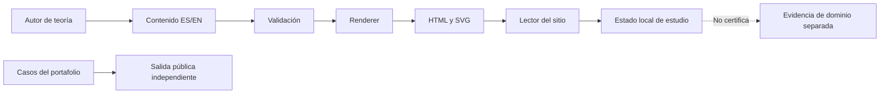
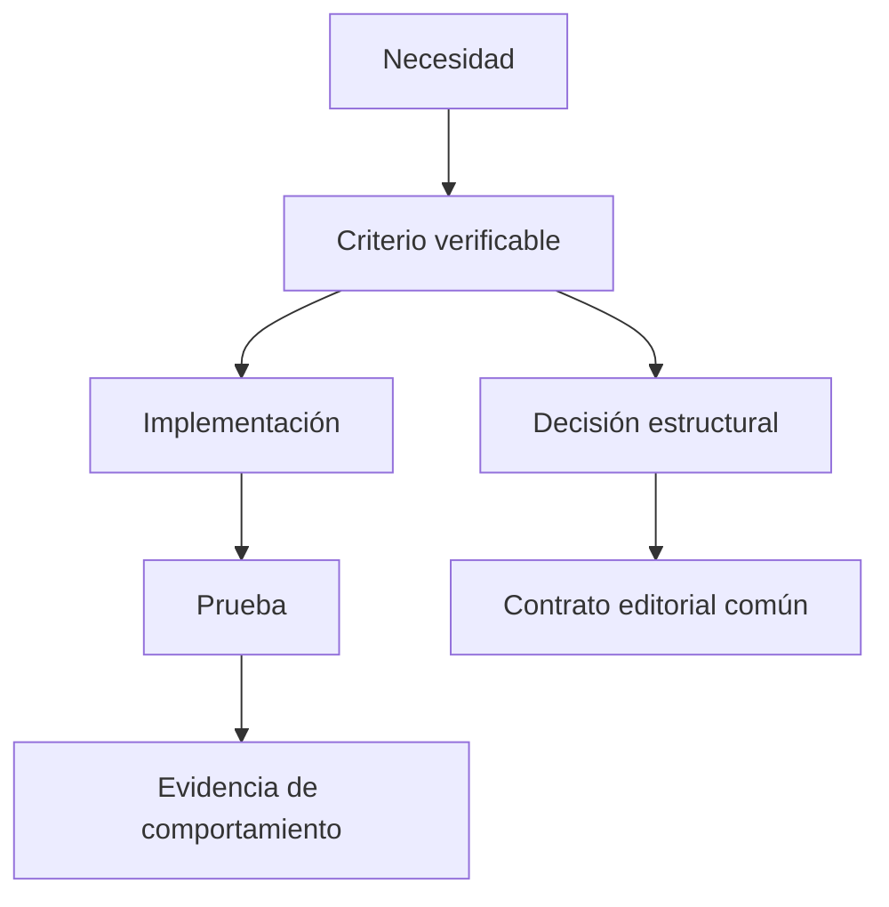
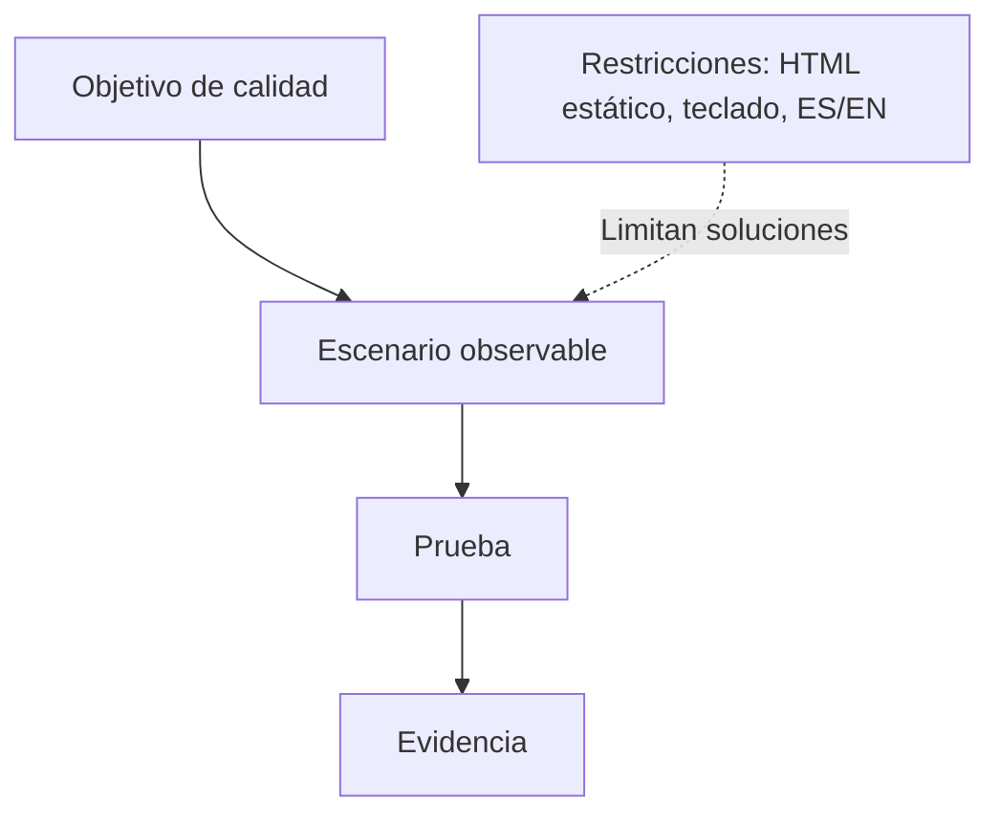
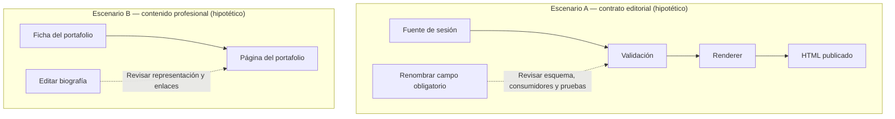
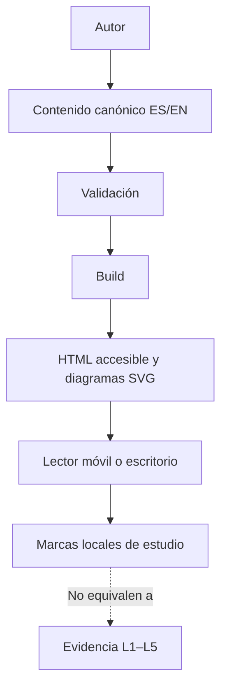
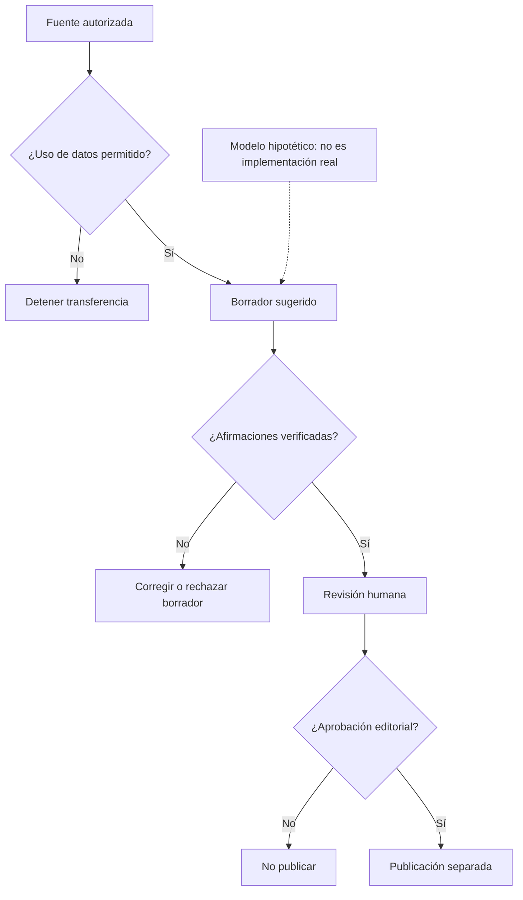
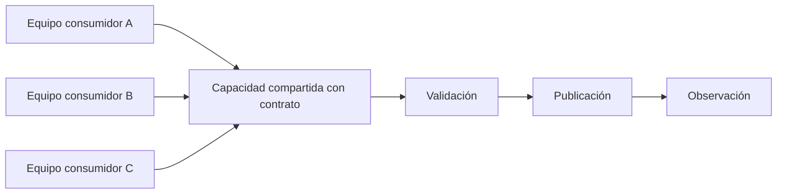

# PA-S001 — Fundamentos de ingeniería, arquitectura de plataforma frontend e ingeniería de producto con IA

**Fase:** F0 — Plataforma Accelerator. **Carriles:** Staff→Principal, Frontend Platform Architecture (FPA), AI Product Engineering (AIPE). **Prerrequisito:** lectura básica de componentes, rutas e interfaces de programación; ninguno de los anteriores exige acreditar otra sesión. **Sistema longitudinal:** P0, portafolio profesional en `apps/portfolio/` y sitio de aprendizaje separado en `site/`. **Resultado de estudio esperado:** explicar, probar y defender los límites de P0 con evidencia separada del seguimiento personal. **Tiempo orientativo de estudio y práctica:** 3 h 20 min–5 h 10 min; estimación, no medición.

> **SÍNTESIS EN 30 SEGUNDOS**
> 1. La ingeniería de software abarca el ciclo de vida; la arquitectura describe decisiones estructurales que condicionan cambios y atributos de calidad.
> 2. Una aplicación entrega un caso de uso, un sistema coordina elementos, una plataforma ofrece capacidades reutilizables y un ecosistema incluye actores y relaciones externas.
> 3. En P0, los límites entre portafolio, sitio de aprendizaje y posibles funciones de IA deben justificarse con pruebas y restricciones, no con títulos de puesto ni casillas marcadas.

## Objetivo

Explicar y distinguir los conceptos de alcance, identificar una frontera y sus dependencias, razonar sobre un atributo de calidad bajo una restricción, y defender un primer límite para P0. La evidencia futura debe mostrar decisiones, funcionamiento y resultados comprobados; leer esta teoría no acredita dominio.

## Vista previa del aprendizaje

**Antes de comenzar.** Una *dependencia* es una relación en la que un elemento necesita un contrato de otro; un *consumidor* es quien usa ese contrato. Un *atributo de calidad* describe una propiedad observable, mientras que una *restricción* limita las soluciones permitidas. No se requiere haber completado otra sesión: estos términos se enseñan a continuación.

Primero estudiarás ingeniería, arquitectura, cuatro escalas de alcance, calidad, restricciones, frontera, acoplamiento y cohesión en el carril Staff→Principal. Después estudiarás la plataforma frontend y, de manera independiente, el producto con inteligencia artificial. La pregunta conductora es: **¿qué responsabilidades conviene reunir y cuáles conviene separar cuando arrancan varios productos?** El ejercicio de aplicación analiza `apps/portfolio/`, `site/` y una hipotética función de resumen asistido, sin presumir que esta última exista. “Contrato” significa aquí una expectativa observable entre componentes: por ejemplo, formato de entrada, salida y errores.

## Conceptos

### Carril Staff → Principal: fundamentos de ingeniería y alcance

#### `engineering.software` — Ingeniería de software

**Nivel 1 — Fundamento.** Es la disciplina de especificar, diseñar, construir, verificar, operar y mantener software con métodos justificables; este alcance sintetiza las áreas de conocimiento de SWEBOK [R1]. Ejemplo: al añadir una ruta `/es/projects/`, implementar el HTML es una parte; revisar requisitos, accesibilidad, pruebas y evolución también es trabajo de ingeniería. Una lista de tecnologías, por sí sola, no define el ciclo de vida.

**Nivel 2 — Mecanismo: Cómo una necesidad se convierte en software verificable.**

**Propósito.** Comprender cómo una necesidad se convierte en software verificable y qué debe comprobarse antes de afirmar un resultado.

**Situación inicial y secuencia causal.** La necesidad de navegar proyectos se transforma en un contrato de ruta, una implementación y pruebas del comportamiento. Compilar confirma algunas propiedades del código, pero no demuestra que la navegación cumpla la necesidad ni que funcione con teclado.

**Límites e implicación en producción.** Revisa una ruta que carga correctamente pero cuyo enlace no recibe foco: el ciclo de ingeniería todavía no está cerrado.

**Recuperación.** Explica el mecanismo con tus palabras e identifica una observación necesaria para verificar el resultado. **Retroalimentación:** distingue el cambio desencadenante del contrato o dependencia que propaga su efecto; no presentes resultados hipotéticos como hechos observados.

**Nivel 3 — Profundización (opcional).** Más comprobaciones tienen coste; selecciona las que cubran riesgos reales. Un test de ruta no confirma que una persona pueda operar la navegación por teclado. Tipo: procedimental; objetivo: trazar cambio a verificación; técnica: recorrido resuelto y posterior práctica independiente; fuente [R1]; revisión: explicar de nuevo después de construir P0. Interacción: no aplica, porque una secuencia textual y una prueba real bastan.

#### `engineering.architecture` — Arquitectura de software

**Nivel 1 — Fundamento.** Es el razonamiento sobre elementos, relaciones y principios estructurales de un sistema; una *descripción arquitectónica* documenta ese razonamiento y sus preocupaciones, pero no es la estructura ejecutada [R2]. Ejemplo: separar `apps/portfolio/` de `site/` evita que una decisión de navegación editorial determine automáticamente la navegación profesional. Un diagrama sin correspondencia con dependencias reales es descripción incorrecta, no arquitectura comprobada.

**Nivel 2 — Mecanismo: Cómo las decisiones estructurales delimitan el cambio.**

**Propósito.** Comprender cómo las decisiones estructurales delimitan el cambio y qué debe comprobarse antes de afirmar un resultado.

**Situación inicial y secuencia causal.** Asignar responsabilidades a sitio y portafolio establece qué contratos pueden compartir y cuáles evolucionan por separado. Un import interno entre ambos puede introducir una dependencia que el diagrama de carpetas no revela.

**Límites e implicación en producción.** Antes de afirmar independencia, inspecciona las importaciones reales; compartir repositorio no prueba dependencia ni aislamiento.

**Recuperación.** Explica el mecanismo con tus palabras e identifica una observación necesaria para verificar el resultado. **Retroalimentación:** distingue el cambio desencadenante del contrato o dependencia que propaga su efecto; no presentes resultados hipotéticos como hechos observados.

**Nivel 3 — Profundización (opcional).** Documenta contexto, alternativas, consecuencia y forma de validar una decisión; no deduzcas calidad solo por tener carpetas distintas. Tipo: estructural y decisional; objetivo: relacionar límites con propagación; técnica: mapa de dependencias y contraejemplo; fuentes [R1, R2]; revisión: comprobar imports y rutas tras P0. Interacción sugerida: selector de una dependencia, que resalte consumidores alcanzables *solo si* se deriva del grafo real; alternativa sin JavaScript: mapa estático.

#### `scope.application` — Aplicación

**Nivel 1 — Fundamento.** Una aplicación es software ensamblado para tareas de sus usuarios en un contexto determinado; aquí se usa como **definición operativa del programa**, no como taxonomía normativa de ISO. `apps/portfolio/` presenta trabajos y contacto a un visitante. Una librería de botones usada por varias interfaces, sin caso de uso propio, no es por ello una segunda aplicación.

**Nivel 2 — Mecanismo: Cómo una petición llega a una experiencia de usuario.**

**Propósito.** Comprender cómo una petición llega a una experiencia de usuario y qué debe comprobarse antes de afirmar un resultado.

**Situación inicial y secuencia causal.** Una URL entra en el router, se resuelve a una vista y el navegador presenta la tarea al visitante. Cambiar la ruta puede afectar enlaces entrantes aunque la vista siga funcionando.

**Límites e implicación en producción.** Un paquete de estilos no se convierte en aplicación solo por tener rutas de desarrollo.

**Recuperación.** Explica el mecanismo con tus palabras e identifica una observación necesaria para verificar el resultado. **Retroalimentación:** distingue el cambio desencadenante del contrato o dependencia que propaga su efecto; no presentes resultados hipotéticos como hechos observados.

**Nivel 3 — Profundización (opcional).** Una aplicación puede contener servicios y una organización puede llamar “app” a algo distinto: declara el alcance antes de dibujarla. Tipo: conceptual; objetivo: identificar responsabilidad de usuario; técnica: contraste con librería; fuentes [R1, R2] y convención P0 [P1]; revisión: clasificar `apps/portfolio/` al implementarlo. Interacción: no aplica.

#### `scope.system` — Sistema

**Nivel 1 — Fundamento.** Un sistema es un conjunto delimitado de elementos que interactúan para cumplir un propósito; su frontera depende de la pregunta de análisis [R2]. Para analizar publicación, el generador, archivos de contenido y HTML generado pueden formar un sistema; para analizar la experiencia del visitante, el navegador y la red también importan. Una carpeta por sí sola no define esa frontera.

**Nivel 2 — Mecanismo: Cómo los componentes cooperan para publicar una sesión.**

**Propósito.** Comprender cómo los componentes cooperan para publicar una sesión y qué debe comprobarse antes de afirmar un resultado.

**Situación inicial y secuencia causal.** El contenido entra al validador; el renderer y el compilador de diagramas generan HTML y SVG que consume el navegador. El resultado depende de que cada paso produzca su artefacto esperado.

**Límites e implicación en producción.** Si falla Mermaid, una compilación que publica la página sin el diagrama no satisface el contrato de publicación.

**Recuperación.** Explica el mecanismo con tus palabras e identifica una observación necesaria para verificar el resultado. **Retroalimentación:** distingue el cambio desencadenante del contrato o dependencia que propaga su efecto; no presentes resultados hipotéticos como hechos observados.

**Nivel 3 — Profundización (opcional).** Explicita inclusiones, exclusiones y entorno para evitar atribuir fallas externas al componente equivocado. Tipo: estructural; objetivo: dibujar la frontera del sistema de publicación; técnica: mapa de elementos y fallo; fuentes [R2, P1]; revisión: repetir el mapa con una falla real. Interacción: no aplica.

#### `scope.platform` — Plataforma

**Nivel 1 — Fundamento.** En este programa, plataforma es un producto de capacidades compartidas con contratos y consumidores; la literatura de CNCF describe las plataformas internas como oferta de autoservicio para equipos [R4]. Una capa de contenido bilingüe, tokens visuales y pipeline Mermaid→SVG puede servir a numerosas sesiones; un componente copiado una sola vez aún no demuestra una plataforma útil.

**Nivel 2 — Mecanismo: Cómo una capacidad compartida atiende consumidores.**

**Propósito.** Comprender cómo una capacidad compartida atiende consumidores y qué debe comprobarse antes de afirmar un resultado.

**Situación inicial y secuencia causal.** Un autor entrega una sesión conforme al esquema; el renderer común la valida y publica sin copiar código específico para cada sesión. La reutilización se comprueba con consumidores reales y cambios compatibles.

**Límites e implicación en producción.** Una única sesión demuestra un prototipo reutilizable, no adopción ni productividad de plataforma.

**Recuperación.** Explica el mecanismo con tus palabras e identifica una observación necesaria para verificar el resultado. **Retroalimentación:** distingue el cambio desencadenante del contrato o dependencia que propaga su efecto; no presentes resultados hipotéticos como hechos observados.

**Nivel 3 — Profundización (opcional).** Abstraer demasiado temprano puede imponer convenciones costosas; un consumidor divergente puede requerir extensión o un límite distinto. Tipo: estructural y decisional; objetivo: evaluar capacidad reusable frente a coste; técnica: matriz de consumidores y trade-off; fuentes [R4, P1]; revisión: observar una segunda sesión antes de generalizar. Interacción: no aplica.

#### `scope.ecosystem` — Ecosistema

**Nivel 1 — Fundamento.** Ecosistema es la red de productos, personas, equipos, normas e integraciones que condicionan una solución; es una **abstracción de análisis**, no una jerarquía formal garantizada por [R2]. En P0 incluiría autor del contenido, aprendiz, hospedaje, navegador, herramientas de prueba y visitantes del portafolio. No equivale a “un repositorio muy grande”.

**Nivel 2 — Mecanismo: Cómo un cambio atraviesa actores sin compartir código.**

**Propósito.** Comprender cómo un cambio atraviesa actores sin compartir código y qué debe comprobarse antes de afirmar un resultado.

**Situación inicial y secuencia causal.** Cambiar el esquema puede exigir coordinar autoría, traducción, renderer y despliegue. La dependencia puede ser contractual u operativa aunque los actores trabajen en repositorios diferentes.

**Límites e implicación en producción.** No confundas el perímetro del repositorio con el ecosistema de personas y servicios.

**Recuperación.** Explica el mecanismo con tus palabras e identifica una observación necesaria para verificar el resultado. **Retroalimentación:** distingue el cambio desencadenante del contrato o dependencia que propaga su efecto; no presentes resultados hipotéticos como hechos observados.

**Nivel 3 — Profundización (opcional).** El límite de ecosistema es una decisión de análisis: incluir todo vuelve el modelo inútil; excluir dependencias críticas oculta riesgos. Tipo: estructural; objetivo: identificar actores y contratos; técnica: mapa de cambio; fuentes [R2, P1]; revisión: añadir dependencias reales cuando existan. Interacción: no aplica.

#### `quality.attribute` — Atributo de calidad

**Nivel 1 — Fundamento.** Es una propiedad de calidad que se especifica y evalúa para un producto; ISO/IEC 25010:2023 ofrece un modelo de referencia, no una nota automática para nuestro sitio [R3]. En P0, accesibilidad y desempeño son preocupaciones distintas: una página puede cargar rápido y aun así tener controles imposibles de usar con teclado [R5, R6].

**Nivel 2 — Mecanismo: Cómo una propiedad se convierte en un criterio observable.**

**Propósito.** Comprender cómo una propiedad se convierte en un criterio observable y qué debe comprobarse antes de afirmar un resultado.

**Situación inicial y secuencia causal.** Elige contexto, estímulo y resultado verificable: navegar el índice con teclado en móvil sin perder foco. La observación debe registrarse mediante una prueba, no inferirse de una captura.

**Límites e implicación en producción.** Una página rápida puede ser inaccesible; un atributo no garantiza otro.

**Recuperación.** Explica el mecanismo con tus palabras e identifica una observación necesaria para verificar el resultado. **Retroalimentación:** distingue el cambio desencadenante del contrato o dependencia que propaga su efecto; no presentes resultados hipotéticos como hechos observados.

**Nivel 3 — Profundización (opcional).** Atributos pueden entrar en tensión: cargar widgets puede afectar el tiempo de respuesta; comprueba ambos con mediciones antes de optimizar. Tipo: decisional; objetivo: formular escenario de prueba; técnica: ejemplo resuelto y comparación; fuentes [R3, R5, R6]; revisión: revalidar tras cambios del sitio. Interacción: no aplica.

#### `quality.constraint` — Restricción de ingeniería

**Nivel 1 — Fundamento.** Es una condición que reduce las soluciones admisibles; se distingue del atributo que intentamos lograr. “Debe publicarse como HTML estático legible sin JavaScript” restringe el diseño de `site/`; “ser accesible” designa una propiedad que debe concretarse en criterios. Una preferencia del equipo no se convierte automáticamente en restricción.

**Nivel 2 — Mecanismo: Cómo una restricción elimina alternativas de diseño.**

**Propósito.** Comprender cómo una restricción elimina alternativas de diseño y qué debe comprobarse antes de afirmar un resultado.

**Situación inicial y secuencia causal.** Exigir lectura sin JavaScript obliga a publicar las explicaciones y respuestas en HTML inicial; el script solo puede mejorar la presentación. Una solución que genera toda la teoría en cliente incumple esa condición.

**Límites e implicación en producción.** La elección de React no es un atributo de calidad ni una restricción sin justificación.

**Recuperación.** Explica el mecanismo con tus palabras e identifica una observación necesaria para verificar el resultado. **Retroalimentación:** distingue el cambio desencadenante del contrato o dependencia que propaga su efecto; no presentes resultados hipotéticos como hechos observados.

**Nivel 3 — Profundización (opcional).** Registra origen y dueño de cada restricción; una restricción falsa puede descartar una opción mejor. Tipo: decisional; objetivo: separar objetivo y condición; técnica: clasificación con justificación; fuentes [R3, P1]; revisión: consultar los criterios del repo real. Interacción: no aplica.

#### `design.boundary` — Frontera

**Nivel 1 — Fundamento.** Una frontera delimita responsabilidad y la interacción permitida entre partes [R2]. `apps/portfolio/` contiene comunicación profesional; `site/` contiene teoría completa y estado de estudio. Un enlace público entre ambos puede ser apropiado; importar el estado privado de estudio al portafolio podría violar el propósito de éste.

**Nivel 2 — Mecanismo: Cómo una frontera limita la propagación.**

**Propósito.** Comprender cómo una frontera limita la propagación y qué debe comprobarse antes de afirmar un resultado.

**Situación inicial y secuencia causal.** Una frontera permite enlaces públicos entre portafolio y sitio, pero evita que el portafolio dependa del esquema privado de tarjetas del sitio. Cambiar el esquema editorial debería afectar al renderer y sus pruebas.

**Límites e implicación en producción.** Una frontera no significa ausencia de comunicación; significa contratos explícitos.

**Recuperación.** Explica el mecanismo con tus palabras e identifica una observación necesaria para verificar el resultado. **Retroalimentación:** distingue el cambio desencadenante del contrato o dependencia que propaga su efecto; no presentes resultados hipotéticos como hechos observados.

**Nivel 3 — Profundización (opcional).** La separación trae duplicación potencial de estilos y trabajo de despliegue; compartir tokens solo cuando su contrato sea estable. Tipo: estructural; objetivo: anticipar propagación; técnica: cambio hipotético y mapa; fuentes [R2, P1]; revisión: inspeccionar diferencias reales de importación. Interacción: no aplica.

#### `design.coupling` — Acoplamiento

**Nivel 1 — Fundamento.** El [acoplamiento:: Dependencia entre partes que propaga cambios] es el grado y la forma de dependencia entre elementos; para este ejercicio interesa **qué cambio exige cambiar a otro consumidor**, sin inventar un índice numérico [R1]. Si el portafolio lee directamente el JSON interno del sitio, una renombrada de campo podría romperlo.

**Nivel 2 — Mecanismo: Cómo un cambio de contrato afecta a un consumidor.**

**Propósito.** Comprender cómo un cambio de contrato afecta a un consumidor y qué debe comprobarse antes de afirmar un resultado.

**Situación inicial y secuencia causal.** Situación inicial: el productor publica `page.title` y el consumidor lee ese campo. Cambio: el productor pasa a `page.heading` sin adaptar al consumidor; si no hay compatibilidad, el renderer puede fallar o mostrar contenido ausente. La causa arquitectónica es la dependencia del contrato interno, no el acto de renombrar en sí.

**Límites e implicación en producción.** Compara actualizar ambos extremos, mantener un alias temporal o introducir un adaptador; cada alternativa tiene costes de migración.

**Recuperación.** Explica el mecanismo con tus palabras e identifica una observación necesaria para verificar el resultado. **Retroalimentación:** distingue el cambio desencadenante del contrato o dependencia que propaga su efecto; no presentes resultados hipotéticos como hechos observados.

**Nivel 3 — Profundización (opcional).** La dirección y estabilidad de la dependencia importan más que contar imports; verifica la ruptura con una prueba de contrato antes de concluir. Tipo: causal/estructural; objetivo: predecir impacto del cambio; técnica: predict→reveal con dos grafos; fuentes [R1, R2]; revisión: ejecutar un cambio controlado. Interacción editorial posible: elegir una arista y resaltar consumidores transitivos del grafo explícito; sin grafo real, usar dos dibujos estáticos.

#### `design.cohesion` — Cohesión

**Nivel 1 — Fundamento.** Expresa cuánto contribuyen las responsabilidades de un módulo a un propósito reconocible [R1]. Un módulo `session-renderer` que organiza secciones, citas y diagramas de sesiones tiene un propósito relacionado; si además gestiona contactos del portafolio y secretos del proveedor de IA, mezcla cambios por razones independientes.

**Nivel 2 — Mecanismo: Cómo los motivos de cambio revelan cohesión.**

**Propósito.** Comprender cómo los motivos de cambio revelan cohesión y qué debe comprobarse antes de afirmar un resultado.

**Situación inicial y secuencia causal.** Un renderer que gestiona secciones, citas y diagramas agrupa responsabilidades editoriales relacionadas. Si también gestiona contactos del portafolio, cambios independientes obligan a revisar el mismo módulo.

**Límites e implicación en producción.** Dividir todo en archivos diminutos no garantiza cohesión y puede aumentar coordinación.

**Recuperación.** Explica el mecanismo con tus palabras e identifica una observación necesaria para verificar el resultado. **Retroalimentación:** distingue el cambio desencadenante del contrato o dependencia que propaga su efecto; no presentes resultados hipotéticos como hechos observados.

**Nivel 3 — Profundización (opcional).** Separar en exceso crea interfaces y coordinación adicionales; comprueba casos reales antes de extraer módulos. Tipo: conceptual/decisional; objetivo: agrupar responsabilidades; técnica: contraste de cambios; fuente [R1]; revisión: revisar el primer diff de P0. Interacción: no aplica.

#### `role.staff` — Alcance Staff

**Nivel 1 — Fundamento.** Para este programa, Staff significa resolver problemas que cruzan equipos o dominios mediante decisiones técnicas explicables, entrega y mentoría. Es una **convención curricular**, no una definición universal de empleo [P1]. Ejemplo: acordar el contrato de navegación del sitio y ayudar a dos autores a utilizarlo.

**Nivel 2 — Mecanismo: Cómo una decisión técnica alcanza a otros equipos.**

**Propósito.** Comprender cómo una decisión técnica alcanza a otros equipos y qué debe comprobarse antes de afirmar un resultado.

**Situación inicial y secuencia causal.** Una incompatibilidad lleva a proponer opciones, acordar responsables, documentar un contrato y comprobar adopción. El impacto Staff depende de colaboración y resultados observables, no de líneas escritas.

**Límites e implicación en producción.** Una propuesta sin adopción es evidencia de razonamiento, no de liderazgo ya demostrado.

**Recuperación.** Explica el mecanismo con tus palabras e identifica una observación necesaria para verificar el resultado. **Retroalimentación:** distingue el cambio desencadenante del contrato o dependencia que propaga su efecto; no presentes resultados hipotéticos como hechos observados.

**Nivel 3 — Profundización (opcional).** El título no certifica competencia; diferenciar propuesta de adopción real evita atribuir liderazgo no observado. Tipo: decisional; objetivo: formular evidencia; técnica: análisis de caso; fuente [P1]; revisión: documentar decisión y feedback real. Interacción: no aplica.

#### `role.principal` — Alcance Principal

**Nivel 1 — Fundamento.** En el modelo del programa, Principal agrega decisiones y dirección técnica a escala de varios sistemas, con consecuencias de evolución y gobernanza explícitas [P1]. Ejemplo: evaluar si el contrato bilingüe de P0 puede sostener los 120 capítulos sin imponer una herramienta obligatoria a proyectos ajenos.

**Nivel 2 — Mecanismo: Cómo una decisión evoluciona entre sistemas.**

**Propósito.** Comprender cómo una decisión evoluciona entre sistemas y qué debe comprobarse antes de afirmar un resultado.

**Situación inicial y secuencia causal.** Comparar alternativas, restricciones y costes de migración permite acordar una regla revisable entre sistemas. Su validez debe reexaminarse cuando aparecen nuevos consumidores.

**Límites e implicación en producción.** Un framework elegido para una página no demuestra alcance Principal.

**Recuperación.** Explica el mecanismo con tus palabras e identifica una observación necesaria para verificar el resultado. **Retroalimentación:** distingue el cambio desencadenante del contrato o dependencia que propaga su efecto; no presentes resultados hipotéticos como hechos observados.

**Nivel 3 — Profundización (opcional).** El alcance depende de organización y contexto; aquí es objetivo de aprendizaje, no pronóstico de carrera. Tipo: decisional; objetivo: comparar radio de decisión; técnica: matriz de alcances; fuente [P1]; revisión: contrastar decisión P0 y su evolución en PA-S002. Interacción: no aplica.

### Carril Frontend Platform Architecture (FPA)

#### `fpa.frontend-platform` — Arquitectura de plataforma frontend

**Nivel 1 — Fundamento.** Es el diseño de capacidades frontend compartidas, sus contratos, consumidores y evolución: por ejemplo, shell de navegación, esquema de sesión, tema, componentes accesibles y compilación de diagramas. Es una **síntesis del programa** sobre plataforma [R4], arquitectura [R2] y accesibilidad [R5]. Una página de marketing aislada puede usar un componente compartido sin convertirse por ello en plataforma.

**Nivel 2 — Mecanismo: Cómo una sesión se publica y conserva estado bilingüe.**

**Propósito.** Comprender cómo una sesión se publica y conserva estado bilingüe y qué debe comprobarse antes de afirmar un resultado.

**Situación inicial y secuencia causal.** El autor define secciones con IDs estables; el renderer genera navegación y HTML; las marcas de estudio se almacenan con los mismos IDs en ES/EN. La traducción cambia etiquetas, no la identidad del ejercicio.

**Límites e implicación en producción.** Marcar una casilla registra actividad y nunca certifica L1–L5.

**Recuperación.** Explica el mecanismo con tus palabras e identifica una observación necesaria para verificar el resultado. **Retroalimentación:** distingue el cambio desencadenante del contrato o dependencia que propaga su efecto; no presentes resultados hipotéticos como hechos observados.

**Nivel 3 — Profundización (opcional).** Considera fallo de JavaScript, compatibilidad de esquema, foco, contraste y peso de scripts; no declare “accesible” una página solo por pasar un escáner. Tipo: estructural/procedimental; objetivo: seguir contrato autor→lector; técnica: diagrama y prueba de teclado; fuentes [R2, R4, R5, P1]; revisión: segunda sesión bilingüe. Interacción: selector de idioma para ver que ID y estado permanecen, únicamente si el sitio implementa la persistencia real; alternativa sin JS: tabla de IDs.

### Carril AI Product Engineering (AIPE)

#### `aipe.ai-product` — Ingeniería de producto con inteligencia artificial

**Nivel 1 — Fundamento.** Trata una función de IA como parte de un flujo de producto con contexto de uso, entradas permitidas, salida, riesgos y evaluación; el marco voluntario AI RMF del NIST organiza la gestión en Govern, Map, Measure y Manage [R7]. Ejemplo **hipotético**: un resumen asistido de un caso público del portafolio; no existe evidencia de que P0 lo tenga o lo necesite.

**Nivel 2 — Mecanismo: Cómo un borrador de IA llega —o no— a publicación.**

**Propósito.** Comprender cómo un borrador de IA llega —o no— a publicación y qué debe comprobarse antes de afirmar un resultado.

**Situación inicial y secuencia causal.** Primero se verifica autorización de los datos; después un modelo puede proponer un borrador que se contrasta con fuentes y se somete a revisión humana. Si falta permiso o evidencia, el flujo se detiene; publicar exige decisión editorial separada.

**Límites e implicación en producción.** Es un modelo hipotético, no una función de IA desplegada ni una evaluación de exactitud.

**Recuperación.** Explica el mecanismo con tus palabras e identifica una observación necesaria para verificar el resultado. **Retroalimentación:** distingue el cambio desencadenante del contrato o dependencia que propaga su efecto; no presentes resultados hipotéticos como hechos observados.

**Nivel 3 — Profundización (opcional).** Salidas pueden variar y contener datos incorrectos; delimitar privacidad, fallos, costo y evaluación antes de un despliegue. Tipo: causal/decisional; objetivo: distinguir demostración de producto; técnica: recorrido de fallo y decisión con criterios; fuentes [R7, R8]; revisión: solo si aparece un caso de uso real. Interacción: no aplica ahora; no hay modelo ni dataset aprobado para simular calidad.

### Mecanismo de aprendizaje y evidencia (auxiliar, separado de los carriles)

#### `learning.evidence` — Evidencia y estado de estudio

**Nivel 1 — Fundamento.** En el programa, evidencia es un artefacto o una observación trazable a una afirmación de capacidad; una casilla de ejercicio indica actividad declarada, no resultado validado [P1]. Ejemplo: “leí sobre navegación por teclado” es estado de estudio; registro de prueba y revisión humana de la ruta es evidencia.

**Nivel 2 — Mecanismo: Cómo se separa actividad de evidencia.**

**Propósito.** Comprender cómo se separa actividad de evidencia y qué debe comprobarse antes de afirmar un resultado.

**Situación inicial y secuencia causal.** Marcar un ejercicio actualiza únicamente el estado reversible de estudio. Una prueba ejecutada y revisada se registra por otro canal con contexto y resultado; el dashboard no deriva dominio de la casilla.

**Límites e implicación en producción.** Una casilla marcada no equivale a una implementación demostrada.

**Recuperación.** Explica el mecanismo con tus palabras e identifica una observación necesaria para verificar el resultado. **Retroalimentación:** distingue el cambio desencadenante del contrato o dependencia que propaga su efecto; no presentes resultados hipotéticos como hechos observados.

**Nivel 3 — Profundización (opcional).** Sin artefacto o criterio observable, el nivel queda pendiente; también cabe “no se puede determinar”. Tipo: conceptual/decisional; objetivo: separar estados; técnica: clasificación y feedback; fuente [P1]; revisión: tras construir y revisar. Interacción: controles de estudio reversibles porque la variable es declaración de seguimiento; sin JS mostrar estado no editable, sin falsas afirmaciones.

#### `learning.levels` — Niveles L1–L5

**Nivel 1 — Fundamento.** El programa distingue L1 Explicar, L2 Implementar, L3 Operar, L4 Decidir y L5 Liderar [P1]. No son porcentajes ni equivalen a las tres **capas de lectura** de un concepto. Ejemplo: explicar por qué un mapa distingue sitio y portafolio puede apoyar L1, pero no prueba que esa frontera se aplique en código.

**Nivel 2 — Mecanismo: Cómo se vincula cada nivel a una prueba diferente.**

**Propósito.** Comprender cómo se vincula cada nivel a una prueba diferente y qué debe comprobarse antes de afirmar un resultado.

**Situación inicial y secuencia causal.** L1 exige explicar; L2, implementar; L3, operar; L4, decidir con alternativas; L5, liderar con adopción verificable. Son afirmaciones diferentes, no una escala inferida automáticamente del número de ejercicios.

**Límites e implicación en producción.** Un tutorial completado no demuestra liderazgo ni operación en producción.

**Recuperación.** Explica el mecanismo con tus palabras e identifica una observación necesaria para verificar el resultado. **Retroalimentación:** distingue el cambio desencadenante del contrato o dependencia que propaga su efecto; no presentes resultados hipotéticos como hechos observados.

**Nivel 3 — Profundización (opcional).** Puede haber evidencia parcial o contradictoria; registra el alcance y no infieras niveles superiores. Tipo: estructural; objetivo: vincular afirmación a prueba; técnica: matriz evidencia→nivel; fuente [P1]; revisión: reevaluar tras nuevos artefactos. Interacción: no aplica hasta contar con registros reales.

### Manifiesto de cobertura atómica

**Cómo utilizar este mapa.** Los conceptos se enseñan en el orden siguiente. Los prerrequisitos son recomendaciones de lectura, no bloqueos. Cada concepto tiene un identificador estable interno para enlaces y seguimiento, pero la tabla muestra **nombres comprensibles**, no claves de software. Las técnicas indican cómo puede practicarse cada tipo de conocimiento, no certifican que exista un widget ejecutado.

| Concepto | Carril | Tipo | Concepto previo | Método de comprensión |
|---|---|---|---|---|
| Ingeniería de software | Staff → Principal | Procedimental | Sin prerrequisito | SWEBOK; recorrido de cambio |
| Arquitectura de software | Staff → Principal | Estructural y decisional | Ingeniería de software | Contrato y dependencias |
| Aplicación | Staff → Principal | Conceptual | Ingeniería de software | Tarea del usuario |
| Sistema | Staff → Principal | Estructural | Aplicación | Límite de análisis |
| Plataforma | Staff → Principal | Estructural y decisional | Sistema | Capacidad y consumidores |
| Ecosistema | Staff → Principal | Estructural | Sistema | Actores y servicios externos |
| Atributo de calidad | Staff → Principal | Decisional | Arquitectura | Escenario comprobable |
| Restricción de ingeniería | Staff → Principal | Decisional | Atributo de calidad | Opciones admitidas |
| Frontera | Staff → Principal | Estructural | Sistema | Contratos |
| Acoplamiento | Staff → Principal | Causal y estructural | Frontera | Propagación de cambio |
| Cohesión | Staff → Principal | Conceptual y decisional | Frontera | Motivos de cambio |
| Alcance Staff | Staff → Principal | Decisional | Ingeniería de software | Influencia y evidencia |
| Alcance Principal | Staff → Principal | Decisional | Alcance Staff | Evolución multisistema |
| Arquitectura de plataforma frontend | FPA | Estructural y procedimental | Plataforma y frontera | Autor → publicación → lector |
| Ingeniería de producto con IA | AIPE | Causal y decisional | Restricción y frontera | Permisos, verificación y revisión |
| Evidencia y estado de estudio | Auxiliar | Conceptual y decisional | Sin prerrequisito | Actividad ≠ resultado |
| Niveles L1–L5 | Auxiliar | Estructural | Evidencia y estado | Pruebas diferentes |

**Lectura de la matriz.** Una técnica de contraste sirve para distinguir términos similares; un mapa de dependencias representa relaciones; un ejemplo resuelto enseña un procedimiento; una matriz de decisión examina alternativas. Ninguna de estas representaciones sustituye la definición desarrollada en su apartado correspondiente [R1, R2, P1].

## Tema principal — Decidir los límites iniciales de P0

**Definición y propósito.** La arquitectura inicial de P0 consiste en delimitar responsabilidades, contratos y decisiones cuya modificación afectaría a varios componentes. P0 contempla dos productos públicos diferentes: el portafolio profesional de `apps/portfolio/`, utilizado por visitantes, y el sitio de aprendizaje de `site/`, utilizado por lectores y estudiantes. Un repositorio compartido no convierte automáticamente estos productos en una única aplicación ni en una plataforma; esos nombres dependen del propósito y de sus consumidores [R2, R4, P1].

**Paso 1: identificar resultados de usuario.** El portafolio permite conocer trabajos, sistemas y evidencia profesional. El sitio de aprendizaje publica capítulos, ejemplos, diagramas, navegación, ejercicios y seguimiento de estudio. Aunque ambos pueden compartir infraestructura de despliegue o criterios de accesibilidad, responden a necesidades distintas. Mezclarlos impediría evolucionar su navegación o contenido independientemente.

**Paso 2: dibujar la frontera.** Dentro de `site/` hay un flujo editorial. Una fuente de teoría validada llega al renderer y se convierte en una página HTML acompañada de diagramas SVG. Esa página se lee en un navegador; el estado local de ejercicios es un dato separado. La aplicación de portafolio no necesita importar el renderer de capítulos para publicar sus fichas. La siguiente representación es un **modelo de responsabilidades para enseñar**, no un grafo real de importaciones comprobado.



**Paso 3: documentar contratos antes de compartir código.** El contrato editorial debe especificar identidad estable de la sesión, idioma, secciones, referencias y claves de ejercicio. El renderer debe producir estructura semántica y referencias resolubles. El seguimiento debe persistir marcas reversibles sin interpretarlas como evidencia de dominio. Si dos sesiones consumen el mismo contrato, compartir un renderer puede justificarse. Compartirlo sin consumidores reales sería una hipótesis arquitectónica, no una plataforma demostrada [R2, R4, P1].

**Paso 4: examinar restricciones y atributos de calidad.** La teoría debe poder leerse sin JavaScript, los controles deben ser utilizables con teclado y pantalla táctil, y los conceptos deben conservar paridad semántica ES/EN. La condición «la teoría existe en HTML inicial» restringe el diseño; «la interfaz es accesible en los escenarios definidos» es una propiedad que debemos evaluar mediante pruebas observables. Un `npm run check` exitoso no certifica por sí solo accesibilidad ni comprensión [R3, R5, P1].

| Decisión | Alternativa | Beneficio potencial | Coste o riesgo | Cómo comprobarla |
|---|---|---|---|---|
| Mantener portafolio y sitio separados | Una sola aplicación con navegación compartida | Cambios editoriales aislados | Duplicación limitada de infraestructura | Inspeccionar imports, rutas y cambios cruzados |
| Reutilizar un contrato editorial estable | Un formato diferente por sesión | Publicación consistente y menor repetición | Migraciones si cambia el contrato | Publicar una segunda sesión sin duplicar renderer |
| Usar HTML legible sin JS | Generar toda la teoría solo en cliente | Lectura y enlaces disponibles sin scripts | Menos interacción sin JS | Desactivar JS y leer íntegra la lección |
| Registrar casillas de estudio | Inferir dominio de cada clic | Seguimiento voluntario reversible | Confundir actividad con evidencia | Verificar que L1–L5 no cambien por marcar |
| Mantener la IA como propuesta | Integrar un proveedor inmediatamente | Evita riesgos antes de validar la necesidad | Se pospone automatización hipotética | Analizar caso de uso, datos, alternativas y revisión |

**Ejemplo resuelto: cambio de idioma.** Si el texto español de un ejercicio cambia, su clave persistente debe conservarse. La versión inglesa usa la misma clave, de modo que el estudiante no pierde su marca al alternar idiomas. Si en cambio el código utiliza la pregunta traducida como clave, una edición de estilo puede invalidar el registro: se colocó una frontera inestable entre presentación y estado.

**Contraejemplo arquitectónico.** Separar carpetas no basta cuando el portafolio importa objetos internos del sitio editorial sin contrato. Tampoco crear «microservicios» como solución universal garantiza calidad: amplía despliegue, llamadas, fallos e integración. El criterio defendible es elegir fronteras por responsabilidad, dirección de dependencia y capacidad de verificar consecuencias [R1, R2].

**Recuperación:** ¿qué decisión debería revisarse antes de extraer un módulo compartido? **Respuesta:** comprobar que más de un consumidor requiere una capacidad estable, definir su contrato y evaluar el costo de evolucionarlo. Una abstracción sin consumidor no demuestra valor arquitectónico.

**Implicación Staff → Principal.** A nivel Staff se defiende el primer límite y se establecen pruebas que lo hagan operable; a nivel Principal se decide cómo evolucionan esos contratos cuando nuevas sesiones y productos los consumen. **Implicación FPA:** publicar teoría y componentes accesibles con contratos. **Implicación AIPE:** no introducir una función de IA antes de verificar entradas autorizadas, riesgos y evaluación. Esta es la síntesis de los tres carriles, no una fusión de sus definiciones.

## Subtemas

### `sub.software-vs-architecture` — Ingeniería de software y arquitectura

**Ingeniería de software: definición.** Esta disciplina comprende especificar una necesidad, diseñar, implementar, verificar, desplegar, operar y mantener una solución. Incluye actividades que pueden cambiar sin alterar la estructura del sistema, por ejemplo corregir un texto o reparar un enlace roto [R1]. No equivale exclusivamente a escribir código.

**Arquitectura de software: definición.** Es el razonamiento acerca de los elementos del sistema, sus relaciones y los principios que organizan su evolución. La arquitectura explica por qué existen contratos y fronteras, no solo cómo se dibujan carpetas [R2]. Una descripción arquitectónica es un documento; su correspondencia con el código debe comprobarse.

**Mecanismo aplicado a P0.** Añadir una sesión exige un requisito verificable («el lector puede abrir PA-S002»), una estructura («todos los capítulos usan un contrato de secciones»), implementación, pruebas y mantenimiento. El requisito pertenece al ciclo de ingeniería. El contrato editorial y la relación entre renderer, fuentes y navegador son decisiones arquitectónicas dentro de ese ciclo. Una publicación puede pasar pruebas de enlaces y seguir teniendo un esquema difícil de evolucionar; también puede poseer un diagrama elegante y publicar enlaces rotos.



**Caso comparado.** Corregir el tamaño tipográfico de una ficha es una intervención local de producto; cambiar el nombre de un campo obligatorio del esquema exige inspeccionar consumidores y posibles migraciones. En el segundo caso interesa la arquitectura porque el cambio puede cruzar límites. La propagación es una posibilidad que deben comprobar imports y tests, no un impacto ya medido.

**Trade-off y producción.** Documentar cada línea de código no es útil. Conviene registrar decisiones con consecuencias de evolución, seguridad, operabilidad o experiencia: contexto, alternativas, decisión, riesgos y forma de verificación. Este criterio mantiene viva la documentación y evita confundir acumulación de diagramas con calidad [R1, R2].

**Práctica guiada.** Clasifica estas acciones: (a) reparar una ruta; (b) cambiar el contrato compartido de identificadores; (c) comprobar el teclado en móvil. **Respuesta explicada:** (a) y (c) son tareas del ciclo de ingeniería; (b) es una decisión estructural dentro de ese mismo ciclo. Las tareas de ingeniería también pueden aportar evidencia sobre las decisiones arquitectónicas.

**Recuperación:** ¿un build verde demuestra una arquitectura apropiada? **Respuesta:** no. Solo demuestra las propiedades efectivamente cubiertas por las comprobaciones ejecutadas; hacen falta escenarios de cambio y calidad relevantes.

### `sub.scope-layers` — Aplicación, sistema, plataforma y ecosistema

**Aplicación.** Es el software preparado para que una persona realice tareas identificables. El portafolio permite explorar casos profesionales y navegar a contactos. Su frontera práctica se establece desde la experiencia del visitante. Una librería de botones no es automáticamente una aplicación porque, por sí sola, no satisface ese objetivo completo [R1, P1].

**Sistema.** Es un conjunto delimitado de elementos que interactúan con un propósito. Al preguntar «¿cómo se publica PA-S001?», el sistema bajo análisis puede incluir fuente, verificador, renderer, HTML y hosting. El sistema puede contener varias aplicaciones y su frontera depende de la pregunta, no de que exista una carpeta llamada `system` [R2].

**Plataforma.** Ofrece capacidades compartidas mediante contratos para consumidores identificables. En P0, el contrato editorial y el renderer podrían constituir una capacidad reutilizable si otra sesión los utiliza. Una dependencia compartida no demuestra que exista una plataforma madura: importa si hay oferta utilizable, evolución y soporte a consumidores [R4, P1].

**Ecosistema.** Abarca actores y relaciones que condicionan el resultado: autor, estudiante, equipos, navegador, hospedaje, estándares, enlaces externos y sistemas relacionados. Es una perspectiva de análisis, no simplemente «el sistema más grande». Incluye dependencias que podrían no estar controladas por el equipo [R2].

| Perspectiva | Pregunta que responde | Ejemplo de P0 | Qué queda fuera según esa pregunta |
|---|---|---|---|
| Aplicación | ¿Qué tarea realiza el usuario? | Consultar casos del portafolio | Pipeline interno editorial |
| Sistema | ¿Qué elementos colaboran para un fin? | Fuente, validador, renderer, HTML | Actores sin relación con esa publicación |
| Plataforma | ¿Qué capacidad consumen varios usuarios internos? | Esquema + renderer de sesiones | Una función sin consumidores |
| Ecosistema | ¿Qué actores y dependencias condicionan la solución? | Autores, navegador, hosting, normas | Elementos ajenos a la decisión analizada |

**Mecanismo y caso borde.** Al cambiar la pregunta de accesibilidad a despliegue, se expande la frontera del sistema para incluir infraestructura y navegador. La aplicación no se convierte por eso en plataforma: cambió el punto de vista del analista. Una analogía de círculos concéntricos rígidos induce error, porque las categorías se solapan y responden a propósitos distintos.

**Práctica con contraste.** «El renderer sirve a PA-S001» describe una capacidad técnica; «el renderer sirve a varias sesiones con un contrato estable y adopción demostrada» permite estudiar su función de plataforma. **Respuesta explicada:** la diferencia es la existencia de consumidores y un contrato compartido, no el nombre de la carpeta.

**Recuperación:** ¿un sistema puede no ser una plataforma? **Respuesta:** sí. Coordinar elementos para un propósito no implica ofrecer capacidades reutilizables a consumidores independientes.

### `sub.quality-constraints` — Atributos de calidad y restricciones

**Atributo de calidad.** Describe una propiedad que interesa evaluar: accesibilidad, confiabilidad, desempeño o mantenibilidad. El modelo ISO/IEC 25010 ofrece categorías de calidad, pero no asigna puntuaciones automáticas a nuestra aplicación. Un atributo se vuelve útil cuando se traduce en un escenario observable [R3].

**Restricción de ingeniería.** Es una condición que limita qué soluciones se admiten. «El contenido académico debe existir en HTML legible sin JavaScript» descarta estrategias cuyo contenido solo aparece tras ejecutar código en el navegador. Esto es distinto de exigir «una experiencia accesible», que requiere criterios y pruebas en escenarios concretos [R5, P1].

**Cómo convertir una aspiración en prueba.** Un escenario contiene contexto, estímulo y observación esperada. Ejemplo de accesibilidad: con un móvil y teclado externo, el lector abre el índice, navega a «Frontera» y vuelve sin quedar atrapado. Resultado esperado: foco visible, orden operable y destino correcto. Eso comprueba un escenario delimitado, no toda la conformidad con WCAG.



**Modelo causal delimitado.** Con texto presente desde el HTML inicial, desactivar JavaScript no elimina la teoría; sí puede deshabilitar persistencia y controles añadidos por scripts. Con texto generado exclusivamente por JavaScript, desactivarlo deja la teoría ausente. Esta afirmación se refiere a presencia de contenido, no a una medición de accesibilidad ni a garantía de red [R5, P1].

**Trade-off y caso borde.** La generación estática exige un build y a veces contenido menos dinámico; permite una base de lectura verificable. La renderización exclusivamente en cliente puede simplificar ciertos cambios en tiempo de ejecución, pero aquí incumpliría el contrato sin un fallback real. No atribuyas calidad a «usar React» o «usar HTML»: verifica comportamientos de usuario y restricciones.

**Práctica con retroalimentación.** Clasifica: «cargar en menos de cierto tiempo medido», «usar JavaScript como requisito», «el índice puede recorrerse con teclado». **Respuesta:** el primer y tercer enunciado pueden expresarse como escenarios de calidad tras concretar condiciones; el segundo es una restricción tecnológica. No inventes valores objetivo sin acordar su contexto.

**Recuperación:** ¿una restricción es lo mismo que un atributo? **Respuesta:** no. El atributo expresa qué propiedad importa; la restricción delimita las implementaciones admisibles.

### `sub.boundary-dependencies` — Fronteras, acoplamiento y cohesión

**Frontera.** Delimita qué responsabilidad pertenece a un componente y qué interacción admite mediante contrato. Para P0, el portafolio administra presentación profesional, mientras que el sitio académico organiza teoría, ejercicios y estado de estudio. Compartir un enlace público no equivale a importar estructuras internas del otro producto [R2, P1].

**Acoplamiento.** Describe dependencias entre partes: una modificación en un productor puede exigir cambios a sus consumidores. El riesgo no se resume en contar imports; importa la dirección, estabilidad y alcance del contrato. Un identificador de ejercicio basado en texto traducido crea acoplamiento accidental entre idioma y persistencia [R1, R2].

**Cohesión.** Expresa si las responsabilidades de un módulo responden a un propósito reconocible. Un renderer centrado en secciones, tablas, referencias y diagramas mantiene responsabilidades relacionadas. Añadirle además procesamiento de mensajes de contacto del portafolio introduciría un motivo de cambio ajeno [R1].

**Mecanismo hipotético, no grafo verificado.** Dos diagramas conceptuales muestran posibles puntos de revisión; **no calculan consumidores realmente alcanzables del repositorio**:



**Observación y consecuencia.** El escenario A puede exigir migraciones si la compatibilidad se rompe; el escenario B debería permanecer local según la frontera pretendida. El impacto efectivo requiere inspección del grafo real de importaciones, diff y pruebas. Un selector puede comparar los dos escenarios y mostrar explicación, **pero no debe resaltar nodos como dependencias reales sin verificación**.

**Contraejemplo.** Partir cada función en un paquete separado maximiza fronteras pero también aumenta contratos, herramientas y coordinación. La arquitectura apropiada equilibra independencia con coste de integración. En producción conviene vigilar cambios transversales, accesibilidad, pruebas de contrato y ownership antes de extraer más módulos.

**Práctica.** Una traducción cambia la etiqueta visible de «Confirmar», pero no su clave persistente. **Respuesta explicada:** en un diseño correcto, el seguimiento permanece; si la clave se deriva de la etiqueta, el estado podría duplicarse. La mitigación es usar IDs semánticos compartidos y pruebas de cambio de idioma.

**Recuperación:** ¿todo enlace entre productos viola una frontera? **Respuesta:** no. Importa que la relación esté permitida y sea estable; un vínculo público intencional puede ser un contrato válido.

### `sub.frontend-platform` — Primer corte de plataforma frontend

**Definición en su carril.** Frontend Platform Architecture (FPA) estudia capacidades de interfaz compartidas, contratos, experiencia de desarrollador, accesibilidad y evolución. En P0, la base frontend incluye el layout, la navegación, la tematización, el modelo de capítulos bilingües y la compilación de diagramas. No equivale a un catálogo de componentes sin consumidores [R2, R4, R5, P1].

**Responsabilidades enseñadas por separado.** El esquema editorial describe qué puede publicar un autor: ID estable, título, secciones, fuentes, visualizaciones y ejercicios. El validador comprueba esa forma y rechaza entradas incompletas. El renderer transforma datos validados en HTML semántico y rutas ES/EN. El navegador presenta la lectura y puede almacenar marcas reversibles. Ninguna de estas funciones necesita inventar niveles de dominio.



**Mecanismo de evolución.** Si PA-S002 comparte el contrato, podrá publicar un capítulo nuevo sin copiar el renderer. Si necesita un nuevo tipo de visualización, se define un bloque con semántica y fallback, se migra el esquema explícitamente y se prueban sesiones anteriores. Esta es una hipótesis de reutilización que PA-S002 deberá demostrar; no se declara éxito sin un segundo consumidor real [R4, P1].

**Fallos y decisiones.** Es incorrecto que la teoría desaparezca cuando JavaScript se desactiva, que los checkboxes estén deshabilitados o que el mapa Mermaid no tenga SVG accesible. También es incorrecto esconder texto completo detrás de tarjetas que solo aparecen tras interactuar. Prioriza publicación legible, navegación estable y controles progresivos; separa métricas de actividad de evidencia L1–L5.

**Práctica con respuesta.** Un equipo propone introducir otro framework solo para imprimir tablas de contenido. **Respuesta explicada:** el requisito es producir tablas legibles, accesibles y mantenibles; una dependencia nueva necesita justificar su coste y compatibilidad, no se deduce de la necesidad de una tabla.

**Recuperación:** ¿cuándo se justifica llamar plataforma al renderer editorial? **Respuesta:** cuando varios consumidores usan sus contratos con garantías de evolución y operación; una sola sesión es una prueba inicial, no demostración suficiente.

### `sub.ai-product` — Límite de una función de IA

**Definición en su carril.** AI Product Engineering (AIPE) integra capacidades de inteligencia artificial en un flujo de producto con necesidades, entradas permitidas, evaluación, riesgos, revisión, costos y operación. No equivale a «llamar un modelo» ni se deduce que P0 deba usar un proveedor. El AI Risk Management Framework de NIST organiza actividades de gobierno, contexto, medición y gestión de riesgo [R7, R8].

**Problema primero, modelo después.** Un posible caso futuro es resumir una descripción pública de un sistema del portafolio. Antes de implementarlo, hay que demostrar necesidad: ¿qué tarea ahorra?, ¿a quién beneficia?, ¿qué alternativa determinista existe?, ¿qué errores importan? Un resumen manual o una plantilla editorial pueden ser alternativas más controlables en un primer corte [R7].

**Mecanismo hipotético.** Para contenido autorizado, el flujo puede establecer límites explícitos. El texto de origen se identifica y se prepara; una generación produce un **borrador**; las afirmaciones se contrastan con fuentes; una persona puede rechazar o aprobar editorialmente el contenido. La aprobación no es automática ni está implementada en PA-S001.



**Fallos que bloquean el flujo.** Si los datos no están autorizados para enviarse al proveedor, se detiene la transferencia. Si las citas no sustentan las afirmaciones, se mantiene como borrador y se corrigen. Si falta revisión humana cuando el proceso la exige, no se publica. Un simulador con esos controles ilustra decisiones, pero no realiza una evaluación real de seguridad, privacidad o calidad.

**Trade-offs y operación.** Automatizar puede reducir trabajo de redacción, pero agrega variabilidad, riesgo de afirmaciones falsas, observabilidad y necesidades de mantenimiento. Para pasar a producción se requieren criterios de evaluación, controles de datos, mecanismos de rechazo, monitoreo y responsables claros [R7, R8]. No hay métricas de ahorro ni calidad medidas en esta sesión.

**Práctica con retroalimentación.** Escenario: el borrador usa una fuente pública pero inventa una cifra. **Respuesta:** no puede publicarse como hecho; una salida convincente no sustituye contraste con evidencia. La alternativa sin IA sigue disponible.

**Recuperación:** ¿un prototipo que «suena bien» ya es apto para producción? **Respuesta:** no. Deben justificarse necesidad, seguridad, evaluación, revisión, operación y costo antes de recomendar integración.

### Síntesis entre dominios (después de los tres carriles)

Staff→Principal define quién argumenta y revisa decisiones de alcance; FPA define contratos compartidos y comportamiento del navegador; AIPE agrega control de entradas, variabilidad de salidas y evaluación únicamente si hay una función real. La relación es una **síntesis de diseño**: un criterio de publicación accesible afecta tanto el capítulo como cualquier borrador generado, pero un resultado de IA no convierte por sí solo una app en plataforma.

## Mapa de teoría a práctica

**Aplicar lo aprendido exige traducir distinciones en decisiones comprobables.** Esta matriz vincula conocimientos con tareas y observaciones que pueden registrarse, pero ninguna fila concede niveles de dominio por sí sola.

| Conceptos estudiados | Trabajo práctico | Qué comprobar | Evidencia admisible |
|---|---|---|---|
| Aplicación, sistema, plataforma y ecosistema | Delimitar productos, elementos y actores de P0 | La frontera responde a una pregunta concreta | Mapa anotado, supuestos y explicación |
| Arquitectura, fronteras, acoplamiento y cohesión | Evaluar un cambio de contrato frente a un cambio editorial | Consumidores reales, migraciones y pruebas, sin confundir el grafo hipotético con el real | Diff, inspección de imports y decisión |
| Atributos de calidad y restricciones | Probar teoría sin JavaScript, navegación con teclado y lectura móvil | Resultado observado en escenarios delimitados | Registro de pruebas en navegador |
| Plataforma frontend | Publicar un capítulo ES/EN desde la misma estructura | IDs compartidos y ausencia de texto omitido | HTML construido y paridad revisada |
| Ingeniería de producto con IA | Comparar resumen manual y generación hipotética | Permisos, citas, revisión humana y alternativas | Análisis y decisión explícita |
| Alcance Staff/Principal y niveles de evidencia | Defender una decisión y explicar su evolución | Evidencia separada de marcas de estudio | Registro de decisión y revisión, no porcentaje inventado |

**Relación entre evidencia y aprendizaje.** El estudio puede marcarse como realizado mientras que la evidencia L1–L5 permanece vacía; para una afirmación de nivel hace falta observar el trabajo que la respalda [P1].

## Tiempo estimado

La estimación se distribuye como guía: lectura y recuperación 60–90 min; mapa y decisión 40–60 min; primer corte y pruebas 80–130 min; reflexión 20–30 min. Suma mínima = 60+40+80+20 = **200 min (3 h 20 min)**; suma máxima = 90+60+130+30 = **310 min (5 h 10 min)**. Dependerá del estado real del repositorio y no representa tiempo medido.

## Ejemplo del mundo real

### Contexto documentado: plataformas internas de ingeniería

**El problema que abordan las plataformas internas.** El white paper de CNCF TAG App Delivery analiza la plataforma como oferta de capacidades consumibles para equipos, apoyada en una experiencia que reduce la necesidad de reconstruir tareas recurrentes de entrega y operación. La fuente describe un enfoque de plataforma y sus responsabilidades; **no documenta resultados medidos del repositorio P0** ni asegura que cualquier herramienta compartida constituya una plataforma [R4].

**Situación organizacional típica, ilustrativa.** Supongamos que tres equipos publican productos web y cada uno configura de manera independiente rutas, automatización de build, controles de seguridad, acceso a métricas y convenciones de despliegue. Cada equipo mantiene autonomía, pero debe resolver decisiones transversales. Este escenario es una ilustración para aplicar el enfoque de CNCF; no se presenta como una empresa, incidente o estudio de caso observado.

**Paso 1 — Identificar a los consumidores.** Antes de extraer una capacidad común, la organización debe preguntar qué tareas realizan los equipos, qué conocimientos requieren y cuáles son recurrentes. Que dos aplicaciones utilicen el mismo lenguaje no prueba una necesidad de plataforma; que repitan un flujo con requisitos compatibles ofrece una hipótesis para investigar [R4].

**Paso 2 — Definir una capacidad con contrato.** Un equipo de plataforma puede ofrecer un proceso de creación y publicación con entrada acordada, validaciones, resultados observables y documentación. El consumidor debe saber qué puede solicitar, cómo utilizarlo, qué está garantizado y qué hacer si falla. La plataforma no es solamente código común: es una oferta que necesita soporte, evolución y límites de responsabilidad.



**Paso 3 — Analizar las alternativas.** La primera opción es mantener implementaciones independientes. Conservará flexibilidad local, a cambio de repetir prácticas y mantenimiento. La segunda opción es compartir paquetes o plantillas sin crear todavía un servicio de plataforma. La tercera es ofrecer una capacidad de autoservicio con responsabilidad de evolución. La decisión depende de consumidores, heterogeneidad, riesgo y capacidad de mantenimiento; no hay un ganador universal [R4].

**Paso 4 — Examinar costos y fallos posibles.** Centralizar puede introducir un cuello de botella si todo cambio depende de un solo equipo. Un contrato sin versionado puede propagar rupturas a varios consumidores. Una solución demasiado general puede no atender bien los casos reales. A la inversa, duplicarlo todo puede elevar el mantenimiento. Estas son consecuencias arquitectónicas plausibles que deben contrastarse con situaciones observadas antes de declarar ventajas.

### Transferencia explícita al proyecto P0

**Equivalencia parcial.** En P0, cada sesión futura funciona como consumidor editorial del esquema y del renderer del sitio. Al crear PA-S002, el autor aporta teoría nueva; el build conserva navegación, tratamiento de fuentes, índice y mecanismos de interacción. Esa analogía ilustra el concepto de reutilización. **No convierte las sesiones en equipos de producto independientes** ni demuestra madurez de una plataforma interna.

**Caso concreto con trazabilidad.** Se añade una sección de arquitectura de monorepo en español e inglés. La validación comprueba que tiene identificador estable y fuentes; el renderer convierte el texto y sus diagramas a HTML/SVG; la navegación enlaza el capítulo; los checkboxes usan claves comunes. Si el nuevo capítulo obliga a copiar y editar internamente el renderer, la supuesta capacidad compartida no está suficientemente desacoplada. Si se publica declarativamente y los capítulos existentes continúan funcionando, existe evidencia más sólida de reutilización, aunque aún queda por medir coste de mantenimiento.

**Qué sí y qué no podemos concluir.** La documentación CNCF apoya tratar una plataforma como capacidad consumible con clientes y contratos [R4]. Que P0 ya haya ganado productividad, reducido errores o ahorrado costos **no está probado**. Esas afirmaciones exigirían observaciones comparables, registros de cambios y criterios acordados. La analogía sirve para diseñar una hipótesis y una prueba, no para fabricar resultados.

**Discusión de nivel Staff/Principal.** Staff puede definir un contrato editorial y defender la separación frente a los equipos implicados. Principal examina si ese contrato podrá evolucionar para muchos consumidores, qué gobernanza necesita y cuándo conviene no centralizar. FPA convierte el contrato en experiencia web accesible. AIPE sigue siendo otro carril: una funcionalidad con IA solo se añade si tiene caso de uso y evaluación propia.

**Recuperación del caso:** ¿qué diferencia una plataforma editorial potencial de un renderer usado una sola vez? **Respuesta:** evidencia de consumidores y contratos estables, adopción y mantenimiento observables. El número de carpetas y el nombre «platform» no son pruebas de valor.

## Ejemplo listo para producción (diseño verificable, aún no ejecutado)

**Contexto:** publicar `PA-S001` en ES y EN, registrar lectura reversible y preservar su fuente. **Flujo normal:** archivos canónicos → esquema de IDs → comprobación de cobertura/citas → compilación Mermaid→SVG → HTML estático → controles progresivos de estudio. En ambas páginas, `PA-S001.exercise.boundary-map` designa el mismo ejercicio; la etiqueta cambia de idioma, la clave no. Un enlace a la página del portafolio no importa datos privados del sitio.

**Fallo:** si falta un ID o falla la compilación SVG, el build debe fallar con archivo y sección; no se sirve código Mermaid crudo como si fuese diagrama. Si falta JavaScript, contenido, respuestas y mapas mantienen lectura. **Contrato mínimo ilustrativo, no implementación ejecutada:**

```ts
type StudyItem = { id: "PA-S001.exercise.boundary-map"; checked: boolean };
type EvidenceRecord = { artifactId: string; claim: string; verification?: string };
// The study item does not mutate EvidenceRecord or L1–L5.
```

**Verificación requerida:** comparar IDs y párrafos ES/EN, inspeccionar HTML real, tabular foco y reversibilidad, recargar almacenamiento, desconectar JS y comprobar que ninguna casilla cambie registros de dominio. Una prueba automática de presencia de encabezados no demuestra comprensión ni accesibilidad completa. **Riesgos:** conflictos de almacenamiento entre dispositivos, enlaces externos rotos y traducciones que alteren matices; documentar limitaciones y correcciones antes de publicar.

## Guía visual de aprendizaje / Visual Learning Studio

**Mapa mental interactivo.** El mapa debe mostrar nombres comprensibles y grupos separados: fundamentos de ingeniería y alcance, plataforma frontend, producto con IA, y evidencia de aprendizaje. Una flecha de estudio significa «comprender antes de integrar», no causalidad física. Cada nodo accesible enlaza con su definición y fuente; una lista navegable ofrece alternativa para pantallas pequeñas. Las claves internas de software permanecen en los atributos y el manifiesto de datos, **no en las etiquetas visibles**.

**Diagramas dentro del artículo.** Los flujos de publicación, las fronteras y los escenarios de IA deben aparecer junto al mecanismo que ilustran. El mapa mental final complementa esos diagramas locales; no los reemplaza. Los SVG deben tener títulos, descripción textual, fuente y ancho adaptable. Cuando la estructura o sus conexiones no estén verificadas, se etiqueta como modelo didáctico o escenario hipotético.

**Tarjetas de recuperación.** Se ofrece una tarjeta por cada uno de los 17 conceptos, una por el tema principal y una por cada uno de los seis subtemas: **24 tarjetas**. El frente solicita explicación o decisión después de la teoría; el reverso conserva respuesta y por qué una alternativa frecuente falla. Las tarjetas se pueden avanzar, retroceder y voltear con teclado o touch; sin JavaScript, su contenido permanece accesible.

**Experiencias justificadas, no decorativas.** El explorador conceptual contrasta cuatro perspectivas; el estructural compara escenarios estáticos sin fingir un grafo real; el causal prueba reglas de presencia de texto con/sin JavaScript bajo supuestos visibles; el decisional compara autorización, verificación de citas y revisión humana sin publicar automáticamente. Todos exponen entrada, mecanismo, resultado, fuente, límites y alternativa textual [R1, R2, R3, R4, R5, R7, P1].

**Repaso posterior.** Tras una sesión, recuperar los conceptos sin mirar y consultar la retroalimentación; volver al comenzar PA-S002 y tras un cambio real de contrato. El repaso es una oportunidad, no un diagnóstico de estilo de aprendizaje ni una puntuación de dominio.

## Ejercicios

1. **`PA-S001.exercise.classify`:** clasifica `apps/portfolio/`, `site/`, renderer y hospedaje según los cuatro alcances; justifica dónde cambiaría tu frontera si la pregunta es accesibilidad frente a publicación. Criterio: cada etiqueta tiene propósito y contraejemplo; marcarla solo registra estudio.
2. **`PA-S001.exercise.boundary-map`:** dibuja un mapa con portafolio, sitio, esquema y estado de estudio; indica contratos y predice la propagación de renombrar un ID traducido. Compara predicción con imports y pruebas cuando exista repo.
3. **`PA-S001.exercise.quality`:** escribe un escenario de accesibilidad con contexto, acción y observación; distingue un atributo de una restricción. Valídalo en navegador con teclado y sin JavaScript cuando esté implementado.
4. **`PA-S001.exercise.ai-decision`:** defiende si el resumen hipotético pertenece al primer corte. Expón datos permitidos, alternativa sin IA, riesgo, evaluación necesaria y quién revisa la salida. No implementes proveedor solo para completar el ejercicio.

## Fuentes verificadas

- [R1] IEEE Computer Society, [SWEBOK Guide V4, áreas de ingeniería, arquitectura y diseño](https://www.computer.org/education/bodies-of-knowledge/software-engineering/topics). Se usa para el alcance de ingeniería y decisiones de diseño, sin atribuirle la taxonomía operativa exacta de P0.
- [R2] ISO/IEC/IEEE, [42010:2022, Architecture description](https://www.iso.org/standard/74393.html). La página pública describe el alcance de la descripción arquitectónica; el texto completo puede requerir licencia.
- [R3] ISO/IEC, [25010:2023, Product quality model](https://www.iso.org/standard/78176.html). La página pública confirma que el modelo tiene nueve características; aquí no se atribuye una lista específica no comprobada.
- [R4] CNCF TAG App Delivery, [Platforms White Paper](https://tag-app-delivery.cncf.io/whitepapers/platforms/) y [maturity model](https://tag-app-delivery.cncf.io/whitepapers/platform-eng-maturity-model/). Describe plataforma interna como capacidad consumible; la aplicación a contenido es inferencia del curso.
- [R5] W3C, [WCAG 2.2](https://www.w3.org/TR/WCAG22/). Fuente normativa de principios y criterios de accesibilidad web; aquí no se afirma conformidad.
- [R6] Mozilla, [What is web performance?](https://developer.mozilla.org/en-US/docs/Learn_web_development/Extensions/Performance/What_is_web_performance). Guía de plataforma para la distinción desempeño/experiencia.
- [R7] NIST, [AI RMF Core](https://airc.nist.gov/airmf-resources/airmf/5-sec-core/). Marco voluntario para gestión del riesgo de IA.
- [R8] NIST, [Generative AI Profile](https://www.nist.gov/publications/artificial-intelligence-risk-management-framework-generative-artificial-intelligence). Perfil complementario para sistemas de IA generativa.
- [P1] Project Sources: `03-MASTER-ROADMAP` (§PA-S001), `04-SESSION-TEMPLATE`, `05-LEARNING-METHODOLOGY`, `06-TECHNICAL-STANDARDS`, `07-PROGRESS`, `08-COMPETENCY-MATRIX`, `09-PROJECTS-AND-APPS`, `10-DECISION-LOG`, `11-CODEX-GUIDELINES`, `12-ARTIFACT-AND-PUBLISHING-STANDARD`, `13-CANONICAL-SESSION-AUDIT`, `14-ACCELERATED-LEARNING-UX`, `15-ADAPTIVE-LEARNING-EXPERIENCE`. Contrato curricular local, no fuente de hechos externos.

## Recursos y método de repaso

Lee la descripción pública de [R2] y formula una frontera para P0; compara el escenario de accesibilidad con [R5], la plataforma con [R4] y la función hipotética con [R7]. Al terminar la sesión, recupera sin mirar las cuatro escalas y comprueba las respuestas en `Conceptos`; vuelve a intentarlo al iniciar PA-S002 y después de la primera modificación real del esquema. Son **oportunidades**, no un calendario óptimo ni evidencia de dominio. Registra pregunta, respuesta, error corregido y artefacto de verificación por separado.

## Lista de comprobación de estudio

Estos IDs son reversibles y compartidos ES/EN; una marca expresa seguimiento personal.

- [ ] `PA-S001.check.engineering` Explico ingeniería y arquitectura con un cambio concreto.
- [ ] `PA-S001.check.scope` Distingo aplicación, sistema, plataforma y ecosistema.
- [ ] `PA-S001.check.quality` Separo atributo, escenario verificable y restricción.
- [ ] `PA-S001.check.boundary` Predigo una propagación por acoplamiento y justifico cohesión.
- [ ] `PA-S001.check.fpa` Explico el contrato editorial bilingüe y el fallback.
- [ ] `PA-S001.check.aipe` Distingo borrador de IA y salida validada.
- [ ] `PA-S001.check.roles` Distingo alcances Staff/Principal sin inferir dominio.
- [ ] `PA-S001.check.evidence` Distingo casilla de estudio de evidencia L1–L5.

## Criterios de éxito de la sesión

**Uso de las casillas.** Estas marcas son un registro reversible de comprobaciones personales de estudio, compartido entre idiomas mediante claves internas estables. **No representan aprobación automática, estado Completed ni dominio L1–L5.** La evidencia de implementación, operación, decisión y liderazgo se evalúa de manera independiente [P1].

- [ ] Puedo explicar con mis palabras ingeniería de software y arquitectura, incluyendo un cambio que afecte contratos.
- [ ] He distinguido aplicación, sistema, plataforma y ecosistema con cuatro ejemplos concretos de P0.
- [ ] He definido un atributo de calidad, una restricción y un escenario de prueba observable sin inventar resultados.
- [ ] He comparado dos fronteras y explicado qué contratos o consumidores habría que inspeccionar.
- [ ] He revisado un diagrama de publicación y explicado qué depende de HTML inicial y qué de JavaScript.
- [ ] He argumentado por qué una función de IA hipotética necesita permisos, verificación, alternativa sin IA y revisión.
- [ ] He respondido y corregido al menos una pregunta de recuperación de cada carril.
- [ ] He separado mis marcas de estudio de cualquier evidencia real para L1–L5.

**Cómo se observa un resultado, sin atribuírselo todavía.** Una explicación de fronteras puede respaldar una evaluación L1 solo después de ser revisada. Un cambio con pruebas ejecutadas puede aportar evidencia L2; operar y analizar fallos reales, L3; justificar alternativas con consecuencias verificadas, L4; lograr adopción e influencia documentadas, L5. Ningún nivel se concede al marcar estas casillas.

**Entregable evaluable.** Un mapa de límites de P0 con contratos, una decisión razonada sobre qué compartir y qué separar, una prueba de teclado y lectura sin JavaScript registrada cuando se ejecute, y un análisis de la función de IA propuesta con fuentes y restricciones. Las pruebas históricas o planes no reemplazan evidencia de ejecución actual.

**Criterio de revisión editorial.** La sesión se considera preparada para ser estudiada cuando todos sus 24 apartados son sustantivos, las explicaciones preceden a preguntas, existen diagramas contextuales accesibles cuando aportan, y las versiones ES/EN preservan conceptos y fuentes. Publicar correctamente no demuestra por sí solo que el estudiante ya aprendió.

## Puente a PA-S002

La siguiente sesión examina si el mismo repositorio necesita workspaces, paquetes y reglas de dependencia. Recupera primero el caso “carpeta ≠ frontera” y verifica con el grafo de importaciones si los límites propuestos sobrevivieron al primer corte.
